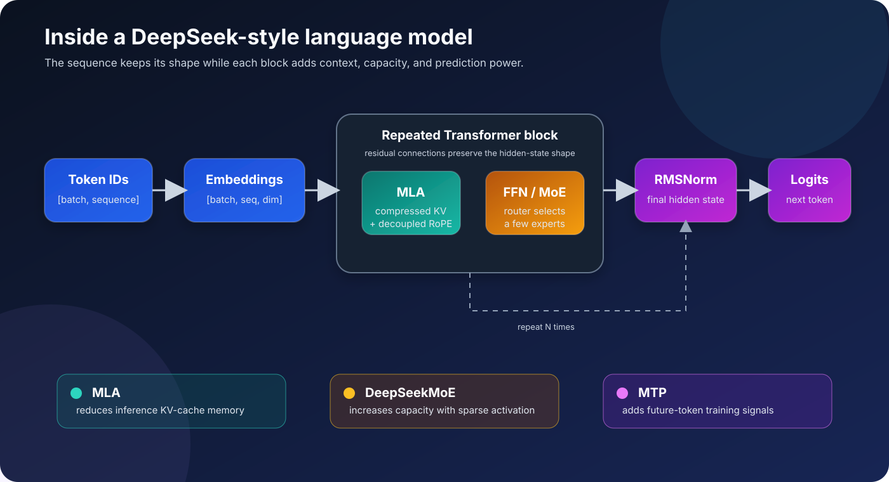
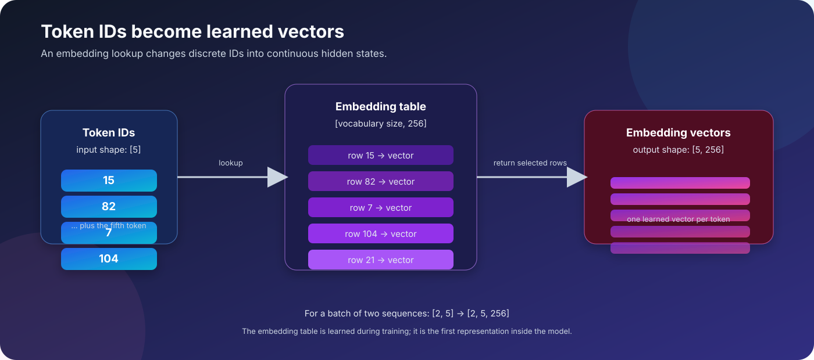

# Understanding DeepSeek-V3 Architecture From Scratch

**Goal:** Understand what we're building, how DeepSeek processes text, why its architecture is different from GPT, and how to represent the model using PyTorch.

By the end of this article, you should be able to explain the complete DeepSeek architecture without looking at the paper.



## 1. First, what exactly is DeepSeek?

Before writing code, understand this distinction:

**DeepSeek-V3 is fundamentally a decoder-only Transformer language model.**

Think about the model you already know: GPT.

A conventional GPT and DeepSeek-V3 share the same high-level flow, but the attention and feed-forward parts are different:

| Stage | Conventional GPT | DeepSeek-V3 |
| --- | --- | --- |
| Input | Token embeddings | Token embeddings |
| Attention | Multi-Head Attention | Multi-Head Latent Attention |
| Feed-forward | Dense FFN | Dense FFN / DeepSeekMoE |
| Depth | Repeated Transformer blocks | Repeated Transformer blocks |
| Output | Next-token logits | Next-token logits |

The basic Transformer remains recognizable.

Both models have token embeddings, causal attention, normalization, residual connections, feed-forward computation, and next-token prediction.

DeepSeek changes **how attention stores information** and **how the feed-forward network uses parameters**.

It also introduces additional training mechanisms.

## 2. What makes DeepSeek-V3 special?

There are four major ideas we will implement.

### 1. Multi-Head Latent Attention (MLA)

Instead of caching full key and value vectors for every attention head, DeepSeek can cache a smaller compressed representation and positional information.

**Main benefit:** Reduce KV-cache memory during inference.

### 2. Mixture of Experts (DeepSeekMoE)

Rather than using one large feed-forward network for every token, DeepSeek selects a small number of specialist networks from a much larger collection, alongside shared experts.

**Main benefit:** Increase total model capacity without activating every parameter for every token.

### 3. Auxiliary-loss-free load balancing

The router may send too many tokens to a few experts, leaving others underused.

DeepSeek-V3 adjusts expert-routing biases to help balance utilization without adding the usual auxiliary balancing objective to the main training loss.

**Main benefit:** Improve expert utilization while reducing interference from an auxiliary balancing loss.

### 4. Multi-Token Prediction (MTP)

Standard next-token training predicts the immediately following token.

DeepSeek-V3 introduces additional prediction supervision for a token further ahead.

**Main benefit:** Provide richer training signals, with potential benefits for representation learning and generation quality.

These mechanisms are specified in the [DeepSeek-V3 Technical Report](https://arxiv.org/abs/2412.19437).

## 3. Understand the original model's scale

DeepSeek-V3 is a very large mixture-of-experts model. The original published architecture has:

| Quantity | Published DeepSeek-V3 value |
| --- | ---: |
| Total parameters | 671B |
| Active parameters per token | 37B |
| Transformer layers | 61 |
| Routed experts per MoE layer | 256 |

The first three Transformer layers use dense feed-forward networks. The remaining 58 use MoE, with eight routed experts selected per token plus a shared expert.

### What does 671B total but only 37B active mean?

Imagine a company with 256 specialist teams.

Every team exists and has its own knowledge. But each incoming task requires assistance from only eight selected specialist teams, plus a general-purpose team.

That is the basic intuition behind MoE.

However, be careful: 37B active parameters does **not** mean the complete model only needs memory for 37B parameters. All 671B parameters must be stored somewhere or made available during inference or training.

That is one reason we are building a scaled-down version.

## 4. Follow one sentence through DeepSeek

Suppose the training text is:

> The capital of France is Paris.

Imagine that our tokenizer converts it into these illustrative token IDs:

```text
The      → 15
capital  → 82
of       → 7
France   → 104
is       → 21
Paris    → 93
.        → 4
```

Real tokenization may split these words differently. We're using these values to understand the pipeline.

### Step A: Token IDs become vectors

Our input is:

```text
X = [15, 82, 7, 104, 21, 93, 4]
```

Each integer indexes a row in the embedding table.

If we choose an embedding dimension of 256, then:

```text
X_embed ∈ R^(7 × 256)
```

We now have seven vectors, each containing 256 numbers.

The embedding table is learned during training.

### Step B: Send the vectors into a Transformer block

A DeepSeek block performs two main computations.

**First: MLA**

Each token gathers relevant information from earlier tokens, while causal masking prevents it from reading future tokens.

For example, when processing the token `"is"`, the model may attend to `"France"`, `"capital"`, and other previous tokens.

**Second: FFN or MoE**

The contextualized representation is transformed using either a dense feed-forward network or a collection of selected experts.

For example, the expert router might select experts 2 and 5 in our tiny model.

Importantly, those experts are learned mathematical networks, not explicitly programmed geography or language specialists. Any specialization emerges during training.

### Step C: Repeat across layers

The output of one Transformer block becomes the input of the next.

The shape remains:

```text
[7, 256] → [7, 256]
```

Although the shape is unchanged, the numbers and the information represented by them change.

### Step D: Predict the next token

After the final Transformer layer, the language-model head produces a score for every token in our vocabulary.

Suppose our vocabulary has 8,192 tokens:

```text
[7, 256] → [7, 8192]
```

For the final position, there are 8,192 possible next-token scores.

During training, we use shifted labels:

| Model input context      | Desired next token |
| ------------------------ | ------------------ |
| The                      | capital            |
| The capital              | of                 |
| The capital of           | France             |
| The capital of France    | is                 |
| The capital of France is | Paris              |

For a real training sequence, the model predicts all next-token positions in parallel using causal attention.

This is the core learning objective behind our entire implementation.

## 5. Our first architecture decision: Mini-DeepSeek

We cannot start with 671B parameters. Instead, we'll build a smaller model with the same important architectural components.

Here is the initial **Tiny-DeepSeek configuration** in `src/model/config.py` for learning and debugging.

| Parameter                       | Original DeepSeek-V3 | Our Tiny-DeepSeek |
| ------------------------------- | -------------------- | ----------------- |
| Vocabulary size                 | 129,280              | 8,192             |
| Hidden dimension                | 7,168                | 256               |
| Transformer layers              | 61                   | 6                 |
| Initial dense layers            | 3                    | 1                 |
| Attention heads                 | 128                  | 8                 |
| Query latent dimension          | 1,536                | 128               |
| KV latent dimension             | 512                  | 64                |
| Non-RoPE Q/K dimension per head | 128                  | 32                |
| RoPE Q/K dimension per head     | 64                   | 16                |
| Value dimension per head        | 128                  | 32                |
| Routed experts per MoE layer    | 256                  | 8                 |
| Active routed experts/token     | 8                    | 2                 |
| Shared experts/MoE layer        | 1                    | 1                 |

Original values reflect the published V3 architecture. Tiny values are our own educational choices, not official DeepSeek configurations.

Why this small configuration?

Because the most important goal right now is **architectural correctness**, not training a powerful model.

If we can implement MLA correctly for eight heads, we can understand how it works for 128 heads.

If we can correctly implement routing among eight experts, we can understand how routing works among 256 experts.

Scaling should not change the core concepts.

## 6. Our first PyTorch implementation

The configuration lives in `src/model/config.py` and acts as the source of truth for every component we implement later.

```python
from dataclasses import dataclass

@dataclass
class DeepSeekConfig:
    vocab_size: int = 8192
    max_seq_len: int = 1024
    dim: int = 256
    n_layers: int = 6
    n_dense_layers: int = 1
    n_heads: int = 8
    inter_dim: int = 768
    moe_inter_dim: int = 256
    q_lora_rank: int = 128
    kv_lora_rank: int = 64
    qk_nope_head_dim: int = 32
    qk_rope_head_dim: int = 16
    v_head_dim: int = 32
    n_routed_experts: int = 8
    n_shared_experts: int = 1
    n_activated_experts: int = 2
    n_expert_groups: int = 1
    n_limited_groups: int = 1
    route_scale: float = 1.0
    rope_theta: float = 10000.0
```

Notice something interesting: We have separate dimensions for the compressed query, compressed KV, non-positional Q/K, and RoPE Q/K.

Why?

Because DeepSeek's MLA does not simply use the standard `hidden_dim / num_heads` arrangement.

We'll understand that thoroughly when we implement MLA.

For now, focus on the fact that a configuration describes **the dimensions and structure of the computation**, rather than being the model itself.

## 7. First hands-on experiment: token embeddings

The first actual neural-network layer is the token embedding in `src/model/embeddings.py`.

```python
import torch

from src.model import DeepSeekConfig, TokenEmbedding

config = DeepSeekConfig()
model = TokenEmbedding(config)

# Batch of 2 sequences, each containing 5 tokens
tokens = torch.tensor([
    [15, 82, 7, 104, 21],
    [11, 24, 35, 45, 19],
])

output = model(tokens)

print("Input shape:", tokens.shape)
print("Output shape:", output.shape)
print("Parameter count:", sum(
    p.numel() for p in model.parameters()
))
```

Expected output:

```text
Input shape: torch.Size([2, 5])
Output shape: torch.Size([2, 5, 256])
Parameter count: 2097152
```

Why 2,097,152 parameters?

An embedding layer contains one learnable vector per vocabulary entry.

```text
8,192 × 256 = 2,097,152
```

Even before building a single attention layer, our model already has over 2 million learnable parameters.

That is why vocabulary size and embedding dimension matter when designing a language model.

### Visualize the tensor transformation



Each token ID selects one row from the embedding table. The complete row has 256 values; the diagram shows the lookup conceptually rather than displaying every value.

Our next steps will preserve this shape through the Transformer blocks.

For a batch of two sequences:

```text
[2, 5, 256] → [2, 5, 256]
```

The final prediction head will eventually convert it into:

```text
[2, 5, 8192]
```

That is the foundation of our model's forward pass.

## 8. Small exercise

**Question:** Suppose we change our Tiny-DeepSeek configuration to:

- Batch size = 4
- Sequence length = 128
- Hidden dimension = 512
- Vocabulary size = 16,384

What will be the shape of the output from the token embedding layer?

1. `[4, 128, 16,384]`
2. `[4, 128, 512]`
3. `[128, 512]`
4. `[4, 512, 128]`

**Answer:** `[4, 128, 512]`

## Recap

Remember these five points:

1. DeepSeek-V3 is a decoder-only Transformer.
2. MLA changes how attention representations and the inference KV cache are organized.
3. MoE increases model capacity using selective expert activation.
4. MTP adds extra prediction supervision during training.
5. We will begin with a small, testable architecture and scale up after verifying it.

The repository now contains the first configuration and embedding implementation. The next implementation step is to build the surrounding Transformer components and test each tensor transformation as it is added.
