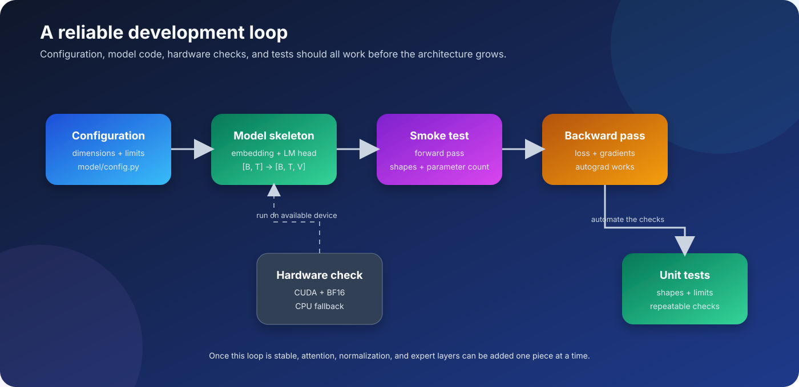

# Setting Up the DeepSeek Codebase

**Goal:** Create a small, executable PyTorch foundation for the DeepSeek implementation, verify the development environment, and understand how configuration, parameters, gradients, and tests fit together.

By the end of this article, the project will have a configuration, a minimal language-model skeleton, a smoke test, and unit tests for the first forward and backward passes.

The goal here is not to implement MLA or MoE yet. The goal is to make the codebase reliable enough that those components can be added and tested one at a time.



## 1. The most important idea: a model is a composition of layers

DeepSeek is a decoder-only Transformer, but the complete model is still assembled from ordinary PyTorch components.

The high-level data flow is:

```text
Token IDs                  [batch, sequence]
    ↓
Token embedding            [batch, sequence, hidden dimension]
    ↓
Transformer blocks
    ├─ RMSNorm → MLA → residual connection
    └─ RMSNorm → dense FFN or DeepSeekMoE → residual connection
    ↓
Final RMSNorm
    ↓
Language-model head        [batch, sequence, vocabulary size]
    ↓
Next-token logits
```

We will create the outer structure first and add the internal Transformer components after the boundaries are clear.

### Why build the structure first?

Imagine you're building a car. You could begin by designing the engine's pistons, but you still need to understand how the engine connects to the rest of the car.

Similarly, we first establish how data enters the model, how layers are registered, how parameters are counted, and how gradients flow. Once those boundaries work, the internal logic of MLA, MoE, and the other components becomes easier to isolate.

## 2. Set up the environment

The project can run on a CPU for shape checks and small tests. GPU experiments should use a compatible NVIDIA driver, CUDA-enabled PyTorch build, and—when available—an H100 or another BF16-capable GPU.

Our primary stack is:

| Tool | Why we need it |
| --- | --- |
| Python 3.11+ | Programming language |
| PyTorch | Tensor operations, autograd, and model training |
| CUDA | Run computations on NVIDIA GPUs |
| pytest | Automated correctness tests |
| Hugging Face datasets | Download and stream training data later |
| tokenizers | Tokenization experiments later |

We will not use Hugging Face Transformers to construct the DeepSeek architecture. The important model components will be written directly in PyTorch.

### Check the GPU

Run this in a terminal when working on an NVIDIA machine:

```bash
nvidia-smi
```

On an H100 system, the output should show the GPU name, driver version, memory, and current utilization. The exact memory capacity depends on the H100 variant.

### Create the Python environment

From the repository root:

```bash
python3 -m venv .venv
source .venv/bin/activate

python -m pip install --upgrade pip
```

Install a CUDA-compatible PyTorch build using the command for your system from the [official PyTorch installation guide](https://pytorch.org/get-started/locally/). Then install the remaining project dependencies:

```bash
python -m pip install -r requirements.txt
```

The correct PyTorch command depends on the operating system, CUDA runtime, and driver already installed. Installing a generic CPU wheel on a GPU machine can make CUDA appear unavailable even when the hardware is present.

### Verify CUDA and BF16

BF16, or Brain Floating Point 16, stores floating-point values in 16 bits rather than 32. It can reduce memory use and accelerate supported operations while retaining a wide exponent range.

```python
import torch

print("PyTorch version:", torch.__version__)
print("CUDA available:", torch.cuda.is_available())
print("CUDA build:", torch.version.cuda)

if torch.cuda.is_available():
    print("GPU count:", torch.cuda.device_count())
    print("GPU name:", torch.cuda.get_device_name(0))
    print(
        "Native BF16 supported:",
        torch.cuda.is_bf16_supported(including_emulation=False),
    )
else:
    print("No CUDA device detected. CPU mode is available.")
```

The native BF16 check is more reliable than guessing from a GPU name. It tells us what the current PyTorch installation can actually use.

## 3. FP32 versus BF16

The two dtypes have different storage costs:

| Dtype | Bytes per parameter or tensor element |
| --- | ---: |
| FP32 | 4 |
| BF16 | 2 |

For a hypothetical model with 200 million parameters, parameter storage alone would be:

| Storage dtype | Parameter storage |
| --- | ---: |
| FP32 | 800 MB |
| BF16 | 400 MB |

That is not the complete training memory requirement. Training also needs gradients, optimizer states, saved activations, and temporary tensors. Mixed-precision training may still retain FP32 parameters or optimizer state.

For the first experiments, keep model parameters in FP32 and use BF16 autocasting only on supported CUDA hardware. Autocast selects suitable computation dtypes for individual operations instead of converting every tensor indiscriminately.

## 4. Create the project structure

The repository is organized by responsibility:

```text
deepseek-from-scratch/
├── docs/          # explanations and diagrams
├── src/           # Python source package
│   ├── model/     # model components
│   ├── commands/  # runnable commands and checks
│   ├── tests/     # automated checks
│   └── smoke_test.py
├── notebooks/     # executable experiments
├── requirements.txt
└── README.md
```

The first model-specific files are small:

```text
src/model/
├── config.py
├── embeddings.py
└── deepseek.py

src/tests/
└── test_model.py

src/smoke_test.py
```

This is a minimal language-model skeleton, not the complete DeepSeek Transformer. The point is to verify the interfaces before adding attention, normalization, routing, and expert layers.

## 5. Implement the model configuration

Create `src/model/config.py`. A dataclass keeps all dimensions and architectural choices together:

```python
from dataclasses import dataclass


@dataclass
class DeepSeekConfig:
    # Tokenizer and sequence length
    vocab_size: int = 8192
    max_seq_len: int = 1024

    # Model dimensions
    dim: int = 256
    n_layers: int = 6
    n_dense_layers: int = 1
    n_heads: int = 8

    # Feed-forward dimensions
    inter_dim: int = 768
    moe_inter_dim: int = 256

    # MLA dimensions
    q_lora_rank: int = 128
    kv_lora_rank: int = 64
    qk_nope_head_dim: int = 32
    qk_rope_head_dim: int = 16
    v_head_dim: int = 32

    # MoE and routing configuration
    n_routed_experts: int = 8
    n_shared_experts: int = 1
    n_activated_experts: int = 2
    n_expert_groups: int = 1
    n_limited_groups: int = 1
    route_scale: float = 1.0

    # Rotary position encoding
    rope_theta: float = 10000.0

    def __post_init__(self) -> None:
        if self.vocab_size <= 0 or self.max_seq_len <= 0:
            raise ValueError("vocab_size and max_seq_len must be positive")
        if self.dim <= 0 or self.n_layers <= 0 or self.n_heads <= 0:
            raise ValueError("model dimensions must be positive")
        if self.dim % self.n_heads != 0:
            raise ValueError("dim must be divisible by n_heads")
        if not 0 <= self.n_dense_layers <= self.n_layers:
            raise ValueError("n_dense_layers must be between 0 and n_layers")
        if not 1 <= self.n_activated_experts <= self.n_routed_experts:
            raise ValueError("invalid number of activated experts")
        if self.qk_rope_head_dim <= 0 or self.qk_rope_head_dim % 2 != 0:
            raise ValueError("qk_rope_head_dim must be a positive even number")
        if self.q_lora_rank <= 0 or self.kv_lora_rank <= 0:
            raise ValueError("LoRA ranks must be positive")
        if self.n_expert_groups <= 0:
            raise ValueError("n_expert_groups must be positive")
        if self.n_routed_experts % self.n_expert_groups != 0:
            raise ValueError("experts must divide evenly across groups")
        if not 1 <= self.n_limited_groups <= self.n_expert_groups:
            raise ValueError("invalid number of limited groups")
        if self.route_scale <= 0:
            raise ValueError("route_scale must be positive")
```

The dataclass creates an initializer and a useful representation automatically. Instead of passing dozens of independent variables through every layer, we pass one configuration object:

```python
config = DeepSeekConfig(dim=256, n_layers=6, n_heads=8)

print(config.dim)       # 256
print(config.n_layers)  # 6
```

The configuration describes the dimensions and structure of the computation. It is not the model itself.

## 6. Build the first model skeleton

Create `src/model/deepseek.py`. For now, implement only two learnable layers:

- Token embedding: converts IDs into hidden vectors.
- Output projection: converts hidden vectors into vocabulary logits.

The Transformer blocks and final RMSNorm are intentionally absent. They can be inserted without changing the input and output contracts.

```python
import torch
from torch import nn

from src.model.config import DeepSeekConfig


class DeepSeekSkeleton(nn.Module):
    def __init__(self, config: DeepSeekConfig) -> None:
        super().__init__()
        self.config = config

        # Token IDs -> hidden vectors
        self.embed_tokens = nn.Embedding(config.vocab_size, config.dim)

        # Hidden vectors -> vocabulary logits
        self.lm_head = nn.Linear(
            config.dim,
            config.vocab_size,
            bias=False,
        )

    def forward(self, input_ids: torch.Tensor) -> torch.Tensor:
        # input_ids: [batch, sequence]
        if input_ids.ndim != 2:
            raise ValueError("Expected input_ids with shape [batch, sequence]")
        if input_ids.shape[1] > self.config.max_seq_len:
            raise ValueError("Sequence exceeds maximum length")

        # [B, T] -> [B, T, D]
        x = self.embed_tokens(input_ids)

        # Transformer blocks and final RMSNorm will be inserted here.

        # [B, T, D] -> [B, T, V]
        return self.lm_head(x)
```

### What does `nn.Module` do?

When a class inherits from `nn.Module`, PyTorch can register its parameters, move it between CPU and GPU, switch between training and evaluation modes, and connect it to autograd.

For example:

```python
self.embed_tokens = nn.Embedding(8192, 256)
```

registers a learnable matrix with shape `[8192, 256]`. Likewise:

```python
self.lm_head = nn.Linear(256, 8192, bias=False)
```

registers a second matrix with shape `[8192, 256]`.

The embedding and output projection currently have the same number of parameters, but they are separate matrices. Weight tying can be considered later; keeping them separate makes the first skeleton easier to inspect.

### Why does the output projection have 8,192 outputs?

The vocabulary contains 8,192 possible tokens. At every position, the model must assign one score to every candidate next token. Those scores are called **logits**. They are not probabilities until a softmax is applied.

## 7. Follow the tensor dimensions

Suppose the input is a batch of two sequences, each containing four token IDs:

```text
input_ids.shape = [2, 4]
```

The model transforms the tensor as follows:

| Operation | Shape | Meaning |
| --- | --- | --- |
| Input IDs | `[2, 4]` | Two sequences with four IDs each |
| Embedding lookup | `[2, 4, 256]` | Eight tokens, each represented by 256 values |
| Linear projection | `[2, 4, 8192]` | One vocabulary score per position |

In general, if `B` is batch size, `T` is sequence length, `D` is hidden dimension, and `V` is vocabulary size:

```text
[B, T]     --Embedding--> [B, T, D]
[B, T, D]  --LM head-->   [B, T, V]
```

This shape convention will appear throughout the implementation.

## 8. Run the first forward pass

Create `src/smoke_test.py`:

```python
import torch

from src.model.config import DeepSeekConfig
from src.model.deepseek import DeepSeekSkeleton


def main() -> None:
    torch.manual_seed(42)
    config = DeepSeekConfig()
    device = torch.device("cuda" if torch.cuda.is_available() else "cpu")

    model = DeepSeekSkeleton(config).to(device)
    tokens = torch.tensor(
        [
            [15, 82, 7, 104],
            [11, 24, 35, 45],
        ],
        dtype=torch.long,
        device=device,
    )

    logits = model(tokens)

    print("Device:", device)
    print("Input:", tokens.shape)
    print("Output:", logits.shape)

    num_params = sum(parameter.numel() for parameter in model.parameters())
    print(f"Parameters: {num_params:,}")

    assert logits.shape == (2, 4, config.vocab_size)


if __name__ == "__main__":
    main()
```

Run it with:

```bash
# From the repository root:
python -m src.smoke_test

# Or from inside src/:
cd src
python smoke_test.py
```

Expected output on a CUDA machine:

```text
Device: cuda
Input: torch.Size([2, 4])
Output: torch.Size([2, 4, 8192])
Parameters: 4,194,304
```

The parameter count is:

```text
(8,192 × 256) + (256 × 8,192) = 4,194,304
```

This is a four-million-parameter network, but it is not yet a contextual language model. Without attention, each position's output depends only on its own token ID. It cannot learn relationships between different positions until Transformer blocks are added.

## 9. What happens during a backward pass?

A forward pass produces logits. Training also needs to determine how the parameters should change to reduce prediction errors.

The basic loop is:

```text
forward pass → logits
compare logits with targets → loss
backward pass → gradients
optimizer step → updated weights
```

Test it with synthetic tokens:

```python
import torch
import torch.nn.functional as F

from src.model.config import DeepSeekConfig
from src.model.deepseek import DeepSeekSkeleton


torch.manual_seed(42)
config = DeepSeekConfig()
device = "cuda" if torch.cuda.is_available() else "cpu"
model = DeepSeekSkeleton(config).to(device)

tokens = torch.randint(
    0,
    config.vocab_size,
    (2, 6),
    device=device,
)

input_ids = tokens[:, :-1]
targets = tokens[:, 1:]
logits = model(input_ids)

loss = F.cross_entropy(
    logits.reshape(-1, config.vocab_size).float(),
    targets.reshape(-1),
)
loss.backward()

print("Loss:", round(loss.item(), 4))
print(
    "Embedding gradient exists:",
    model.embed_tokens.weight.grad is not None,
)
print(
    "LM head gradient exists:",
    model.lm_head.weight.grad is not None,
)
```

`loss.backward()` computes gradients; it does not update the weights. An optimizer uses those gradients later to perform parameter updates.

For this skeleton, a finite loss and non-null gradients prove that the network supports backpropagation.

## 10. Try BF16 autocasting

Once the FP32 path works, try BF16 autocasting on supported CUDA hardware:

```python
from contextlib import nullcontext

import torch
import torch.nn.functional as F

from src.model.config import DeepSeekConfig
from src.model.deepseek import DeepSeekSkeleton


config = DeepSeekConfig()
device = torch.device("cuda" if torch.cuda.is_available() else "cpu")
model = DeepSeekSkeleton(config).to(device)
tokens = torch.randint(0, config.vocab_size, (2, 128), device=device)

use_bf16 = (
    device.type == "cuda"
    and torch.cuda.is_bf16_supported(including_emulation=False)
)
context = (
    torch.autocast("cuda", dtype=torch.bfloat16)
    if use_bf16
    else nullcontext()
)

with context:
    logits = model(tokens[:, :-1])
    loss = F.cross_entropy(
        logits.float().reshape(-1, config.vocab_size),
        tokens[:, 1:].reshape(-1),
    )

loss.backward()

print("Using BF16 autocast:", use_bf16)
print("Logits dtype:", logits.dtype)
print("Parameter dtype:", model.lm_head.weight.dtype)
print("Loss:", loss.item())
```

On a compatible H100 setup, the projected logits will ordinarily be BF16 while the model parameters remain FP32.

The important distinction is:

> Computation dtype and parameter-storage dtype are not necessarily the same.

`torch.set_float32_matmul_precision("high")` controls the internal precision used by some FP32 matrix multiplications. It is separate from BF16 autocasting.

## 11. Write the first unit tests

Test the model continuously rather than waiting until it contains hundreds of millions of parameters.

Create `src/tests/test_model.py`:

```python
import pytest
import torch

from src.model.config import DeepSeekConfig
from src.model.deepseek import DeepSeekSkeleton


def test_forward_shape() -> None:
    config = DeepSeekConfig()
    model = DeepSeekSkeleton(config)
    input_ids = torch.randint(0, config.vocab_size, (2, 16))

    logits = model(input_ids)

    assert logits.shape == (2, 16, config.vocab_size)


def test_parameter_count() -> None:
    config = DeepSeekConfig()
    model = DeepSeekSkeleton(config)
    actual = sum(parameter.numel() for parameter in model.parameters())
    expected = 2 * config.vocab_size * config.dim

    assert actual == expected


def test_backward() -> None:
    config = DeepSeekConfig()
    model = DeepSeekSkeleton(config)
    input_ids = torch.randint(0, config.vocab_size, (2, 8))

    model(input_ids).square().mean().backward()

    for parameter in model.parameters():
        assert parameter.grad is not None
        assert torch.isfinite(parameter.grad).all()


def test_sequence_limit() -> None:
    config = DeepSeekConfig(max_seq_len=8)
    model = DeepSeekSkeleton(config)
    input_ids = torch.randint(0, config.vocab_size, (1, 9))

    with pytest.raises(ValueError):
        model(input_ids)
```

Run the tests with:

```bash
python -m pytest src/tests/ -v
```

The expected result is four passing tests covering output shape, parameter count, gradient flow, and sequence-length validation. These tests do not prove that MLA, MoE, or causal attention are correct; those components have not been added yet.

## 12. How does model size affect parameter count?

For this two-layer skeleton, the embedding and output projection each scale linearly with the hidden dimension `D`:

```text
total parameters = 2 × vocabulary size × D
```

With a vocabulary of 8,192 tokens:

| Hidden dimension `D` | Embedding parameters | Total skeleton parameters |
| ---: | ---: | ---: |
| 256 | 2.10M | 4.19M |
| 384 | 3.15M | 6.29M |
| 512 | 4.19M | 8.39M |

Doubling the hidden dimension doubles the parameters in this skeleton. Once attention and feed-forward networks are added, the parameter count will involve more products of model dimensions.

## 13. What we have accomplished

At this point, the repository has a clear development loop:

| Completed | Purpose |
| --- | --- |
| Environment setup | Run the same checks on CPU or CUDA |
| Model configuration | Keep dimensions and limits in one place |
| Token embeddings | Convert IDs into hidden vectors |
| Language-model head | Convert hidden vectors into logits |
| Forward and backward checks | Verify shapes and gradient flow |
| Unit tests | Catch regressions as the model grows |

The implementation is still a skeleton, but it now has the infrastructure needed to add the actual DeepSeek layers safely.
