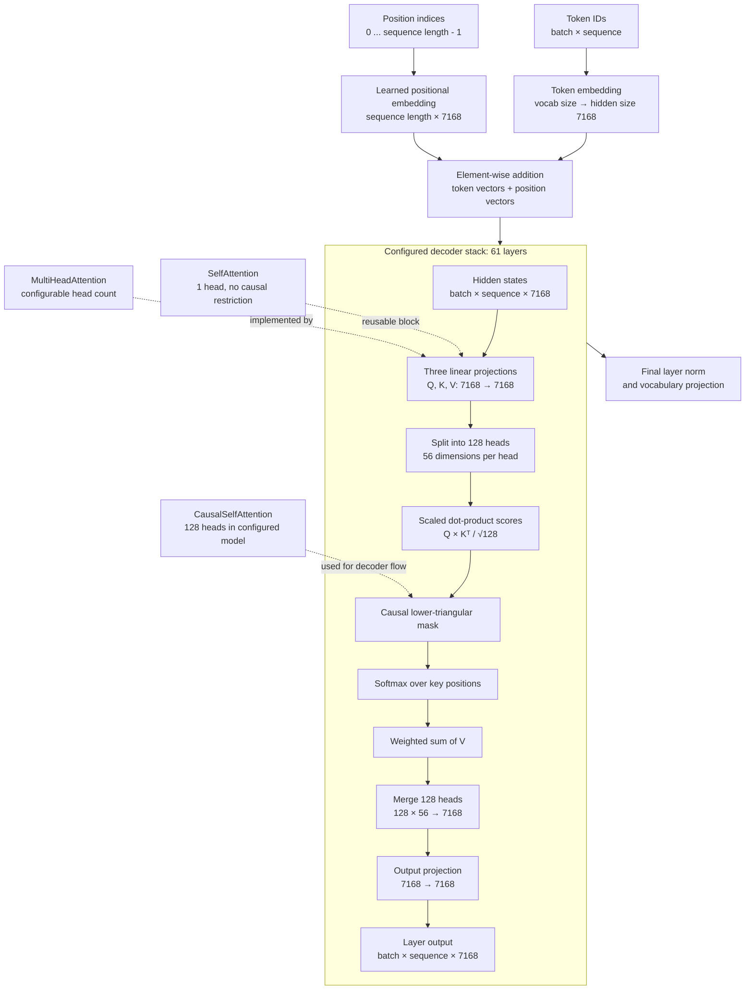

# Step 2 — Implement attention blocks

This document is a permanent reconstruction record for the attention step. It
contains the exact files and code that belong to this commit. If the source
code changes later, use this document to recreate the original step from a
clean checkout.

## Goal of this commit

Add the attention components required by the decoder model:

1. General multi-head attention.
2. Single-head self-attention.
3. Causal self-attention for autoregressive training.
4. Learned absolute positional embeddings.

The input and output representation used throughout this step is:

```text
(batch_size, sequence_length, embedding_dimension)
```

For attention weights, the representation is:

```text
(batch_size, number_of_heads, query_length, key_length)
```

## Architecture diagram

The configuration records the DeepSeek-V3-scale dimensions: 61 decoder layers,
hidden size 7168, 128 attention heads, and 56 dimensions per head. This step
implements the reusable attention blocks shown inside one layer. The complete
decoder stack is assembled by the `DeepSeek` integration documented below.



### What exists after this step

The code currently provides the blocks represented by the dotted connections:

- `SelfAttention` for one-head self-attention.
- `MultiHeadAttention` for configurable multi-head attention.
- `CausalSelfAttention` for autoregressive masking.
- `LearnedPositionalEmbedding` for position vectors.

The `DeepSeek` integration now includes token embeddings, positional
embeddings, repeated decoder blocks, residual connections, layer normalization,
the feed-forward sublayer, final normalization, vocabulary logits, and optional
next-token training loss.

## Complete model integration

Create `src/model/deepseek.py` with exactly this content:

```python
"""Complete decoder-only model assembled from the current building blocks."""

from __future__ import annotations

from dataclasses import dataclass

import torch
from torch import Tensor, nn
from torch.nn import functional as F

from .attention import CausalSelfAttention, LearnedPositionalEmbedding
from .config import ModelConfig, load_default_config


class DecoderBlock(nn.Module):
    """Pre-normalized decoder block with causal attention and an MLP."""

    def __init__(self, config: ModelConfig) -> None:
        super().__init__()
        self.input_layernorm = nn.LayerNorm(config.hidden_size, eps=config.rms_norm_eps)
        self.attention = CausalSelfAttention(
            embed_dim=config.hidden_size,
            num_heads=config.num_attention_heads,
            dropout=config.attention_dropout,
            bias=config.attention_bias,
        )
        self.post_attention_layernorm = nn.LayerNorm(config.hidden_size, eps=config.rms_norm_eps)
        self.mlp = nn.Sequential(
            nn.Linear(config.hidden_size, config.intermediate_size, bias=config.attention_bias),
            nn.SiLU(),
            nn.Linear(config.intermediate_size, config.hidden_size, bias=config.attention_bias),
        )

    def forward(self, hidden_states: Tensor, attention_mask: Tensor | None = None) -> Tensor:
        hidden_states = hidden_states + self.attention(
            self.input_layernorm(hidden_states), attention_mask=attention_mask
        )
        hidden_states = hidden_states + self.mlp(self.post_attention_layernorm(hidden_states))
        return hidden_states


@dataclass
class DeepSeekOutput:
    """Outputs returned by :class:`DeepSeek`."""

    logits: Tensor
    loss: Tensor | None = None


class DeepSeek(nn.Module):
    """Decoder-only language model assembled from the repository config.

    Pass a smaller ``ModelConfig`` while developing locally. Calling the class
    without a config uses the full checked-in DeepSeek-V3-scale dimensions.
    """

    def __init__(self, config: ModelConfig | None = None) -> None:
        super().__init__()
        self.config = config or load_default_config()
        self.token_embeddings = nn.Embedding(self.config.vocab_size, self.config.hidden_size)
        self.position_embeddings = LearnedPositionalEmbedding(
            max_sequence_length=self.config.max_position_embeddings,
            embed_dim=self.config.hidden_size,
        )
        self.layers = nn.ModuleList(DecoderBlock(self.config) for _ in range(self.config.num_hidden_layers))
        self.final_layernorm = nn.LayerNorm(self.config.hidden_size, eps=self.config.rms_norm_eps)
        self.lm_head = nn.Linear(self.config.hidden_size, self.config.vocab_size, bias=False)

        if self.config.tie_word_embeddings:
            self.lm_head.weight = self.token_embeddings.weight

        self.apply(self._initialize_weights)

    def _initialize_weights(self, module: nn.Module) -> None:
        if isinstance(module, (nn.Linear, nn.Embedding)):
            nn.init.normal_(module.weight, mean=0.0, std=self.config.initializer_range)
            if isinstance(module, nn.Linear) and module.bias is not None:
                nn.init.zeros_(module.bias)

    def forward(
        self,
        input_ids: Tensor,
        labels: Tensor | None = None,
        attention_mask: Tensor | None = None,
    ) -> DeepSeekOutput:
        if input_ids.ndim != 2:
            raise ValueError("input_ids must have shape (batch, sequence)")
        if input_ids.shape[1] == 0:
            raise ValueError("sequence length must be greater than zero")
        if input_ids.shape[1] > self.config.max_position_embeddings:
            raise ValueError("sequence length exceeds max_position_embeddings")
        if labels is not None and labels.shape != input_ids.shape:
            raise ValueError("labels must have the same shape as input_ids")

        hidden_states = self.token_embeddings(input_ids)
        hidden_states = hidden_states + self.position_embeddings(
            input_ids.shape[1], device=input_ids.device
        )
        for layer in self.layers:
            hidden_states = layer(hidden_states, attention_mask=attention_mask)
        logits = self.lm_head(self.final_layernorm(hidden_states))

        loss = None
        if labels is not None:
            loss = F.cross_entropy(
                logits[:, :-1].contiguous().view(-1, logits.shape[-1]),
                labels[:, 1:].contiguous().view(-1),
            )
        return DeepSeekOutput(logits=logits, loss=loss)
```

The `DeepSeek` class accepts token IDs shaped `(batch, sequence)`. It returns
logits shaped `(batch, sequence, vocab_size)`. When `labels` are supplied, it
also computes the shifted next-token cross-entropy loss used for training.

For local development, create a small `ModelConfig` rather than instantiating
the full configuration immediately. The checked-in values describe the target
architecture and are not intended to be trained on a personal machine at this
stage.

## Training integration

Add these imports at the top of `src/model/deepseek.py`:

```python
import math
from pathlib import Path
from typing import Iterable

import torch
```

Then append the following definitions after `DeepSeekOutput` and before the
`DeepSeek` class:

```python
@dataclass(frozen=True)
class TrainingConfig:
    """Optimization and loop settings for pretraining."""

    learning_rate: float = 3e-4
    betas: tuple[float, float] = (0.9, 0.95)
    eps: float = 1e-8
    weight_decay: float = 0.1
    warmup_steps: int = 100
    max_steps: int = 1000
    max_grad_norm: float = 1.0

    def __post_init__(self) -> None:
        if self.learning_rate <= 0:
            raise ValueError("learning_rate must be positive")
        if not 0 < self.betas[0] < 1 or not 0 < self.betas[1] < 1:
            raise ValueError("betas must be between zero and one")
        if self.warmup_steps < 0 or self.max_steps <= self.warmup_steps:
            raise ValueError("max_steps must be greater than warmup_steps")
        if self.max_grad_norm <= 0:
            raise ValueError("max_grad_norm must be positive")


class DeepSeekTrainer:
    """Own the optimizer and one complete language-model training loop."""

    def __init__(self, model: DeepSeek, config: TrainingConfig | None = None) -> None:
        self.model = model
        self.config = config or TrainingConfig()
        self.optimizer = torch.optim.AdamW(
            self.model.parameters(),
            lr=self.config.learning_rate,
            betas=self.config.betas,
            eps=self.config.eps,
            weight_decay=self.config.weight_decay,
        )
        self.scheduler = torch.optim.lr_scheduler.LambdaLR(self.optimizer, self._lr_multiplier)
        self.global_step = 0

    def _lr_multiplier(self, step: int) -> float:
        if step < self.config.warmup_steps:
            return max(step, 1) / max(self.config.warmup_steps, 1)
        progress = (step - self.config.warmup_steps) / (
            self.config.max_steps - self.config.warmup_steps
        )
        return max(0.0, 0.5 * (1.0 + math.cos(math.pi * progress)))

    def train_batch(
        self,
        input_ids: Tensor,
        labels: Tensor | None = None,
        attention_mask: Tensor | None = None,
    ) -> DeepSeekOutput:
        """Run forward, loss, backward, clipping, optimizer, and scheduler steps."""

        self.model.train()
        self.optimizer.zero_grad(set_to_none=True)
        output = self.model(
            input_ids,
            labels=labels if labels is not None else input_ids,
            attention_mask=attention_mask,
        )
        if output.loss is None:
            raise RuntimeError("training requires a language-model loss")
        output.loss.backward()
        nn.utils.clip_grad_norm_(self.model.parameters(), self.config.max_grad_norm)
        self.optimizer.step()
        self.scheduler.step()
        self.global_step += 1
        return output

    def train_epoch(self, batches: Iterable[Tensor | tuple[Tensor, Tensor]]) -> float:
        """Train over batches and return the mean loss."""

        losses: list[float] = []
        for batch in batches:
            if isinstance(batch, tuple):
                input_ids, labels = batch
            else:
                input_ids, labels = batch, None
            output = self.train_batch(input_ids, labels=labels)
            losses.append(float(output.loss.detach()))
        if not losses:
            raise ValueError("batches must contain at least one batch")
        return sum(losses) / len(losses)

    def save_checkpoint(self, path: str | Path) -> None:
        """Save model, optimizer, scheduler, and progress state."""

        torch.save(
            {
                "model": self.model.state_dict(),
                "optimizer": self.optimizer.state_dict(),
                "scheduler": self.scheduler.state_dict(),
                "global_step": self.global_step,
            },
            Path(path),
        )

    def load_checkpoint(self, path: str | Path) -> None:
        """Restore model, optimizer, scheduler, and progress state."""

        checkpoint = torch.load(Path(path), map_location="cpu", weights_only=True)
        self.model.load_state_dict(checkpoint["model"])
        self.optimizer.load_state_dict(checkpoint["optimizer"])
        self.scheduler.load_state_dict(checkpoint["scheduler"])
        self.global_step = int(checkpoint["global_step"])
```

The trainer now defines AdamW optimization, warmup plus cosine learning-rate
decay, gradient clipping, forward/backward/update ordering, epoch loss
aggregation, and checkpoint persistence.

## Step 1: add the model package

Create the directory `src/model/`.

Create `src/model/__init__.py` with exactly this content:

```python
"""Neural-network building blocks for the decoder-only model."""

from .attention import (
    CausalSelfAttention,
    LearnedPositionalEmbedding,
    MultiHeadAttention,
    SelfAttention,
)

__all__ = [
    "CausalSelfAttention",
    "LearnedPositionalEmbedding",
    "MultiHeadAttention",
    "SelfAttention",
]
```

## Step 2: add the attention implementation

Create `src/model/attention.py` with exactly this content:

```python
"""Standard self-attention building blocks.

This stage intentionally implements ordinary multi-head attention.
"""

from __future__ import annotations

import math

import torch
from torch import Tensor, nn


def _validate_hidden_states(hidden_states: Tensor, embed_dim: int) -> None:
    if hidden_states.ndim != 3:
        raise ValueError("hidden_states must have shape (batch, sequence, embed_dim)")
    if hidden_states.shape[-1] != embed_dim:
        raise ValueError(f"expected embedding size {embed_dim}, got {hidden_states.shape[-1]}")
    if hidden_states.shape[1] == 0:
        raise ValueError("sequence length must be greater than zero")


class MultiHeadAttention(nn.Module):
    """Scaled dot-product multi-head attention.

    Inputs use the shape ``(batch, sequence, embed_dim)``. A boolean
    ``attention_mask`` may be broadcast to ``(batch, heads, query, key)``;
    ``True`` means that a position is visible. When ``causal=True``, future
    key positions are hidden automatically.
    """

    def __init__(self, embed_dim: int, num_heads: int, dropout: float = 0.0, bias: bool = True, causal: bool = False) -> None:
        super().__init__()
        if embed_dim <= 0:
            raise ValueError("embed_dim must be positive")
        if num_heads <= 0:
            raise ValueError("num_heads must be positive")
        if embed_dim % num_heads != 0:
            raise ValueError("embed_dim must be divisible by num_heads")
        if not 0.0 <= dropout < 1.0:
            raise ValueError("dropout must be in the range [0, 1)")

        self.embed_dim = embed_dim
        self.num_heads = num_heads
        self.head_dim = embed_dim // num_heads
        self.causal = causal
        self.q_proj = nn.Linear(embed_dim, embed_dim, bias=bias)
        self.k_proj = nn.Linear(embed_dim, embed_dim, bias=bias)
        self.v_proj = nn.Linear(embed_dim, embed_dim, bias=bias)
        self.out_proj = nn.Linear(embed_dim, embed_dim, bias=bias)
        self.dropout = nn.Dropout(dropout)

    def _split_heads(self, states: Tensor) -> Tensor:
        batch, sequence, _ = states.shape
        return states.view(batch, sequence, self.num_heads, self.head_dim).transpose(1, 2)

    def forward(
        self,
        hidden_states: Tensor,
        attention_mask: Tensor | None = None,
        *,
        return_attention: bool = False,
    ) -> Tensor | tuple[Tensor, Tensor]:
        _validate_hidden_states(hidden_states, self.embed_dim)
        batch, sequence, _ = hidden_states.shape

        query = self._split_heads(self.q_proj(hidden_states))
        key = self._split_heads(self.k_proj(hidden_states))
        value = self._split_heads(self.v_proj(hidden_states))
        scores = torch.matmul(query, key.transpose(-2, -1)) / math.sqrt(self.head_dim)

        if self.causal:
            causal_mask = torch.ones(sequence, sequence, dtype=torch.bool, device=hidden_states.device).tril()
            scores = scores.masked_fill(~causal_mask, torch.finfo(scores.dtype).min)
        if attention_mask is not None:
            if attention_mask.dtype is not torch.bool:
                raise TypeError("attention_mask must have boolean dtype")
            scores = scores.masked_fill(~attention_mask, torch.finfo(scores.dtype).min)

        weights = torch.softmax(scores, dim=-1)
        weights = self.dropout(weights)
        attended = torch.matmul(weights, value)
        attended = attended.transpose(1, 2).contiguous().view(batch, sequence, self.embed_dim)
        output = self.out_proj(attended)
        if return_attention:
            return output, weights
        return output


class SelfAttention(MultiHeadAttention):
    """Ordinary single-head self-attention without a causal restriction."""

    def __init__(self, embed_dim: int, dropout: float = 0.0, bias: bool = True) -> None:
        super().__init__(embed_dim, num_heads=1, dropout=dropout, bias=bias, causal=False)


class CausalSelfAttention(MultiHeadAttention):
    """Multi-head self-attention that cannot read future tokens."""

    def __init__(self, embed_dim: int, num_heads: int, dropout: float = 0.0, bias: bool = True) -> None:
        super().__init__(embed_dim, num_heads, dropout=dropout, bias=bias, causal=True)


class LearnedPositionalEmbedding(nn.Module):
    """Learned absolute positional embeddings for a fixed context length."""

    def __init__(self, max_sequence_length: int, embed_dim: int) -> None:
        super().__init__()
        if max_sequence_length <= 0:
            raise ValueError("max_sequence_length must be positive")
        self.max_sequence_length = max_sequence_length
        self.embedding = nn.Embedding(max_sequence_length, embed_dim)

    def forward(self, sequence_length: int, *, device: torch.device | None = None) -> Tensor:
        if sequence_length <= 0:
            raise ValueError("sequence_length must be positive")
        if sequence_length > self.max_sequence_length:
            raise ValueError("sequence_length exceeds max_sequence_length")
        positions = torch.arange(sequence_length, device=device)
        return self.embedding(positions).unsqueeze(0)
```

## Step 3: add PyTorch

Open `requirements.txt` and add this section after the dataset dependencies:

```text
# Model implementation
torch>=2.2,<3
```

The complete dependency file at this step is:

```text
# Dataset preparation
datasets>=2.18,<5
tqdm>=4.66,<5

# Model implementation
torch>=2.2,<3

# Development and tests
pytest>=8.0,<9
```

## Step 4: add the tests

Create `tests/test_attention.py` with exactly this content:

```python
import pytest
import torch

from src.model.attention import CausalSelfAttention, LearnedPositionalEmbedding, MultiHeadAttention, SelfAttention


def test_multi_head_attention_preserves_shape() -> None:
    attention = MultiHeadAttention(embed_dim=12, num_heads=3)

    output, weights = attention(torch.randn(2, 5, 12), return_attention=True)

    assert output.shape == (2, 5, 12)
    assert weights.shape == (2, 3, 5, 5)
    assert torch.allclose(weights.sum(dim=-1), torch.ones(2, 3, 5), atol=1e-6)


def test_self_attention_is_one_head() -> None:
    attention = SelfAttention(embed_dim=8)

    _, weights = attention(torch.randn(2, 4, 8), return_attention=True)

    assert weights.shape == (2, 1, 4, 4)


def test_causal_attention_cannot_use_future_tokens() -> None:
    torch.manual_seed(0)
    attention = CausalSelfAttention(embed_dim=8, num_heads=2).eval()
    original = torch.randn(1, 4, 8)
    changed_future = original.clone()
    changed_future[:, 2:] += 1000

    first_two_original = attention(original)[:, :2]
    first_two_changed = attention(changed_future)[:, :2]

    assert torch.allclose(first_two_original, first_two_changed, atol=1e-5)


def test_learned_positional_embedding_shape_and_limit() -> None:
    positions = LearnedPositionalEmbedding(max_sequence_length=16, embed_dim=8)

    assert positions(5).shape == (1, 5, 8)
    with pytest.raises(ValueError, match="exceeds"):
        positions(17)


def test_attention_rejects_invalid_head_configuration() -> None:
    with pytest.raises(ValueError, match="divisible"):
        MultiHeadAttention(embed_dim=10, num_heads=3)
```

## Step 5: install and reproduce

From the repository root, install the dependencies:

```bash
python -m pip install -r requirements.txt
```

Run only the tests for this step:

```bash
pytest tests/test_attention.py
```

## Step 6: commit this exact step

Review that the changed files are exactly:

```text
requirements.txt
src/model/__init__.py
src/model/attention.py
src/model/deepseek.py
tests/test_attention.py
docs/02b-attention.md
README.md
```

Create the commit:

```bash
git add requirements.txt src/model/__init__.py src/model/attention.py src/model/deepseek.py tests/test_attention.py docs/02b-attention.md README.md
git commit -m "feat(model): add standard causal multi-head attention"
```

The next step can build decoder layers around these components. Keep that work
in a separate commit and add another reconstruction document rather than
rewriting this historical record.
