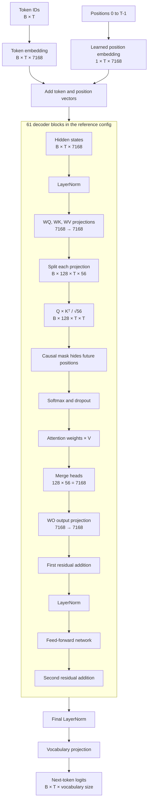

# Step 02b — Implement understandable attention blocks

This document records the standard attention implementation used by the
current educational model. The implementation intentionally keeps projection,
head reshaping, masking, softmax, value mixing, and output projection together
inside one readable `forward` method.

This stage does not implement KV caching, grouped-query attention,
multi-query attention, or multi-head latent attention.

## What this step builds

The input and output hidden-state shape is:

```text
[batch, sequence, hidden_size]
```

Attention temporarily splits `hidden_size` into heads:

```text
head_dim = hidden_size / num_attention_heads
[batch, sequence, hidden_size]
    → [batch, heads, sequence, head_dim]
```

The attention-weight shape is:

```text
[batch, heads, query_sequence, key_sequence]
```

The current classes are deliberately small:

- `MultiHeadAttention` contains the complete standard attention calculation.
- `SelfAttention` selects one non-causal head.
- `CausalSelfAttention` enables the causal mask used by decoder blocks.
- `LearnedPositionalEmbedding` supplies one learned vector per position.

## Architecture diagram

The full reference configuration uses hidden size 7168, 128 heads, and a head
dimension of 56 because `7168 / 128 = 56`. The same decoder-block operation is
repeated 61 times in that configuration.



The output projection has its own learned weight matrix. After the heads are
merged, their features are still grouped by where they came from. `WO` learns
how to mix information across all heads and produces the representation that
is added to the residual stream.

## Step 1: create the model package

Create `src/model/` and create `src/model/__init__.py` with this public API:

```python
"""Public model API for the decoder-only model."""

# Re-export building blocks so callers do not need to know internal file layout.
from .attention import (
    CausalSelfAttention,
    LearnedPositionalEmbedding,
    MultiHeadAttention,
    SelfAttention,
)
from .config import ModelConfig, default_config_path, load_default_config
from .deepseek import DecoderBlock, DeepSeek, DeepSeekOutput, DeepSeekTrainer, TrainingConfig

__all__ = [
    "CausalSelfAttention",
    "LearnedPositionalEmbedding",
    "MultiHeadAttention",
    "SelfAttention",
    "ModelConfig",
    "default_config_path",
    "load_default_config",
    "DecoderBlock",
    "DeepSeek",
    "DeepSeekOutput",
    "DeepSeekTrainer",
    "TrainingConfig",
]
```

## Step 2: create the attention implementation

Create `src/model/attention.py` with exactly this content:

```python
"""Simple self-attention components used by the educational decoder."""

from __future__ import annotations

import math

import torch
from torch import Tensor, nn


class MultiHeadAttention(nn.Module):
    """Scaled dot-product attention for tensors shaped ``[B, T, D]``."""

    def __init__(
        self,
        embed_dim: int,
        num_heads: int,
        dropout: float = 0.0,
        bias: bool = True,
        causal: bool = False,
    ) -> None:
        super().__init__()

        # Every head receives an equal slice of the embedding dimension, so all
        # dimensions must be positive and `embed_dim` must divide evenly.
        if embed_dim <= 0:
            raise ValueError("embed_dim must be positive")
        if num_heads <= 0:
            raise ValueError("num_heads must be positive")
        if embed_dim % num_heads != 0:
            raise ValueError("embed_dim must be divisible by num_heads")
        if not 0.0 <= dropout < 1.0:
            raise ValueError("dropout must be in the range [0, 1)")

        # D = H * Dh. For the reference config: 7168 = 128 * 56.
        self.embed_dim = embed_dim
        self.num_heads = num_heads
        self.head_dim = embed_dim // num_heads

        # `causal` controls whether token t may read tokens after position t.
        self.causal = causal

        # These four matrices are learned independently. Q and K decide which
        # tokens interact, V carries content, and WO mixes the merged heads.
        self.q_proj = nn.Linear(embed_dim, embed_dim, bias=bias)
        self.k_proj = nn.Linear(embed_dim, embed_dim, bias=bias)
        self.v_proj = nn.Linear(embed_dim, embed_dim, bias=bias)
        self.out_proj = nn.Linear(embed_dim, embed_dim, bias=bias)

        # Dropout applies to normalized attention probabilities during training.
        self.dropout = nn.Dropout(dropout)

    def forward(
        self,
        hidden_states: Tensor,
        attention_mask: Tensor | None = None,
        *,
        return_attention: bool = False,
    ) -> Tensor | tuple[Tensor, Tensor]:
        """Project, attend, merge heads, and project back to ``embed_dim``."""

        # Attention expects one vector per token: batch B, sequence T, width D.
        if hidden_states.ndim != 3:
            raise ValueError("hidden_states must have shape (batch, sequence, embed_dim)")
        if hidden_states.shape[-1] != self.embed_dim:
            raise ValueError(
                f"expected embedding size {self.embed_dim}, got {hidden_states.shape[-1]}"
            )
        if hidden_states.shape[1] == 0:
            raise ValueError("sequence length must be greater than zero")

        # Only B and T vary at runtime; D was fixed when this module was built.
        batch, sequence, _ = hidden_states.shape

        # Each projection starts as [B, T, D]. `view` exposes H independent
        # heads, and `transpose` puts H before T for batched matrix products:
        # [B, T, D] -> [B, T, H, Dh] -> [B, H, T, Dh].
        query = self.q_proj(hidden_states).view(
            batch, sequence, self.num_heads, self.head_dim
        ).transpose(1, 2)
        key = self.k_proj(hidden_states).view(
            batch, sequence, self.num_heads, self.head_dim
        ).transpose(1, 2)
        value = self.v_proj(hidden_states).view(
            batch, sequence, self.num_heads, self.head_dim
        ).transpose(1, 2)

        # Every query is compared with every key in the same head. Dividing by
        # sqrt(Dh) prevents large dot products from saturating the softmax:
        # [B, H, T, Dh] @ [B, H, Dh, T] -> [B, H, T, T].
        scores = torch.matmul(query, key.transpose(-2, -1)) / math.sqrt(self.head_dim)

        if self.causal:
            # The lower triangle contains positions at or before each query.
            # Its [T, T] shape broadcasts over the batch and head dimensions.
            visible = torch.ones(
                sequence,
                sequence,
                dtype=torch.bool,
                device=hidden_states.device,
            ).tril()

            # Hidden future positions receive the smallest representable value,
            # which makes their probability effectively zero after softmax.
            scores = scores.masked_fill(~visible, torch.finfo(scores.dtype).min)
        if attention_mask is not None:
            # In this API True means visible and False means blocked. The mask
            # must be broadcastable to [B, H, T, T].
            if attention_mask.dtype is not torch.bool:
                raise TypeError("attention_mask must have boolean dtype")
            scores = scores.masked_fill(~attention_mask, torch.finfo(scores.dtype).min)

        # Softmax converts each query row into probabilities over key positions.
        # The probabilities sum to one before dropout is applied.
        weights = self.dropout(torch.softmax(scores, dim=-1))

        # Use those probabilities to take a weighted sum of value vectors:
        # [B, H, T, T] @ [B, H, T, Dh] -> [B, H, T, Dh].
        attended = torch.matmul(weights, value)

        # Return from separate heads to one vector per token. `contiguous` makes
        # the transposed memory layout safe to flatten: [B, H, T, Dh] -> [B, T, D].
        attended = attended.transpose(1, 2).contiguous().view(batch, sequence, self.embed_dim)

        # WO is not a reshape: it is a learned D x D transformation that mixes
        # information from all heads before the decoder's residual addition.
        output = self.out_proj(attended)

        # Attention probabilities are optional because training normally needs
        # only the transformed hidden states; tests and visualizations may need both.
        return (output, weights) if return_attention else output


class SelfAttention(MultiHeadAttention):
    """Non-causal single-head attention kept as a simple specialization."""

    def __init__(self, embed_dim: int, dropout: float = 0.0, bias: bool = True) -> None:
        # One head and no causal mask provide the simplest self-attention case.
        super().__init__(embed_dim, 1, dropout=dropout, bias=bias, causal=False)


class CausalSelfAttention(MultiHeadAttention):
    """Causal multi-head attention used inside every decoder block."""

    def __init__(
        self,
        embed_dim: int,
        num_heads: int,
        dropout: float = 0.0,
        bias: bool = True,
    ) -> None:
        # Decoder language modeling needs multiple heads plus future-token masking.
        super().__init__(embed_dim, num_heads, dropout=dropout, bias=bias, causal=True)


class LearnedPositionalEmbedding(nn.Module):
    """Learned absolute position vectors for a fixed maximum sequence length."""

    def __init__(self, max_sequence_length: int, embed_dim: int) -> None:
        super().__init__()

        # The embedding table needs one learned row for every allowed position.
        if max_sequence_length <= 0:
            raise ValueError("max_sequence_length must be positive")
        self.max_sequence_length = max_sequence_length
        self.embedding = nn.Embedding(max_sequence_length, embed_dim)

    def forward(self, sequence_length: int, *, device: torch.device | None = None) -> Tensor:
        """Return position vectors with shape ``[1, sequence_length, embed_dim]``."""

        # Reject invalid lengths before indexing the finite embedding table.
        if sequence_length <= 0:
            raise ValueError("sequence_length must be positive")
        if sequence_length > self.max_sequence_length:
            raise ValueError("sequence length exceeds max_sequence_length")

        # The leading size-one batch axis lets this tensor broadcast over every
        # example when it is added to token embeddings shaped [B, T, D].
        positions = torch.arange(sequence_length, device=device)
        return self.embedding(positions).unsqueeze(0)
```

There are no separate `_validate_hidden_states` or `_split_heads` methods. The
few checks and reshapes are kept beside the calculations they explain, which
makes the complete attention flow visible in one place.

## Step 3: add dependencies

The dependency file at this stage is:

```text
# Dataset preparation
datasets>=2.18,<5
tqdm>=4.66,<5

# Model implementation
torch>=2.2,<3
tensorboard>=2.14,<3

# Development and tests
pytest>=8.0,<9
```

## Step 4: add attention tests

Create `tests/test_attention.py`:

```python
import pytest
import torch

from src.model.attention import CausalSelfAttention, LearnedPositionalEmbedding, MultiHeadAttention, SelfAttention


def test_multi_head_attention_preserves_shape() -> None:
    # A 12-wide model split across 3 heads should return the original width.
    attention = MultiHeadAttention(embed_dim=12, num_heads=3)

    output, weights = attention(torch.randn(2, 5, 12), return_attention=True)

    assert output.shape == (2, 5, 12)
    assert weights.shape == (2, 3, 5, 5)
    assert torch.allclose(weights.sum(dim=-1), torch.ones(2, 3, 5), atol=1e-6)


def test_self_attention_is_one_head() -> None:
    # SelfAttention is the single-head specialization of the general module.
    attention = SelfAttention(embed_dim=8)

    _, weights = attention(torch.randn(2, 4, 8), return_attention=True)

    assert weights.shape == (2, 1, 4, 4)


def test_causal_attention_cannot_use_future_tokens() -> None:
    # Changing future tokens must not change outputs for earlier positions.
    torch.manual_seed(0)
    attention = CausalSelfAttention(embed_dim=8, num_heads=2).eval()
    original = torch.randn(1, 4, 8)
    changed_future = original.clone()
    changed_future[:, 2:] += 1000

    first_two_original = attention(original)[:, :2]
    first_two_changed = attention(changed_future)[:, :2]

    assert torch.allclose(first_two_original, first_two_changed, atol=1e-5)


def test_learned_positional_embedding_shape_and_limit() -> None:
    # Position vectors broadcast across the batch and enforce the configured limit.
    positions = LearnedPositionalEmbedding(max_sequence_length=16, embed_dim=8)

    assert positions(5).shape == (1, 5, 8)
    with pytest.raises(ValueError, match="exceeds"):
        positions(17)


def test_attention_rejects_invalid_head_configuration() -> None:
    # The hidden width must divide evenly into the requested number of heads.
    with pytest.raises(ValueError, match="divisible"):
        MultiHeadAttention(embed_dim=10, num_heads=3)
```

## Step 5: reproduce and verify

```bash
python -m pip install -r requirements.txt
pytest tests/test_attention.py
```

The full model and its compact training helper are assembled in
[02c-training.md](./02c-training.md). Keeping model assembly there avoids
duplicating a second, easily outdated copy of `src/model/deepseek.py` in this
attention-only step.

## Step 6: commit this step

```bash
git add requirements.txt src/model/__init__.py src/model/attention.py tests/test_attention.py docs/02b-attention.md README.md
git commit -m "feat(model): add standard causal multi-head attention"
```
