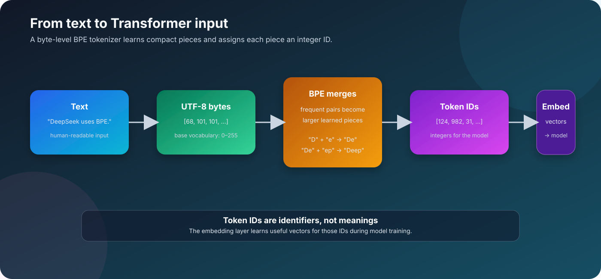
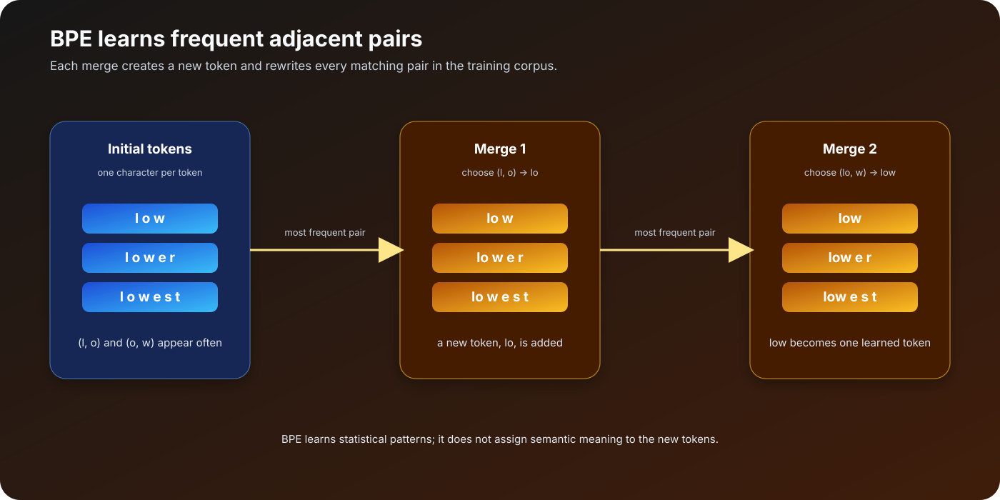
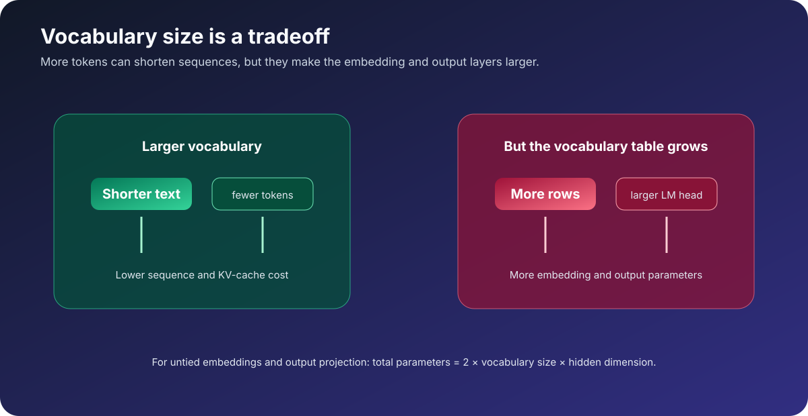

# Building a Tokenizer From Scratch

**Goal:** Build a small byte-level Byte Pair Encoding (BPE) tokenizer, understand how it learns a vocabulary from text, and connect it to the DeepSeek model.

By the end of this article, the tokenizer will be able to:

- Learn token pieces from a training corpus.
- Convert text into integer token IDs.
- Reconstruct text from those IDs.
- Handle new words, punctuation, and Unicode text.
- Produce IDs that can be passed to the PyTorch model.

We will implement the core BPE algorithm ourselves instead of relying on a pretrained tokenizer.



## 1. Why does DeepSeek need a tokenizer?

Consider the text:

> DeepSeek is building a language model.

A neural network cannot directly multiply the word `DeepSeek` by a matrix. Neural networks operate on numbers, so text must first be converted into a sequence of integer IDs.

An illustrative tokenization might look like this:

| Text piece | Token ID |
| --- | ---: |
| `Deep` | 124 |
| `Seek` | 982 |
| ` is` | 31 |
| ` building` | 291 |
| ` a` | 76 |
| ` language` | 501 |
| ` model` | 117 |
| `.` | 9 |

These IDs are only identifiers. Token ID 124 is not mathematically more meaningful than token ID 31. The embedding layer learns a vector for each ID.

The first important question is therefore:

> What should count as one token?

## 2. Three ways to tokenize text

| Approach | Example for `unhappiness` | Problem |
| --- | --- | --- |
| Word-level | `[` `"unhappiness"` `]` | Huge vocabulary and unseen words |
| Character-level | `[` `"u"`, `"n"`, `"h"`, … `]` | Much longer sequences |
| Subword-level | `[` `"un"`, `"happiness"` `]` | Requires learning useful pieces |

Subword tokenization offers a useful compromise. Common words or word fragments can become individual tokens, while uncommon words can be represented using smaller pieces.

For example:

- `running` might become one token.
- `unbelievably` might become `un`, `believ`, `ably`.
- A rare technical word might be split into several smaller tokens.

The exact segmentation depends on the vocabulary learned by the tokenizer.

DeepSeek-V3 uses a BPE-family tokenizer with a vocabulary dimension of 129,280. The production tokenizer is available from the [official DeepSeek Hugging Face repository](https://huggingface.co/deepseek-ai/DeepSeek-V3/blob/main/tokenizer.json). Our implementation will use a much smaller vocabulary so the algorithm remains easy to inspect.

## 3. Understand BPE through a simple example

BPE stands for **Byte Pair Encoding**.

The core idea is simple:

> Find the most frequent adjacent pair, merge it into a new token, and repeat.

Use this tiny training corpus:

```text
low
low
low
lower
lowest
```

For illustration, begin with one character per token. The first sequence is:

```text
[l, o, w]
```

Counting adjacent pairs across all five sequences gives:

| Pair | Frequency |
| --- | ---: |
| `(l, o)` | 5 |
| `(o, w)` | 5 |
| `(w, e)` | 2 |
| `(e, r)` | 1 |
| `(e, s)` | 1 |
| `(s, t)` | 1 |

There is a tie between `(l, o)` and `(o, w)`. Suppose the deterministic tie-breaking rule selects `(l, o)`:

```text
(l, o) → lo
```

The sequences become:

```text
[lo, w]
[lo, w]
[lo, w]
[lo, w, e, r]
[lo, w, e, s, t]
```

The next common pair is `(lo, w)`:

```text
(lo, w) → low
```

Now the sequences are:

```text
[low]
[low]
[low]
[low, e, r]
[low, e, s, t]
```

The algorithm learned the token `low` without being told what the word means.



This is the key idea:

> BPE learns frequent patterns in text, not semantic meaning.

Whenever two existing tokens are merged, the number of tokens needed to represent the training text usually decreases. That makes BPE useful for compressing common patterns into shorter sequences.

BPE is not a semantic compression algorithm. A frequent sequence may be linguistic nonsense, while a meaningful rare word may still be split into many pieces.

## 4. Why use bytes instead of characters?

Character-level tokenization has to decide which characters belong in its vocabulary. That becomes difficult when text contains many languages, symbols, or emoji:

```text
Hello
नमस्ते
你好
🚀
```

UTF-8 represents text as sequences of bytes. Each byte has an integer value from 0 through 255, so a byte-level tokenizer can begin with all 256 possible byte values.

```python
text = "cat"
print(list(text.encode("utf-8")))
```

Output:

```text
[99, 97, 116]
```

The same works for an emoji:

```python
text = "🚀"
print(list(text.encode("utf-8")))
```

Output:

```text
[240, 159, 154, 128]
```

The rocket emoji occupies four UTF-8 bytes. Because every valid UTF-8 string can be represented as bytes, a byte-level tokenizer does not need an unknown-character token.

A learned BPE vocabulary adds frequent byte sequences on top of those original 256 byte tokens.

For example, a toy vocabulary could contain:

| Vocabulary part | Number of tokens |
| --- | ---: |
| Base byte tokens | 256 |
| Learned BPE merges | 44 |
| Total ordinary tokens | 300 |

Production tokenizers also reserve IDs for special tokens such as end-of-sequence markers, instruction boundaries, or other control symbols. Our first implementation will reserve one EOS token.

## 5. Implement BPE training from scratch

Create `src/data/tokenizer.py`.

The tokenizer needs to:

1. Count adjacent token pairs.
2. Find the most frequent pair.
3. Replace occurrences of that pair with a new token.
4. Store the merge order so new text can be encoded later.

The core implementation is:

```python
from collections import Counter


def merge_pair(ids: list[int], pair: tuple[int, int], new_id: int) -> list[int]:
    merged = []
    index = 0

    while index < len(ids):
        if index < len(ids) - 1 and (ids[index], ids[index + 1]) == pair:
            merged.append(new_id)
            index += 2
        else:
            merged.append(ids[index])
            index += 1

    return merged


class BPETokenizer:
    def __init__(self) -> None:
        self.vocab = {token_id: bytes([token_id]) for token_id in range(256)}
        self.merges: dict[tuple[int, int], int] = {}
        self.eos_id: int | None = None

    def train(self, texts: list[str], vocab_size: int) -> None:
        if vocab_size < 257:
            raise ValueError("vocab_size must leave room for byte tokens and EOS")

        corpus = [list(text.encode("utf-8")) for text in texts]
        next_id = 256

        while next_id < vocab_size - 1:
            counts = Counter()
            for ids in corpus:
                counts.update(zip(ids, ids[1:]))

            if not counts:
                break

            pair, frequency = min(
                counts.items(),
                key=lambda item: (-item[1], item[0]),
            )
            if frequency < 2:
                break

            self.merges[pair] = next_id
            self.vocab[next_id] = (
                self.vocab[pair[0]] + self.vocab[pair[1]]
            )
            corpus = [merge_pair(ids, pair, next_id) for ids in corpus]
            next_id += 1

        self.eos_id = next_id

    def encode(self, text: str, add_eos: bool = False) -> list[int]:
        ids = list(text.encode("utf-8"))

        for pair, new_id in self.merges.items():
            ids = merge_pair(ids, pair, new_id)

        if add_eos:
            if self.eos_id is None:
                raise RuntimeError("Train the tokenizer before encoding")
            ids.append(self.eos_id)

        return ids

    def decode(self, ids: list[int]) -> str:
        pieces = []
        for token_id in ids:
            if token_id == self.eos_id:
                continue
            pieces.append(self.vocab[token_id])
        return b"".join(pieces).decode("utf-8")

    @property
    def vocab_size(self) -> int:
        return len(self.vocab) + 1
```

This is a small but complete implementation of the core byte-level BPE algorithm. It deliberately skips production optimizations such as pre-tokenization, priority queues, batch frequency updates, special-token parsing, and high-performance encoding.

This simple implementation can merge byte pairs across spaces and punctuation, and even across word boundaries. That is valid for learning the algorithm, but production tokenizers usually apply additional pre-tokenization rules. It will not reproduce DeepSeek's exact token IDs.

The order of `self.merges` matters. Python dictionaries preserve insertion order, so encoding applies the merges in exactly the order in which they were learned.

## 6. Train the first tokenizer

Create `src/train_tokenizer.py`:

```python
from src.data.tokenizer import BPETokenizer


corpus = [
    "DeepSeek is a language model.",
    "DeepSeek uses attention.",
    "DeepSeek uses mixture of experts.",
    "Language models learn from text.",
    "Attention helps language models.",
    "We are building DeepSeek from scratch.",
] * 100

tokenizer = BPETokenizer()
tokenizer.train(corpus, vocab_size=350)

text = "DeepSeek uses attention."
ids = tokenizer.encode(text)

print("Vocabulary size:", tokenizer.vocab_size)
print("Number of merges:", len(tokenizer.merges))
print("Original text:", text)
print("Encoded IDs:", ids)
print("Decoded text:", tokenizer.decode(ids))

print("First 10 merges:")
for pair, new_id in list(tokenizer.merges.items())[:10]:
    print(new_id, repr(tokenizer.vocab[new_id]))
```

Run it with:

```bash
python -m src.train_tokenizer
```

Common byte patterns should combine into larger token pieces. Some frequent words may eventually become single tokens, while others remain split. The exact merges depend on the corpus and the deterministic tie-breaking rule.

The training loop is:

```text
UTF-8 text
    ↓
byte sequences
    ↓
count adjacent pairs
    ↓
select the most frequent pair
    ↓
create a new token ID
    ↓
rewrite the corpus
    ↓
repeat until the vocabulary target or stopping condition
```

The educational implementation stops when the most frequent pair occurs only once. Merging a pair that appears once does not provide repeated-pattern compression on the training corpus. Production implementations can choose different stopping conditions.

## 7. See how vocabulary size changes tokenization

A larger vocabulary usually allows common patterns to be represented using fewer tokens, but it also makes the model's embedding and output layers larger.

```python
from src.data.tokenizer import BPETokenizer


corpus = [
    "DeepSeek is a language model.",
    "DeepSeek uses attention.",
    "Language models use tokens.",
    "We are building a language model.",
] * 200

text = "DeepSeek is a language model."

for size in [257, 270, 300, 350]:
    tokenizer = BPETokenizer()
    tokenizer.train(corpus, vocab_size=size)
    ids = tokenizer.encode(text)
    print(
        f"Vocab: {tokenizer.vocab_size:3d}, "
        f"Tokens: {len(ids):2d}, "
        f"IDs: {ids}"
    )
```

For a fixed text sample, a larger vocabulary can reduce the number of tokens. That matters because attention and KV-cache memory grow with sequence length.



There is also a parameter cost. If the hidden dimension is `D` and the vocabulary size is `V`:

```text
embedding parameters       = V × D
embedding + untied LM head = 2 × V × D
```

Increasing the vocabulary can shorten sequences, but it also increases the embedding and output layers. Larger vocabularies can additionally spend capacity on tokens that appear rarely. There is no universally optimal vocabulary size.

## 8. Connect the tokenizer to the DeepSeek model

The current model configuration uses:

```python
vocab_size = 8192
```

But a newly trained tokenizer may have a different vocabulary size. The embedding table and language-model head must agree with the tokenizer's actual IDs.

```python
from src.model import DeepSeekConfig, DeepSeekSkeleton


config = DeepSeekConfig(vocab_size=tokenizer.vocab_size)
model = DeepSeekSkeleton(config)
ids = tokenizer.encode("DeepSeek uses attention.", add_eos=True)
```

The important contract is:

```text
tokenizer IDs: 0 ... tokenizer.vocab_size - 1
model vocabulary size: tokenizer.vocab_size
```

Now real text can flow into the neural network instead of randomly generated IDs. The network still cannot model relationships between positions until attention is implemented, but the input pipeline is connected.

## 9. EOS tokens and document boundaries

Suppose training text contains two documents:

```text
Document A: The capital of France is Paris.
Document B: Elephants are large animals.
```

If the documents are concatenated without a separator, the model sees:

```text
... Paris. Elephants are ...
```

It cannot tell from the token sequence alone that one document ended and another began. An end-of-sequence token makes the boundary explicit:

```text
The capital of France is Paris. [EOS]
Elephants are large animals. [EOS]
```

In the tokenizer:

```python
ids = tokenizer.encode(text, add_eos=True)
```

The EOS ID is reserved outside the ordinary BPE vocabulary. Later, dataset preparation will decide how to concatenate documents, handle EOS boundaries, and pack tokens into fixed-length sequences.

An EOS token marks a boundary; it does not automatically stop attention from crossing that boundary. Attention masking and document-packing policies are separate concerns.

## 10. Test the tokenizer

Create `src/tests/test_tokenizer.py`:

```python
import pytest

from src.data.tokenizer import BPETokenizer


@pytest.fixture
def tokenizer() -> BPETokenizer:
    tokenizer = BPETokenizer()
    corpus = [
        "hello world",
        "hello DeepSeek",
        "world of language models",
    ] * 100
    tokenizer.train(corpus, vocab_size=300)
    return tokenizer


def test_roundtrip(tokenizer: BPETokenizer) -> None:
    text = "hello world"
    assert tokenizer.decode(tokenizer.encode(text)) == text


def test_unicode_roundtrip(tokenizer: BPETokenizer) -> None:
    text = "hello 🚀"
    assert tokenizer.decode(tokenizer.encode(text)) == text


def test_eos(tokenizer: BPETokenizer) -> None:
    ids = tokenizer.encode("hello", add_eos=True)
    assert ids[-1] == tokenizer.eos_id
    assert tokenizer.decode(ids) == "hello"


def test_vocab_size_is_positive(tokenizer: BPETokenizer) -> None:
    assert tokenizer.vocab_size >= 257
```

Run the tests with:

```bash
python -m pytest src/tests/test_tokenizer.py -v
```

The strict UTF-8 decoder will correctly round-trip sequences produced by `encode()`. Arbitrary or truncated token IDs may end in the middle of a multibyte character and raise a decoding error; generation code can decide how to handle incomplete byte sequences later.

## 11. How this compares with DeepSeek-V3

This implementation teaches the fundamentals. DeepSeek's production tokenizer is more sophisticated:

| Feature | Our tokenizer | DeepSeek-V3 |
| --- | --- | --- |
| Tokenization family | Byte-level BPE | BPE-based tokenizer |
| Vocabulary size | Small toy vocabulary | 129,280 model vocabulary entries |
| Text pre-tokenization | None | Tokenizer-defined rules |
| Special tokens | One EOS token | Multiple control and special tokens |
| Encoding speed | Educational Python | Optimized implementation |
| Training corpus | Tiny example | Large-scale multilingual corpus |
| Goal | Understand the algorithm | Production language modeling |

The production tokenizer definition can be inspected in the [DeepSeek-V3 tokenizer file](https://huggingface.co/deepseek-ai/DeepSeek-V3/blob/main/tokenizer.json). Its model configuration separately defines the embedding vocabulary size. The count of ordinary learned merges and the model vocabulary size do not have to be identical.

For learning, keep this implementation small and transparent. Later, it can be trained toward an 8K–16K vocabulary on a larger corpus and compared with an optimized tokenizer.
