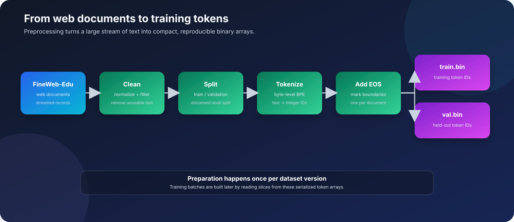
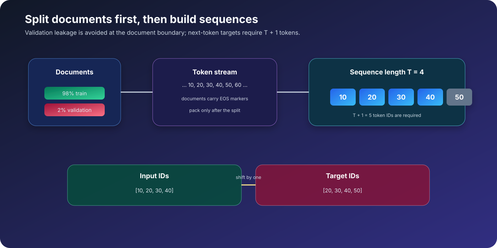

# Preparing the Pretraining Dataset

**Goal:** Stream real text, clean it, tokenize it, split it into training and validation data, and serialize the resulting token IDs for efficient training.

The BPE tokenizer now turns text into integers. The next problem is scale: a language model needs millions or billions of tokens, not a handful of example sentences.

Even a perfectly implemented Transformer will not learn useful language patterns from poor or leaky data. The preparation pipeline is therefore part of the model system, not an afterthought.



## 1. The complete data pipeline

The pipeline has these stages:

| Stage | Purpose | Output |
| --- | --- | --- |
| FineWeb-Edu | Read real web documents | Streamed records |
| Streaming | Avoid loading the full corpus into memory | One document at a time |
| Cleaning | Remove empty, short, or unusable records | Clean text |
| Document split | Keep evaluation data separate | Train or validation record |
| BPE tokenization | Convert text into integer IDs | Token sequence |
| EOS insertion | Mark document boundaries | Token sequence plus EOS |
| Binary serialization | Store compact arrays on disk | `train.bin`, `val.bin` |

The resulting files can later be read by a PyTorch data loader.

## 2. The dataset: FineWeb-Edu

We will use [FineWeb-Edu](https://huggingface.co/datasets/HuggingFaceFW/fineweb-edu), a large web corpus filtered and scored for educational quality. It provides document text and metadata such as quality scores.

The dataset includes sampled configurations such as `sample-10BT`, which contains approximately 10 billion GPT-2-tokenizer tokens. We will not download that entire sample for the first run. We will begin with a small document limit, verify the pipeline, and scale the token budget only after the output is trustworthy.

### Inspect a real document

The `datasets` package is included in `requirements.txt`:

```bash
python -m pip install -r requirements.txt
```

Then inspect one streamed record:

```python
from datasets import load_dataset


dataset = load_dataset(
    "HuggingFaceFW/fineweb-edu",
    name="sample-10BT",
    split="train",
    streaming=True,
)

sample = next(iter(dataset))
print("Available fields:", sample.keys())
print("\nDocument preview:\n")
print(sample["text"][:1000])
print("\nEducational score:", sample.get("score"))
```

Each record contains actual web text, not precomputed embeddings.

### Why `streaming=True`?

Suppose the dataset is 100 GB but the machine has only 32 GB of system RAM. Materializing the whole dataset would be wasteful or impossible.

With streaming, documents are read incrementally as the iterator advances. The dataset behaves like a long book that is read one page at a time instead of being copied into memory before reading begins.

## 3. Documents, tokens, and training examples

These quantities are different:

| Quantity | Meaning |
| --- | --- |
| Document | One text record from the dataset |
| Token | One integer ID produced by the tokenizer |
| Training example | A fixed-length sequence presented to the model |

Suppose we have 10,000 documents, each averaging 500 tokens:

```text
10,000 × 500 = 5,000,000 tokens
```

With a sequence length of 1,024, that produces approximately:

```text
5,000,000 ÷ 1,024 ≈ 4,882 complete sequences
```

This ignores leftovers, EOS handling, and any filtering that happens before packing. It also uses our tokenizer's token count; FineWeb-Edu's published count uses a different tokenizer and should not be treated as exact for this project.

## 4. Data cleaning: what should we keep?

Web text is messy. Some documents contain useful explanations; others contain navigation menus, repeated advertisements, short fragments, or corrupted text.

| Example | Decision | Reason |
| --- | --- | --- |
| `Photosynthesis is the process by which plants convert light energy...` | Keep | Substantial educational content |
| `Click here. Home. Login. Sign up.` | Remove | Very short and low information |
| `FREE FREE FREE!!! BUY NOW!!!` | Inspect or remove | Likely promotional or low-information |

For a first experiment, use a conservative filter:

```python
def clean_document(text: object) -> str | None:
    if not isinstance(text, str):
        return None

    text = text.replace("\r\n", "\n")
    text = text.replace("\r", "\n")
    text = text.replace("\x00", "")
    text = text.strip()

    if len(text) < 200:
        return None
    if len(text.split()) < 40:
        return None

    return text
```

These thresholds are practical starting choices, not FineWeb-Edu's official cleaning algorithm. A short but valuable code example or mathematical explanation could be removed by this filter.

For a serious pretraining run, we would also consider exact and near-duplicate removal, language distribution, code and mathematical content, personal information, licensing restrictions, evaluation contamination, and repeated boilerplate. Because FineWeb-Edu already applies upstream processing, adding filters blindly can remove useful data.

## 5. Train and validation data

Validation data measures performance on documents that were not used to update the model's weights.

| Split | Example share | Purpose |
| --- | ---: | --- |
| Training | 98% | Update model parameters |
| Validation | 2% | Measure held-out performance |

The exact percentage is a design choice, not a universal requirement.

### Split before packing tokens

If we concatenate every document first and then randomly split overlapping sequences, nearly identical text may appear in both training and validation. Instead, assign each complete cleaned document to a split before tokenization and packing.

A stable hash gives a deterministic assignment without keeping every document in memory:

```python
import hashlib


def document_split(text: str, val_fraction: float = 0.02) -> str:
    digest = hashlib.sha256(text.encode("utf-8")).digest()
    number = int.from_bytes(digest[:8], "big")
    fraction = number / (2**64)
    return "val" if fraction < val_fraction else "train"


text = "Photosynthesis converts light energy."
print(document_split(text))
print(document_split(text))  # deterministic
```

The validation fraction approaches 2% over many distinct documents, but a small sample can deviate. Hashing does not prevent near-duplicate documents from crossing the split; robust near-duplicate detection is a separate data-curation problem.



## 6. Store token IDs as binary arrays

Saving token IDs as text is easy to inspect:

```text
[15, 82, 7, 104, 21, 93, 4]
```

But commas, spaces, and decimal formatting waste storage. Training needs integer arrays, so we write the IDs directly in a binary format.

If the vocabulary has no more than 65,536 IDs, each token can fit in a 16-bit unsigned integer, `uint16`, which uses two bytes:

| Token count | `uint16` storage |
| ---: | ---: |
| 1 million | 2 MB |
| 100 million | 200 MB |
| 1 billion | 2 GB |

These are decimal storage estimates and exclude metadata and filesystem overhead.

For a 300–500-token educational vocabulary, `uint16` is more than sufficient. DeepSeek-V3's 129,280-token vocabulary exceeds the range of `uint16`, so a wider representation such as `uint32` would be required.

Always check that the maximum token ID fits the selected dtype before writing the file.

### Why use binary files?

NumPy memory mapping allows part of a large token file to be read without copying the entire array into RAM:

```python
import numpy as np


tokens = np.memmap(
    "data/processed/train.bin",
    dtype="<u2",
    mode="r",
)
```

This becomes valuable when the dataset contains hundreds of millions or billions of tokens.

## 7. Build the dataset-preparation script

The pipeline script will live at `src/data/prepare_data.py`. It will:

1. Stream FineWeb-Edu.
2. Reserve an initial sample exclusively for tokenizer training.
3. Fit the educational BPE tokenizer.
4. Filter and split subsequent documents.
5. Tokenize each document and append EOS.
6. Save compact binary token files and metadata.

### Save and load the tokenizer

Add persistence methods to `BPETokenizer` in `src/data/tokenizer.py` so the same vocabulary and merge order can be reused:

```python
import json
from pathlib import Path


def save(self, path: str | Path) -> None:
    state = {
        "vocab": {
            str(token_id): piece.hex()
            for token_id, piece in self.vocab.items()
        },
        "merges": [
            [left, right, new_id]
            for (left, right), new_id in self.merges.items()
        ],
        "eos_id": self.eos_id,
    }
    Path(path).write_text(json.dumps(state, indent=2), encoding="utf-8")


@classmethod
def load(cls, path: str | Path) -> "BPETokenizer":
    state = json.loads(Path(path).read_text(encoding="utf-8"))
    tokenizer = cls()
    tokenizer.vocab = {
        int(token_id): bytes.fromhex(piece)
        for token_id, piece in state["vocab"].items()
    }
    tokenizer.merges = {
        (left, right): new_id
        for left, right, new_id in state["merges"]
    }
    tokenizer.eos_id = state["eos_id"]
    return tokenizer
```

The merge order is part of the tokenizer state. Saving only the vocabulary pieces without the ordered merges would not guarantee the same encoding behavior after a restart.

### Prepare documents and write shards

The core loop has this shape:

```python
import json
from pathlib import Path

import numpy as np
from datasets import load_dataset

from src.data.tokenizer import BPETokenizer


OUTPUT_DIR = Path("data/processed")
MAX_DOCUMENTS = 5_000
VAL_FRACTION = 0.02


def main() -> None:
    OUTPUT_DIR.mkdir(parents=True, exist_ok=True)

    dataset = load_dataset(
        "HuggingFaceFW/fineweb-edu",
        name="sample-10BT",
        split="train",
        streaming=True,
    )

    # Collect a small, separate sample for tokenizer training.
    tokenizer_texts = []
    iterator = iter(dataset)
    while len(tokenizer_texts) < 1_000:
        record = next(iterator)
        text = clean_document(record.get("text"))
        if text is not None:
            tokenizer_texts.append(text)

    tokenizer = BPETokenizer()
    tokenizer.train(tokenizer_texts, vocab_size=350)
    tokenizer.save(OUTPUT_DIR / "tokenizer.json")

    dtype = np.dtype("<u2")
    writers = {
        "train": open(OUTPUT_DIR / "train.bin", "wb"),
        "val": open(OUTPUT_DIR / "val.bin", "wb"),
    }
    token_counts = {"train": 0, "val": 0}
    document_counts = {"train": 0, "val": 0}

    try:
        accepted = 0
        while accepted < MAX_DOCUMENTS:
            record = next(iterator)
            text = clean_document(record.get("text"))
            if text is None:
                continue

            split = document_split(text, VAL_FRACTION)
            ids = tokenizer.encode(text, add_eos=True)
            if max(ids) > np.iinfo(dtype).max:
                raise ValueError("Token ID exceeds dtype capacity")

            np.asarray(ids, dtype=dtype).tofile(writers[split])
            token_counts[split] += len(ids)
            document_counts[split] += 1
            accepted += 1
    finally:
        for writer in writers.values():
            writer.close()

    metadata = {
        "source": "HuggingFaceFW/fineweb-edu",
        "config": "sample-10BT",
        "tokenizer_vocab_size": tokenizer.vocab_size,
        "eos_id": tokenizer.eos_id,
        "dtype": dtype.str,
        "tokens": token_counts,
        "documents": document_counts,
        "tokenizer_training_documents": len(tokenizer_texts),
        "val_fraction": VAL_FRACTION,
    }
    (OUTPUT_DIR / "metadata.json").write_text(
        json.dumps(metadata, indent=2),
        encoding="utf-8",
    )


if __name__ == "__main__":
    main()
```

Run it from the repository root after the tokenizer persistence methods and helper functions exist:

```bash
python -m src.data.prepare_data
```

This is an educational pipeline. The simple BPE implementation repeatedly scans the corpus during training and applies merges sequentially during encoding, so it will be slow on large corpora. A production run would use an optimized tokenizer and restart-safe sharded output.

The documents used to train the tokenizer are intentionally excluded from model training and validation. For large-scale preprocessing, we would also add near-deduplication, shard-level statistics, versioned split manifests, reproducible source revisions, and restart-safe writing.

## 8. Inspect the generated files

After a successful small run, the processed directory should contain:

```text
data/processed/
├── tokenizer.json
├── train.bin
├── val.bin
└── metadata.json
```

An inspection script can read the metadata and memory-map the token files:

```python
import json

import numpy as np
from src.data.tokenizer import BPETokenizer


metadata = json.loads(
    open("data/processed/metadata.json", encoding="utf-8").read()
)
tokenizer = BPETokenizer.load("data/processed/tokenizer.json")
dtype = np.dtype(metadata["dtype"])
train = np.memmap("data/processed/train.bin", dtype=dtype, mode="r")

print("Training tokens:", len(train))
print("Vocabulary size:", tokenizer.vocab_size)
print("First 20 token IDs:", train[:20].tolist())

assert train.dtype == dtype
assert train.min() >= 0
assert train.max() < tokenizer.vocab_size
assert len(train) == metadata["tokens"]["train"]
print("Dataset checks passed!")
```

The important result is that `train.bin` contains real text converted into this project's tokenizer IDs. The files can be read again whenever the model is trained.

## 9. Dataset preparation versus training batches

These are different operations:

| Operation | When it happens | What it does |
| --- | --- | --- |
| Dataset preparation | Usually once per dataset version | Clean, tokenize, split, and serialize documents |
| Batch construction | During model training | Select windows and build input-target tensors |

Suppose a token file contains:

```text
[10, 20, 30, 40, 50, 60, 70, 80]
```

With sequence length `T = 4`, one training example is:

| Input IDs | Target IDs |
| --- | --- |
| 10 | 20 |
| 20 | 30 |
| 30 | 40 |
| 40 | 50 |

The target sequence is shifted one token forward. The model learns to predict each next token using the preceding context.

To construct an input sequence of length `T` and its `T` next-token targets, we need `T + 1` consecutive token IDs:

```text
required tokens = T + 1
```

The final input token still needs a next-token target. The data loader will implement this carefully when it turns the binary arrays into batches.

### Document boundaries

The binary file concatenates documents separated by EOS tokens. A fixed-length window can cross an EOS marker, so the model may attend to tokens from the previous document unless boundary-aware masking is added.

That is a separate decision from inserting EOS. For the first data loader, we will make the behavior explicit and keep the implementation simple.

## Recap

We covered:

1. Why large language models need carefully prepared training corpora.
2. What FineWeb-Edu provides and how streaming works.
3. How document counts, token counts, and sequence counts differ.
4. Basic filtering and reproducible train/validation separation.
5. EOS markers between documents.
6. Compact binary storage and NumPy memory mapping.
7. The difference between dataset preparation and training-batch construction.

The prepared token files are now ready for a data loader that creates fixed-length input-target pairs.
