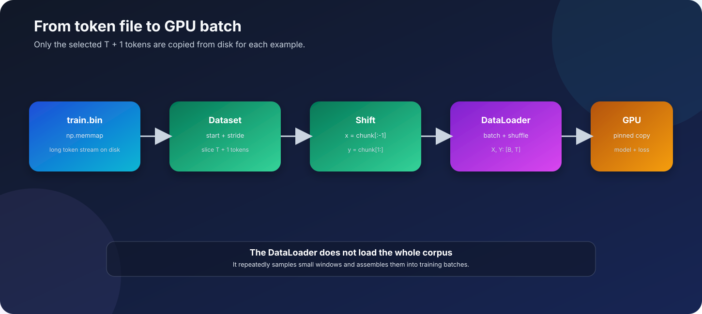

# Building the PyTorch DataLoader

**Goal:** Build the data-loading system that supplies training batches to the DeepSeek model.

The preparation pipeline converted FineWeb-Edu documents into token IDs and saved them in `train.bin` and `val.bin`. Now we need to transform those long token streams into input and target tensors.

We will implement sliding windows, batch sampling, memory mapping, and CPU-to-GPU transfers while keeping the tensor shapes explicit.



## 1. What does a DataLoader actually do?

Imagine that `train.bin` contains 100 million token IDs. We cannot feed all of them into the model at once. Instead, we divide the stream into smaller examples and combine those examples into batches.

There are two separate components:

| Component | Responsibility |
| --- | --- |
| `Dataset` | Retrieve one training example from the token stream |
| `DataLoader` | Combine examples into batches and deliver them |

The complete flow is:

```text
train.bin
    ↓
Dataset: choose a window and create input-target pairs
    ↓
DataLoader: sample and batch examples
    ↓
X: [batch, sequence], Y: [batch, sequence]
    ↓
GPU → DeepSeek → loss
```

## 2. Next-token prediction

Suppose the token stream contains:

```text
[10, 20, 30, 40, 50, 60, 70, 80]
```

With sequence length `T = 4`, one training example is:

| Position | Input token | Target token |
| ---: | ---: | ---: |
| 0 | 10 | 20 |
| 1 | 20 | 30 |
| 2 | 30 | 40 |
| 3 | 40 | 50 |

The input tensor is:

```text
X = [10, 20, 30, 40]
```

The target tensor is shifted by one position:

```text
Y = [20, 30, 40, 50]
```

The model produces a vocabulary distribution for each input position. Cross-entropy compares those predictions with the target IDs.

For sequence length `T = 4`, we need five consecutive tokens:

```text
required tokens = T + 1
```

This one-token shift is fundamental to autoregressive language-model training.

## 3. Sliding windows

To create multiple examples from one token stream, slide a window across the data.

For a sequence length of four and a window beginning at token 40:

```text
Token stream: [10, 20, 30, 40, 50, 60, 70, 80]

Input X:      [40, 50, 60, 70]
Target Y:     [50, 60, 70, 80]
```

The distance between consecutive window starts is the **stride**:

- Stride 1: move one token forward each time.
- Stride 4: move four tokens forward each time.
- Random sampling: choose valid starts in a randomized order.

### Why not always use stride 1?

For a sequence length of 1,024, two adjacent stride-1 examples share 1,023 input tokens. That creates a large amount of repeated computation.

Random sampling or larger strides reduce that redundancy while still providing useful contexts. The first implementation will use a map-style sliding-window dataset that supports sequential or randomized example selection.

## 4. What reaches the GPU?

Suppose:

- Batch size = 8
- Sequence length = 1,024
- Hidden dimension = 256
- Vocabulary size = 8,192

The shapes are:

| Tensor | Shape |
| --- | --- |
| Input token IDs | `[8, 1024]` |
| Token embeddings | `[8, 1024, 256]` |
| Transformer output | `[8, 1024, 256]` |
| Vocabulary logits | `[8, 1024, 8192]` |
| Target IDs | `[8, 1024]` |

There are `8 × 1,024 = 8,192` target positions in each batch. The logits contain:

```text
8 × 1,024 × 8,192 = 67,108,864 values
```

At two bytes per BF16 value, the raw logits alone require approximately 134 MB. A modest batch can therefore create large intermediate tensors.

The data loader transfers integer IDs and targets. The GPU computes embeddings, hidden states, logits, and loss during the forward and backward passes.

## 5. Implement the dataset

The prepared files are stored under:

```text
data/processed/
├── train.bin
├── val.bin
├── tokenizer.json
└── metadata.json
```

The dataset should read these files without loading all tokens into RAM. Use `np.memmap` and PyTorch's `Dataset`.

Create `src/data/dataset.py`:

```python
import json
from pathlib import Path

import numpy as np
import torch
from torch.utils.data import Dataset


class TokenDataset(Dataset):
    def __init__(
        self,
        data_dir: str | Path,
        split: str = "train",
        seq_len: int = 1024,
        stride: int = 1024,
    ) -> None:
        data_dir = Path(data_dir)
        if split not in {"train", "val"}:
            raise ValueError("split must be train or val")
        if seq_len <= 0 or stride <= 0:
            raise ValueError("seq_len and stride must be positive")

        metadata = json.loads(
            (data_dir / "metadata.json").read_text(encoding="utf-8")
        )
        self.seq_len = seq_len
        self.stride = stride
        self.tokens = np.memmap(
            data_dir / f"{split}.bin",
            dtype=np.dtype(metadata["dtype"]),
            mode="r",
        )

        self.num_tokens = len(self.tokens)
        if self.num_tokens < seq_len + 1:
            raise ValueError("Not enough tokens for one example")

        self.num_examples = (
            (self.num_tokens - seq_len - 1) // stride
        ) + 1

    def __len__(self) -> int:
        return self.num_examples

    def __getitem__(self, index: int) -> tuple[torch.Tensor, torch.Tensor]:
        if not 0 <= index < self.num_examples:
            raise IndexError(index)

        start = index * self.stride
        end = start + self.seq_len + 1
        chunk = np.array(self.tokens[start:end], dtype=np.int64, copy=True)
        chunk = torch.from_numpy(chunk)

        return chunk[:-1], chunk[1:]
```

### What does `np.memmap` do?

This loads the whole file into memory:

```python
tokens = np.fromfile("train.bin", dtype=np.uint16)
```

For a billion `uint16` tokens, that is approximately 2 GB. Memory mapping leaves the file on disk and lets the operating system load only the pages needed by each window.

```python
tokens = np.memmap("train.bin", dtype=np.uint16, mode="r")
```

### What happens inside `__getitem__`?

For:

```text
seq_len = 4
stride = 1
index = 2
```

the start position is:

```text
start = index × stride = 2
```

The dataset reads five tokens:

```text
[30, 40, 50, 60, 70]
```

and returns:

```text
x = [30, 40, 50, 60]
y = [40, 50, 60, 70]
```

The compact disk dtype is converted to `torch.long` only for the selected window because embedding layers expect integer indices, usually `torch.int64`.

## 6. Count the windows

Suppose the file contains `N = 1,000` token IDs, the sequence length is `T = 100`, and the stride is `S = 50`.

The last valid start is:

```text
N - T - 1 = 899
```

The valid starts are:

```text
0, 50, 100, …, 850
```

The number of examples is:

```text
examples = floor((N - T - 1) / S) + 1
         = floor(899 / 50) + 1
         = 18
```

Different strides produce different overlap:

| Stride | Examples | Characteristic |
| ---: | ---: | --- |
| 1 | 900 | Heavy overlap |
| 10 | 90 | Substantial overlap |
| 50 | 18 | Moderate overlap |
| 100 | 9 | Nearly non-overlapping inputs |

When stride equals sequence length, adjacent targets still share one boundary token, but almost all input positions are distinct. That is a reasonable efficient baseline for the first experiments.

## 7. Build the DataLoader

Create `src/data/dataloader.py`:

```python
import torch
from torch.utils.data import DataLoader

from src.data.dataset import TokenDataset


def create_dataloader(
    data_dir: str,
    split: str = "train",
    batch_size: int = 8,
    seq_len: int = 1024,
    stride: int | None = None,
    num_workers: int = 0,
) -> DataLoader:
    if stride is None:
        stride = seq_len

    dataset = TokenDataset(
        data_dir=data_dir,
        split=split,
        seq_len=seq_len,
        stride=stride,
    )
    use_cuda = torch.cuda.is_available()

    return DataLoader(
        dataset,
        batch_size=batch_size,
        shuffle=(split == "train"),
        num_workers=num_workers,
        pin_memory=use_cuda,
        drop_last=(split == "train"),
    )
```

Important arguments:

| Argument | Meaning |
| --- | --- |
| `batch_size=8` | Combine eight examples into one batch |
| `shuffle=True` | Randomize training-window order |
| `num_workers=0` | Load samples in the main process initially |
| `pin_memory=True` | Use page-locked CPU memory for CUDA transfers |
| `drop_last=True` | Keep training batches the same size |

Start with `num_workers=0` because it is simple and reliable in notebooks. More workers are not automatically faster; the result depends on preprocessing cost, CPU speed, storage, and batch size.

### Test the DataLoader

```python
from src.data.dataloader import create_dataloader


loader = create_dataloader(
    data_dir="data/processed",
    split="train",
    batch_size=4,
    seq_len=128,
    stride=128,
)

x, y = next(iter(loader))
print("Input shape:", x.shape)
print("Target shape:", y.shape)
print("First 10 input IDs:", x[0, :10])
print("First 10 target IDs:", y[0, :10])

assert x.shape == (4, 128)
assert y.shape == (4, 128)
assert (x[:, 1:] == y[:, :-1]).all()
```

Expected shapes:

```text
Input shape: torch.Size([4, 128])
Target shape: torch.Size([4, 128])
```

The final assertion checks:

```text
X[:, 1:] = Y[:, :-1]
```

The target is always the input shifted by one token. If the preparation sample contains fewer than four full windows, reduce `batch_size` or `seq_len` while testing.

## 8. Transfer batches to the GPU

The data loader returns CPU tensors. Transfer each batch to the selected device before the model forward pass:

```python
import torch

from src.data.dataloader import create_dataloader


device = torch.device("cuda" if torch.cuda.is_available() else "cpu")
loader = create_dataloader(
    data_dir="data/processed",
    batch_size=4,
    seq_len=128,
)

x, y = next(iter(loader))
print("Before transfer:", x.device)

x = x.to(device, non_blocking=True)
y = y.to(device, non_blocking=True)

print("After transfer:", x.device)
print("Input shape:", x.shape)
```

On a CUDA machine, the output will look like:

```text
Before transfer: cpu
After transfer: cuda:0
Input shape: torch.Size([4, 128])
```

`pin_memory=True` enables transfers from page-locked host memory. `non_blocking=True` permits asynchronous transfers where supported, but effective overlap also requires appropriate buffering and stream management. Correctness comes first.

## 9. Connect the DataLoader to the model

The complete flow is now:

```text
Tokenizer
    ↓
Preprocessed FineWeb-Edu data
    ↓
Dataset and DataLoader
    ↓
Model skeleton
    ↓
Logits and loss
```

The model receives:

```python
input_ids.shape == (batch_size, sequence_length)
targets.shape == (batch_size, sequence_length)
```

The model produces logits with shape:

```text
[batch_size, sequence_length, vocabulary_size]
```

The data loader is responsible only for retrieving and batching IDs. It does not embed tokens, apply attention, or compute loss.

## 10. Test the dataset logic with a tiny file

Before using millions of real tokens, test the window logic with a temporary synthetic file. Create `src/tests/test_dataset.py`:

```python
import json

import numpy as np

from src.data.dataset import TokenDataset


def test_window_and_target_shift(tmp_path) -> None:
    tokens = np.array(
        [10, 20, 30, 40, 50, 60, 70, 80],
        dtype="<u2",
    )
    tokens.tofile(tmp_path / "train.bin")
    (tmp_path / "metadata.json").write_text(
        json.dumps({"dtype": "<u2"}),
        encoding="utf-8",
    )

    dataset = TokenDataset(
        data_dir=tmp_path,
        split="train",
        seq_len=4,
        stride=1,
    )

    assert len(dataset) == 4
    x, y = dataset[0]
    assert x.tolist() == [10, 20, 30, 40]
    assert y.tolist() == [20, 30, 40, 50]

    x2, y2 = dataset[2]
    assert x2.tolist() == [30, 40, 50, 60]
    assert y2.tolist() == [40, 50, 60, 70]
```

Run it with:

```bash
python -m pytest src/tests/test_dataset.py -v
```

This catches off-by-one errors before the dataset becomes large.

## 11. Measure data-loading throughput

A fast GPU is useful only when the input pipeline can supply it. Measure CPU-side loader throughput with a short benchmark:

```python
import time

from src.data.dataloader import create_dataloader


loader = create_dataloader(
    data_dir="data/processed",
    batch_size=8,
    seq_len=128,
    num_workers=0,
)

total_tokens = 0
start = time.perf_counter()

for step, (x, _) in enumerate(loader):
    total_tokens += x.numel()
    if step >= 49:
        break

elapsed = time.perf_counter() - start
print(f"Tokens processed: {total_tokens:,}")
print(f"Elapsed seconds: {elapsed:.3f}")
print(f"Tokens/second: {total_tokens / elapsed:,.0f}")
```

This measures CPU-side data-loader throughput, not complete model-training throughput. A realistic benchmark would include GPU transfers and compare data loading alone, model forward/backward, and the combined pipeline.

## Recap

The data loader now has a clear contract:

- Token files store a long sequence of integer IDs.
- The dataset retrieves windows of `T + 1` tokens.
- Inputs and targets are offset by one token.
- The DataLoader groups examples into `[B, T]` batches.
- Memory mapping avoids loading the entire corpus into RAM.
- The GPU receives token IDs; the model computes embeddings and representations.

The next architectural step is to implement token embeddings and RMSNorm, then replace the model skeleton with real Transformer computations.
