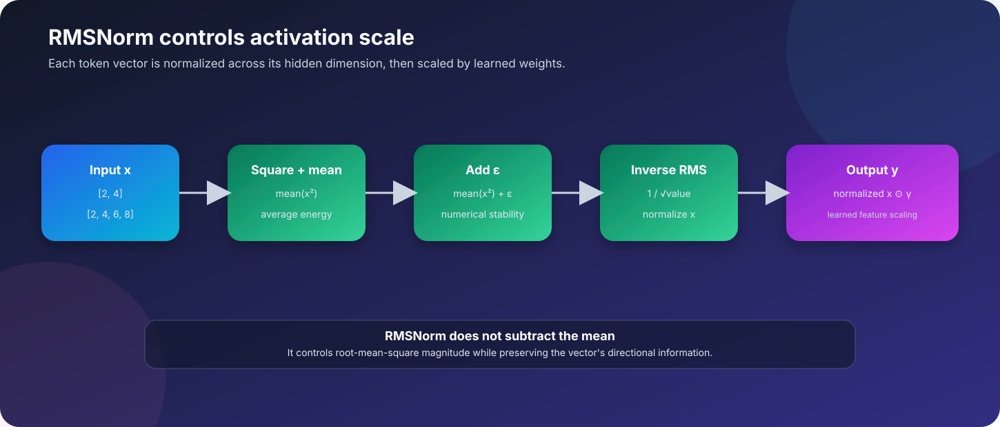
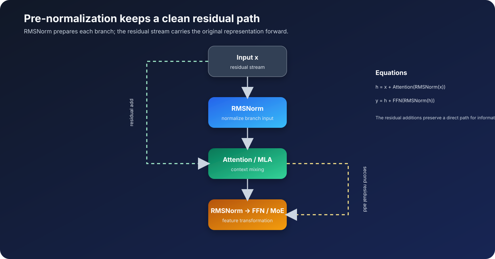

# Token Embeddings and RMSNorm From Scratch

**Goal:** Understand token embeddings, learn why Transformer networks use normalization, implement RMSNorm in PyTorch, and integrate it into the DeepSeek model skeleton.

We will focus on:

1. What token embeddings do inside DeepSeek.
2. Why normalization is necessary.
3. How RMSNorm differs from LayerNorm.
4. How RMSNorm fits before attention and feed-forward layers.
5. How to test numerical values, gradients, and low-precision behavior.



## 1. Where are we in the implementation?

The current data flow is:

```text
Token IDs [B, T]
    ↓
Token embeddings [B, T, D]
    ↓
RMSNorm [B, T, D]
    ↓
Attention → feed-forward layers
    ↓
Vocabulary logits [B, T, V]
```

DeepSeek-V3 uses RMSNorm before its attention and feed-forward sublayers, as well as a final normalization before the output projection. RMSNorm is also used inside parts of MLA.

We will implement the reusable RMSNorm component without pretending that it is already a complete Transformer block. Causal attention and feed-forward layers come later.

## 2. Why does a Transformer need normalization?

Imagine that the token `France` is represented by:

```text
x = [2, 4, 6, 8]
```

After several layers, its representation might become:

```text
x' = [200, 400, 600, 800]
```

The direction is unchanged, but the magnitude is 100 times larger. Changes in activation scale can affect attention logits, nonlinearities, gradients, and numerical stability.

Normalization helps manage these scales. The goal is not to make every vector identical; it is to control scale while preserving useful differences between vectors.

## 3. RMSNorm with a numerical example

RMSNorm means **Root Mean Square Normalization**. Start with:

```text
x = [2, 4]
```

The calculation is:

```text
x² = [4, 16]
mean(x²) = (4 + 16) / 2 = 10
RMS(x) = √10 ≈ 3.1623
x̂ = [2 / 3.1623, 4 / 3.1623]
  ≈ [0.6325, 1.2649]
```

The output values are not restricted to `[-1, 1]`. RMSNorm is not min-max normalization. Instead:

```text
(0.6325² + 1.2649²) / 2 ≈ 1
```

Scaling both input coordinates by the same positive factor leaves the normalized values almost unchanged, except when the epsilon term becomes significant. This is RMSNorm's approximate scale invariance.

## 4. The RMSNorm formula

For a hidden vector of dimension `D`:

```text
RMSNorm(x) = x / sqrt(mean(x²) + ε) ⊙ γ
```

| Symbol | Meaning |
| --- | --- |
| `x` | Input vector |
| `D` | Hidden dimension |
| `ε` | Numerical-stability constant |
| `γ` | Learnable scaling vector |
| `⊙` | Element-wise multiplication |

DeepSeek-V3 uses an RMSNorm epsilon of `1e-6` in its model configuration.

### Why do we need gamma?

Suppose normalization produces:

```text
x̂ = [0.6325, 1.2649]
```

If the learned scale is:

```text
γ = [2, 0.5]
y = x̂ ⊙ γ = [1.2649, 0.6325]
```

Gamma lets the model learn how strongly each feature should contribute after normalization. It starts at 1 for every feature, and gradient descent adjusts it during training.

RMSNorm has exactly `D` learnable parameters. With `dim=256`, it adds only 256 parameters.

## 5. RMSNorm versus LayerNorm

- **LayerNorm:** subtracts the mean, then normalizes by standard deviation.
- **RMSNorm:** does not subtract the mean; it normalizes by root mean square.

For `x = [2, 4, 6]`, LayerNorm has mean `μ = 4` and centered values:

```text
x - μ = [-2, 0, 2]
variance = ((-2)² + 0² + 2²) / 3 = 8 / 3
LayerNorm(x) ≈ [-1.2247, 0, 1.2247]
```

RMSNorm instead computes:

```text
sqrt((4 + 16 + 36) / 3) = sqrt(56 / 3) ≈ 4.3205
RMSNorm(x) ≈ [0.4629, 0.9258, 1.3887]
```

| Property | LayerNorm | RMSNorm |
| --- | --- | --- |
| Subtracts mean | Yes | No |
| Controls activation scale | Yes | Yes |
| Learned scaling | Yes | Yes |
| Learned bias in standard version | Yes | No |
| Common in modern LLMs | Yes | Yes |

RMSNorm is also not L2 normalization. L2 normalization divides by `sqrt(sum(x²))`, while RMSNorm divides by `sqrt((1 / D) × sum(x²))`. Ignoring epsilon and gamma:

```text
RMSNorm(x) = sqrt(D) × x / ||x||₂
```

An RMS-normalized `D`-dimensional vector therefore has L2 norm approximately `sqrt(D)`, not 1.

## 6. Implement RMSNorm in PyTorch

Create `src/model/rmsnorm.py`:

```python
import torch
from torch import nn


class RMSNorm(nn.Module):
    def __init__(self, dim: int, eps: float = 1e-6) -> None:
        super().__init__()
        self.eps = eps
        self.weight = nn.Parameter(torch.ones(dim))

    def forward(self, x: torch.Tensor) -> torch.Tensor:
        original_dtype = x.dtype
        x_float = x.float()
        mean_square = x_float.pow(2).mean(dim=-1, keepdim=True)
        inv_rms = torch.rsqrt(mean_square + self.eps)
        x_norm = (x_float * inv_rms).to(original_dtype)
        return x_norm * self.weight
```

The statistics are calculated in FP32 for stability, then the normalized activations are cast back to the input dtype before gamma is applied.

For an input with shape `[2, 5, 256]`, `mean_square` has shape `[2, 5, 1]`: one value for each token vector. Broadcasting applies the 256 learned weights to every token.

## 7. Numerical correctness

```python
import torch

from src.model.rmsnorm import RMSNorm


norm = RMSNorm(dim=2, eps=1e-6)
x = torch.tensor([[2.0, 4.0]])
y = norm(x)
expected = x / torch.sqrt(
    x.square().mean(dim=-1, keepdim=True) + 1e-6
)

torch.testing.assert_close(y, expected)
print("Numerical test passed!")
```

The result is approximately `[0.6325, 1.2649]`.

## 8. Compare with PyTorch's implementation

```python
import torch
from torch import nn

from src.model.rmsnorm import RMSNorm


torch.manual_seed(42)
dim = 256
ours = RMSNorm(dim=dim, eps=1e-6)
reference = nn.RMSNorm(dim, eps=1e-6)

with torch.no_grad():
    reference.weight.copy_(ours.weight)

x = torch.randn(2, 16, dim)
torch.testing.assert_close(
    ours(x),
    reference(x),
    atol=1e-5,
    rtol=1e-5,
)
print("Our implementation matches PyTorch RMSNorm!")
```

Small FP32 differences can come from operation ordering and numerical precision.

## 9. Why RMSNorm comes before attention

DeepSeek-V3 follows a **pre-normalization** structure:



The simplified equations are:

```text
h = x + Attention(RMSNorm(x))
y = h + FFN(RMSNorm(h))
```

Residual additions provide a direct path for information and gradients. The exact block uses MLA for attention and either a dense FFN or MoE depending on the layer.

In a post-normalized block:

```text
y = Norm(x + F(x))
```

In a pre-normalized block:

```text
y = x + F(Norm(x))
```

RMSNorm normalizes the inputs to the computation branches, not every residual addition afterward.

## 10. Integrate RMSNorm into the model

The full Transformer is not ready because causal attention and the feed-forward network have not been implemented. We can still add a final RMSNorm to `src/model/deepseek.py`:

```python
import torch
from torch import nn

from .config import DeepSeekConfig
from .embeddings import TokenEmbedding
from .rmsnorm import RMSNorm


class DeepSeekSkeleton(nn.Module):
    def __init__(self, config: DeepSeekConfig) -> None:
        super().__init__()
        self.config = config
        self.embed_tokens = TokenEmbedding(config)
        self.norm = RMSNorm(config.dim, eps=1e-6)
        self.lm_head = nn.Linear(config.dim, config.vocab_size, bias=False)

    def forward(self, input_ids: torch.Tensor) -> torch.Tensor:
        if input_ids.ndim != 2:
            raise ValueError("Expected input_ids with shape [batch, sequence]")
        if input_ids.shape[1] > self.config.max_seq_len:
            raise ValueError("Sequence exceeds maximum length")

        x = self.embed_tokens(input_ids)
        x = self.norm(x)
        return self.lm_head(x)
```

RMSNorm adds `config.dim = 256` gamma parameters. The parameter count changes from:

```text
4,194,304
```

to:

```text
4,194,304 + 256 = 4,194,560
```

Update the parameter-count test:

```python
expected = 2 * config.vocab_size * config.dim + config.dim
```

## 11. Input magnitude and gradient flow

RMSNorm should keep output scale stable when the input is multiplied by different factors:

```python
import torch

from src.model.rmsnorm import RMSNorm


torch.manual_seed(42)
norm = RMSNorm(dim=256)
x = torch.randn(1, 256)

for scale in [0.1, 1.0, 10.0, 100.0]:
    y = norm(x * scale)
    input_rms = (x * scale).square().mean().sqrt()
    output_rms = y.square().mean().sqrt()
    print(scale, input_rms.item(), output_rms.item())
```

With gamma initialized to 1, output RMS should remain close to 1 while input RMS changes by orders of magnitude. After training, gamma can change individual feature scales.

The input and gamma must also receive gradients:

```python
import torch

from src.model.rmsnorm import RMSNorm


norm = RMSNorm(dim=256)
x = torch.randn(2, 16, 256, requires_grad=True)
norm(x).square().mean().backward()

assert x.grad is not None
assert norm.weight.grad is not None
assert torch.isfinite(x.grad).all()
assert torch.isfinite(norm.weight.grad).all()
```

## 12. BF16 numerical stability

The normalization statistic is intentionally computed in FP32:

```python
x_float = x.float()
mean_square = x_float.pow(2).mean(dim=-1, keepdim=True)
```

This reduces the risk of overflow or loss of precision when the input activation is BF16. Because gamma remains FP32, the output may be promoted to FP32 in this readable implementation.

## 13. Add RMSNorm tests

Create `src/tests/test_rmsnorm.py`:

```python
import torch

from src.model.rmsnorm import RMSNorm


def test_zero_input() -> None:
    norm = RMSNorm(256)
    x = torch.zeros(2, 16, 256)
    torch.testing.assert_close(norm(x), x)


def test_backward() -> None:
    norm = RMSNorm(256)
    x = torch.randn(2, 16, 256, requires_grad=True)
    norm(x).square().mean().backward()

    assert x.grad is not None
    assert norm.weight.grad is not None
    assert torch.isfinite(x.grad).all()
    assert torch.isfinite(norm.weight.grad).all()


def test_scale_invariance() -> None:
    norm = RMSNorm(256, eps=1e-6)
    x = torch.randn(2, 16, 256)
    torch.testing.assert_close(norm(x), norm(x * 10), atol=1e-4, rtol=1e-4)
```

Run the tests with:

```bash
python -m pytest src/tests/test_rmsnorm.py -v
```

## Recap

We covered:

1. Why token representations need controlled activation scale.
2. How RMSNorm computes a root-mean-square statistic.
3. Why RMSNorm differs from LayerNorm and L2 normalization.
4. How pre-normalization and residual connections fit together.
5. How to implement and test RMSNorm.
6. Why FP32 statistics can improve BF16 numerical stability.

The next architectural step is causal multi-head attention, where one token's representation can finally depend on previous tokens.
