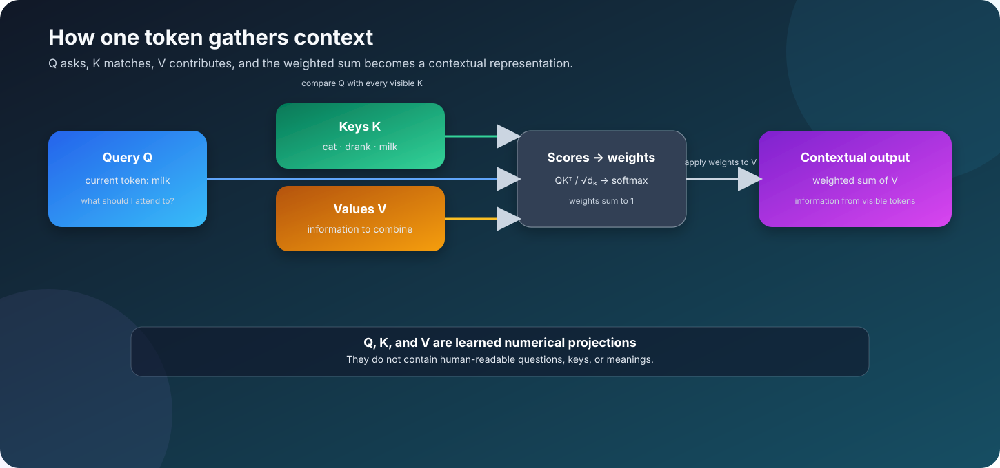
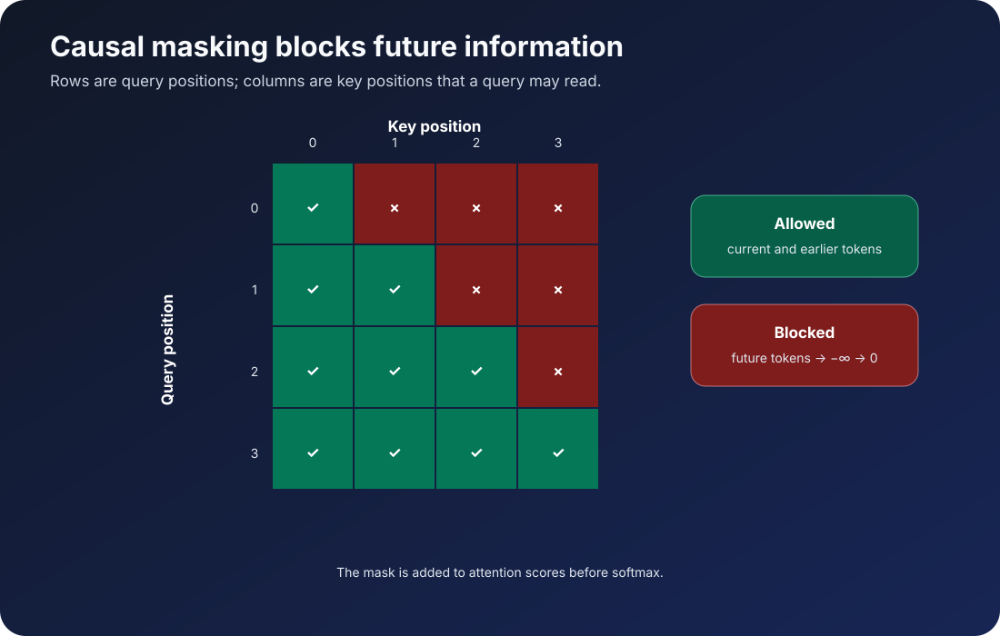

# Causal Self-Attention From Scratch

Attention is the part of a language model that lets each token use information from the tokens around it. Before adding rotary position information or the later DeepSeek attention design, it is useful to build the basic causal version carefully.

## 1. Why attention is necessary

A simple language model might look like this:

```text
Token IDs -> Token embeddings -> RMSNorm -> LM head -> Next-token prediction
```

That gives every token an embedding, but an embedding by itself does not describe the token's meaning in its sentence.

Consider the word `bank`:

```text
I deposited money at the bank.
The boat reached the river bank.
```

The word is the same, but the surrounding words change its meaning. A language model needs a way to mix information between token positions so that each position can build a context-dependent representation.

Self-attention does this by allowing every position to look at other positions in the same sequence. In an autoregressive language model, the look-up must be causal: a token may use the current and earlier tokens, but never a future token.



## 2. Queries, keys, and values

For every token representation, attention learns three different views:

- A **query** describes the information this position is looking for.
- A **key** describes the information this position offers for matching.
- A **value** contains the representation that is mixed into the output.

These names are useful intuition, but they are learned numerical vectors rather than literal questions, labels, or database records.

For a sequence with hidden-state matrix `X`, the projections are:

```text
Q = X W_Q
K = X W_K
V = X W_V
```

If `X` has shape `[T, D]`, then each projection can produce `[T, d_head]`. Separate projections let the model learn different spaces for matching and information transfer.

For example, in:

```text
The cat drank milk
```

the representation at `milk` may find the earlier words useful when predicting what comes next. The learned attention scores determine how much information is taken from each visible position.

## 3. Computing attention scores

The similarity between every query and key is computed with a matrix multiplication:

```text
scores = Q K^T
```

The dot products grow with the key dimension, so they are scaled before softmax:

```text
scores = (Q K^T) / sqrt(d_head)
```

Softmax converts each row into weights that sum to one. The output is the weighted combination of values:

```text
attention_output = softmax(scores) V
```

### A small numerical example

Suppose three tokens have these query and key vectors:

```text
Q = K = [[1, 0],
         [0, 1],
         [1, 1]]

V = [[10],
     [20],
     [30]]
```

For the third token, the query is `[1, 1]`. Its unscaled scores are:

```text
[1, 1, 2]
```

With `d_head = 2`, scaling gives approximately:

```text
[0.707, 0.707, 1.414]
```

The softmax weights are approximately:

```text
[0.248, 0.248, 0.503]
```

The resulting value is therefore:

```text
0.248 * 10 + 0.248 * 20 + 0.503 * 30 = 22.55
```

The output is not a copy of one token. It is a learned mixture of the visible values.

## 4. Causal masking

During next-token prediction, position `t` must not see positions greater than `t`. Otherwise the model could read the answer while training.

Before softmax, future scores are replaced with negative infinity. Their softmax probability becomes zero:

```text
causal_scores = scores + mask
attention = softmax(causal_scores) V
```

For a sequence of length three, the mask has this shape:



```text
visible positions:
        0  1  2
    0   1  0  0
    1   1  1  0
    2   1  1  1
```

The complete single-head equation is:

```text
Attention(Q, K, V) = softmax((Q K^T) / sqrt(d_head) + M) V
```

The mask is applied before softmax, not after it. Masking after softmax would leave probability mass in the wrong places.

## 5. A single attention head in PyTorch

The following implementation keeps the tensor operations visible:

```python
import math

import torch


def causal_attention(q: torch.Tensor,
                     k: torch.Tensor,
                     v: torch.Tensor) -> torch.Tensor:
    """Compute single-head causal attention for [batch, time, channels]."""
    _, time, head_dim = q.shape
    scores = q @ k.transpose(-2, -1)
    scores = scores / math.sqrt(head_dim)

    future = torch.triu(
        torch.ones(time, time, device=q.device, dtype=torch.bool),
        diagonal=1,
    )
    scores = scores.masked_fill(future, float("-inf"))
    weights = torch.softmax(scores, dim=-1)
    return weights @ v
```

For input shape `[B, T, d_head]`, the score and weight matrices have shape `[B, T, T]`. The two time dimensions are important: each query position receives one weight for every key position.

## 6. Why the attention matrix can be expensive

The attention matrix grows quadratically with sequence length. At `T = 1024`:

```text
T * T = 1,048,576 scores per head and batch item
```

With batch size `4` and `8` heads:

```text
4 * 8 * 1024 * 1024 = 33,554,432 scores
```

In BF16, that is roughly 67 MB just for one score tensor. This is one reason long-context attention and the KV cache require careful memory design.

## 7. From one head to multi-head attention

One attention head can learn one type of relationship. Multi-head attention runs several smaller heads in parallel. Each head has its own projected subspace, and their outputs are joined afterward.

For a small configuration:

```text
hidden size D = 256
number of heads H = 8
head size d_head = D / H = 32
```

The main shape changes are:

| Tensor | Shape |
| --- | --- |
| Input | `[B, T, 256]` |
| Q, K, V before splitting | `[B, T, 256]` |
| Q, K, V after splitting | `[B, 8, T, 32]` |
| Attention scores | `[B, 8, T, T]` |
| Weighted values | `[B, 8, T, 32]` |
| Merged heads | `[B, T, 256]` |
| Output projection | `[B, T, 256]` |

The transpose from `[B, T, H, d_head]` to `[B, H, T, d_head]` puts the head dimension before the two sequence dimensions. That makes the batched score multiplication straightforward.

## 8. The reusable attention layer

Create `src/model/attention.py` with a complete multi-head implementation:

```python
import math

import torch
from torch import nn


class CausalSelfAttention(nn.Module):
    """Readable multi-head causal self-attention."""

    def __init__(self, dim: int, n_heads: int, max_seq_len: int) -> None:
        super().__init__()
        if dim % n_heads != 0:
            raise ValueError("dim must be divisible by n_heads")

        self.dim = dim
        self.n_heads = n_heads
        self.head_dim = dim // n_heads

        self.q_proj = nn.Linear(dim, dim, bias=False)
        self.k_proj = nn.Linear(dim, dim, bias=False)
        self.v_proj = nn.Linear(dim, dim, bias=False)
        self.out_proj = nn.Linear(dim, dim, bias=False)

        future = torch.triu(
            torch.ones(max_seq_len, max_seq_len, dtype=torch.bool),
            diagonal=1,
        )
        self.register_buffer("future_mask", future, persistent=False)

    def _split_heads(self, x: torch.Tensor) -> torch.Tensor:
        batch, time, _ = x.shape
        x = x.view(batch, time, self.n_heads, self.head_dim)
        return x.transpose(1, 2)

    def forward(self, x: torch.Tensor) -> torch.Tensor:
        batch, time, _ = x.shape
        if time > self.future_mask.size(0):
            raise ValueError("sequence is longer than max_seq_len")

        q = self._split_heads(self.q_proj(x))
        k = self._split_heads(self.k_proj(x))
        v = self._split_heads(self.v_proj(x))

        scores = q @ k.transpose(-2, -1)
        scores = scores / math.sqrt(self.head_dim)
        mask = self.future_mask[:time, :time]
        scores = scores.masked_fill(mask, float("-inf"))

        weights = torch.softmax(scores, dim=-1)
        attended = weights @ v
        attended = attended.transpose(1, 2).contiguous()
        attended = attended.view(batch, time, self.dim)
        return self.out_proj(attended)
```

The four projections each contain `D * D` weights. With `D = 256`, the attention projections contain:

```text
4 * 256 * 256 = 262,144 parameters
```

This count excludes biases because the implementation uses bias-free projections.

## 9. Position inside a transformer block

Attention is used inside a residual block. With pre-normalization, the flow is:

```python
class AttentionBlock(nn.Module):
    def __init__(self, dim: int, n_heads: int, max_seq_len: int) -> None:
        super().__init__()
        self.attn_norm = RMSNorm(dim)
        self.attention = CausalSelfAttention(dim, n_heads, max_seq_len)

    def forward(self, x: torch.Tensor) -> torch.Tensor:
        return x + self.attention(self.attn_norm(x))
```

The residual connection preserves the incoming representation while attention contributes contextual information. The feed-forward sublayer and rotary position information will be added later; this small block is intentionally limited to attention and normalization.

The attention-only model should then:

1. Look up token embeddings.
2. Pass the sequence through the attention blocks.
3. Apply a final RMSNorm.
4. Project hidden states to vocabulary logits.

For the current source layout, the model pieces belong in:

```text
src/model/attention.py
src/model/transformer.py
src/model/deepseek.py
src/tests/test_attention.py
```

## 10. Verifying the implementation

The most important tests check behavior, not only whether the code runs.

### Output shape

For input `[B, T, D]`, the result must also be `[B, T, D]`.

### Future-token isolation

Run the same prefix twice. Change only a later token, then compare the earlier outputs. The outputs at earlier positions must remain unchanged. If they change, the causal mask is incorrect.

### Gradients

Run a scalar loss through the layer and check that every projection receives finite gradients.

### Parameter count

For bias-free projections, verify `4 * D * D` attention parameters. A count mismatch often means a projection was duplicated or a bias was added unexpectedly.

The checks can be run with:

```bash
python -m pytest src/tests/test_attention.py -v
```

## 11. Connecting attention to a batch

Once the layer is integrated with the existing data loader, a forward pass should look like this:

```python
import torch
import torch.nn.functional as F

from src.data.dataloader import create_dataloader
from src.model import DeepSeekConfig, DeepSeekSkeleton

config = DeepSeekConfig(
    vocab_size=8192,
    dim=256,
    n_heads=8,
    n_layers=6,
    max_seq_len=128,
)

loader = create_dataloader(
    data_dir="data/processed",
    split="train",
    batch_size=4,
    seq_len=config.max_seq_len,
)
model = DeepSeekSkeleton(config)
input_ids, target_ids = next(iter(loader))
logits = model(input_ids)
loss = F.cross_entropy(
    logits.view(-1, config.vocab_size),
    target_ids.view(-1),
)
loss.backward()
```

The tensors should have these shapes:

```text
input_ids: [B, T]
hidden states: [B, T, D]
logits: [B, T, vocab_size]
targets: [B, T]
```

This connects the token batches to the first real contextual model computation. The loss is still ordinary next-token cross-entropy; the new behavior comes from the causal attention layer.

## 12. Parameter accounting

For an attention-only stack with vocabulary size `V`, hidden size `D`, and `L` blocks, a useful estimate is:

```text
P = 2 * V * D + (4 * D^2 + D) * L + D
```

The first term accounts for input embeddings and the output head when they are not tied. Each block contributes four attention projections and one RMSNorm scale. The last term is the final RMSNorm scale.

This is a bookkeeping estimate, not a replacement for inspecting `model.parameters()`. It becomes more complicated once feed-forward layers, MoE experts, position projections, and additional prediction heads are added.

## 13. Why this leads toward MLA

Standard multi-head attention stores keys and values for every previous token during autoregressive generation. A toy layer with eight heads and head size 32 stores:

```text
2 * 8 * 32 = 512 values per token and layer
```

At BF16 precision that is about 1,024 bytes per token per layer. For 4,096 tokens and six layers, the KV cache is roughly 24 MiB before implementation overhead.

Multi-Head Latent Attention addresses this memory pressure by caching a compressed latent representation and handling positional information separately. The ordinary causal attention layer above gives us the reference behavior needed to understand that change.


## Summary

Self-attention creates context-dependent token representations by comparing queries with keys and mixing values. Scaling keeps the dot products numerically manageable. A causal mask prevents information from flowing backward from future tokens. Multi-head attention repeats this process in several learned subspaces and combines the results with an output projection.

The implementation here is deliberately transparent. It gives us a tested baseline before adding rotary position embeddings, low-rank KV compression, decoupled positional dimensions, and the compressed cache used by MLA.
