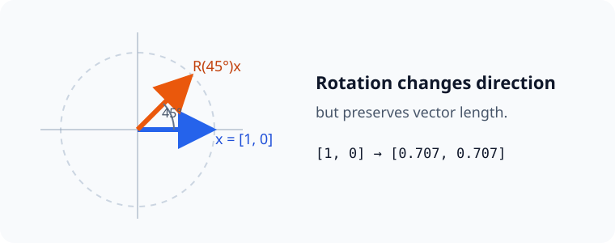
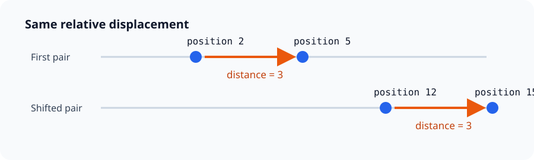

# Rotary Position Embeddings From Scratch

Self-attention can mix information between tokens, but the attention equation does not automatically know where a token appears in the sequence. Rotary Position Embeddings, usually called RoPE, add position information by rotating the projected query and key vectors before their dot product is computed.

This gives us a clear positional baseline before we study DeepSeek's decoupled positional path in Multi-Head Latent Attention.

## 1. Why attention needs position information

Consider these two sentences:

```text
Dog bites man.
Man bites dog.
```

They contain the same words, but their meanings are different because the order changed.

The attention layer from the previous article computes:

```text
Q = X W_Q
K = X W_K
V = X W_V
Attention(Q, K, V) = softmax(Q K^T / sqrt(d_head) + M) V
```

The causal mask tells a position which tokens are visible. It does not directly tell the model whether two visible tokens are three positions apart or thirty positions apart. RoPE introduces that positional relationship inside the query-key score.

## 2. Rotation in two dimensions

Start with a two-dimensional vector:

```text
x = [1, 0]
```

It points to the right. Rotating it by 45 degrees produces approximately `[0.707, 0.707]`.



For a vector `[a, b]`, rotation by angle `theta` is:

```text
a' = a * cos(theta) - b * sin(theta)
b' = a * sin(theta) + b * cos(theta)
```

In matrix form:

```text
[a']   [ cos(theta)  -sin(theta) ] [a]
[b'] = [ sin(theta)   cos(theta) ] [b]
```

Rotation changes direction but preserves length. RoPE uses this simple operation independently on pairs of hidden dimensions.

## 3. Turning rotation into position

RoPE assigns an angle to every sequence position. In a simple illustration, imagine the angle increasing by 30 degrees per token:

| Position | Angle |
| ---: | ---: |
| 0 | 0 degrees |
| 1 | 30 degrees |
| 2 | 60 degrees |
| 3 | 90 degrees |
| 4 | 120 degrees |

The same content vector receives a different rotation at each position. The important property is not merely that positions look different. It is that the dot product between a rotated query and rotated key depends naturally on their relative displacement.

## 4. The relative-position property

Let the angle at position `p` be:

```text
theta_p = p * omega
```

where `omega` is an angular frequency. For positions `m` and `n`:

```text
theta_m - theta_n = (m - n) * omega
```

If both tokens move forward by the same number of positions, their difference stays the same.

Suppose query and key both start as `[1, 0]`, and use one radian per position. At positions 2 and 5, the rotated dot product is:

```text
R(2) q · R(5) k = cos(2 - 5) = cos(-3) ≈ -0.9900
```

At positions 12 and 15:

```text
R(12) q · R(15) k = cos(12 - 15) = cos(-3) ≈ -0.9900
```

The absolute positions changed, but the relative displacement stayed three. The content vectors still affect the final score, so this does not mean every pair separated by three positions receives the same attention score.



## 5. Why rotate Q and K, not V

RoPE is applied after the learned query and key projections:

```text
q_p' = R(p) (W_Q x_p)
k_p' = R(p) (W_K x_p)
```

The value vector remains unchanged:

```text
v_p' = W_V x_p
```

For two positions, the query-key score becomes:

```text
(q_m')^T k_n' = q_m^T R(m)^T R(n) k_n
```

Because rotations compose by angle addition:

```text
R(m)^T R(n) = R(n - m)
```

The positional part therefore depends on the displacement between the positions. The values carry the information that will be mixed; queries and keys determine how much information is selected.

Rotating the input embeddings before the learned projections would not provide this clean result in general, because arbitrary learned projection matrices do not necessarily commute with the rotation.

## 6. Multiple frequencies across the head

In the current small configuration:

```text
hidden size = 256
number of heads = 8
head size = 256 / 8 = 32
```

Each 32-dimensional head contains 16 pairs:

```text
[x0, x1] [x2, x3] [x4, x5] ... [x30, x31]
    |         |         |             |
  rotate    rotate    rotate        rotate
    |         |         |             |
[y0, y1] [y2, y3] [y4, y5] ... [y30, y31]
```

Different pairs use different frequencies. The standard frequency for pair `i` is:

```text
omega_i = 1 / theta ** (2 * i / d_head)
```

Here `i` ranges from `0` through `d_head / 2 - 1`, and `theta` is usually 10,000. With a four-dimensional toy vector:

```text
omega_0 = 1
omega_1 = 1 / 100
```

At position 10, the first pair rotates by 10 radians while the second rotates by 0.1 radians. Fast and slow frequencies let the model represent positional patterns at different scales.

## 7. Implementing RoPE

Create `src/model/rope.py`:

```python
import torch
from torch import nn


class RotaryEmbedding(nn.Module):
    """Apply interleaved-pair rotary position embeddings."""

    def __init__(
        self,
        dim: int,
        max_seq_len: int = 1024,
        theta: float = 10_000.0,
    ) -> None:
        super().__init__()
        if dim <= 0 or dim % 2 != 0:
            raise ValueError("RoPE dimension must be positive and even")
        if max_seq_len <= 0 or theta <= 0:
            raise ValueError("max_seq_len and theta must be positive")

        self.dim = dim
        self.max_seq_len = max_seq_len
        self.theta = theta

        pair_indices = torch.arange(0, dim, 2, dtype=torch.float32)
        inv_freq = 1.0 / (theta ** (pair_indices / dim))
        positions = torch.arange(max_seq_len, dtype=torch.float32)
        angles = positions[:, None] * inv_freq[None, :]

        self.register_buffer(
            "cos_cached",
            angles.cos()[None, None, :, :],
            persistent=False,
        )
        self.register_buffer(
            "sin_cached",
            angles.sin()[None, None, :, :],
            persistent=False,
        )

    def forward(self, x: torch.Tensor, start_pos: int = 0) -> torch.Tensor:
        """Rotate x shaped [batch, heads, sequence, dim]."""
        if x.ndim != 4 or x.shape[-1] != self.dim:
            raise ValueError("Expected x with shape [batch, heads, sequence, dim]")
        if start_pos < 0 or start_pos + x.shape[-2] > self.max_seq_len:
            raise ValueError("requested positions exceed max_seq_len")

        end_pos = start_pos + x.shape[-2]
        cos = self.cos_cached[:, :, start_pos:end_pos, :].to(dtype=x.dtype)
        sin = self.sin_cached[:, :, start_pos:end_pos, :].to(dtype=x.dtype)

        pairs = x.reshape(*x.shape[:-1], self.dim // 2, 2)
        even = pairs[..., 0]
        odd = pairs[..., 1]
        rotated_even = even * cos - odd * sin
        rotated_odd = even * sin + odd * cos

        rotated = torch.stack((rotated_even, rotated_odd), dim=-1)
        return rotated.flatten(-2)
```

The cached cosine and sine tables are buffers rather than trainable parameters. PyTorch moves them with the model, but the optimizer does not update them. `persistent=False` keeps these derived tables out of the ordinary state dictionary.

For an input shaped `[B, H, T, 32]`, the implementation temporarily views the final dimension as `[16, 2]`, rotates each pair, and returns the original shape.

## 8. Verify a two-dimensional rotation

For `dim=2`, position zero leaves `[1, 0]` unchanged. At position one, with the first frequency equal to one, the result is approximately `[cos(1), sin(1)]`:

```python
import torch

from src.model.rope import RotaryEmbedding

rope = RotaryEmbedding(dim=2, max_seq_len=16)
x = torch.tensor([[[[1.0, 0.0]]]])  # [batch, heads, time, dim]

position_zero = rope(x, start_pos=0)
position_one = rope(x, start_pos=1)

print(position_zero.flatten().tolist())
print(position_one.flatten().tolist())
```

Expected values are approximately:

```text
Position 0: [1.0, 0.0]
Position 1: [0.5403, 0.8415]
```

## 9. Verify relative position numerically

The following experiment rotates the same query and key at two pairs of positions with the same displacement:

```python
import torch

from src.model.rope import RotaryEmbedding

rope = RotaryEmbedding(dim=32, max_seq_len=64)
q = torch.randn(1, 1, 1, 32)
k = torch.randn(1, 1, 1, 32)

score_one = (rope(q, start_pos=8) * rope(k, start_pos=13)).sum()
score_two = (rope(q, start_pos=21) * rope(k, start_pos=26)).sum()

torch.testing.assert_close(score_one, score_two, atol=1e-5, rtol=1e-5)
print("relative-position check passed")
```

The common shift is 13 positions, and both pairs are separated by five positions. The dot products match up to floating-point precision. This is also why a future KV-cache implementation must pass the actual position of each newly generated token to RoPE.

## 10. Add RoPE to causal attention

Update `src/model/attention.py` so that queries and keys are rotated after projection and head splitting:

```python
from .rope import RotaryEmbedding


class CausalSelfAttention(nn.Module):
    def __init__(
        self,
        dim: int,
        n_heads: int,
        max_seq_len: int,
        rope_theta: float = 10_000.0,
    ) -> None:
        super().__init__()
        if dim % n_heads != 0:
            raise ValueError("dim must be divisible by n_heads")

        self.dim = dim
        self.n_heads = n_heads
        self.head_dim = dim // n_heads
        if self.head_dim % 2 != 0:
            raise ValueError("RoPE head dimension must be even")

        self.q_proj = nn.Linear(dim, dim, bias=False)
        self.k_proj = nn.Linear(dim, dim, bias=False)
        self.v_proj = nn.Linear(dim, dim, bias=False)
        self.out_proj = nn.Linear(dim, dim, bias=False)
        self.rope = RotaryEmbedding(self.head_dim, max_seq_len, rope_theta)

    def forward(self, x: torch.Tensor, start_pos: int = 0) -> torch.Tensor:
        q = self._split_heads(self.q_proj(x))
        k = self._split_heads(self.k_proj(x))
        v = self._split_heads(self.v_proj(x))

        q = self.rope(q, start_pos=start_pos)
        k = self.rope(k, start_pos=start_pos)

        scores = q @ k.transpose(-2, -1)
        scores = scores / math.sqrt(self.head_dim)
        scores = scores.masked_fill(self.future_mask[: x.shape[1], : x.shape[1]], -torch.inf)
        weights = torch.softmax(scores.float(), dim=-1).to(v.dtype)
        attended = weights @ v
        attended = attended.transpose(1, 2).contiguous()
        attended = attended.view(x.shape[0], x.shape[1], self.dim)
        return self.out_proj(attended)
```

The existing `AttentionBlock` remains a pre-normalized residual wrapper. Pass the RoPE base through `src/model/deepseek.py` from `config.rope_theta`.

The attention flow is now:

```text
Hidden states
    -> Q, K, V projections
    -> split into heads
    -> RoPE(Q) and RoPE(K); V unchanged
    -> scaled dot products
    -> causal mask and softmax
    -> weighted values
    -> merge heads and output projection
```

## 11. Correctness checks

Add `src/tests/test_rope.py` with checks for:

- output shape preservation;
- vector-length preservation;
- relative-position invariance under a common shift;
- gradient flow through the rotation;
- causal future-token isolation after RoPE is added.

Run them with:

```bash
python -m pytest src/tests/test_rope.py -v
```

RoPE adds no trainable parameters. Its cosine and sine tables are fixed buffers, so the parameter count remains the same as the causal attention baseline.

## 12. How this differs from DeepSeek's positional path

Conventional RoPE rotates every query and key head dimension. DeepSeek-V3's Multi-Head Latent Attention uses a decoupled positional path:

```text
Hidden state
    -> compressed content path (no RoPE)
    -> separate positional query/key path (RoPE)
    -> combined attention score
```

This separation helps DeepSeek keep the compressed KV representation cache-friendly. Applying a position-dependent rotation to an entire reconstructed key would make matrix absorption less convenient, while a separate positional component preserves the positional signal.

The [DeepSeek-V3 technical report](https://arxiv.org/abs/2412.19437) describes this design. The standard RoPE implementation here is the reference point needed before building MLA.


## Summary

RoPE adds position information by rotating query and key vectors in two-dimensional pairs. Different pairs use different frequencies, so the model can represent positional relationships at multiple scales. Because rotations compose by angle difference, query-key scores naturally include relative position information.

The implementation adds no learned position table and leaves values unrotated. It gives us a conventional positional attention baseline before we move to DeepSeek's decoupled RoPE path inside MLA.
