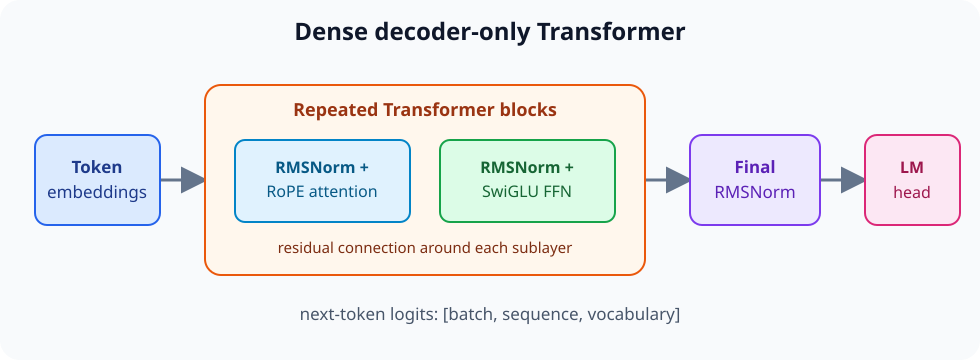
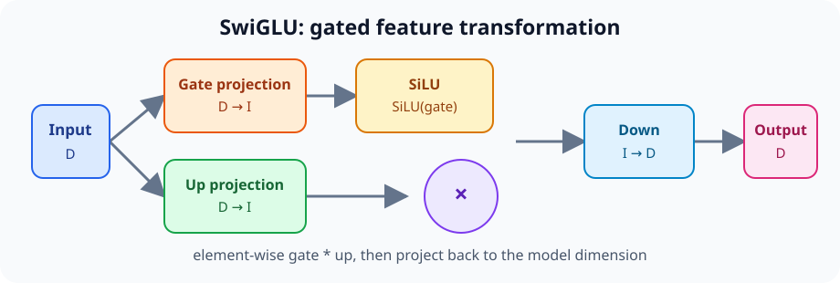
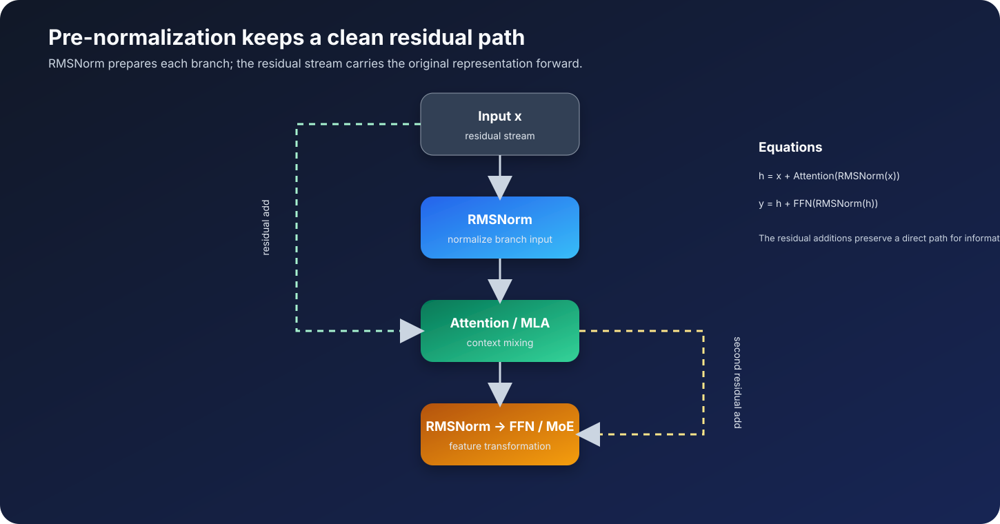

# Building a Complete GPT-Style Transformer

We now have token embeddings, RMSNorm, causal self-attention, RoPE, and a working data pipeline. The missing piece is the feed-forward sublayer. Adding it gives us a complete dense decoder-only Transformer that can produce next-token logits and serve as a baseline for the later DeepSeek components.

This baseline is intentionally dense. Every token uses the same feed-forward network in every block. That makes the architecture easy to understand before replacing the dense network with routed experts.

## 1. The architecture we are assembling

The model now follows this pattern:

```text
Token IDs
    -> token embeddings
    -> repeated pre-norm Transformer blocks
         -> RMSNorm -> causal attention with RoPE -> residual addition
         -> RMSNorm -> SwiGLU FFN -> residual addition
    -> final RMSNorm
    -> language-model head
    -> next-token logits
```



Attention and the feed-forward network perform different jobs:

- **Attention** mixes information across token positions.
- **The FFN** transforms features independently within each token position.

Both operations are needed. Attention gathers context; the FFN processes the contextual representation.

## 2. The feed-forward network

Suppose the hidden tensor has shape `[B, T, D]`, where `B` is batch size, `T` is sequence length, and `D` is the hidden dimension. A feed-forward network expands each token from `D` features to an intermediate size `I`, applies a nonlinear transformation, and projects it back to `D`:

```text
[B, T, D] -> [B, T, I] -> [B, T, I] -> [B, T, D]
```

The same weights are applied independently at every position. There is no mixing between sequence positions inside the FFN.

For the small configuration used here:

```text
D = 256
I = 768
```

The larger intermediate space gives the network room to learn richer feature transformations before returning to the model dimension.

## 3. From an ordinary FFN to SwiGLU

A traditional feed-forward layer can be written as:

```text
FFN(x) = W_down ReLU(W_up x)
```

Modern language models often use gated activations instead. SwiGLU uses two expansion projections:

```text
gate = W_gate x
up = W_up x
hidden = SiLU(gate) * up
output = W_down hidden
```

The multiplication is element-wise. The gate controls how strongly each intermediate feature contributes.

SiLU, also called Swish, is:

```text
SiLU(z) = z * sigmoid(z)
sigmoid(z) = 1 / (1 + exp(-z))
```



Gating here is feature-wise multiplication. It is not expert routing; MoE routing is a separate mechanism that will be added later.

## 4. A small numerical example

Assume the two expansion branches produce:

```text
gate = [2, -1]
up   = [3,  4]
```

The SiLU values are approximately:

```text
SiLU(2)  =  1.762
SiLU(-1) = -0.269
```

The gated intermediate vector is:

```text
[1.762, -0.269] * [3, 4] = [5.286, -1.076]
```

The down projection then maps this vector back to the model dimension. The up branch alone does not determine the result; the gate can amplify, reduce, or change the sign of each intermediate feature.

## 5. Implement SwiGLU

Create `src/model/ffn.py`:

```python
import torch
import torch.nn.functional as F
from torch import nn


class SwiGLUFFN(nn.Module):
    """Bias-free gated feed-forward network."""

    def __init__(self, dim: int, hidden_dim: int) -> None:
        super().__init__()
        if dim <= 0 or hidden_dim <= 0:
            raise ValueError("dim and hidden_dim must be positive")

        self.gate_proj = nn.Linear(dim, hidden_dim, bias=False)
        self.up_proj = nn.Linear(dim, hidden_dim, bias=False)
        self.down_proj = nn.Linear(hidden_dim, dim, bias=False)

    def forward(self, x: torch.Tensor) -> torch.Tensor:
        gate = F.silu(self.gate_proj(x))
        up = self.up_proj(x)
        return self.down_proj(gate * up)
```

For input shape `[4, 128, 256]`, the shapes are:

| Operation | Shape |
| --- | --- |
| Input | `[4, 128, 256]` |
| Gate projection | `[4, 128, 768]` |
| Up projection | `[4, 128, 768]` |
| Gated multiplication | `[4, 128, 768]` |
| Down projection | `[4, 128, 256]` |

The FFN parameter count is:

```text
P_ffn = D * I + D * I + I * D
      = 3 * D * I
      = 3 * 256 * 768
      = 589,824
```

There are no biases in this implementation.

## 6. Build the complete Transformer block

The block has two pre-normalized residual sublayers:

```text
h = x + Attention(RMSNorm_1(x))
y = h + SwiGLU(RMSNorm_2(h))
```

The two RMSNorm layers have separate learned scale vectors. The first prepares the input for attention. The second prepares the attention-updated representation for the FFN.



The residual additions let every sublayer learn an update instead of replacing the entire representation:

```text
new representation = old representation + learned update
```

Update `src/model/transformer.py`:

```python
import torch
from torch import nn

from .attention import CausalSelfAttention
from .ffn import SwiGLUFFN
from .rmsnorm import RMSNorm


class TransformerBlock(nn.Module):
    """Pre-norm attention and SwiGLU residual block."""

    def __init__(self, config) -> None:
        super().__init__()
        self.attn_norm = RMSNorm(config.dim, eps=1e-6)
        self.attention = CausalSelfAttention(
            dim=config.dim,
            n_heads=config.n_heads,
            max_seq_len=config.max_seq_len,
            rope_theta=config.rope_theta,
        )
        self.ffn_norm = RMSNorm(config.dim, eps=1e-6)
        self.ffn = SwiGLUFFN(
            dim=config.dim,
            hidden_dim=config.inter_dim,
        )

    def forward(self, x: torch.Tensor) -> torch.Tensor:
        x = x + self.attention(self.attn_norm(x))
        return x + self.ffn(self.ffn_norm(x))


# Kept as a compatibility name for the attention-only implementation.
AttentionBlock = TransformerBlock
```

Keeping the earlier `AttentionBlock` name as a small compatibility wrapper avoids breaking attention-only examples while the model moves to the complete block.

## 7. Assemble the language model

`src/model/deepseek.py` now stacks complete blocks between the embedding table and final language-model head:

```python
class DeepSeekSkeleton(nn.Module):
    def __init__(self, config: DeepSeekConfig) -> None:
        super().__init__()
        self.config = config
        self.embed_tokens = TokenEmbedding(config)
        self.blocks = nn.ModuleList(
            [TransformerBlock(config) for _ in range(config.n_layers)]
        )
        self.norm = RMSNorm(config.dim, eps=1e-6)
        self.lm_head = nn.Linear(config.dim, config.vocab_size, bias=False)

    def forward(self, input_ids: torch.Tensor) -> torch.Tensor:
        hidden_states = self.embed_tokens(input_ids)
        for block in self.blocks:
            hidden_states = block(hidden_states)
        hidden_states = self.norm(hidden_states)
        return self.lm_head(hidden_states)
```

The model output has shape `[B, T, V]`, where `V` is vocabulary size. Each position receives one logit for every possible next token.

The class name remains `DeepSeekSkeleton` for compatibility with the earlier code. It is now a complete dense baseline rather than an embedding-only skeleton.

## 8. Parameter accounting

For vocabulary size `V`, hidden size `D`, intermediate size `I`, and `L` blocks:

```text
embedding + LM head = 2 * V * D
attention projections per block = 4 * D * D
SwiGLU per block = 3 * D * I
two block RMSNorm scales = 2 * D
final RMSNorm = D

total = 2 * V * D
      + L * (4 * D * D + 3 * D * I + 2 * D)
      + D
```

With `V=8192`, `D=256`, `I=768`, and `L=6`:

```text
embedding + LM head = 4,194,304
one complete block   = 852,480
six blocks           = 5,114,880
final RMSNorm        = 256
total                = 9,309,440
```

RoPE does not change this count because its cosine and sine tables are fixed buffers, not trainable parameters.

Always verify the count from the instantiated model:

```python
from src.model import DeepSeekConfig, DeepSeekSkeleton

config = DeepSeekConfig(
    vocab_size=8192,
    dim=256,
    n_layers=6,
    n_heads=8,
    inter_dim=768,
)
model = DeepSeekSkeleton(config)
total_params = sum(parameter.numel() for parameter in model.parameters())

print(f"Total parameters: {total_params:,}")
assert total_params == 9_309_440
```

If the tokenizer uses a smaller vocabulary, the embedding and output head become smaller as well.

## 9. Connect the model to next-token loss

The data loader returns shifted input and target sequences:

```text
input:  [t0, t1, t2, ..., t(T-1)]
target: [t1, t2, t3, ..., tT]
```

The model produces logits for every input position. Flattening batch and sequence dimensions makes the vocabulary cross-entropy straightforward:

```python
import torch.nn.functional as F

input_ids, target_ids = next(iter(loader))
logits = model(input_ids)
loss = F.cross_entropy(
    logits.reshape(-1, config.vocab_size),
    target_ids.reshape(-1),
)
loss.backward()
```

For batch size 8 and sequence length 128, the loss receives 1,024 next-token predictions per batch. AdamW then updates all embedding, attention, normalization, and FFN parameters.

## 10. A small training experiment

The first useful experiment is deliberately modest:

| Setting | Value |
| --- | --- |
| Layers | 6 |
| Hidden size | 256 |
| Heads | 8 |
| FFN size | 768 |
| Sequence length | 128 |
| Batch size | 8 |
| Optimizer | AdamW |
| Learning rate | `3e-4` |
| Precision | BF16 autocast on supported CUDA GPUs |

The goal is to verify that the complete model can train, not to produce high-quality text. A reliable first debugging experiment is to hold one batch fixed and optimize it repeatedly. The loss should fall substantially. If it does not, inspect the shifted targets, causal mask, gradients, dtype handling, and optimizer setup before scaling the run.

BF16 autocast can reduce activation memory on supported GPUs while keeping model parameters and optimizer state in their usual precision. RMSNorm computes its statistics in FP32 in this repository, which is useful for numerical stability.

For a uniform vocabulary of size `V`, the reference cross-entropy is:

```text
loss_reference = log(V)
```

For `V=512`, that is approximately `6.238`. A randomly initialized model does not need to start exactly at this value, but it is a useful scale reference.

## 11. Generate text autoregressively

After training, generation repeats the same operation:

```text
prompt -> predict next-token logits -> choose a token -> append it -> repeat
```

A minimal sampling loop looks like this:

```python
import torch


@torch.no_grad()
def generate(model, input_ids, max_new_tokens, temperature=1.0):
    model.eval()
    tokens = input_ids

    for _ in range(max_new_tokens):
        context = tokens[:, -model.config.max_seq_len:]
        logits = model(context)[:, -1, :]
        logits = logits / max(temperature, 1e-5)
        probabilities = torch.softmax(logits, dim=-1)
        next_token = torch.multinomial(probabilities, num_samples=1)
        tokens = torch.cat([tokens, next_token], dim=1)

    return tokens
```

This simple version recomputes the whole visible context on every step. It is easy to understand, but inefficient for long generation. A KV cache will avoid repeating earlier attention computation when we study inference in detail.

Because this baseline has limited parameters and training, generated text may contain fragments, repetitions, or invalid-looking sequences. That is expected. The important result is that the model can complete the full forward, loss, backward, and generation path.

## 12. Tests for the complete baseline

Add `src/tests/test_transformer.py`:

```python
import torch

from src.model import DeepSeekConfig, DeepSeekSkeleton
from src.model.ffn import SwiGLUFFN
from src.model.transformer import TransformerBlock


def small_config() -> DeepSeekConfig:
    return DeepSeekConfig(
        vocab_size=256,
        dim=64,
        n_layers=2,
        n_heads=4,
        inter_dim=128,
        max_seq_len=32,
    )


def test_swiglu_shape() -> None:
    ffn = SwiGLUFFN(64, 128)
    x = torch.randn(2, 8, 64)
    assert ffn(x).shape == x.shape


def test_block_shape() -> None:
    block = TransformerBlock(small_config())
    x = torch.randn(2, 8, 64)
    assert block(x).shape == x.shape


def test_model_shape_and_backward() -> None:
    config = small_config()
    model = DeepSeekSkeleton(config)
    input_ids = torch.randint(0, config.vocab_size, (2, 8))
    logits = model(input_ids)
    logits.square().mean().backward()

    assert logits.shape == (2, 8, config.vocab_size)
    assert all(parameter.grad is not None for parameter in model.parameters())
```

Run the focused checks with:

```bash
python -m pytest src/tests/test_transformer.py -v
```

The earlier attention and RoPE tests should continue to pass. Update any old parameter-count expectation because the model now includes the FFN and a second RMSNorm in every block.

## 13. Why this baseline matters

The complete dense model gives us a controlled reference for later architectural changes:

| Component | Dense baseline | DeepSeek-style replacement |
| --- | --- | --- |
| Position encoding | Standard RoPE | Decoupled RoPE inside MLA |
| Attention | Standard multi-head attention | Multi-Head Latent Attention |
| Feed-forward layer | One SwiGLU per block | Shared and routed experts |
| Routing | None | Top-k expert selection and balancing |
| Objective | Next-token prediction | Next-token prediction plus MTP |

The existing architecture is not discarded. We will replace one mechanism at a time and compare each replacement with this readable dense baseline.

## Summary

SwiGLU adds a gated nonlinear transformation after attention. A complete pre-norm block applies RMSNorm, causal RoPE attention, a residual connection, a second RMSNorm, SwiGLU, and another residual connection. Stacking those blocks between token embeddings and an LM head produces a complete dense GPT-style language model.

This model is small enough to debug and large enough to exercise the full next-token training path. It is the reference system for understanding what MLA and DeepSeekMoE change.
