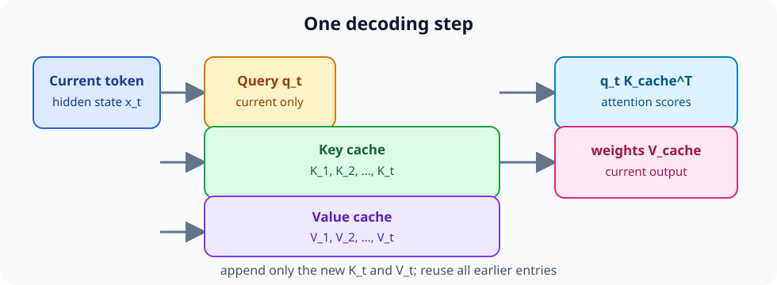
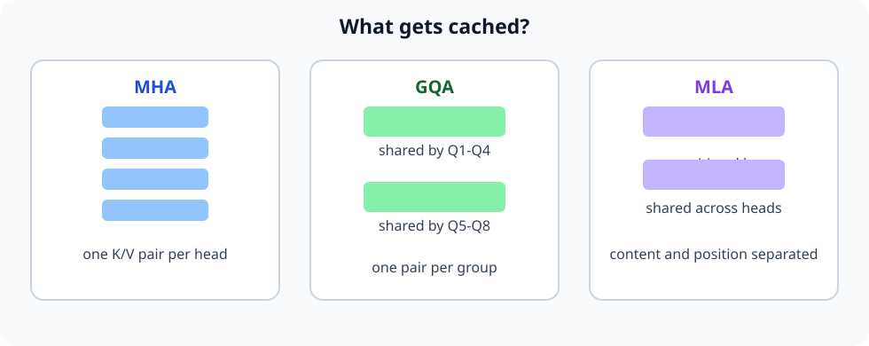

# Why DeepSeek Uses Multi-Head Latent Attention

Our dense Transformer can now process a sequence, cache keys and values during generation, and produce next-token predictions. The next question is a systems question:

**How much information must inference keep in the KV cache?**

For short sequences the cache is easy to ignore. For long contexts, many attention heads, many layers, and multiple simultaneous requests, it can become one of the largest memory consumers. Multi-Head Latent Attention (MLA) is DeepSeek's answer to this pressure.

This article develops the problem first. It compares MHA, MQA, and GQA, then introduces MLA's compressed KV representation, matrix absorption, and decoupled positional path. The full MLA layer comes next; here we measure and understand the cache.

## 1. Why a KV cache exists

Autoregressive generation predicts one token at a time:

```text
prompt -> next token -> next token -> next token -> ...
```

At every layer, the new token needs to attend to all visible earlier tokens. Standard attention forms:

```text
Q = X W_Q
K = X W_K
V = X W_V
```

When generating a new token, the old tokens' hidden states do not change. Their keys and values have already been computed, so recomputing them at every generation step would waste work.

The KV cache stores those past keys and values. At a new decoding step:

1. Compute the current token's query, key, and value.
2. Append the new key and value to the cache.
3. Compare the current query with all cached keys.
4. Combine the cached values using the attention weights.

Old queries are not normally cached because single-token decoding only needs the query for the current position.



## 2. What the cache contains

For one layer with two attention heads, a four-token cache conceptually looks like this:

```text
Key cache:
  token 1 -> K[head 1], K[head 2]
  token 2 -> K[head 1], K[head 2]
  token 3 -> K[head 1], K[head 2]
  token 4 -> K[head 1], K[head 2]

Value cache:
  token 1 -> V[head 1], V[head 2]
  token 2 -> V[head 1], V[head 2]
  token 3 -> V[head 1], V[head 2]
  token 4 -> V[head 1], V[head 2]
```

The real cache stores numerical tensors. The labels above only show the organization. With standard MHA, each query head has its own key and value head.

## 3. MHA cache memory

For standard Multi-Head Attention, the cache memory is:

```text
M_KV = 2 * B * L * T * H_KV * d_KV * bytes_per_element
```

Where:

| Symbol | Meaning |
| --- | --- |
| `B` | batch size |
| `L` | number of Transformer layers |
| `T` | cached sequence length |
| `H_KV` | number of key/value heads |
| `d_KV` | dimension of one key/value head |
| `bytes_per_element` | storage size, 2 for BF16 |
| `2` | one key cache plus one value cache |

This assumes key and value heads have the same dimension and ignores allocator overhead, metadata, temporary tensors, and model weights.

### A V3-scale comparison

Use this hypothetical conventional-MHA reference:

```text
attention heads = 128
key/value head dimension = 128
layers = 61
precision = BF16 = 2 bytes
batch size = 1
sequence length = 32,768
```

For one token in one layer:

```text
2 * 128 * 128 = 32,768 elements
32,768 * 2 bytes = 65,536 bytes
```

Across 61 layers, that is about 3.81 MiB per token. At 32,768 tokens, the cache is approximately:

```text
122 GiB
```

This is only the KV cache. It excludes weights, temporary activations, attention workspaces, and other GPU allocations.



## 4. MHA, MQA, and GQA

### Multi-Head Attention

MHA gives every query head its own key and value head:

```text
Q1 -> K1, V1
Q2 -> K2, V2
Q3 -> K3, V3
Q4 -> K4, V4
```

This gives each head an independent K/V representation, but it creates the largest cache.

### Multi-Query Attention

MQA uses many query heads with one shared key head and one shared value head:

```text
Q1 ─┐
Q2 ─┼-> shared K, shared V
Q3 ─┤
Q4 ─┘
```

The cache becomes much smaller, but all query heads must use the same K/V representation.

### Grouped-Query Attention

GQA is a compromise. Query heads are divided into groups, and each group shares a K/V pair:

```text
Q1, Q2, Q3, Q4 -> K/V group 1
Q5, Q6, Q7, Q8 -> K/V group 2
```

For 128 query heads:

| Attention | Query heads | KV heads | Cached K/V relationship |
| --- | ---: | ---: | --- |
| MHA | 128 | 128 | independent pair per query head |
| GQA | 128 | 8 | one pair per group |
| MQA | 128 | 1 | one pair for every query head |

MQA and GQA reduce cache size by reducing the number of K/V heads. MLA takes a different route: it stores a learned compressed representation from which useful K/V information can be derived.

## 5. MLA's compressed KV representation

In conventional attention, a hidden vector goes directly to full keys and values:

```text
x -> full K
x -> full V
cache K and V
```

MLA first compresses the hidden representation:

```text
c_KV = W_DKV x
```

Then learned up-projections can reconstruct content keys and values:

```text
K_content = W_UK c_KV
V = W_UV c_KV
```

The latent `c_KV` is shared across heads. It can be much smaller than concatenating every full key and value head.

### A small example

Suppose:

```text
hidden size = 256
number of heads = 8
key/value head dimension = 32
```

Standard MHA stores:

```text
8 * 32 = 256 key values
8 * 32 = 256 value values
512 cached values total
```

If MLA uses a latent dimension of 64, the shared content cache stores only:

```text
64 latent values
```

The compression is learned, not lossless. During training, the down- and up-projections learn to preserve information useful for the language-model objective.

## 6. Compression alone is not enough

There is an important objection:

> If the model reconstructs full keys and values every time, have we only traded memory for extra computation?

There are two possible implementations.

### Expand the latent

Store the latent and reconstruct full K/V representations when needed:

```text
cache c_KV
K_content = W_UK c_KV
V = W_UV c_KV
```

This saves cache storage but may materialize large temporary tensors.

### Absorb the projections

The attention score for a content key is:

```text
q^T K_content = q^T W_UK c_KV
```

Rearrange the multiplication:

```text
q^T W_UK c_KV = (W_UK^T q)^T c_KV
```

Instead of reconstructing every cached key, transform the current query and compare it directly with the cached latent.

The value projection can be moved after aggregation because it is linear:

```text
sum_j alpha_j (W_UV c_j) = W_UV (sum_j alpha_j c_j)
```

The optimized path therefore works conceptually like this:

```text
cache compressed latents
transform the current query into compressed-key space
compute attention over latent vectors
aggregate latent values
project the aggregate into output space
```

This matrix-absorption idea is why MLA is more than simply adding a low-rank bottleneck.

## 7. Why RoPE must be decoupled

Our conventional attention rotates the full query and key vectors:

```text
q_p' = R(p) q_p
k_p' = R(p) k_p
```

If a content key is reconstructed from a latent:

```text
k_p = W_UK c_p
k_p' = R(p) W_UK c_p
```

The position-dependent rotation generally cannot be absorbed into a fixed projection in the same convenient way. The rotation depends on the cached token's position.

DeepSeek separates content and position:

```text
content path:  c_KV -> content key/value information, no RoPE
position path: separate positional query/key features, apply RoPE
```

The query and key can be represented conceptually as:

```text
q_i = [q_i_content ; q_i_position]
k_j = [k_j_content ; k_j_position]
```

The score combines both terms:

```text
score(i, j) =
    (q_i_content · k_j_content)
    + (q_i_position · k_j_position)
```

The content term supports compression and absorption. The positional term preserves relative-position information through RoPE. MLA therefore caches a small content latent plus a separate positional key representation.

## 8. Comparing cache sizes

For a V3-scale storage comparison, use:

```text
query heads = 128
KV latent dimension = 512
positional key dimension = 64
value dimension per head = 128
layers = 61
sequence length = 32,768
batch size = 1
precision = BF16
```

The theoretical cached elements per token and layer are:

```text
MHA = 2 * 128 * 128 = 32,768
MQA = 2 * 1 * 128 = 256
GQA = 2 * 8 * 128 = 2,048
MLA = 512 + 64 = 576
```

The resulting approximate cache sizes are:

| Attention | Elements/token/layer | Total cache |
| --- | ---: | ---: |
| MHA, 128 KV heads | 32,768 | 122 GiB |
| MQA, 1 KV head | 256 | 0.95 GiB |
| GQA, 8 KV heads | 2,048 | 7.63 GiB |
| MLA, latent plus positional key | 576 | 2.14 GiB |

MLA is about 56.9 times smaller than this conventional MHA reference by stored-element count:

```text
32,768 / 576 ≈ 56.9
```

This is not a claim that the complete model is 56.9 times faster or uses 56.9 times less total GPU memory. It describes one cache-storage comparison. Projection costs, kernels, bandwidth, batching, weights, and temporary tensors still matter.

MQA can be smaller than MLA under this particular comparison. MLA's purpose is to retain richer head-specific transformations and quality while substantially reducing the cache, not to minimize one scalar memory number at any cost.

## 9. Measure a toy configuration

The repository utility in `src/inference/kv_cache_memory.py` estimates logical cache storage without launching a large model:

```python
from src.inference.kv_cache_memory import estimate_cache_mib

settings = {
    "batch_size": 1,
    "seq_len": 4096,
    "n_layers": 6,
    "query_heads": 8,
    "head_dim": 32,
    "gqa_kv_heads": 2,
    "kv_latent_dim": 64,
    "rope_dim": 16,
    "bytes_per_element": 2,
}

for attention_type in ("mha", "gqa", "mla"):
    memory = estimate_cache_mib(attention_type, **settings)
    print(f"{attention_type}: {memory:.2f} MiB")
```

For this toy setup:

```text
MHA: 24.00 MiB
GQA: 6.00 MiB
MLA: 3.75 MiB
```

The MLA cache stores `64 + 16 = 80` values per token and layer, compared with `2 * 8 * 32 = 512` for MHA. The ratio is:

```text
512 / 80 = 6.4
```

These totals include all six layers. They are logical tensor-storage estimates; real GPU allocation includes allocator overhead and other tensors.

## 10. What MLA does not solve

MLA reduces the amount of cached K/V information. It does not eliminate attention computation. During decoding, the current query still needs to interact with the visible context, and the amount of work generally grows with context length.

It also does not reduce model-weight storage by the same ratio. The 56.9 times figure above applies only to the selected KV-cache comparison.

The compressed KV latent and the low-rank query path serve related but different purposes. Old queries are not part of the ordinary decoding cache; the query path mainly affects projection computation and parameterization.

## 11. Check your understanding

What is the central difference between GQA and MLA?

```text
GQA reduces the number of K/V heads.
MLA stores shared compressed KV information and a separate positional key path.
```

Both reduce cache pressure, but they make different architectural trade-offs.

## Summary

Standard MHA caches a key and value for every head, layer, and previous token. MQA and GQA reduce this cache by sharing K/V heads. MLA instead learns a compact shared KV latent, uses matrix absorption to avoid repeatedly reconstructing full cached keys and values, and separates the positional RoPE path from the compressed content path.

The key idea is not merely “compress the cache.” It is to design the attention parameterization so that compressed cached information can still support expressive attention computation. The next step is to implement the low-rank query and KV projections and verify their tensor shapes and gradients.

References: [DeepSeek-V3 Technical Report](https://arxiv.org/abs/2412.19437) and the [official DeepSeek-V3 implementation](https://github.com/deepseek-ai/DeepSeek-V3/blob/main/inference/model.py).
