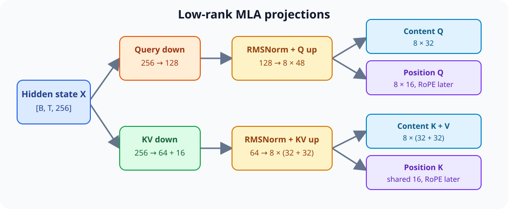

# Low-Rank Query and KV Compression

The previous article explained why DeepSeek uses Multi-Head Latent Attention. A conventional attention layer stores full key and value vectors for every head and every cached token. MLA changes that parameterization by introducing compact latent representations.

This article implements the first part of MLA: low-rank query compression, joint key/value compression, and a temporary content-only attention path. The positional query and key features are returned but not rotated yet. They will be connected to RoPE in the next architectural step.

## 1. What we are building

Our dense attention layer projects the hidden state directly into head-specific Q, K, and V tensors:

```text
X -> Q, K, V -> attention
```

The MLA projection layout introduces bottlenecks:

```text
Query branch:
X [B, T, 256]
    -> down-project to 128
    -> RMSNorm
    -> up-project to 8 * (32 + 16)
    -> content Query + positional Query

KV branch:
X [B, T, 256]
    -> down-project to 64 + 16
    -> RMSNorm on the 64-dimensional latent
    -> up-project the latent to 8 * (32 + 32)
    -> content Key + Value
```



The 16-dimensional positional components are carried separately. They will receive RoPE later, so this implementation deliberately keeps them visible without using them in the temporary attention score.

## 2. Low-rank projection in a small example

Suppose an input has eight features and we want sixteen outputs. A direct projection needs:

```text
8 * 16 = 128 weights
```

A factored projection can use a three-dimensional latent:

```text
8 -> 3 -> 16
```

```text
c = W_down x
y = W_up c
```

The matrix product is:

```text
y = W_up W_down x
```

The two matrices need:

```text
8 * 3 + 3 * 16 = 72 weights
```

The intermediate dimension limits the rank of the combined linear transformation to at most three. MLA adds RMSNorm between the down- and up-projections, so the complete branch is not one single linear matrix, but the low-dimensional bottleneck remains the central idea.

This resembles an autoencoder structurally, but it is not trained to reconstruct the original hidden state. The projections are trained jointly through the language-model objective to preserve information useful for attention and prediction.

## 3. Dimensions for the small model

The current configuration uses:

| Quantity | Symbol | Value |
| --- | --- | ---: |
| Hidden dimension | `D` | 256 |
| Attention heads | `H` | 8 |
| Query latent rank | `r_Q` | 128 |
| KV latent rank | `r_KV` | 64 |
| Content Q/K per head | `d_C` | 32 |
| Positional Q/K per head | `d_R` | 16 |
| Value per head | `d_V` | 32 |

The total query/key feature size per head is:

```text
d_Q = d_K = d_C + d_R = 32 + 16 = 48
```

The value size is 32. Query and key dimensions must match for a dot product; value can use a different dimension.

For batch size 2 and sequence length 128:

| Tensor | Shape |
| --- | --- |
| Input `X` | `[2, 128, 256]` |
| Compressed query | `[2, 128, 128]` |
| Expanded query | `[2, 128, 8, 48]` |
| Content query | `[2, 128, 8, 32]` |
| Positional query | `[2, 128, 8, 16]` |
| Compressed KV latent | `[2, 128, 64]` |
| Positional key | `[2, 128, 16]` |
| Content key | `[2, 128, 8, 32]` |
| Values | `[2, 128, 8, 32]` |

The positional key has no head dimension at this stage. It is shared across heads, while the positional query is head-specific.

## 4. Query compression

The query branch is:

```text
c_Q = W_DQ X                  [B, T, 256] -> [B, T, 128]
c_Q_norm = RMSNorm(c_Q)      [B, T, 128]
Q = W_UQ c_Q_norm             [B, T, 128] -> [B, T, 384]
reshape Q                    [B, T, 8, 48]
split                        content Q [B, T, 8, 32]
                             positional Q [B, T, 8, 16]
```

RMSNorm controls the latent scale before it is expanded into head-specific queries. The compressed query is mainly a parameterization and computation choice; it is not what makes the decoding KV cache smaller, because old queries are not normally cached.

## 5. Joint KV compression

The KV branch first produces one shared latent and a separate positional key:

```text
compressed = W_DKV X             [B, T, 256] -> [B, T, 80]
split compressed                 latent [B, T, 64]
                                 positional key [B, T, 16]
normalize latent                 [B, T, 64]
up-project latent                [B, T, 64] -> [B, T, 512]
reshape                         [B, T, 8, 64]
split                           content K [B, T, 8, 32]
                                 V [B, T, 8, 32]
```

The 512 expanded features are:

```text
8 * (32 content-key features + 32 value features) = 512
```

The normalized 64-dimensional latent and the 16-dimensional positional key are the tensors that a compressed MLA cache can store later. This article returns the reconstructed content keys and values as well so that we can verify the temporary attention computation.

## 6. Implement the projection branches

Create `src/model/mla.py`:

```python
import math

import torch
import torch.nn.functional as F
from torch import nn

from .config import DeepSeekConfig
from .rmsnorm import RMSNorm


class QueryCompression(nn.Module):
    """Compress hidden states, then create content and position queries."""

    def __init__(self, config: DeepSeekConfig) -> None:
        super().__init__()
        self.n_heads = config.n_heads
        self.d_content = config.qk_nope_head_dim
        self.d_rope = config.qk_rope_head_dim
        self.head_dim = self.d_content + self.d_rope

        self.q_down = nn.Linear(config.dim, config.q_lora_rank, bias=False)
        self.q_norm = RMSNorm(config.q_lora_rank)
        self.q_up = nn.Linear(
            config.q_lora_rank,
            config.n_heads * self.head_dim,
            bias=False,
        )

    def forward(self, x: torch.Tensor) -> tuple[torch.Tensor, torch.Tensor]:
        batch, time, _ = x.shape
        compressed = self.q_norm(self.q_down(x))
        expanded = self.q_up(compressed)
        expanded = expanded.reshape(batch, time, self.n_heads, self.head_dim)
        q_content, q_rope = torch.split(
            expanded,
            [self.d_content, self.d_rope],
            dim=-1,
        )
        return q_content, q_rope


class KVCompression(nn.Module):
    """Create a shared KV latent, content keys, values, and a position key."""

    def __init__(self, config: DeepSeekConfig) -> None:
        super().__init__()
        self.n_heads = config.n_heads
        self.kv_rank = config.kv_lora_rank
        self.d_content = config.qk_nope_head_dim
        self.d_rope = config.qk_rope_head_dim
        self.d_value = config.v_head_dim

        self.kv_down = nn.Linear(
            config.dim,
            self.kv_rank + self.d_rope,
            bias=False,
        )
        self.kv_norm = RMSNorm(self.kv_rank)
        self.kv_up = nn.Linear(
            self.kv_rank,
            self.n_heads * (self.d_content + self.d_value),
            bias=False,
        )

    def forward(
        self,
        x: torch.Tensor,
    ) -> tuple[torch.Tensor, torch.Tensor, torch.Tensor, torch.Tensor]:
        batch, time, _ = x.shape
        compressed = self.kv_down(x)
        kv_latent, k_rope = torch.split(
            compressed,
            [self.kv_rank, self.d_rope],
            dim=-1,
        )
        kv_latent = self.kv_norm(kv_latent)

        expanded = self.kv_up(kv_latent)
        expanded = expanded.reshape(
            batch,
            time,
            self.n_heads,
            self.d_content + self.d_value,
        )
        k_content, values = torch.split(
            expanded,
            [self.d_content, self.d_value],
            dim=-1,
        )
        return kv_latent, k_rope, k_content, values
```

## 7. Temporary content-only MLA

Before adding decoupled RoPE, we can verify the content path with a real causal attention calculation. The content-only score for head `h` is:

```text
score[i, j, h] = q_content[i, h] · k_content[j, h]
```

After scaling and masking:

```text
weights = softmax(score / sqrt(d_C) + causal_mask)
output = weights @ values
```

Add this class to `src/model/mla.py`:

```python
class ContentOnlyMLA(nn.Module):
    """Educational MLA path without positional attention yet."""

    def __init__(self, config: DeepSeekConfig) -> None:
        super().__init__()
        self.q_branch = QueryCompression(config)
        self.kv_branch = KVCompression(config)
        self.n_heads = config.n_heads
        self.d_content = config.qk_nope_head_dim
        self.d_value = config.v_head_dim
        self.out_proj = nn.Linear(
            config.n_heads * self.d_value,
            config.dim,
            bias=False,
        )
        future = torch.triu(
            torch.ones(config.max_seq_len, config.max_seq_len, dtype=torch.bool),
            diagonal=1,
        )
        self.register_buffer("future_mask", future, persistent=False)

    def forward(self, x: torch.Tensor) -> torch.Tensor:
        batch, time, _ = x.shape
        q_content, _ = self.q_branch(x)
        _, _, k_content, values = self.kv_branch(x)

        scores = torch.einsum("bihd,bjhd->bhij", q_content, k_content)
        scores = scores / math.sqrt(self.d_content)
        scores = scores.masked_fill(
            self.future_mask[:time, :time],
            float("-inf"),
        )
        weights = F.softmax(scores.float(), dim=-1).to(values.dtype)
        attended = torch.einsum("bhij,bjhd->bihd", weights, values)
        attended = attended.reshape(batch, time, self.n_heads * self.d_value)
        return self.out_proj(attended)
```

This is not complete MLA. It excludes the positional query/key score and does not use a compressed KV cache yet. It is a useful intermediate because it exercises both low-rank branches and preserves causal attention behavior.

## 8. Check the tensor shapes

```python
import torch

from src.model import DeepSeekConfig
from src.model.mla import ContentOnlyMLA, KVCompression, QueryCompression

config = DeepSeekConfig()
x = torch.randn(2, 128, config.dim)

query = QueryCompression(config)
q_content, q_rope = query(x)
print(q_content.shape)  # [2, 128, 8, 32]
print(q_rope.shape)     # [2, 128, 8, 16]

kv = KVCompression(config)
latent, k_rope, k_content, values = kv(x)
print(latent.shape)     # [2, 128, 64]
print(k_rope.shape)     # [2, 128, 16]
print(k_content.shape)  # [2, 128, 8, 32]
print(values.shape)     # [2, 128, 8, 32]

mla = ContentOnlyMLA(config)
output = mla(x)
print(output.shape)     # [2, 128, 256]
```

## 9. Parameter count

For the default small configuration:

| Component | Parameters |
| --- | ---: |
| Query down-projection | 32,768 |
| Query RMSNorm | 128 |
| Query up-projection | 49,152 |
| KV down-projection | 20,480 |
| KV RMSNorm | 64 |
| KV up-projection | 32,768 |
| Output projection | 65,536 |
| **Total** | **200,896** |

Standard MHA used four 256-by-256 projections:

```text
4 * 256 * 256 = 262,144 parameters
```

This toy MLA projection layer is smaller, but parameter reduction is not its only goal. The important inference benefit comes from caching one shared latent and one positional key per token instead of full per-head keys and values.

## 10. Head-specific reconstruction from a shared latent

There is one compressed KV latent per token:

```text
c_KV[j] in R^64
```

Each head uses a different learned slice of the up-projection:

```text
k_content[j, 1] = W_UK,1 c_KV[j]
k_content[j, 2] = W_UK,2 c_KV[j]
```

The latent is shared, but the reconstructed keys and values need not be identical. This is different from MQA, where every query head uses one shared K/V head directly.

## 11. Tests

Add `src/tests/test_mla.py`:

```python
import torch

from src.model import DeepSeekConfig
from src.model.mla import ContentOnlyMLA, KVCompression, QueryCompression


def small_config() -> DeepSeekConfig:
    return DeepSeekConfig(
        vocab_size=256,
        dim=64,
        n_layers=2,
        n_heads=4,
        inter_dim=128,
        q_lora_rank=16,
        kv_lora_rank=8,
        qk_nope_head_dim=8,
        qk_rope_head_dim=4,
        v_head_dim=8,
        max_seq_len=32,
    )


def test_query_shapes() -> None:
    config = small_config()
    q_content, q_rope = QueryCompression(config)(torch.randn(2, 16, 64))
    assert q_content.shape == (2, 16, 4, 8)
    assert q_rope.shape == (2, 16, 4, 4)


def test_kv_shapes() -> None:
    config = small_config()
    latent, k_rope, k_content, values = KVCompression(config)(
        torch.randn(2, 16, 64)
    )
    assert latent.shape == (2, 16, 8)
    assert k_rope.shape == (2, 16, 4)
    assert k_content.shape == (2, 16, 4, 8)
    assert values.shape == (2, 16, 4, 8)


def test_content_only_mla_shape_and_backward() -> None:
    config = small_config()
    model = ContentOnlyMLA(config)
    output = model(torch.randn(2, 16, 64, requires_grad=True))
    output.square().mean().backward()

    assert output.shape == (2, 16, 64)
    assert model.q_branch.q_down.weight.grad is not None
    assert model.kv_branch.kv_down.weight.grad is not None
```

Run the focused checks with:

```bash
python -m pytest src/tests/test_mla.py -v
```

Keep `ContentOnlyMLA` separate from the complete GPT model for now. Replacing standard attention at this point would temporarily discard the positional attention contribution. The next step will rotate the positional query and key components, combine both score terms, and build the complete naive MLA forward pass.

## 12. Check your understanding

How can eight heads produce different keys and values from one 64-dimensional KV latent?

```text
The latent is shared, but each head has different learned up-projection weights.
```

The model does not create eight independent latents, and it does not use identical keys and values for every head.

## Summary

The query branch follows `256 -> 128 -> 8 * 48` and separates content and positional query features. The KV branch follows `256 -> (64 + 16)`, normalizes the 64-dimensional latent, and expands it into head-specific content keys and values. The 16-dimensional positional key remains separate.

The temporary content-only MLA layer proves that these low-rank branches can participate in causal attention while preserving the expected `[B, T, D]` output shape. The complete positional path and cache-friendly MLA computation will build on these components.
