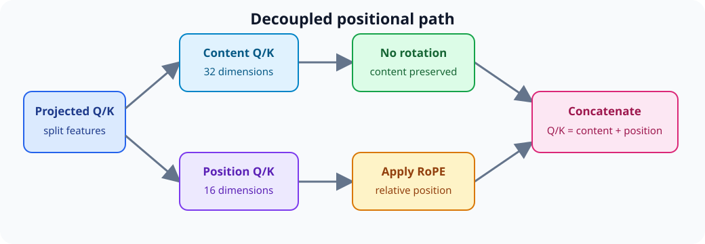

# Decoupled RoPE in Multi-Head Latent Attention

The previous article built low-rank query and KV projections. Those branches produced content features and separate positional features, but the temporary attention layer used only the content features.

Now we activate the positional path. The result is a complete, naive MLA forward pass with query compression, shared KV compression, decoupled RoPE, causal masking, attention, and an output projection. It is mathematically complete but does not yet implement compressed KV-cache inference.

## 1. The two MLA branches

For the current small configuration, the hidden state has shape `[B, T, 256]`:

```text
Query branch:
256 -> 128 -> 8 * (32 content + 16 positional)

KV branch:
256 -> (64 latent + 16 positional key)
64  -> 8 * (32 content key + 32 value)
```

The content-only implementation used:

```text
content Query · content Key
```

The complete implementation adds the positional contribution:

```text
content Query · content Key
    + rotated positional Query · rotated positional Key
```



## 2. What decoupled RoPE means

For one head, split the query and key into content and positional parts:

```text
q_content in R^32       k_content in R^32
q_position in R^16      k_position in R^16
```

Only the positional parts receive RoPE:

```text
q = [q_content ; RoPE_i(q_position)]
k = [k_content ; RoPE_j(k_position)]
```

The final query and key each have 48 features:

```text
32 content features + 16 positional features = 48
```

The content path remains suitable for the matrix-absorption idea from the KV-compression article. The positional path preserves relative-position information without rotating the reconstructed content key.

## 3. One complete score by hand

Use two content and two positional dimensions for a toy example:

```text
q_content = [1, 2]
k_content = [3, 1]
```

The content score is:

```text
s_content = 1 * 3 + 2 * 1 = 5
```

Let the unrotated positional vectors both be `[1, 0]`. Put the query at position 3 and key at position 1, using one radian per position. Their positional score is:

```text
s_position = cos(3 - 1) = cos(2) ≈ -0.4161
```

The combined unscaled score is:

```text
s = s_content + s_position
  = 5 - 0.4161
  = 4.5839
```

The full query/key dimension is four, so the scaled score is:

```text
s_scaled = 4.5839 / sqrt(4) ≈ 2.2919
```

Neither contribution is a probability. The combined score is passed through the causal softmax along with the scores for the other visible tokens.

## 4. Head shapes

| Representation | Per-head shape |
| --- | ---: |
| Content query | 32 |
| Positional query | 16 |
| Final query | 48 |
| Content key | 32 |
| Positional key | 16 |
| Final key | 48 |
| Value | 32 |

For `B=2`, `T=128`, and `H=8`, the forward pass uses:

| Tensor | Shape |
| --- | --- |
| Input | `[2, 128, 256]` |
| Content query | `[2, 8, 128, 32]` |
| Rotated positional query | `[2, 8, 128, 16]` |
| Content key | `[2, 8, 128, 32]` |
| Rotated positional key | `[2, 8, 128, 16]` |
| Final query and key | `[2, 8, 128, 48]` |
| Scores | `[2, 8, 128, 128]` |
| Values | `[2, 8, 128, 32]` |
| Weighted values | `[2, 8, 128, 32]` |
| Output | `[2, 128, 256]` |

The positional key starts as `[B, T, 16]` because it is shared across heads. It becomes `[B, 1, T, 16]` and is expanded to `[B, H, T, 16]` for the batched attention calculation. `expand` creates a broadcasted view; it does not create eight independently learned positional keys.

## 5. Add the complete MLA layer

Keep `QueryCompression`, `KVCompression`, and `ContentOnlyMLA` in `src/model/mla.py`. Add:

```python
from .rope import RotaryEmbedding


class MLA(nn.Module):
    """Naive DeepSeek-style MLA without optimized KV caching."""

    def __init__(self, config: DeepSeekConfig) -> None:
        super().__init__()
        self.n_heads = config.n_heads
        self.d_content = config.qk_nope_head_dim
        self.d_rope = config.qk_rope_head_dim
        self.d_value = config.v_head_dim
        self.qk_dim = self.d_content + self.d_rope
        self.scale = self.qk_dim**-0.5

        self.q_branch = QueryCompression(config)
        self.kv_branch = KVCompression(config)
        self.rope = RotaryEmbedding(
            dim=self.d_rope,
            max_seq_len=config.max_seq_len,
            theta=config.rope_theta,
        )
        self.out_proj = nn.Linear(
            self.n_heads * self.d_value,
            config.dim,
            bias=False,
        )
        future = torch.triu(
            torch.ones(config.max_seq_len, config.max_seq_len, dtype=torch.bool),
            diagonal=1,
        )
        self.register_buffer("future_mask", future, persistent=False)

    def forward(self, x: torch.Tensor, start_pos: int = 0) -> torch.Tensor:
        batch, time, _ = x.shape
        if time > self.future_mask.size(0):
            raise ValueError("sequence is longer than max_seq_len")

        q_content, q_position = self.q_branch(x)
        _, k_position, k_content, values = self.kv_branch(x)

        # [B, T, H, d] -> [B, H, T, d]
        q_content = q_content.transpose(1, 2)
        q_position = q_position.transpose(1, 2)
        k_content = k_content.transpose(1, 2)
        values = values.transpose(1, 2)

        # The positional key is shared across heads.
        k_position = k_position.unsqueeze(1)
        k_position = k_position.expand(-1, self.n_heads, -1, -1)

        q_position = self.rope(q_position, start_pos=start_pos)
        k_position = self.rope(k_position, start_pos=start_pos)

        q = torch.cat([q_content, q_position], dim=-1)
        k = torch.cat([k_content, k_position], dim=-1)
        scores = q @ k.transpose(-2, -1)
        scores = scores * self.scale
        scores = scores.masked_fill(
            self.future_mask[:time, :time],
            float("-inf"),
        )
        weights = F.softmax(scores.float(), dim=-1).to(values.dtype)
        attended = weights @ values
        attended = attended.transpose(1, 2).contiguous()
        attended = attended.reshape(batch, time, self.n_heads * self.d_value)
        return self.out_proj(attended)
```

The positional query has shape `[B, T, H, d_R]`, so it is transposed before calling the existing `RotaryEmbedding`, which expects `[B, H, T, d_R]`. The shared positional key is expanded across the head dimension before rotation.

## 6. Concatenated and separate score calculations

Concatenating content and positional features before the dot product is mathematically equivalent to adding two score matrices:

```text
concat_score = [Q_content; Q_position] [K_content; K_position]^T

separate_score = Q_content K_content^T
               + Q_position K_position^T
```

The complete layer uses concatenation for clarity. The separate form is important for later optimization because the content score can be computed in compressed latent space while the positional score remains separate.

## 7. Run the naive MLA layer

```python
import torch

from src.model import DeepSeekConfig
from src.model.mla import MLA

torch.manual_seed(42)
config = DeepSeekConfig()
model = MLA(config)
x = torch.randn(2, 128, config.dim, requires_grad=True)

output = model(x)
print("input:", x.shape)
print("output:", output.shape)

output.square().mean().backward()
print(model.q_branch.q_down.weight.grad.norm())
print(model.kv_branch.kv_down.weight.grad.norm())
print(model.out_proj.weight.grad.norm())
```

The input and output are both `[B, T, 256]`, so this layer can eventually replace standard attention inside a residual Transformer block without changing surrounding dimensions.

## 8. Correctness checks

The implementation should verify:

- output shape `[B, T, D]`;
- finite gradients through query and KV down-projections;
- equality of concatenated and separate score calculations;
- causal future-token isolation;
- relative-position behavior of the 16-dimensional RoPE path.

Add these checks to `src/tests/test_mla.py` and run:

```bash
python -m pytest src/tests/test_mla.py -v
```

Changing tokens at positions 5 and later must not change outputs at positions 0 through 4. RoPE changes the query and key representations, but it does not change the causal mask.

## 9. Parameter count

The naive MLA layer has the same learned projection count as the content-only layer:

| Component | Parameters |
| --- | ---: |
| Query compression and reconstruction | 82,048 |
| KV compression and reconstruction | 53,312 |
| Output projection | 65,536 |
| **Total** | **200,896** |

RoPE contributes no trainable parameters. The important change is positional behavior, not a new learned position table.

## 10. What this implementation does not optimize yet

The forward pass is complete mathematically, but it still materializes expanded content keys and values for the full input sequence:

```text
content keys: [B, H, T, 32]
values:       [B, H, T, 32]
scores:       [B, H, T, T]
```

The compressed-cache implementation will instead retain:

```text
normalized KV latent: [B, T, 64]
positional key:      [B, T, 16]
```

That requires matrix absorption and a decoding-specific cache path. It is deliberately left for the later inference work.


## Summary

Decoupled RoPE rotates only the positional query and key features in MLA. The content and positional dot products contribute to the same attention score, which is scaled by the full 48-dimensional query/key size before causal softmax.

The naive `MLA` layer now combines low-rank projections, shared latent reconstruction, a shared positional key, RoPE, causal masking, weighted values, and output projection. The next step is integrating this layer into the complete Transformer while preserving the stable dense baseline for comparison.
