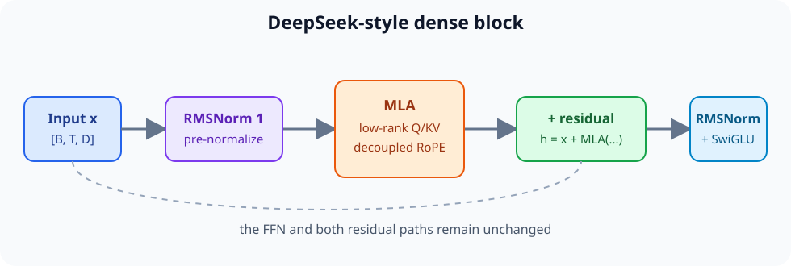

# Integrating MLA Into the Dense Transformer

The previous articles built a complete naive MLA attention layer with low-rank projections and decoupled RoPE. It has only been tested in isolation so far.

Now we place MLA inside a real Transformer block and stack those blocks into a complete language model. The original dense GPT baseline stays available, which gives us a direct comparison.

## 1. What changes in the block

The dense baseline uses:

```text
x
 -> RMSNorm -> standard causal attention with RoPE -> residual addition
 -> RMSNorm -> SwiGLU FFN -> residual addition
```

The MLA version changes only the attention sublayer:

```text
x
 -> RMSNorm -> naive MLA with decoupled RoPE -> residual addition
 -> RMSNorm -> SwiGLU FFN -> residual addition
```



The block still follows:

```text
h = x + attention(RMSNorm_1(x))
y = h + SwiGLU(RMSNorm_2(h))
```

The official model later combines MLA with dense and MoE feed-forward layers. This repository first uses dense SwiGLU throughout so the attention replacement can be studied independently.

## 2. One tensor through the block

For `B=2`, `T=128`, and hidden size `D=256`:

| Operation | Input | Output |
| --- | --- | --- |
| RMSNorm 1 | `[2, 128, 256]` | `[2, 128, 256]` |
| Query compression | `[2, 128, 256]` | query latent `[2, 128, 128]` |
| KV compression | `[2, 128, 256]` | latent `[2, 128, 64]` plus positional key |
| MLA attention | projected Q/K/V | `[2, 128, 256]` |
| First residual | two `[2, 128, 256]` tensors | `[2, 128, 256]` |
| RMSNorm 2 | `[2, 128, 256]` | `[2, 128, 256]` |
| SwiGLU gate and up | `[2, 128, 256]` | two `[2, 128, 768]` tensors |
| SwiGLU down | `[2, 128, 768]` | `[2, 128, 256]` |
| Second residual | two `[2, 128, 256]` tensors | `[2, 128, 256]` |

The internal query, key, value, and attention-score tensors are larger or differently shaped, but the block input and output always have the same hidden size. That is what lets us stack the blocks.

## 3. Build `DeepSeekBlock`

Keep the existing `TransformerBlock` as the dense GPT baseline. Add this class to `src/model/transformer.py`:

```python
from .mla import MLA


class DeepSeekBlock(nn.Module):
    """Dense Transformer block using naive MLA attention."""

    def __init__(self, config) -> None:
        super().__init__()
        self.attn_norm = RMSNorm(config.dim, eps=1e-6)
        self.attention = MLA(config)
        self.ffn_norm = RMSNorm(config.dim, eps=1e-6)
        self.ffn = SwiGLUFFN(
            dim=config.dim,
            hidden_dim=config.inter_dim,
        )

    def forward(self, x: torch.Tensor) -> torch.Tensor:
        x = x + self.attention(self.attn_norm(x))
        return x + self.ffn(self.ffn_norm(x))
```

The only architectural replacement is `MLA(config)` in place of `CausalSelfAttention(...)`. The normalization, FFN, and residual paths remain the same.

## 4. Build `DeepSeekMLA`

Create `src/model/deepseek_mla.py`:

```python
import torch
from torch import nn

from .config import DeepSeekConfig
from .embeddings import TokenEmbedding
from .rmsnorm import RMSNorm
from .transformer import DeepSeekBlock


class DeepSeekMLA(nn.Module):
    """Dense language model with MLA attention and SwiGLU FFNs."""

    def __init__(self, config: DeepSeekConfig) -> None:
        super().__init__()
        self.config = config
        self.embed_tokens = TokenEmbedding(config)
        self.blocks = nn.ModuleList(
            [DeepSeekBlock(config) for _ in range(config.n_layers)]
        )
        self.norm = RMSNorm(config.dim, eps=1e-6)
        self.lm_head = nn.Linear(config.dim, config.vocab_size, bias=False)

    def forward(self, input_ids: torch.Tensor) -> torch.Tensor:
        if input_ids.ndim != 2:
            raise ValueError("Expected input_ids with shape [batch, sequence]")
        if input_ids.shape[1] > self.config.max_seq_len:
            raise ValueError("Sequence exceeds maximum length")

        hidden_states = self.embed_tokens(input_ids)
        for block in self.blocks:
            hidden_states = block(hidden_states)
        hidden_states = self.norm(hidden_states)
        return self.lm_head(hidden_states)
```

The complete data flow is:

```text
token IDs [B, T]
    -> embeddings [B, T, D]
    -> DeepSeekBlock repeated L times
    -> final RMSNorm
    -> LM head [B, T, vocabulary]
```

Each block has its own MLA projections, output projection, FFN weights, and normalization scales. Parameters are not shared across layers.

## 5. Parameter count

For the small configuration:

```text
D = 256
I = 768
L = 6
V = 8,192
```

The naive MLA layer has 200,896 learned parameters. The dense SwiGLU has:

```text
3 * D * I = 3 * 256 * 768 = 589,824
```

The two block RMSNorms add `2 * D = 512`. Therefore:

```text
one MLA block = 200,896 + 589,824 + 512
              = 791,232
```

The full model is:

```text
total = 2 * V * D + L * 791,232 + D
      = 4,194,304 + 4,747,392 + 256
      = 8,941,952 parameters
```

The dense GPT baseline has 9,309,440 parameters for the same vocabulary, hidden size, and number of layers. These models are not parameter-matched, so a loss comparison should report both parameter counts.

Verify counts from instantiated models rather than relying only on arithmetic:

```python
from src.model import DeepSeekConfig, DeepSeekSkeleton
from src.model.deepseek_mla import DeepSeekMLA

config = DeepSeekConfig()
gpt = DeepSeekSkeleton(config)
mla = DeepSeekMLA(config)

def count_parameters(model):
    return sum(parameter.numel() for parameter in model.parameters())

print("GPT:", count_parameters(gpt))
print("MLA:", count_parameters(mla))
```

The lower parameter count is not the main motivation for MLA. Its primary purpose is the compressed KV representation used during inference, which this naive layer does not implement yet.

## 6. Full-network forward and backward

An integration test should run the loss through the entire model:

```python
import torch
import torch.nn.functional as F

from src.model import DeepSeekConfig
from src.model.deepseek_mla import DeepSeekMLA

config = DeepSeekConfig(vocab_size=512, max_seq_len=128)
model = DeepSeekMLA(config)
tokens = torch.randint(0, config.vocab_size, (2, 128))
input_ids = tokens[:, :-1]
target_ids = tokens[:, 1:]

logits = model(input_ids)
loss = F.cross_entropy(
    logits.reshape(-1, config.vocab_size),
    target_ids.reshape(-1),
)
loss.backward()

assert model.blocks[0].attention.q_branch.q_down.weight.grad is not None
assert model.blocks[-1].attention.kv_branch.kv_down.weight.grad is not None
```

The gradient path is:

```text
loss -> LM head -> final block -> ... -> first block -> embeddings
```

Gradients must reach both query and KV compression branches in every block.

## 7. Causality across the complete model

The MLA layer already uses an upper-triangular future mask. Residual connections, RMSNorm, and SwiGLU operate independently at each position, so they should preserve causality when stacked.

The behavioral test is:

```python
torch.manual_seed(42)
config = DeepSeekConfig(
    vocab_size=256,
    dim=64,
    n_layers=3,
    n_heads=4,
    q_lora_rank=32,
    kv_lora_rank=16,
    qk_nope_head_dim=16,
    qk_rope_head_dim=8,
    v_head_dim=16,
    inter_dim=128,
    max_seq_len=32,
)
model = DeepSeekMLA(config).eval()

original = torch.tensor([[10, 20, 30, 40, 50, 60, 70, 80]])
changed = torch.tensor([[10, 20, 30, 40, 50, 91, 92, 93]])

with torch.no_grad():
    original_logits = model(original)
    changed_logits = model(changed)

torch.testing.assert_close(
    original_logits[:, :5],
    changed_logits[:, :5],
)
```

Changing positions 5 and later must not alter the logits at positions 0 through 4. If this fails, inspect the MLA mask, tensor transposes, and positional-key broadcasting.

## 8. Compare GPT and MLA fairly

The first comparison should use identical data and optimization settings:

| Setting | GPT baseline | MLA model |
| --- | --- | --- |
| Dataset | FineWeb-Edu subset | same |
| Tokenizer | repository BPE | same |
| Hidden size | 256 | 256 |
| Layers | 6 | 6 |
| FFN | SwiGLU | SwiGLU |
| Attention | standard MHA | naive MLA |
| Optimizer | AdamW | AdamW |
| Learning rate | `3e-4` | `3e-4` |

Record more than the final loss:

- training loss;
- validation loss;
- parameter count;
- tokens per second;
- peak training memory.

Naive MLA may be slower or use similar training memory because it still materializes full attention score matrices and expanded content keys and values. A smaller theoretical inference cache does not automatically mean lower full-sequence training memory.

The reproducible comparison entry point is `src/experiments/compare_gpt_mla.py`:

```bash
python -m src.experiments.compare_gpt_mla \
  --data-dir data/processed \
  --steps 50 \
  --batch-size 4 \
  --seq-len 128
```

This short run is an integration experiment, not evidence that one architecture universally outperforms the other. Use multiple seeds and a held-out evaluation set for meaningful conclusions.

## 9. What is still missing

This repository now has:

| Component | Current implementation |
| --- | --- |
| Token embeddings | yes |
| RMSNorm | yes |
| Low-rank query projection | yes |
| Joint KV compression | yes |
| Decoupled RoPE | yes |
| Naive MLA forward pass | yes |
| MLA inside a full dense Transformer | yes |
| Compressed KV-cache decoding | not yet |
| DeepSeekMoE | not yet |
| Auxiliary-loss-free routing | not yet |
| Multi-Token Prediction | not yet |

The current `DeepSeekMLA` model reconstructs expanded content keys and values for each full forward pass. The compressed cache and matrix-absorption path are separate inference work.

## 10. Tests

The integration checks live in `src/tests/test_deepseek_mla.py`:

```bash
python -m pytest src/tests/test_deepseek_mla.py -v
```

They cover block shape, full-model logits, backward propagation, parameter count, and full-network causality. The existing dense GPT, RoPE, and isolated MLA tests should continue to pass as well.

## Check your understanding

Does integrating MLA into the Transformer automatically provide the compressed KV-cache memory savings?

```text
No. The current naive forward pass still reconstructs full head-specific content keys and values. The compressed-cache implementation comes later.
```

## Summary

MLA replaces the attention sublayer while the Transformer block keeps its RMSNorm, residual, and SwiGLU structure. `DeepSeekBlock` and `DeepSeekMLA` now provide a complete dense language model with decoupled RoPE and naive MLA attention.

The stable GPT baseline remains available for controlled comparisons. The next inference step is to implement the compressed KV cache and matrix absorption so that the memory-saving parameterization is reflected in actual decoding behavior.
