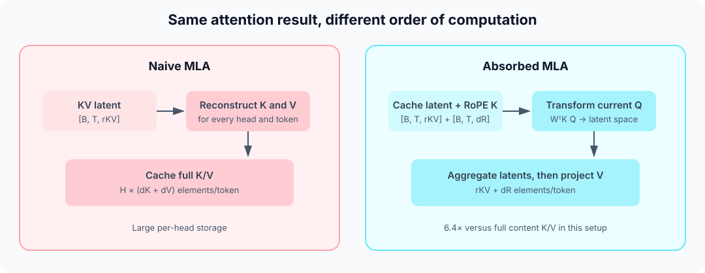

# Compressed KV Cache and Matrix Absorption

The MLA layer can now calculate attention correctly, but it still reconstructs
full Keys and Values for every token. That is useful for learning the
architecture. During generation, however, we want to avoid repeatedly
expanding all representations from previous tokens.

This article implements two mathematically equivalent inference paths:

- **Naive MLA:** reconstruct full K/V vectors and then calculate attention.
- **Absorbed MLA:** keep compressed KV latents in the cache and rearrange the
  matrix multiplications so past K/V vectors are never reconstructed.

We will also implement prompt prefill, incremental token decoding, numerical
equivalence tests, and full-model cache integration.



## 1. What problem remains after full MLA integration?

The existing MLA path does this:

```text
Past hidden states
        ↓
Compressed KV latents [B, T, rKV]
        ↓
Reconstruct full K and V for every head
        ↓
Calculate attention
```

For one token in the small configuration, the full content K/V tensors contain

\[
8\times32+8\times32=512
\]

numbers. Instead, MLA can retain

\[
64+16=80
\]

numbers: 64 compressed KV features and 16 positional Key features.

The challenge is to calculate the same attention result without expanding every
cached K/V vector.

## 2. Matrix absorption with a simple example

Imagine a two-dimensional Query, a one-dimensional compressed Key latent, and
a reconstruction matrix:

\[
q=[2,3],
\qquad
c=[4],
\qquad
W_K=\begin{bmatrix}1\\2\end{bmatrix}.
\]

### Reconstruct the Key first

\[
k=W_Kc=\begin{bmatrix}4\\8\end{bmatrix}
\]

so the attention score is

\[
q^\mathsf{T}k=2(4)+3(8)=32.
\]

### Transform the Query instead

Rearrange the multiplication:

\[
q^\mathsf{T}W_Kc=(W_K^\mathsf{T}q)^\mathsf{T}c.
\]

The transformed Query is

\[
W_K^\mathsf{T}q=1(2)+2(3)=8,
\]

and the score against the compressed latent is

\[
8\times4=\boxed{32}.
\]

The score is identical without constructing the two-dimensional Key. This is
not an approximation. It is associativity of matrix multiplication.

## 3. Value matrix absorption

Suppose three cached KV latents are \(c_1,c_2,c_3\), and the Value
reconstruction is

\[
v_j=W_Vc_j.
\]

The attention output is

\[
o=\alpha_1v_1+\alpha_2v_2+\alpha_3v_3.
\]

Substituting the reconstruction gives

\[
o=\alpha_1W_Vc_1+\alpha_2W_Vc_2+\alpha_3W_Vc_3.
\]

Because the projection is linear and shared across token positions within one
head,

\[
\boxed{o=W_V(\alpha_1c_1+\alpha_2c_2+\alpha_3c_3)}.
\]

Instead of reconstructing three full Values, we combine the small latent
vectors first and reconstruct once.

The two identities are:

\[
\boxed{q^\mathsf{T}(W_Kc)=(W_K^\mathsf{T}q)^\mathsf{T}c}
\]

and

\[
\boxed{\sum_j\alpha_jW_Vc_j=W_V\sum_j\alpha_jc_j}.
\]

The content path has no position-dependent rotation between the latent and its
reconstructed Key. That is why the positional features were separated when we
implemented decoupled RoPE.

## 4. Full attention with content and position

For head \(h\), the content Key is

\[
k_{j,h}^C=W_{K,h}c_j^{KV},
\]

and the positional Key is

\[
k_j^R=\operatorname{RoPE}_j(k_{j,\mathrm{raw}}^R).
\]

The total score is

\[
s_{ijh}=\frac{
(q_{i,h}^C)^\mathsf{T}W_{K,h}c_j^{KV}
+(q_{i,h}^R)^\mathsf{T}k_j^R
}{\sqrt{d_C+d_R}}.
\]

After absorbing the content Key projection:

\[
\boxed{
s_{ijh}=\frac{
(W_{K,h}^\mathsf{T}q_{i,h}^C)^\mathsf{T}c_j^{KV}
+(q_{i,h}^R)^\mathsf{T}k_j^R
}{\sqrt{d_C+d_R}}
}
\]

The positional contribution is still calculated separately. After softmax, the
weighted latent is projected through the Value matrix:

\[
\boxed{o_{i,h}=W_{V,h}\sum_j\alpha_{ijh}c_j^{KV}}.
\]

For one new token, the computation is:

```text
Current content Query + RoPE Query
                 ↓
Content scores: transformed Query × cached KV latents
Position scores: RoPE Query × cached RoPE Keys
                 ↓
Add scores → scale → softmax
                 ↓
Weighted sum of cached KV latents
                 ↓
Value up-projection → output projection
```

## 5. The compressed cache

For the small configuration, the cache stores these tensors after (T) tokens:

| Tensor | Shape |
| --- | --- |
| Normalized KV latent | `[B, T, 64]` |
| Rotated positional Key | `[B, T, 16]` |

It does not store expanded per-head K/V tensors.

The KV latent must be taken **after KV RMSNorm**, because that is the
representation supplied to the KV up-projection. The positional Key is stored
**after RoPE**, so previous positions do not need to be rotated again.

`src/model/mla_cache.py` defines `CachedMLA`, a subclass of the existing
`MLA` layer. It reuses every trained projection weight. The inherited
`forward()` remains the naive full-sequence reference path.

The cache is dynamically sized with `torch.cat`. That makes the algorithm easy
to inspect, although a production implementation would preallocate storage or
use a specialized allocator.

```python
from src.model import CachedMLA, DeepSeekConfig

model = CachedMLA(DeepSeekConfig()).eval()
model.reset_cache()
```

The `cache_length` property reports the number of stored positions. Calling
`reset_cache()` starts a new request without changing any learned weights.

## 6. Prompt prefill

`CachedMLA.prefill(x)` uses the trusted full MLA forward path to calculate the
prompt output. It then computes and stores the normalized KV latents and
rotated positional Keys for that prompt.

```python
import torch

from src.model import CachedMLA, DeepSeekConfig

config = DeepSeekConfig(max_seq_len=128)
model = CachedMLA(config).eval()
prompt_hidden = torch.randn(1, 5, config.dim)

with torch.no_grad():
    prompt_output = model.prefill(prompt_hidden)

print(model.cache_length)  # 5
```

Prefill starts a fresh request. Call `reset_cache()` before using it again.
Keeping this rule explicit prevents a prompt from accidentally being appended
to an old request.

## 7. One-token absorbed decoding

`CachedMLA.decode_step(x)` expects `[B, 1, D]` and performs these operations:

1. Produce the current content and positional Queries.
2. Produce the current normalized KV latent and positional Key.
3. Rotate the new positional Key at its absolute cache position.
4. Append both representations to the cache.
5. Transform the content Query with each head's Key reconstruction matrix.
6. Calculate content and position scores against all cached positions.
7. Aggregate cached latents using the attention probabilities.
8. Reconstruct the Value output once per head.

For a Tiny-DeepSeek with (H=8), (d_C=32), (d_R=16), (d_V=32), and
(r_{KV}=64), decoding position 129 produces:

| Operation | Shape |
| --- | --- |
| New hidden state | `[B, 1, 256]` |
| Current content Query | `[B, 8, 32]` |
| Current positional Query | `[B, 8, 16]` |
| Updated latent cache | `[B, 129, 64]` |
| Updated RoPE Key cache | `[B, 129, 16]` |
| Key reconstruction matrix | `[8, 32, 64]` |
| Absorbed Query | `[B, 8, 64]` |
| Content scores | `[B, 8, 129]` |
| Position scores | `[B, 8, 129]` |
| Attention probabilities | `[B, 8, 129]` |
| Aggregated KV latent | `[B, 8, 64]` |
| Reconstructed Value | `[B, 8, 32]` |
| Final output | `[B, 1, 256]` |

Every head sees the same compressed cache, but each head applies different Key
and Value reconstruction weights. Head-specific behavior is preserved without
head-specific cached K/V tensors.

## 8. The decisive equivalence tests

Both inference paths must agree when they use the same weights and context.
The tests in `src/tests/test_mla_cache.py` cover a standalone layer and the
complete language model.

For a standalone layer:

```python
torch.manual_seed(42)
config = DeepSeekConfig(dim=64, n_heads=4, max_seq_len=32)
model = CachedMLA(config).eval()
hidden_states = torch.randn(2, 6, config.dim)

with torch.no_grad():
    naive_output = model(hidden_states)
    model.reset_cache()
    model.prefill(hidden_states[:, :5])
    absorbed_output = model.decode_step(hidden_states[:, 5:6])

torch.testing.assert_close(
    naive_output[:, 5:6],
    absorbed_output,
    atol=2e-4,
    rtol=2e-4,
)
```

The test also decodes a complete sequence one token at a time and compares
every output to the ordinary causal forward pass. This checks cache growth,
absolute positional offsets, and causal behavior throughout the sequence.

Small differences are expected in FP32 because the two paths perform matrix
operations in a different order. The test uses a tolerance rather than
requiring bit-for-bit equality.

Run the focused tests with:

```bash
python -m pytest src/tests/test_mla_cache.py -v
```

## 9. Cached inference in every Transformer block

A complete Transformer needs one compressed cache per layer. Every layer sees
different hidden states and has different learned projection matrices, so the
latent stored by one layer cannot be reused by another.

`DeepSeekBlock` now has three inference operations:

| Method | Purpose |
| --- | --- |
| `forward(x)` | Ordinary full-sequence MLA, used for training |
| `prefill(x)` | Process a prompt and initialize this block's cache |
| `decode_step(x)` | Process one token using the cached context |

The block preserves both residual connections:

```python
hidden_states = x + self.attention.prefill(self.attn_norm(x))
hidden_states = hidden_states + self.ffn(
    self.ffn_norm(hidden_states)
)
```

`DeepSeekMLA` exposes the same interface. It embeds the prompt, passes it
through every block's `prefill()`, and then applies the final normalization and
language-model head. `decode_step()` performs the same sequence for one new
token.

```python
from src.model import DeepSeekConfig, DeepSeekMLA

config = DeepSeekConfig(vocab_size=512, max_seq_len=64, n_layers=3)
model = DeepSeekMLA(config).eval()
tokens = torch.randint(0, config.vocab_size, (1, 12))

with torch.no_grad():
    full_logits = model(tokens)
    model.reset_cache()
    model.prefill(tokens[:, :-1])
    cached_logits = model.decode_step(tokens[:, -1:])

torch.testing.assert_close(
    full_logits[:, -1:],
    cached_logits,
    atol=2e-4,
    rtol=2e-4,
)
```

The ordinary `forward()` method does not clear or update inference caches.
Training and inference state remain separate and explicit.

## 10. Measure actual storage

The compressed representation uses

\[
r_{KV}+d_R=64+16=80
\]

elements per token per layer. With BF16 storage, that is

\[
80\times2=160\text{ bytes}.
\]

The full content K/V comparison uses

\[
8\times32+8\times32=512
\]

elements, or 1,024 bytes in BF16. This is the 6.4× theoretical reduction
described earlier.

The actual cache dtype matters. RMSNorm and surrounding operations can produce
FP32 tensors, depending on how the model is run. The educational
implementation stores the tensors produced by the model, so the cache's
`dtype`, `numel()`, and `element_size()` should be inspected rather than
assuming every element occupies two bytes.

```python
def tensor_mib(tensor):
    return tensor.numel() * tensor.element_size() / (1024 ** 2)

print("KV latent shape:", model.blocks[0].attention.kv_cache.shape)
print("KV latent dtype:", model.blocks[0].attention.kv_cache.dtype)
print("KV latent MiB:", tensor_mib(model.blocks[0].attention.kv_cache))
```

For a fair BF16 comparison, both implementations must store their K/V
representations using the same two-byte dtype. In production, dtype selection,
cache layout, memory allocation, and kernel support all affect realized
memory savings.

This completes the MLA inference path. The next architecture change is
DeepSeekMoE.
