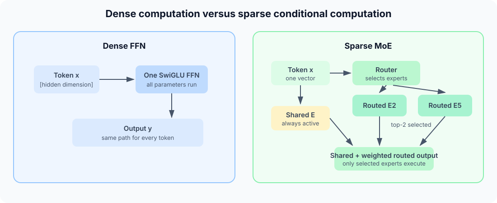

# Why DeepSeek Uses Mixture of Experts

The MLA attention path is now complete. The next architectural change is the
feed-forward sublayer: instead of sending every token through one dense FFN,
we will create many smaller FFNs and activate only a few for each token.

This is the central idea behind sparse Mixture of Experts (MoE). It gives the
model more total parameters without making every token execute every expert.

This article focuses on the design and the parameter arithmetic. The expert
networks and router will be implemented in the following articles.



## 1. What problem does MoE solve?

The dense baseline uses the same SwiGLU feed-forward network for every token.
For the small configuration, one Transformer block contains:

```text
Token representation [256]
        ↓
Dense SwiGLU FFN
        256 → 768 → 256
        ↓
Output representation [256]
```

That same FFN must process very different representations, such as:

- `The mitochondria produces...`
- `def quicksort(arr):`
- `The capital of France is...`

Dense Transformers work well, but increasing the size of one FFN increases the
computation performed by every token. MoE offers another option: create many
independent FFNs and let a router activate only a small subset for each token.

This is also called **conditional computation**. The model has many available
computations, but the input determines which ones run.

## 2. Dense FFN versus MoE

In a dense Transformer, every token follows one path:

```text
Token → FFN → Output
```

In an MoE Transformer, the token follows a routed path:

```text
Token → Router → selected experts → weighted output
```

The input and output dimensions remain the same. Internally, multiple expert
networks exist, but the router determines which ones process a given token.

An expert is a feed-forward network—not a separate Transformer, tokenizer, or
language model. Attention and tokenization remain outside the experts.

## 3. What is an expert?

An expert is the same gated FFN structure already used by the dense baseline:

\[
\operatorname{Expert}(x)=
W_d\left[\operatorname{SiLU}(W_gx)\odot W_ux\right].
\]

In code, an expert will reuse the `SwiGLUFFN` structure from
`src/model/ffn.py`:

```python
from src.model.ffn import SwiGLUFFN

expert = SwiGLUFFN(dim=256, hidden_dim=256)
```

The difference is scale. The dense baseline uses an intermediate dimension of
768. Each small routed expert uses an intermediate dimension of 256.

For a bias-free SwiGLU, the parameter count is approximately

\[
P_{\text{expert}}=3DI.
\]

With \(D=256\) and \(I=256\):

\[
P_{\text{expert}}=3\times256\times256
=\boxed{196,608}.
\]

One expert is smaller than the dense FFN, which has approximately

\[
3\times256\times768=589,824
\]

parameters. MoE gets its additional capacity from having multiple independent
experts.

## 4. The router chooses experts

Suppose there are eight routed experts. For each token representation

\[
x\in\mathbb{R}^{256},
\]

the router produces one score per expert:

\[
s=\sigma(W_{\text{router}}x),
\qquad
W_{\text{router}}\in\mathbb{R}^{8\times256},
\qquad
s\in\mathbb{R}^{8}.
\]

An illustrative score vector might be

\[
s=[0.12,0.81,0.23,0.14,0.91,0.20,0.34,0.16].
\]

With top-2 routing, the token selects:

- Expert 5 with score 0.91
- Expert 2 with score 0.81

The other six routed experts are not executed for that token.

DeepSeek-style routing uses sigmoid affinity scores and normalized weights for
the selected experts. The assignments are learned from the training signal;
they are not manually assigned to topics.

## 5. Shared experts and routed experts

DeepSeekMoE has two parallel paths.

### Routed experts

The router selects a small subset of the routed experts for each token. With
eight routed experts and top-2 routing, different tokens may use combinations
such as:

```text
Token A → experts 2 and 5
Token B → experts 1 and 7
Token C → experts 2 and 3
```

### Shared experts

Shared experts process every token, regardless of the router's choices. The
small configuration uses one shared expert.

The conceptual MoE output is

\[
\boxed{
y=\operatorname{SharedExpert}(x)
+\sum_{i\in\operatorname{TopK}(x)}
g_i(x)\operatorname{Expert}_i(x)
}.
\]

The shared path can learn broadly useful transformations, while routed experts
can develop more differentiated behavior. Without a shared path, common
patterns may need to be learned redundantly across routed experts.

That is a design motivation, not a guarantee that every expert learns one
human-readable subject.

## 6. Does expert specialization happen?

If the router repeatedly sends some token representations to one expert, that
expert receives gradients from those examples and can develop useful behavior
for the representations it sees.

Over time:

1. The router learns which expert combinations help prediction.
2. Experts improve on the representations routed to them.
3. Different experts can develop different learned behaviors.

It is tempting to say that one expert learns biology, another learns code, and
another learns geography. Real specialization is usually more complicated.
Experts may respond to syntax, token distributions, feature combinations, or
patterns that are difficult to interpret. Routing can also change by context
and by Transformer layer.

MoE is learned conditional computation, not manual domain assignment.

## 7. Total parameters versus active parameters

DeepSeek-V3 is commonly described as having approximately 671B total
parameters and approximately 37B activated parameters per token. These are
different measurements:

| Quantity | Meaning |
| --- | --- |
| Total parameters | All model weights, including inactive experts |
| Active parameters | Weights involved in one token's selected computation |

Inactive expert weights still need to be stored or made available for other
tokens. Active parameters also do not determine runtime by themselves: routing,
memory movement, communication, and other operations add overhead.

An analogy is a company with many specialist teams. The company has all teams
available, but a particular task requires only a few of them.

## 8. Parameter arithmetic for the small configuration

The configuration already contains the settings needed for MoE in
`src/model/config.py`:

| Parameter | Value |
| --- | ---: |
| Hidden dimension | 256 |
| Routed experts | 8 |
| Active routed experts per token | 2 |
| Shared experts | 1 |
| Expert intermediate dimension | 256 |
| Router output scores | 8 |

Each expert has 196,608 parameters.

### Total MoE parameters

Eight routed experts contribute

\[
8\times196,608=1,572,864.
\]

One shared expert contributes 196,608 parameters. The router contributes

\[
8\times256=2,048.
\]

Therefore:

\[
\boxed{
1,572,864+196,608+2,048=1,771,520
}
\]

parameters are available in one MoE FFN sublayer.

### Parameters on one token's active path

Two routed experts and one shared expert process the token:

\[
3\times196,608=589,824.
\]

Including the router:

\[
\boxed{589,824+2,048=591,872}
\]

parameters participate in the active MoE path.

The dense FFN also has 589,824 parameters in this comparison. The MoE sublayer
therefore provides roughly three times the FFN parameter capacity while
activating approximately the same number of FFN weights per token.

The router and expert dispatch create real overhead, so equal parameter counts
do not imply equal wall-clock time.

## 9. Why begin with dense layers?

DeepSeek-V3 uses dense FFNs in its first few layers and MoE in later layers.
For our six-layer small model, the planned layout is:

| Layer | Feed-forward sublayer |
| ---: | --- |
| 1 | Dense SwiGLU |
| 2 | One shared + top-2 routed experts |
| 3 | One shared + top-2 routed experts |
| 4 | One shared + top-2 routed experts |
| 5 | One shared + top-2 routed experts |
| 6 | One shared + top-2 routed experts |

Early layers can provide broadly reusable transformations, while later layers
can benefit from additional conditional capacity. This is an architectural
motivation, not a strict claim about what each layer learns.

The existing `DeepSeekMLA` model still uses dense SwiGLU blocks. Replacing
later FFNs with MoE will happen after the expert and routing components are
implemented and tested.

## 10. The load-balancing challenge

Suppose eight experts exist, but the router selects experts 1 and 2 for almost
every token. Then:

- Experts 1 and 2 become overloaded.
- The other experts receive little training.
- Much of the available capacity is unused.
- Distributed implementations can be bottlenecked by the overloaded experts.

The router must balance two objectives:

\[
\text{Route tokens to useful experts}
\]

and

\[
\text{Avoid overloading a small subset of experts}.
\]

Earlier MoE systems commonly used auxiliary losses to encourage balanced
expert usage. DeepSeek-V3 emphasizes an auxiliary-loss-free balancing strategy
with expert-wise routing biases adjusted from observed loads. The technical
report also describes a small supplementary sequence-wise balancing loss.

The exact balancing algorithm belongs in the later routing work. For now, the
important point is that expert selection cannot be considered independently
from expert capacity and utilization.

## 11. Inspect the configuration

The current configuration can be inspected without implementing MoE yet:

```python
from src.model import DeepSeekConfig

config = DeepSeekConfig()
print("Routed experts:", config.n_routed_experts)
print("Shared experts:", config.n_shared_experts)
print("Selected routed experts:", config.n_activated_experts)
print("Expert intermediate dim:", config.moe_inter_dim)
print("Initial dense layers:", config.n_dense_layers)
```

Expected values are:

```text
Routed experts: 8
Shared experts: 1
Selected routed experts: 2
Expert intermediate dim: 256
Initial dense layers: 1
```

The parameter calculation can also be reproduced directly:

```python
D = config.dim
I = config.moe_inter_dim
experts = config.n_routed_experts
active = config.n_activated_experts
shared = config.n_shared_experts

expert_params = 3 * D * I
router_params = D * experts
total = (experts + shared) * expert_params + router_params
active_path = (active + shared) * expert_params + router_params

print(f"One expert: {expert_params:,}")
print(f"Total MoE sublayer: {total:,}")
print(f"Active path: {active_path:,}")
```

This is a parameter-counting exercise, not a working MoE implementation.

## 12. Check your understanding

There are eight routed experts, two selected routed experts, and one shared
expert. How many expert FFNs process one token in one MoE layer?

**Answer: three** — two routed experts plus one shared expert.

## 13. Recap

The key ideas are:

1. MoE increases model capacity without executing every expert for every token.
2. An expert is a SwiGLU FFN with its own independent weights.
3. Shared experts process every token; routed experts are selected by the router.
4. Total parameters include inactive experts, while active parameters describe
   the selected computation path.
5. Routing introduces a load-balancing problem and additional runtime overhead.

The next implementation step is to create individual SwiGLU experts, place
them in an `nn.ModuleList`, and implement the always-active shared expert.
Token-dependent top-k routing will be added after the expert computation is
understood in isolation.
