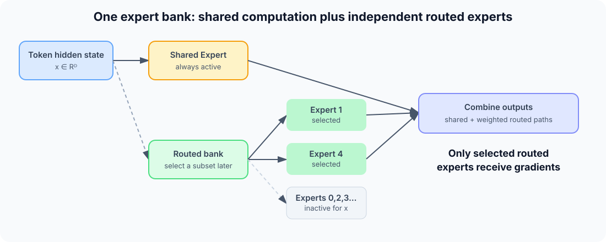

# Implementing DeepSeek Expert Networks

Mixture-of-Experts routing needs actual expert networks before it can choose
which experts to execute. Here an expert is a SwiGLU feed-forward network with
its own independent parameters.

This article implements:

- one reusable `Expert` network;
- a bank of independently trainable routed experts;
- an always-active shared expert;
- manual weighted expert combination; and
- tests that verify sparse gradient flow.

Top-k routing is intentionally left for the next implementation step. Until a
router exists, the selected expert IDs and weights in the examples are fixed.



## 1. The expert bank

The small configuration has eight routed experts and one shared expert:

```text
Input hidden states [B, T, 256]
        ├── shared SwiGLU expert      (always active)
        └── routed expert bank
              ├── Expert 0
              ├── Expert 1
              ├── ...
              └── Expert 7
                    ↓
             combine expert outputs
                    ↓
              Output [B, T, 256]
```

An expert is not an entire Transformer. It processes hidden features with a
feed-forward network. Each expert has the same architecture, but its own
weights.

## 2. Reuse the SwiGLU computation

The expert uses the same gated FFN formula as the dense baseline:

\[
\operatorname{SwiGLU}(x)=
W_{\mathrm{down}}
\left[\operatorname{SiLU}(W_{\mathrm{gate}}x)
\odot W_{\mathrm{up}}x\right].
\]

For one small expert:

```text
Input [256]
  ├── gate projection → SiLU
  └── up projection
          ↓
    element-wise product [256]
          ↓
    down projection → Output [256]
```

The expert intermediate dimension is 256 rather than 768, so its parameter
count is

\[
3\times256\times256=\boxed{196,608}.
\]

The output has the same shape as the input and can later be used inside a
Transformer residual path.

## 3. Implement one expert

`src/model/experts.py` contains the explicit `Expert` class:

```python
from src.model import Expert

expert = Expert(dim=256, hidden_dim=256)
x = torch.randn(2, 128, 256)
y = expert(x)

assert y.shape == x.shape
assert sum(parameter.numel() for parameter in expert.parameters()) == 196_608
```

The class has three bias-free projections: `gate_proj`, `up_proj`, and
`down_proj`. It accepts any leading dimensions, so both `[B, T, D]` batches and
individual `[D]` token vectors are valid as long as the last dimension is the
configured hidden size.

## 4. Create independent routed experts

The bank uses `nn.ModuleList`:

```python
self.routed_experts = nn.ModuleList(
    [
        Expert(dim=config.dim, hidden_dim=config.moe_inter_dim)
        for _ in range(config.n_routed_experts)
    ]
)
```

This creates separate `Expert` objects with separate trainable tensors. The
experts share an architecture, not weights.

If every expert shared the same parameters, selecting different expert IDs
would not provide different learned transformations. Independent weights are
what make specialization possible.

## 5. The shared expert

The bank also owns an always-active shared path:

```python
self.shared_expert = Expert(
    dim=config.dim,
    hidden_dim=config.n_shared_experts * config.moe_inter_dim,
)
```

The shared path is represented as one wider SwiGLU. With
`n_shared_experts=1`, its intermediate dimension is 256. If the configuration
uses a larger shared-expert count, the intermediate dimension grows instead of
creating several independent shared modules.

The current bank exposes two explicit methods:

```python
shared_output = bank.forward_shared(x)
expert_output = bank.forward_expert(expert_id=3, x=x)
```

There is intentionally no automatic `forward()` that runs all routed experts.
Doing so would hide the sparse-computation behavior before routing has been
implemented.

## 6. Inspect the expert bank

```python
from src.model import DeepSeekConfig, ExpertBank

config = DeepSeekConfig()
bank = ExpertBank(config)
x = torch.randn(2, 16, config.dim)

shared = bank.forward_shared(x)
expert_0 = bank.forward_expert(0, x)
expert_3 = bank.forward_expert(3, x)

print("Shared:", shared.shape)
print("Expert 0:", expert_0.shape)
print("Expert 3:", expert_3.shape)
print("Same routed outputs:", torch.allclose(expert_0, expert_3))
```

All outputs have shape `[2, 16, 256]`. The two routed outputs are generally
different because their weights were initialized independently.

## 7. Manually combine selected experts

Before building a router, select experts 1 and 4 by hand. Suppose their future
routing weights are 0.6 and 0.4:

\[
\boxed{
y=E_{\mathrm{shared}}(x)+0.6E_1(x)+0.4E_4(x)
}.
\]

```python
shared = bank.forward_shared(x)
selected_1 = bank.forward_expert(1, x)
selected_4 = bank.forward_expert(4, x)

output = shared + 0.6 * selected_1 + 0.4 * selected_4
assert output.shape == x.shape
```

The same two experts are selected for every token in this example. The real
router will allow different tokens in one batch to select different experts.

## 8. Sparse gradient flow

Suppose the manually selected experts are 1 and 4:

\[
y=E_{\mathrm{shared}}(x)+0.6E_1(x)+0.4E_4(x).
\]

For a loss such as

\[
\mathcal{L}=\operatorname{mean}(y^2),
\]

the shared expert receives gradients because it contributed to every output.
Experts 1 and 4 receive gradients because they contributed to the routed
output. Experts 0, 2, 3, 5, 6, and 7 are not part of the computation graph for
this loss, so their weights receive no gradient from it.

```python
x = torch.randn(2, 16, config.dim, requires_grad=True)
output = (
    bank.forward_shared(x)
    + 0.6 * bank.forward_expert(1, x)
    + 0.4 * bank.forward_expert(4, x)
)
output.square().mean().backward()

assert bank.shared_expert.gate_proj.weight.grad is not None
assert bank.routed_experts[1].gate_proj.weight.grad is not None
assert bank.routed_experts[4].gate_proj.weight.grad is not None
assert bank.routed_experts[0].gate_proj.weight.grad is None
```

In a real batch, different tokens select different experts. Each expert
receives accumulated gradients from the tokens routed to it.

## 9. Parameter counts

The bank contains eight routed experts and one shared expert:

\[
9\times196,608=1,769,472
\]

expert parameters. The router is not included yet; its future weight matrix
would add

\[
256\times8=2,048
\]

parameters.

For one manually selected pair, the shared expert plus two routed experts
participate in the active expert path:

\[
3\times196,608=589,824.
\]

The inactive expert weights still occupy storage even though they do not
participate in this token's computation graph.

The parameter count can be checked directly:

```python
expert_params = 3 * config.dim * config.moe_inter_dim
total_expert_params = sum(
    parameter.numel() for parameter in bank.parameters()
)
active_expert_params = (
    sum(parameter.numel() for parameter in bank.shared_expert.parameters())
    + 2 * expert_params
)

assert total_expert_params == 1_769_472
assert active_expert_params == 589_824
```

These counts describe the expert bank, not the full Transformer.

## 10. Token dispatch is the next challenge

The current manual example runs a complete tensor through one expert:

```python
bank.forward_expert(1, x)
```

But future routing can assign different tokens to different experts:

| Token | Expert A | Expert B |
| ---: | ---: | ---: |
| 0 | E1 | E4 |
| 1 | E2 | E5 |
| 2 | E1 | E3 |
| 3 | E0 | E4 |
| 4 | E2 | E7 |
| 5 | E1 | E5 |

Expert E1 should process tokens 0, 2, and 5—not all six tokens. A routed MoE
therefore needs to gather tokens for each expert, run that expert on its token
subset, and scatter-add the results back to their original positions.

That token dispatch and aggregation will be added with top-k routing. In a
distributed implementation, experts may also live on different devices, which
adds communication to the dispatch path.

## 11. Tests and understanding check

The focused tests are in `src/tests/test_experts.py`:

```bash
python -m pytest src/tests/test_experts.py -v
```

They check output shapes, independent weights, shared and routed paths, manual
combination, invalid expert IDs, parameter counts, and sparse gradients.

There are eight routed experts, and a batch selects experts 1, 3, and 6 over
its tokens. Assuming no other losses involve their weights, only experts 1, 3,
and 6 receive routed gradients. The shared expert still receives gradients
because it is always active.

## 12. Recap

1. Every routed expert is a separate SwiGLU FFN with independent weights.
2. The shared expert runs for every token; routed experts are conditional.
3. Manually weighted expert outputs preserve the hidden-state shape.
4. Only selected routed experts participate in the current computation graph.
5. Token-dependent dispatch is required before top-k routing can be efficient.

The next step is a trainable router with sigmoid scores, top-k selection,
normalized routing weights, token dispatch, and scatter-add aggregation.
