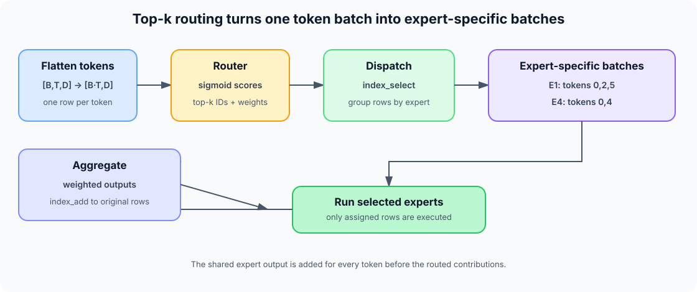
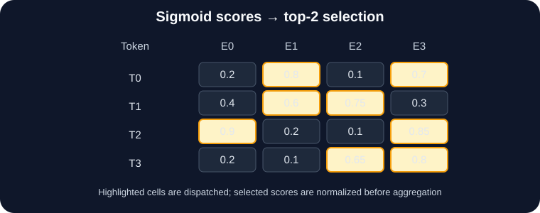

# Top-k Routing and Token Dispatch

The expert bank now contains independent routed experts and an always-active
shared expert. The previous examples selected the same expert IDs manually for
every token. That is not yet a working MoE layer.

This article adds:

1. a trainable routing projection;
2. sigmoid affinity scores;
3. top-k expert selection;
4. normalization over only the selected scores;
5. token dispatch with `index_select`; and
6. output aggregation with `index_add`.

The result is a small, single-device DeepSeek-style MoE layer. Expert-load
balancing, group-limited routing, and distributed expert execution are left for
later work.



## 1. Different tokens choose different experts

Suppose four tokens are represented by 256-dimensional vectors and eight
routed experts are available:

| Token | Selected experts | Routing weights |
| --- | --- | --- |
| 0 | E2, E5 | 0.65, 0.35 |
| 1 | E1, E4 | 0.55, 0.45 |
| 2 | E2, E7 | 0.80, 0.20 |
| 3 | E5, E7 | 0.60, 0.40 |

The shared expert runs for every token. Expert E2 processes tokens 0 and 2,
while E5 processes tokens 0 and 3. E2 should not process tokens 1 and 3.

That is why sparse MoE needs token dispatch: each expert receives only the
token representations assigned to it.

## 2. Routing scores

For a token representation \(x\in\mathbb{R}^{256}\), the router has a weight
matrix

\[
W_r\in\mathbb{R}^{8\times256}.
\]

It computes logits and independent affinity scores:

\[
z=W_rx,
\qquad
s_i=\sigma(z_i),
\qquad
s\in\mathbb{R}^{8}.
\]

### Why sigmoid instead of softmax?

Softmax scores sum to one across all experts. Sigmoid scores each expert
independently. For example,

\[
s=[0.2,0.8,0.1,0.7]
\]

does not need to sum to one. We first select the top-k scores and then
normalize only those selected scores.

For this implementation, `TopKRouter` uses a bias-free linear projection,
sigmoid scores, and `torch.topk`. Routing-bias adjustments and expert-group
selection are not included yet.

## 3. A numerical top-2 example

Given

\[
s=[0.2,0.8,0.1,0.7],
\]

top-2 selection returns experts 1 and 3 with scores 0.8 and 0.7. Normalize
only those values:

\[
g_1=\frac{0.8}{0.8+0.7}\approx0.5333,
\qquad
g_3=\frac{0.7}{0.8+0.7}\approx0.4667.
\]

The routed part of the output is

\[
\boxed{0.5333E_1(x)+0.4667E_3(x)}.


\]

Adding the shared expert gives the complete output:

\[
y=E_{\mathrm{shared}}(x)+0.5333E_1(x)+0.4667E_3(x).
\]

Sigmoid is applied before top-k selection. Normalization happens only among
the selected experts; this is different from applying softmax to all experts
and then truncating the probabilities.

## 4. Implement the trainable router

`src/model/router.py` defines `TopKRouter`:

```python
from src.model import DeepSeekConfig, TopKRouter

config = DeepSeekConfig()
router = TopKRouter(config)
x = torch.randn(2, 4, config.dim)
indices, weights = router(x)

print(indices.shape)  # [2, 4, 2]
print(weights.shape)  # [2, 4, 2]
print(weights[0, 0].sum())  # route_scale, normally 1.0
```

The router accepts any tensor with hidden dimension `config.dim` and returns:

| Output | Shape | Meaning |
| --- | --- | --- |
| `indices` | `[..., top_k]` | selected routed expert IDs |
| `weights` | `[..., top_k]` | normalized selected scores |

The indices are integer tensors. The weights are floating-point tensors. The
sum of the selected weights equals `route_scale`.

## 5. Token dispatch

For a batch with \(B=2\), \(T=4\), and \(D=256\), flatten the input:

\[
X:[2,4,256]\rightarrow[8,256].
\]

The router returns selected IDs with shape `[8, 2]`. A possible assignment is:

```text
Token 0 → E1, E4
Token 1 → E2, E5
Token 2 → E1, E7
Token 3 → E0, E3
Token 4 → E4, E6
Token 5 → E1, E2
Token 6 → E5, E7
Token 7 → E0, E6
```

The corresponding expert batches are different sizes:

```text
Expert 0 → tokens 3, 7
Expert 1 → tokens 0, 2, 5
Expert 2 → tokens 1, 5
Expert 3 → token 3
Expert 4 → tokens 0, 4
Expert 5 → tokens 1, 6
Expert 6 → tokens 4, 7
Expert 7 → tokens 2, 6
```

Each token appears twice because top-k is 2. To dispatch one expert, select its
token rows:

```python
expert_input = flat_x.index_select(0, token_ids)
```

After the expert runs, its weighted output must be added back to the original
token rows:

```python
output = output.index_add(0, token_ids, contribution)
```

`index_add` is essential. A token can be sent to two experts, so ordinary
assignment would overwrite one contribution instead of adding both.

## 6. The sparse MoE layer

`src/model/moe.py` defines `DeepSeekMoE`:

```python
from src.model import DeepSeekConfig, DeepSeekMoE

config = DeepSeekConfig()
moe = DeepSeekMoE(config)
x = torch.randn(2, 4, config.dim)
y = moe(x)

assert y.shape == x.shape
```

Its forward pass is:

1. Flatten `[B, T, D]` into `[B*T, D]`.
2. Run the shared expert on every flattened token.
3. Route every token and receive its top-k expert IDs and weights.
4. For each expert, gather only its assigned token rows.
5. Run that expert on its gathered rows.
6. Weight the results and scatter-add them into the output rows.
7. Reshape the output back to `[B, T, D]`.

If an expert receives no tokens, it is skipped entirely. Its weights receive no
gradient from the routed path for that batch.

## 7. Tensor shapes

For \(B=2\), \(T=4\), \(D=256\), and \(K=2\):

| Operation | Shape |
| --- | --- |
| Input | `[2, 4, 256]` |
| Flattened tokens | `[8, 256]` |
| Router logits | `[8, 8]` |
| Selected expert IDs | `[8, 2]` |
| Selected weights | `[8, 2]` |
| Shared output | `[8, 256]` |
| One gathered expert input | `[N_assigned, 256]` |
| One expert output | `[N_assigned, 256]` |
| Aggregated output | `[8, 256]` |
| Final output | `[2, 4, 256]` |

`N_assigned` varies per expert. That variation is the computation saved by
sparse dispatch.

## 8. Parameter count

The default expert bank contains 1,769,472 expert parameters. The router adds

\[
256\times8=2,048
\]

weights, so the complete MoE layer contains

\[
\boxed{1,771,520}
\]

parameters.

The total includes all eight routed experts and the shared expert. A single
token still activates only two routed experts plus the shared expert.

## 9. Does the router learn?

Top-k selection is discrete. The expert IDs themselves do not carry a useful
gradient that tells the router how to change a selection boundary.

The selected routing weights are differentiable:

\[
g_i=\frac{s_i}{\sum_{j\in\operatorname{TopK}}s_j},
\qquad
s_i=\sigma(W_ix).
\]

The prediction loss can therefore backpropagate through the selected weights
into the router's projection. The hard expert identities do not receive that
same direct gradient. This is one reason routing can become unstable or
imbalanced, which will be addressed later.

The shared expert always receives gradients. A routed expert receives gradients
when at least one token in the batch is dispatched to it.

## 10. Sparse implementation versus sparse weighting

It would be possible to run every expert on every token and multiply unselected
outputs by zero. That would produce the right weighted result, but it would not
save expert computation.

The implementation here performs actual sparse dispatch with `index_select` and
`index_add`. An expert only sees the rows assigned to it.

The tests compare this path against a deliberately inefficient reference that
runs every expert on every token and masks the unselected outputs. Matching
outputs provide a strong check that dispatch and aggregation preserve the
mathematics.

## 11. Expert usage

Every token contributes exactly `top_k` routed assignments. For 512 tokens and
top-2 routing:

\[
512\times2=1,024
\]

assignments are distributed across the eight experts. Perfectly balanced usage
would be 128 assignments per expert, but random initialization need not produce
that distribution.

An expert that receives no tokens is skipped. If that happens repeatedly, its
weights receive little opportunity to improve. Sustained imbalance can also
create bottlenecks when experts are distributed across devices.

## 12. Tests

The focused tests are in `src/tests/test_moe.py`:

```bash
python -m pytest src/tests/test_moe.py -v
```

They cover:

- router output shapes and selected-weight normalization;
- deterministic top-k selection;
- route scaling;
- complete MoE output shape and parameter count;
- sparse dispatch versus an all-expert reference;
- router and selected-expert gradients; and
- expert assignment counts.

## 13. Scope and next step

This implementation now has the essential single-device structure:

| Component | Current implementation |
| --- | --- |
| SwiGLU routed experts | Yes |
| Always-active shared expert | Yes |
| Sigmoid router scores | Yes |
| Top-k selection | Yes |
| Selected-weight normalization | Yes |
| Token dispatch | Python loop with `index_select` |
| Output aggregation | `index_add` |
| Expert-wise balancing bias | Not yet |
| Group-limited routing | Not yet |
| Expert parallelism | Not yet |

The MoE layer is not integrated into the Transformer yet. The next problem is
load balancing: preventing most tokens from selecting the same few experts.
