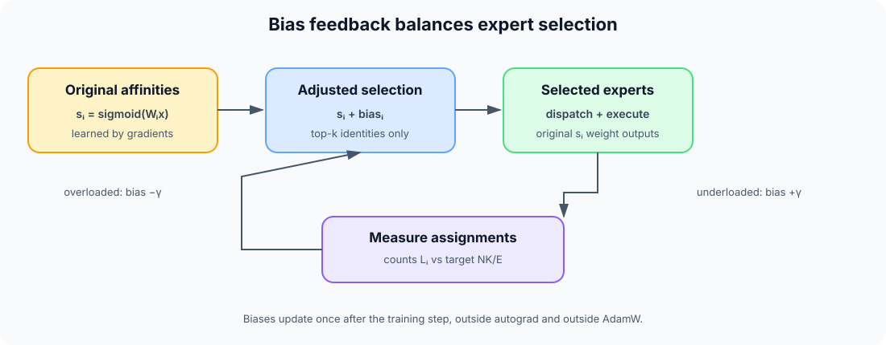

# Auxiliary-Loss-Free Load Balancing

Top-k routing works, but it does not control how many tokens each expert
receives. If the router sends most tokens to the same few experts, those
experts become overloaded while the others receive little training.

This article adds DeepSeek-style expert-selection biases. The biases change
which experts are selected, but the output weights still come from the
original sigmoid affinities. Biases are updated from measured loads rather
than through AdamW or a large auxiliary balancing loss.



## 1. The overload problem

With eight routed experts and top-2 routing, 100 tokens create

\[
100\times2=200
\]

expert assignments. A balanced target would be

\[
200/8=25
\]

assignments per expert.

An imbalanced router might send most assignments to E0 and E1. This creates:

- a learning problem, because underused experts receive fewer gradients; and
- an engineering problem, because overloaded experts become computation and
  communication bottlenecks in distributed MoE systems.

The router must learn useful expert choices while also distributing work.

## 2. Why not only add a balancing loss?

A traditional approach adds a second term to the training objective:

\[
\mathcal{L}_{\mathrm{total}}=
\mathcal{L}_{\mathrm{language}}+
\lambda\mathcal{L}_{\mathrm{balance}}.
\]

The language-model term encourages useful routing. The balancing term
encourages uniform routing. If the balancing penalty is too strong, the router
may sacrifice useful expert assignments to reduce the penalty.

DeepSeek's principal alternative is to adjust expert selection directly using
expert-wise routing biases. The technical report also describes a small
sequence-wise balancing loss, so “auxiliary-loss-free” refers to the main
expert-balancing mechanism rather than the literal absence of every auxiliary
term.

## 3. One bias per expert

The earlier router produces sigmoid affinity scores:

\[
s_i=\sigma(W_ix).
\]

Load balancing adds one state value per expert:

\[
b_i=\text{routing bias for expert }i.
\]

The adjusted score used for selection is

\[
\boxed{\widetilde{s}_i=s_i+b_i}.
\]

If an expert is overloaded, its bias decreases and it becomes less likely to
be selected. If it is underloaded, its bias increases and it becomes more
competitive.

The bias is implemented as a PyTorch buffer. It moves with the model, is saved
in checkpoints, and is excluded from the optimizer's trainable parameters.

## 4. Selection scores and output weights are different

This is the most important detail.

Selection uses the adjusted scores:

\[
\widetilde{s}_i=s_i+b_i.
\]

After top-k selection, output weights use the original scores:

\[
\boxed{
g_i=\frac{s_i}
{\sum_{j\in\operatorname{TopK}(\widetilde{s})}s_j}
}.
\]

The bias changes **who is selected**, not **how strongly selected experts are
weighted**.

### Numerical example

| Expert | Original score | Bias | Adjusted score |
| --- | ---: | ---: | ---: |
| E0 | 0.90 | −0.30 | 0.60 |
| E1 | 0.80 | −0.25 | 0.55 |
| E2 | 0.60 | +0.15 | 0.75 |
| E3 | 0.50 | +0.20 | 0.70 |

Before balancing, E0 and E1 had the largest original scores. After adding the
biases, E2 and E3 are selected. Their output weights are still calculated from
0.60 and 0.50:

\[
g_2=\frac{0.6}{0.6+0.5}\approx0.5455,
\qquad
g_3=\frac{0.5}{0.6+0.5}\approx0.4545.
\]

We do not normalize the adjusted values 0.75 and 0.70.

## 5. Updating the biases from measured load

Suppose a batch contains (N) tokens, each selects (K) experts, and there
are (E) routed experts. The target assignment count is

\[
\boxed{L_{\mathrm{target}}=\frac{NK}{E}}.
\]

For (N=128), (K=2), and (E=8), the target is 32 assignments per expert.

The simple feedback update is

\[
\boxed{
b_i\leftarrow b_i+
\gamma\operatorname{sign}(L_{\mathrm{target}}-L_i)
}.
\]

An overloaded expert has (L_i>L_{\mathrm{target}}), so its bias decreases. An
underloaded expert has a positive adjustment. An exactly balanced expert is
unchanged.

The update step is not gradient descent:

| State | Update source |
| --- | --- |
| Router weights (W_r) | gradients from the language-model loss |
| Expert FFN weights | gradients from assigned tokens |
| Balancing biases (b_i) | measured expert assignments |

`gamma` controls the feedback strength. A large value can cause oscillation; a
small value adapts slowly.

## 6. The balanced router implementation

`TopKRouter` in `src/model/router.py` now contains:

```python
self.register_buffer(
    "expert_bias",
    torch.zeros(self.n_experts),
)
```

Its forward pass still returns the same `(indices, weights)` interface used by
`DeepSeekMoE`:

```python
selection_scores = original_scores + self.expert_bias
_, indices = torch.topk(selection_scores, k=self.top_k, dim=-1)
selected_scores = original_scores.gather(-1, indices)
weights = selected_scores / selected_scores.sum(-1, keepdim=True)
```

The public update method is:

```python
counts = router.update_bias(indices, gamma=0.01)
```

It returns the measured assignment count for each expert and updates the buffer
under `torch.no_grad()`.

## 7. Manual update example

Consider four experts and these twelve assignments:

\[
L=[6,4,1,1].
\]

The target is (12/4=3). With \(\gamma=0.05\), the expected update is

\[
[-0.05,-0.05,+0.05,+0.05].
\]

```python
indices = torch.tensor(
    [[0, 1], [0, 1], [0, 1], [0, 1], [0, 2], [0, 3]],
    dtype=torch.long,
)
counts = router.update_bias(indices, gamma=0.05)
print(counts.tolist())
print(router.expert_bias.tolist())
```

No balancing loss is calculated. The update observes routing usage and changes
future selection scores.

## 8. Controlled balancing experiment

`src/experiments/moe_balancing.py` creates a router that strongly prefers E0
and E1, then repeatedly updates only the balancing biases:

```bash
python -m src.experiments.moe_balancing
```

The experiment prints assignment counts, coefficient of variation, and maximum
load ratio at intervals. It keeps the learned gate weights fixed so the effect
of the feedback rule is easy to isolate.

This synthetic experiment does not promise perfect balance. Nearly identical
token vectors and hard top-k ties can make the assignment pattern change in
discrete steps. The update is feedback control, not a guarantee of uniform
counts on every batch.

## 9. Measuring imbalance

One useful metric is the coefficient of variation:

\[
\operatorname{CV}=\frac{\operatorname{std}(L)}{\operatorname{mean}(L)}.
\]

Lower values mean more uniform load. Another metric is maximum-load ratio:

\[
\operatorname{MaxLoadRatio}=
\frac{\max_iL_i}{L_{\mathrm{target}}}.
\]

If the busiest expert receives 64 assignments while the target is 32, its
maximum-load ratio is 2.

The helper `load_metrics(counts)` returns both values. Metrics need not decrease
monotonically because hard routing changes assignments discretely.

## 10. Update order during training

Biases should be updated once after the assignments from a training step have
been measured:

1. The router selects experts using the current biases.
2. Selected experts process their assigned tokens.
3. The language-model loss is computed.
4. Backpropagation and the optimizer update model weights.
5. Actual expert assignments are counted.
6. The balancing biases are updated outside autograd.

Do not update biases inside the forward pass, and do not add them to the
optimizer's gradient computation.

The current small layer does not yet own a complete language-model training
loop. A caller can capture the actual `indices` returned by each router—for
example with a forward hook—and call `update_bias()` once per optimizer step.
With microbatches or distributed experts, counts must be accumulated and
reduced before the update.

## 11. What this does not guarantee

Balanced counts do not guarantee expert specialization. Experts still need the
language-model objective to learn useful transformations.

Balanced counts also do not guarantee equal runtime. Sequence lengths,
communication, capacity limits, and dispatch kernels can still create
bottlenecks.

This educational implementation assumes one expert group. Group-limited
selection and expert-parallel communication are not implemented.

## 12. Tests

The focused tests are in `src/tests/test_balancing.py`:

```bash
python -m pytest src/tests/test_balancing.py -v
```

They verify:

- balancing bias is a non-trainable checkpointed buffer;
- overloaded and underloaded experts move in the correct directions;
- bias changes selection but not original-score output weights;
- gradients flow through learned router weights, not through the bias buffer;
- bias state survives checkpoint save/load; and
- invalid update inputs are rejected.

## 13. Recap

1. Expert overload hurts learning and distributed execution.
2. A routing bias can alter selection without adding a large balancing loss.
3. Selection uses biased scores; output weighting uses original affinities.
4. Biases are updated from observed counts, not by AdamW.
5. Balancing is feedback control, not a guarantee of perfect uniformity.

The next step is to combine MLA, dense early FFNs, shared experts, routed
experts, top-k dispatch, and load balancing inside the complete Transformer.
