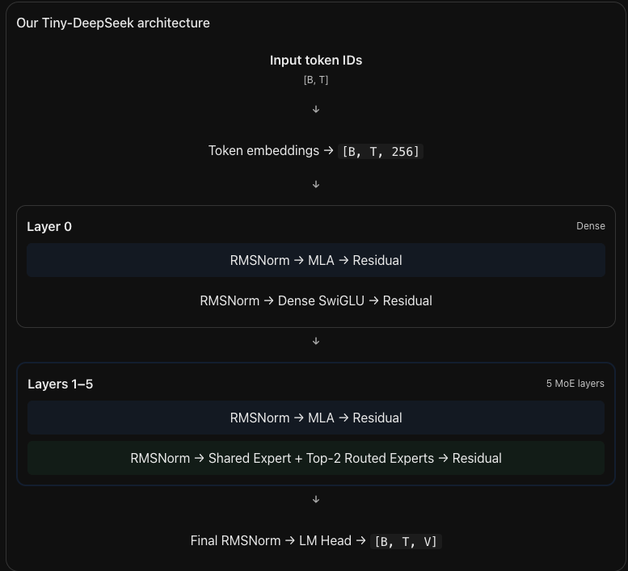

# Building the Complete DeepSeekMoE Transformer

The repository now has the two major architectural pieces needed for a small
DeepSeek-style language model:

- **MLA** compresses Key/Value representations and handles causal attention.
- **DeepSeekMoE** uses a shared expert and selected routed experts instead of
  running one dense FFN for every token.

This article combines them into a trainable six-layer model. The first layer
uses a dense SwiGLU FFN, while the remaining layers use sparse MoE. Training
uses the ordinary naive MLA forward path; compressed-cache decoding remains a
separate inference path.



## 1. The complete architecture

The dense MLA model used the same FFN type in every block:

\[
\text{Embedding}\rightarrow6\times(\text{MLA}+\text{Dense FFN}).
\]

The new model uses:

\[
\text{Embedding}\rightarrow
\begin{cases}
\text{Layer 0: MLA + Dense FFN}\\
\text{Layers 1--5: MLA + MoE}
\end{cases}
\]

Every layer still has pre-normalization and residual connections. Only the
feed-forward sublayer changes by layer:

| Layer | Attention | Feed-forward sublayer |
| ---: | --- | --- |
| 0 | MLA | Dense SwiGLU |
| 1 | MLA | Shared expert + top-2 routed experts |
| 2 | MLA | Shared expert + top-2 routed experts |
| 3 | MLA | Shared expert + top-2 routed experts |
| 4 | MLA | Shared expert + top-2 routed experts |
| 5 | MLA | Shared expert + top-2 routed experts |

The implementation is in `src/model/deepseek_moe.py` as `TinyDeepSeek` and
`DeepSeekMoEBlock`.

## 2. One Transformer block

For one token representation \(x\), the attention sublayer is

\[
h=x+\operatorname{MLA}(\operatorname{RMSNorm}_1(x)).
\]

The feed-forward sublayer is

\[
\boxed{y=h+\operatorname{FFN}(\operatorname{RMSNorm}_2(h))}.
\]

For a dense layer, `FFN` is `SwiGLUFFN`. For an MoE layer:

\[
\operatorname{FFN}(z)=
E_{\mathrm{shared}}(z)+
\sum_{i\in\operatorname{Top2}(z)}g_i(z)E_i(z).
\]

MLA and MoE solve different problems:

| Component | Responsibility |
| --- | --- |
| MLA | Gather information from preceding token positions |
| MoE | Transform the current token features |
| RMSNorm | Normalize before each sublayer |
| Residual connection | Preserve existing features while adding updates |

The complete model trains all of these components together through the
next-token prediction loss.

## 3. Reuse the existing components

The new model composes code already in the repository:

| Component | Implementation |
| --- | --- |
| RMSNorm | `src/model/rmsnorm.py` |
| Dense SwiGLU | `src/model/ffn.py` |
| Naive MLA | `src/model/mla.py` |
| Expert bank | `src/model/experts.py` |
| Top-k MoE | `src/model/moe.py` |
| Balancing router | `src/model/router.py` |

The model does not duplicate attention or expert logic. `DeepSeekMoEBlock`
chooses the FFN type from `layer_id >= config.n_dense_layers`.

## 4. Layer selection in code

```python
self.is_moe = layer_id >= config.n_dense_layers

if self.is_moe:
    self.ffn = DeepSeekMoE(config)
else:
    self.ffn = SwiGLUFFN(
        dim=config.dim,
        hidden_dim=config.inter_dim,
    )
```

With six layers and `n_dense_layers=1`, layer 0 is dense and layers 1 through 5
are MoE. Every block still uses MLA for attention.

## 5. The full language model

`TinyDeepSeek` contains token embeddings, the layer stack, final RMSNorm, and
the vocabulary projection:

```python
from src.model import DeepSeekConfig, TinyDeepSeek

config = DeepSeekConfig(
    vocab_size=512,
    n_layers=3,
    n_dense_layers=1,
    max_seq_len=64,
)
model = TinyDeepSeek(config)
tokens = torch.randint(0, config.vocab_size, (2, 16))
logits = model(tokens)

assert logits.shape == (2, 16, config.vocab_size)
```

This training model uses the naive `MLA.forward()` path. The compressed KV-cache
implementation remains available through `CachedMLA` and `DeepSeekMLA` for
inference experiments, but it is not mixed into this training architecture.

## 6. Total versus active parameters

For the default small configuration, one dense FFN has

\[
3\times256\times768=589,824
\]

parameters. One MoE FFN sublayer contains:

- eight routed experts;
- one shared expert; and
- one router matrix.

Its approximate parameter count is

\[
1,769,472+2,048=1,771,520.
\]

Replacing five dense FFNs with MoE therefore adds approximately

\[
5(1,771,520-589,824)
\]

parameters to the dense MLA baseline. The resulting model is approximately
14.85M parameters with the default vocabulary and dimensions.

For one token in one MoE layer, the active FFN path contains:

- one shared expert: 196,608 parameters;
- two routed experts: 393,216 parameters; and
- the router: 2,048 parameters.

Therefore the active MoE path is approximately

\[
591,872
\]

parameters, close to the dense FFN's 589,824 parameters.

These are accounting measures. In a batch, different tokens can select
different experts, so more of the total expert bank may be used across the
batch. Dispatch, memory movement, and communication also contribute runtime.

The exact count changes when the vocabulary or model dimensions change. Check
the actual model with:

```python
total = sum(parameter.numel() for parameter in model.parameters())
print(f"Total parameters: {total:,}")
```

## 7. Gradient propagation through the complete model

The integration test uses a next-token loss:

```python
import torch.nn.functional as F

tokens = torch.randint(0, config.vocab_size, (2, 17))
inputs = tokens[:, :-1]
targets = tokens[:, 1:]

logits = model(inputs)
loss = F.cross_entropy(
    logits.float().reshape(-1, config.vocab_size),
    targets.reshape(-1),
)
loss.backward()
```

Gradients should reach MLA projections, the router, the shared expert, and any
routed expert that received at least one token. It is valid for an individual
routed expert to have no gradient in a small batch if no token selected it.

## 8. Causality remains intact

The router processes each token independently after attention. It does not mix
information across sequence positions. Therefore future-token isolation still
comes from MLA's causal attention mask.

```python
model = TinyDeepSeek(config).eval()
prefix = torch.tensor([[10, 20, 30, 40, 50, 60, 70, 80]])
changed = torch.tensor([[10, 20, 30, 40, 50, 91, 92, 93]])

with torch.no_grad():
    original_logits = model(prefix)
    changed_logits = model(changed)

torch.testing.assert_close(
    original_logits[:, :5],
    changed_logits[:, :5],
)
```

This relies on per-token routing. Future behavior could change if a later
optimization introduces batch-dependent normalization, global token mixing, or
capacity-based token dropping.

## 9. Update balancing biases after real forward passes

The complete model has a separate router and bias buffer in every MoE layer.
The assignments must be collected from the actual forward pass, not by running
the router a second time after the optimizer changes model weights.

`src/training/moe_balancer.py` provides `MoELoadBalancer`:

```python
from src.training import MoELoadBalancer

with MoELoadBalancer(model, gamma=0.01) as balancer:
    balancer.clear()
    logits = model(inputs)
    loss = F.cross_entropy(
        logits.float().reshape(-1, config.vocab_size),
        targets.reshape(-1),
    )
    loss.backward()
    optimizer.step()
    load_ratios = balancer.update()
```

The balancer attaches hooks to every `TopKRouter`, stores the selected IDs,
groups assignments by router, and calls `update_bias()` once per router. It
returns the maximum-load ratio for each MoE layer.

The order is:

1. Forward pass and route tokens.
2. Compute the language-model loss.
3. Backpropagate through MLA, routers, and selected experts.
4. Update trainable weights with AdamW.
5. Update balancing biases outside autograd.

The biases are not optimizer parameters.

## 10. Train a small model

`src/train_moe.py` reuses the prepared token dataset and runs a short training
loop with the balancer:

```bash
python -m src.train_moe \
  --data-dir data/processed \
  --steps 100 \
  --batch-size 4 \
  --seq-len 128 \
  --log-every 10
```

The script performs next-token cross-entropy training, gradient clipping,
AdamW updates, and post-step bias updates. It saves a checkpoint to
`checkpoints/tiny_deepseek_moe.pt` by default.

The mean maximum-load ratio is

\[
\frac{\text{busiest expert assignments}}
{\text{target assignments per expert}}.
\]

A value near 1 indicates even usage. A value of 2 means the busiest expert has
twice its ideal assignment count. The value need not decrease monotonically.

This is a correctness and learning experiment, not a production H100 training
loop. Expert dispatch still uses Python loops and per-expert indexing.

## 11. Tests

The complete-model checks are in `src/tests/test_deepseek_moe.py`:

```bash
python -m pytest src/tests/test_deepseek_moe.py -v
```

They cover:

- dense-versus-MoE layer selection;
- complete model output shapes;
- gradient propagation through MLA, routers, and experts;
- causal future-token isolation;
- one balancer record per MoE layer; and
- accumulation across multiple forward calls.

## 12. Scope compared with a production model

| Component | Small implementation | Production DeepSeek-style system |
| --- | --- | --- |
| MLA attention | Yes | Yes, with additional scaling details |
| Decoupled RoPE | Yes | Yes |
| Shared KV compression | Yes | Yes |
| Compressed-cache inference | Separate path | Optimized kernels and allocation |
| SwiGLU experts | Yes | Yes |
| Top-k routing | Yes | Yes |
| Shared experts | Yes | Yes |
| Expert balancing bias | Yes | Yes, with additional balancing details |
| Distributed expert parallelism | No | Yes |
| Group-limited routing | No | Yes |
| Multi-Token Prediction | No | Yes |

The small model preserves the central architectural mechanisms while leaving
distributed systems and production optimizations for later work.

## 13. Recap

1. MLA modifies attention; MoE modifies selected feed-forward sublayers.
2. The first layer can remain dense while later layers use sparse MoE.
3. All model components train together through next-token prediction.
4. Expert-bias balancing is updated from actual assignments after optimizer
   steps, not through AdamW.
5. The model has more total parameters than the dense baseline without
   activating every expert for every token.

The next step is to measure routing behavior, expert utilization, and dispatch
overhead experimentally.
