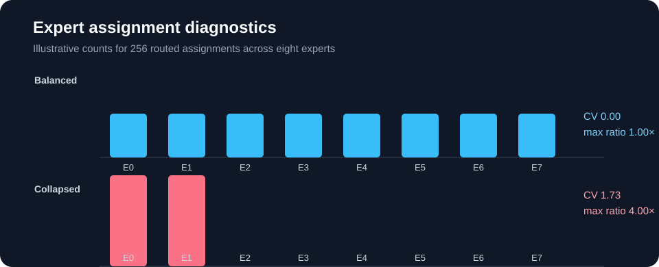
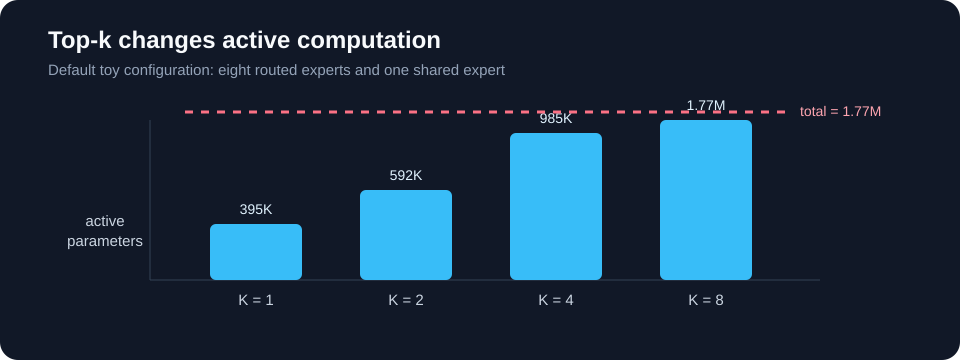
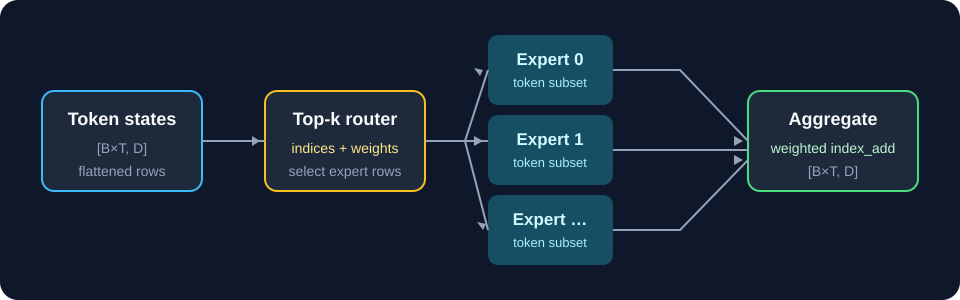

# DeepSeekMoE Experiments, Routing Analysis, and Performance

We have a complete small DeepSeek-style model with MLA attention, shared
experts, routed experts, top-k selection, and auxiliary-loss-free balancing.
The next question is not whether the code runs. It is whether the design
choices are useful under controlled measurements.

This article sets up experiments for five questions:

1. Does MoE improve language-model quality compared with a dense FFN?
2. Are the routed experts receiving balanced workloads?
3. What changes when we activate more experts per token?
4. Does the shared expert help?
5. Where does the naive sparse implementation spend time?

No new attention mechanism is introduced here. The experiments reuse the
model built in the earlier articles.



## 1. The experimental starting point

The repository contains three useful reference points:

| Model | Attention | Feed-forward path |
| --- | --- | --- |
| GPT baseline | Causal MHA | Dense SwiGLU |
| Dense MLA | MLA | Dense SwiGLU |
| Tiny-DeepSeek | MLA | Dense early layer, then MoE |

The default MoE configuration uses eight routed experts, two selected experts
per token, and one always-active shared expert:

\[
E=8,\qquad K=2,\qquad S=1.
\]

Here, (E) is the number of routed experts, (K) is the number selected for
each token, and (S) is the number of shared expert paths. These dimensions
are deliberately small and are intended for experiments, not for reproducing
the parameter count of the original model.

For a fair comparison, keep the tokenizer, data, sequence length, optimizer,
training tokens, and evaluation procedure fixed. A lower loss after a short
run is a useful observation, but it is not enough to establish that one
architecture is better.

## 2. Dense FFN versus MoE

The first comparison holds attention constant and changes only the
feed-forward sublayer. The dense and MoE paths are approximately matched for
active expert computation:

\[
P_{\text{dense FFN}}=3\times256\times768=589{,}824.
\]

With a 256-dimensional expert hidden layer, one shared expert and two routed
experts activate approximately:

\[
P_{\text{active MoE}}
 = (1+2)\times(3\times256\times256)+256\times8
 =591{,}872.
\]

The MoE has more total capacity because all eight routed experts are stored,
even though only two are selected for a token. Record at least:

| Metric | What it tells us |
| --- | --- |
| Training loss | Whether optimization is progressing |
| Validation loss | Held-out next-token quality |
| Perplexity | (\exp(\mathcal L_{\text{val}})) for natural-log loss |
| Tokens per second | Training throughput |
| Peak GPU memory | Memory cost |
| Expert load statistics | Routing behavior |

The existing `src.experiments.compare_gpt_mla` script compares the dense
baseline and dense MLA. A matched dense-versus-MoE experiment can use the same
data-loader and training structure, while recording the additional routing
metrics described below.

Use multiple seeds and compare both equal-token and equal-compute runs before
drawing a conclusion. MoE can benefit from its larger total capacity even when
active computation is approximately matched.

## 3. Routing balance

With eight experts, two selections per token, and 128 token positions, there
are (128\times2=256) assignments. Perfect balance would be 32 assignments
per expert.


For expert loads (L_1,\ldots,L_E), measure:

\[
R_{\max}=\frac{\max_i L_i}{NK/E}
\]

and

\[
CV=\frac{\operatorname{std}(L)}{\operatorname{mean}(L)}.
\]

Lower values indicate more even assignment. Entropy is also useful because it
captures how widely assignments are distributed:

\[
H(L)=-\sum_i p_i\log p_i,\qquad p_i=\frac{L_i}{\sum_j L_j}.
\]

The utility `src/experiments/analyze_routing.py` computes counts, CV,
maximum-load ratio, entropy, and normalized entropy from router indices. It
also attaches temporary hooks to every `TopKRouter`, runs one evaluation
forward pass, and restores the model's original training state.

Run it from a Python session:

```python
import torch

from src.experiments.analyze_routing import inspect_model_routing
from src.model import DeepSeekConfig, TinyDeepSeek

config = DeepSeekConfig(vocab_size=512, max_seq_len=128)
model = TinyDeepSeek(config).eval()
tokens = torch.randint(0, config.vocab_size, (4, 128))

results = inspect_model_routing(model, tokens)
for layer_name, metrics in results.items():
    print(layer_name, metrics)
```

The default six-layer model has one dense early layer and five MoE layers, so
the result contains five router records. Random initialization is useful for
checking plumbing, but trained checkpoints are needed to interpret expert
preferences.

## 4. Top-k and active parameters

The total number of MoE parameters does not change when (K) changes. The
active path does:

\[
P_{\text{active MoE}}(K)
 = (K+S)\times3D H + D E,
\]

where (D) is the model dimension and (H) is the per-expert hidden size.
For the default configuration:

| Selected routed experts (K) | Active expert FFNs | Total MoE parameters |
| ---: | ---: | ---: |
| 1 | 2 including shared | 1.77M |
| 2 | 3 including shared | 1.77M |
| 4 | 5 including shared | 1.77M |
| 8 | 9 including shared | 1.77M |

The helper `moe_parameter_report(config)` returns the exact counts for the
current dimensions. Try the configurations (K\in\{1,2,4,8\}) and record
validation loss, throughput, routing balance, and active parameters.

There is an important limitation in the current educational router. It
normalizes selected sigmoid scores by their sum. When (K=1), that normalized
weight is exactly one, so the main loss has no useful gradient through the
weight. Top-1 selection can still be benchmarked, but training it fairly
requires a different weighting or routing objective.



## 5. Shared-expert ablation

The shared path is intended to learn reusable features while routed experts
specialize. Compare:

| Configuration | Shared experts | Routed experts selected |
| --- | ---: | ---: |
| A | 1 | 2 |
| B | 0 | 3 |

Both configurations activate about three expert FFNs per token, but they do
not have the same total parameters or the same division between shared and
routed computation. This is an informative ablation, not a perfectly matched
comparison.

The configuration now permits `n_shared_experts=0`. In that case
`ExpertBank.forward_shared` returns zeros with the input shape and no shared
parameters are created:

```python
from src.model import DeepSeekConfig, DeepSeekMoE

config = DeepSeekConfig(
    n_shared_experts=0,
    n_activated_experts=3,
)
layer = DeepSeekMoE(config)
```

Use the same data, optimizer, token budget, and random seeds for both
configurations. If one has lower held-out loss consistently, that supports a
conclusion only under these settings. Similar or reversed results are also
useful evidence.

## 6. Expert specialization

Routing frequency alone does not prove specialization. An expert may respond
to punctuation, token frequency, or sequence position instead of a semantic
domain.

For held-out groups such as programming, science, and general writing, define

\[
P(e\mid d)
\]

as the fraction of routed assignments sent to expert (e) for domain (d).
Compare these distributions with entropy, pairwise distances, and stability
across random seeds. A stronger intervention disables or replaces one expert
and measures the change in each domain's validation loss.

Interpret interventions carefully: removing an expert creates an input path
the model was not trained to handle. The result is evidence about functional
dependence, not a direct proof that the expert stores a named subject area.

## 7. Benchmark actual FFN execution

`DeepSeekMoE` currently dispatches tokens with a Python loop:

```python
for expert_id in range(self.n_experts):
    token_ids, top_k_slots = torch.where(indices == expert_id)
    expert_input = flat_x.index_select(0, token_ids)
    expert_output = self.experts.forward_expert(expert_id, expert_input)
    output = output.index_add(0, token_ids, contribution)
```

The computation is logically sparse, but it may be slower than a dense FFN:
small expert matrix multiplications, index extraction, and scatter operations
can dominate. The effect depends strongly on the number of token positions:

\[
\frac{16\times2}{8}=4
\quad\text{versus}\quad
\frac{2048\times2}{8}=512
\]

average assignments per expert.

Run the isolated benchmark:

```bash
python -m src.experiments.benchmark_ffn \
  --device cpu \
  --batch-size 4 \
  --seq-len 128 \
  --warmup 5 \
  --repeats 20
```

On a CUDA machine, use `--device cuda`. The output reports median, mean, and
minimum forward latency for the dense FFN and MoE, plus the MoE-to-dense
median ratio. It measures the actual Python dispatch implementation, not a
production grouped-GEMM or fused-kernel implementation.



## 8. Keep an experiment scorecard

| Experiment | Main metric | Interpretation |
| --- | --- | --- |
| Dense versus MoE | Validation loss | Predictive quality |
| Routing balance | CV and max-load ratio | Work distribution |
| Top-k ablation | Loss, latency, active parameters | Capacity-compute trade-off |
| Shared-expert ablation | Validation loss | Shared-path contribution |
| Specialization | Domain routing distributions | Routing differentiation |
| FFN benchmark | Median latency and tokens/sec | Execution efficiency |

Run experiments in this order:

1. Verify shapes, causality, gradients, and sparse-versus-dense equivalence.
2. Measure routing on random and trained checkpoints.
3. Benchmark the isolated dense and MoE FFNs.
4. Compare training under matched token and compute budgets.
5. Run top-k, shared-path, and specialization ablations.

This order keeps a correctness issue from being misread as an architectural
advantage.

## 9. Interpreting results

Suppose a short run produces:

| Model | Validation loss | FFN latency |
| --- | ---: | ---: |
| Dense FFN | 3.42 | 0.8 ms |
| MoE | 3.35 | 1.4 ms |

The defensible conclusion is that MoE achieved lower validation loss but
higher latency in this experiment. More controlled runs are needed before
claiming a general advantage. The result does not prove specialization, and
the faster dense FFN is not automatically better for every quality or scaling
objective.

The central lessons are:

- Conditional capacity does not guarantee lower validation loss.
- A balanced router is not automatically a useful router.
- Sparse computation is not automatically fast computation.

The next article consolidates MLA and MoE into the fuller Transformer block
and distinguishes the educational implementation from the official
architecture.
