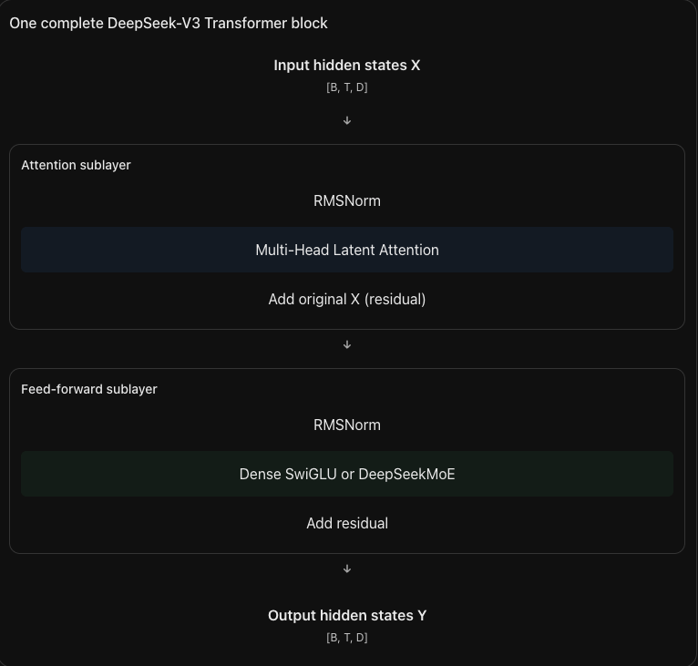

# Understanding the Complete DeepSeek Transformer Block

The two distinctive pieces of our model are now in place:

- Multi-Head Latent Attention (MLA) compresses key/value information.
- DeepSeekMoE supplies conditional feed-forward computation.

This article puts those pieces back into their surrounding Transformer
block. The goal is to understand the data flow before adding the final model
assembly and Multi-Token Prediction components.



## 1. The block at a glance

DeepSeek-V3 remains a decoder-only, causal Transformer. Its main substitutions
are inside the familiar attention and feed-forward sublayers:

| Standard Transformer | DeepSeek-style Transformer |
| --- | --- |
| Multi-Head Attention | Multi-Head Latent Attention |
| Dense FFN in every layer | Dense FFN in early layers, then DeepSeekMoE |

The high-level flow is:

\[
H=X+\operatorname{MLA}(\operatorname{RMSNorm}(X))
\]

\[
\boxed{Y=H+\operatorname{FFN}(\operatorname{RMSNorm}(H))}
\]

`FFN` is either a dense SwiGLU or a DeepSeekMoE layer. Because normalization
happens before each sublayer, this is a pre-RMSNorm Transformer.

The implementation in `src/model/deepseek_moe.py` follows this structure:

```python
def forward(self, x):
    x = x + self.attention(self.attn_norm(x))
    return x + self.ffn(self.ffn_norm(x))
```

Both sublayers accept and return `[batch, sequence, hidden_dim]` tensors.

## 2. Why there are two residual connections

Without residual connections, every layer would need to reconstruct a complete
representation from its input. A residual path lets each sublayer learn an
update instead.

For example, if

\[
x=[1,2,3]
\]

and the normalized attention branch returns

\[
[0.2,-0.3,0.5],
\]

then the first residual produces

\[
h=x+[0.2,-0.3,0.5]=[1.2,1.7,3.5].
\]

If the normalized FFN branch returns `[0.1, 0.4, -0.2]`, the final result is

\[
y=h+[0.1,0.4,-0.2]=[1.3,2.1,3.3].
\]

The second residual adds to `h`, not the original `x`, because the FFN receives
the representation after the attention update. This provides a direct path
for information and gradients through both sublayers.

## 3. Dense early layers and MoE later layers

The original DeepSeek-V3 uses a dense prefix followed by a sparse remainder:

| Layer range | Attention | Feed-forward layer |
| --- | --- | --- |
| First 3 of 61 | MLA | Dense SwiGLU |
| Remaining 58 | MLA | DeepSeekMoE |

The reason is architectural rather than a strict claim that early layers only
learn syntax and later layers only learn knowledge. A dense prefix provides
general transformations before later layers use conditional expert capacity.

Our smaller configuration uses one dense layer followed by five MoE layers:

| Layer | Attention | Feed-forward layer |
| ---: | --- | --- |
| 0 | MLA | Dense SwiGLU |
| 1--5 | MLA | DeepSeekMoE |

`DeepSeekMoEBlock` selects the feed-forward implementation from
`layer_id >= config.n_dense_layers`; attention and normalization stay the same
for every layer.

## 4. Full-scale versus educational dimensions

The important comparison is the mechanism, not the size:

| Component | DeepSeek-V3 | Tiny-DeepSeek |
| --- | ---: | ---: |
| Hidden dimension | 7,168 | 256 |
| Transformer layers | 61 | 6 |
| Initial dense layers | 3 | 1 |
| Attention heads | 128 | 8 |
| Query compression rank | 1,536 | 128 |
| KV compression rank | 512 | 64 |
| Content Q/K dimension per head | 128 | 32 |
| RoPE dimension per head | 64 | 16 |
| Value dimension per head | 128 | 32 |
| Routed experts per MoE layer | 256 | 8 |
| Selected routed experts | 8 | 2 |
| Shared experts | 1 | 1 |

The original model has hundreds of billions of total parameters. The default
educational model has about 14.85 million. It is small enough to inspect and
train, while preserving the important MLA, MoE, residual, and normalization
mechanisms.

## 5. Follow a batch through the model

Use a batch with (B=2), (T=128), and hidden width (D=256). Token IDs
start at:

\[
\text{input\_ids}:[2,128].
\]

### Token embedding

The embedding table maps each ID to a 256-dimensional vector:

\[
[2,128]\rightarrow[2,128,256].
\]

### First Transformer layer

Layer 0 uses MLA and dense SwiGLU. The main MLA tensors have these shapes:

| Tensor | Shape |
| --- | --- |
| Query latent | `[2,128,128]` |
| KV latent | `[2,128,64]` |
| Content query | `[2,8,128,32]` |
| Positional query | `[2,8,128,16]` |
| Content key | `[2,8,128,32]` |
| Positional key | `[2,1,128,16]` |
| Value | `[2,8,128,32]` |
| Attention output | `[2,128,256]` |

The dense FFN expands each token from 256 to 768 intermediate features and
returns to 256. Both residual outputs remain `[2,128,256]`.

### First MoE layer

The next layer runs MLA in the same way, then sends normalized hidden states
through the router. For the default configuration:

\[
\text{router scores}:[2,128,8]
\]

\[
\text{selected expert IDs}:[2,128,2].
\]

The shared expert sees all 256 token positions. The routed paths process

\[
256\times2=512
\]

expert-token assignments in total. Weighted routed outputs are added to the
shared output, and the MoE result is still `[2,128,256]`.

### Remaining layers and output head

The remaining layers repeat MLA plus MoE. After the stack:

\[
\text{Final RMSNorm}:[2,128,256]
\]

\[
\text{LM head}:[2,128,8192].
\]

The hidden dimension is the invariant at every block boundary. MLA and MoE
can use different internal dimensions, but they must return the same hidden
width to preserve residual addition.

## 6. Architecture inspection script

Run the structural audit from the repository root:

```bash
python -m src.experiments.inspect_architecture
```

The script checks that every layer uses MLA, verifies the dense prefix and MoE
suffix, and prints parameter counts. The default report is:

```text
Complete Tiny-DeepSeek architecture

Layer 0: MLA + Dense SwiGLU | 791,232 parameters
Layer 1: MLA + MoE | 1,972,928 parameters
Layer 2: MLA + MoE | 1,972,928 parameters
Layer 3: MLA + MoE | 1,972,928 parameters
Layer 4: MLA + MoE | 1,972,928 parameters
Layer 5: MLA + MoE | 1,972,928 parameters

Total: 14,850,432
```

The corresponding code is in
`src/experiments/inspect_architecture.py`, and its tests verify both the
default parameter accounting and custom dense-prefix configurations.

## 7. Where Multi-Token Prediction fits

Multi-Token Prediction does not replace the main Transformer stack. The main
stack first computes final hidden representations and the ordinary language
model head predicts the next token. Additional MTP modules then create an
auxiliary training path for future-token supervision.

A simplified view is:

```text
token embeddings
       │
main MLA + dense/MoE stack
       │
final hidden states ──► main LM head ──► next-token loss
       │
       └───────────────► MTP modules ──► auxiliary loss
```

The actual MTP path combines shifted hidden states with shifted token
embeddings, normalizes and projects them, and processes them through an
additional Transformer block. The exact indexing belongs in the next MTP
implementation article; the ordinary causal path remains unchanged.

## 8. Architecture audit

| Component | Current state | Remaining work |
| --- | --- | --- |
| Pre-RMSNorm and residuals | Implemented | Validate consistently |
| MLA compression and decoupled RoPE | Implemented | Final-model validation |
| Dense FFN and MoE selection | Implemented | Final configuration checks |
| Shared and routed experts | Implemented | Performance optimization |
| Sigmoid top-k router | Implemented | Group-limited routing is omitted |
| Expert balancing bias | Implemented | Integrate with training statistics |
| Compressed KV decoding | Separate implementation | Integrate with final inference model |
| Multi-Token Prediction | Not implemented | Add in the next architecture phase |
| Full validation suite | Partial | Consolidate in the validation phase |

Two details are easy to confuse:

1. Block-level RMSNorm is applied before attention and before the FFN. MLA
   also has its own normalization on compressed query and KV latents. These
   serve different purposes.
2. The cached MLA model is a separate inference path. `TinyDeepSeek` currently
   uses the straightforward MLA forward path, so it should not be described as
   an optimized cached-generation model yet.

## 9. The key idea

DeepSeek-V3 is still a causal Transformer. MLA changes how attention stores
and reconstructs information; MoE changes how feed-forward capacity is
selected. RMSNorm and residual connections keep the block interface simple:

\[
[B,T,D]\rightarrow[B,T,D].
\]

That stable interface is why the complete architecture can be assembled from
independently tested components. The next step is to consolidate the model
configuration and prepare the final stack for MTP integration.
