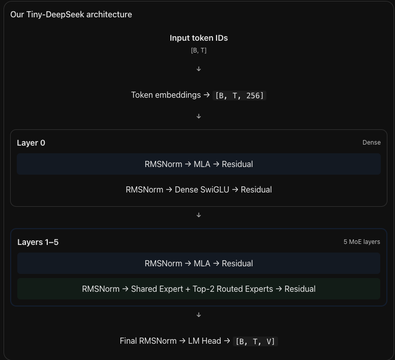
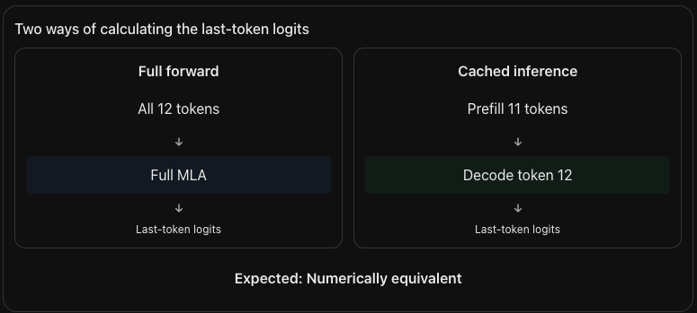

# Assembling the Final DeepSeek Model

The important components now need one consistent interface for training,
checkpointing, and autoregressive inference. This assembly keeps the earlier
experimental model available, while adding a final model whose blocks use the
same learned MLA weights for both full-sequence and cached execution.



The implementation is in `src/model/final_deepseek.py`:

- `FinalDeepSeekBlock` combines pre-RMSNorm, cached MLA, residuals, and either
  dense SwiGLU or DeepSeekMoE.
- `TinyDeepSeek` exposes `forward`, `prefill`, `decode_step`, and
  `reset_cache`.
- `return_hidden=True` exposes the final normalized states for MTP.

## 1. One model, two attention algorithms

The final model uses `CachedMLA` in every Transformer block. Its methods have
different execution roles:

| Operation | Method | Behavior |
| --- | --- | --- |
| Training/full sequence | `forward()` | Full causal MLA with gradients |
| Prompt processing | `prefill()` | Full MLA plus compressed KV-cache initialization |
| One-token decoding | `decode_step()` | Absorbed MLA over cached latents |

These paths share query, key/value, and output-projection weights. They use
different matrix operations, but they represent the same attention function
up to floating-point round-off.

The current `CachedMLA.prefill()` intentionally performs a full attention
calculation and also fills the cache. It is correct for validation, but it is
not yet an optimized prefill kernel.

## 2. The consolidated block

The block keeps the same pre-RMSNorm structure as the previous model:

\[
h=x+\operatorname{MLA}(\operatorname{RMSNorm}_1(x))
\]

\[
y=h+\operatorname{FFN}(\operatorname{RMSNorm}_2(h)).
\]

The only attention difference is that the final block uses `CachedMLA`:

```python
class FinalDeepSeekBlock(nn.Module):
    def __init__(self, config, layer_id):
        super().__init__()
        self.is_moe = layer_id >= config.n_dense_layers
        self.attn_norm = RMSNorm(config.dim, eps=1e-6)
        self.attention = CachedMLA(config)
        self.ffn_norm = RMSNorm(config.dim, eps=1e-6)
        self.ffn = (
            DeepSeekMoE(config)
            if self.is_moe
            else SwiGLUFFN(config.dim, config.inter_dim)
        )

    def forward(self, x):
        x = x + self.attention(self.attn_norm(x))
        return x + self.ffn(self.ffn_norm(x))
```

`prefill` and `decode_step` reuse the same FFN and residual logic; only the
attention call changes to `self.attention.prefill(...)` or
`self.attention.decode_step(...)`.

## 3. The final model interface

The model has a single full-sequence path and explicit inference methods:

```python
from src.model.final_deepseek import TinyDeepSeek

model = TinyDeepSeek(config)

logits = model(input_ids)
logits, hidden = model(input_ids, return_hidden=True)

prompt_logits = model.prefill(prompt_ids)
next_logits = model.decode_step(next_token)
model.reset_cache()
```

The shapes are:

| Value | Shape |
| --- | --- |
| `input_ids` | `[B,T]` |
| hidden states | `[B,T,D]` |
| logits | `[B,T,V]` |
| one-token decode input | `[B,1]` |
| one-token decode logits | `[B,1,V]` |

`return_hidden=True` returns the final RMSNorm output together with the
logits. The hidden states are the representation that the later MTP module can
consume without running the main stack a second time.

## 4. Trace the model with real dimensions

For (B=2), (T=128), (D=256), and (V=8192):

\[
\text{input\_ids}:[2,128]
\rightarrow
\text{embeddings}:[2,128,256]
\rightarrow
\text{six blocks}:[2,128,256]
\rightarrow
\text{final norm}:[2,128,256]
\rightarrow
\text{LM head}:[2,128,8192].
\]

Layer 0 uses dense SwiGLU. Layers 1 through 5 use the shared expert plus two
routed experts. The block boundary never changes from `[B,T,D]`, which is what
makes residual addition and layer composition straightforward.

## 5. The critical equivalence test

The final position can be calculated in two ways:

1. Run the whole sequence with `model(tokens)`.
2. Run all but the last token with `model.prefill(...)`, then pass the last
   token to `model.decode_step(...)`.



```python
import torch
from src.model.final_deepseek import TinyDeepSeek

model = TinyDeepSeek(config).eval()
tokens = torch.randint(0, config.vocab_size, (1, 12))

with torch.no_grad():
    full_logits = model(tokens)
    model.prefill(tokens[:, :-1])
    cached_logits = model.decode_step(tokens[:, -1:])

torch.testing.assert_close(
    cached_logits,
    full_logits[:, -1:],
    rtol=3e-4,
    atol=3e-4,
)
```

This test covers MLA, decoupled RoPE, compressed KV caching, dense and routed
experts, residual connections, and the LM head together. Small differences
are expected because the full and absorbed paths multiply matrices in a
different order. Hard top-k routing can also be sensitive to near-tied scores.

## 6. Configuration validation

`DeepSeekConfig` owns structural constraints shared by all model components:

| Setting | Constraint | Reason |
| --- | --- | --- |
| `n_layers` | Positive | At least one block |
| `n_dense_layers` | `0` through `n_layers` | Valid dense/MoE split |
| `n_activated_experts` | `1` through `n_routed_experts` | Valid top-k selection |
| `qk_rope_head_dim` | Positive and even | RoPE works on pairs |
| `max_seq_len` | Positive | Valid cache and masks |
| `vocab_size` | Positive | Embedding and LM head |
| `kv_lora_rank` | Positive | Non-empty compressed KV state |

The final model repeats only the layer-allocation and expert-selection checks
at its boundary. Keeping shared structural validation in the config avoids
multiple inconsistent sources of truth.

The educational router still uses one expert group. A configuration with
multiple groups should not be interpreted as the complete distributed
group-limited routing used by the full-scale reference implementation.

## 7. Checkpoints

`src/training/checkpoint.py` saves:

- the serialized `DeepSeekConfig`;
- model weights, including router balancing buffers;
- the training step;
- optional optimizer state; and
- optional caller-supplied metadata.

Save and restore a final model like this:

```python
from src.training.checkpoint import load_checkpoint, save_checkpoint

save_checkpoint(
    "checkpoints/final_deepseek.pt",
    model,
    optimizer=optimizer,
    step=100,
)

restored, metadata = load_checkpoint(
    "checkpoints/final_deepseek.pt",
    device="cpu",
)
```

The router's `expert_bias` is registered as a buffer, so it is included in
`state_dict()` automatically. The dynamic MLA caches are ordinary runtime
state and are not checkpointed; call `prefill` for each new inference request.

For a full training resume, restore the optimizer, scheduler, random-number
states, and data-loader position as well. This article only establishes the
model checkpoint boundary.

Only load checkpoint files from trusted sources. The loader uses the explicit
PyTorch checkpoint format already used by this repository.

## 8. Prepare for Multi-Token Prediction

The final model exposes the main hidden sequence without changing any block:

```python
logits, hidden = model(input_ids, return_hidden=True)
```

If the input represents

```text
The | cat | sat | on | the | mat
```

the main stack produces contextual states (h_0,\ldots,h_5). Ordinary next-
token prediction uses (h_0\rightarrow\text{cat}), (h_1\rightarrow\text{sat}),
and so on. MTP will add a separate future-token objective by combining shifted
main hidden states with appropriately shifted token embeddings.

The main causal path and next-token loss remain intact. MTP is an additional
training branch, not a replacement for the Transformer.

## 9. Final architecture audit

Run the consolidated model tests:

```bash
python -m pytest src/tests/test_final_deepseek.py -v
```

They verify:

- every final block uses `CachedMLA`;
- the dense-prefix/MoE-suffix split is preserved;
- hidden states have the expected shape;
- full forward and cached final-position logits agree;
- `reset_cache` clears every block; and
- checkpoints restore predictions and router bias buffers.

The model retains the same default parameter count as the previous
implementation. `CachedMLA` adds cache methods and runtime tensors, not new
trainable projection weights.

The main architecture is now ready for the MTP integration and the final
validation work.
