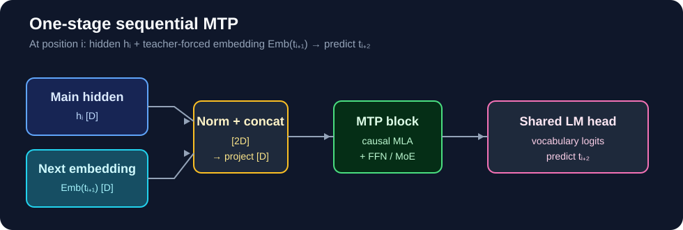

# Implementing Multi-Token Prediction

Ordinary language-model training asks the main Transformer to predict the
next token. Multi-Token Prediction (MTP) adds another teacher-forced signal for
a token further ahead.

The important detail is that MTP is not just a second linear head on the same
hidden state. The additional prediction module receives the main hidden state
and the embedding of the actual next token, processes their combination with
another causal Transformer block, and predicts the following token.



The implementation has two pieces:

- `src/model/mtp.py` contains one sequential `MTPModule`.
- `src/model/deepseek_with_mtp.py` combines the main loss and the MTP loss.

## 1. Ordinary next-token prediction

For tokens

\[
[t_0,t_1,t_2,t_3,t_4,t_5],
\]

ordinary training uses:

```python
inputs = tokens[:, :-1]
targets = tokens[:, 1:]
```

The main model learns the relationships:

| Main position | Context | Target |
| ---: | --- | --- |
| 0 | `The` | `cat` |
| 1 | `The cat` | `sat` |
| 2 | `The cat sat` | `on` |
| 3 | `The cat sat on` | `the` |
| 4 | `The cat sat on the` | `mat` |

This remains the primary objective. MTP adds a second objective without
changing the ordinary causal language-model path.

## 2. What the MTP module receives

At position (i), the first MTP module receives:

- the main hidden state (h_i), which contains context through (t_i);
- the embedding of the actual next token (t_{i+1}).

It predicts (t_{i+2}):

\[
(h_i,\operatorname{Emb}(t_{i+1}))\rightarrow t_{i+2}.
\]

For the example above:

| Main hidden | Extra input | Main target | MTP target |
| --- | --- | --- | --- |
| (h_0) after `The` | embedding of `cat` | `cat` | `sat` |
| (h_1) after `The cat` | embedding of `sat` | `sat` | `on` |
| (h_2) after `The cat sat` | embedding of `on` | `on` | `the` |
| (h_3) after `The cat sat on` | embedding of `the` | `the` | `mat` |

The actual next token is available during teacher-forced training. The token
being predicted by MTP is not provided as input.

## 3. Exact tensor alignment

For a token batch shaped `[B, L]`, the main input and MTP slices are:

```python
main_inputs = tokens[:, :-1]
main_targets = tokens[:, 1:]

main_logits, hidden = main_model(
    main_inputs,
    return_hidden=True,
)

mtp_hidden = hidden[:, :-1]
mtp_next_tokens = tokens[:, 1:-1]
mtp_targets = tokens[:, 2:]
```

For (L=6):

| Tensor | Shape |
| --- | --- |
| `tokens` | `[B,6]` |
| `main_inputs` | `[B,5]` |
| `main_targets` | `[B,5]` |
| `hidden` | `[B,5,D]` |
| `mtp_hidden` | `[B,4,D]` |
| `mtp_next_tokens` | `[B,4]` |
| `mtp_targets` | `[B,4]` |

The number of valid one-stage MTP positions is (L-2). The two slices must
have the same batch and sequence dimensions before they are fused.

## 4. Why this is still causal

At MTP position zero, the module receives (h_0) and
\(\operatorname{Emb}(t_1)\), then predicts (t_2). It does not receive
\(t_2\) or any later token as an input.

The additional Transformer block is causal across MTP positions. Therefore,
changing (t_2) must not change the MTP prediction at position zero. It may
change later MTP positions, because those positions are allowed to condition
on it.

This is the correct meaning of “future-token” supervision: the MTP target is
future relative to the inputs available at that MTP position, while the
teacher-forced intermediate token is intentionally provided.

## 5. Inside one MTP module

The module uses:

| Component | Input | Output |
| --- | --- | --- |
| Main hidden RMSNorm | `[B,L-2,D]` | `[B,L-2,D]` |
| Next-token embedding RMSNorm | `[B,L-2,D]` | `[B,L-2,D]` |
| Concatenation | two D-dimensional vectors | `[B,L-2,2D]` |
| Projection | `[B,L-2,2D]` | `[B,L-2,D]` |
| Additional Transformer block | `[B,L-2,D]` | `[B,L-2,D]` |
| Final RMSNorm | `[B,L-2,D]` | `[B,L-2,D]` |
| Shared LM head | `[B,L-2,D]` | `[B,L-2,V]` |

The projection and additional block have independent trainable parameters. The
token embedding table and vocabulary projection are supplied by the main
model, so MTP does not create duplicate copies.

```python
mtp_logits = mtp_module(
    main_hidden=mtp_hidden,
    next_token_ids=mtp_next_tokens,
    shared_embedding=main_model.embed_tokens,
    shared_lm_head=main_model.lm_head,
)
```

The additional block uses the same educational DeepSeek block family. With
the default configuration it is an MoE block because it is placed after the
dense prefix. It has its own attention, normalization, router, and expert
weights.

## 6. The combined loss

The main loss is ordinary next-token cross-entropy:

\[
\mathcal L_{\text{main}}
=\operatorname{CE}(\text{main logits},t_{i+1}).
\]

The MTP loss is:

\[
\mathcal L_{\text{MTP}}
=\operatorname{CE}(\text{MTP logits},t_{i+2}).
\]

The wrapper combines them as:

\[
\boxed{\mathcal L_{\text{total}}
=\mathcal L_{\text{main}}+\lambda\mathcal L_{\text{MTP}}}.
\]

The default educational weight is `λ = 0.3`, and it is configurable:

```python
from src.model import DeepSeekConfig, DeepSeekWithMTP

model = DeepSeekWithMTP(
    DeepSeekConfig(vocab_size=512, max_seq_len=32),
    mtp_weight=0.3,
)
result = model(tokens)
result["loss"].backward()
```

The result dictionary includes:

| Key | Meaning |
| --- | --- |
| `loss` | Weighted total loss |
| `main_loss` | Ordinary next-token loss |
| `mtp_loss` | One-stage two-ahead loss |
| `main_logits` | `[B,L-1,V]` |
| `mtp_logits` | `[B,L-2,V]` |
| `main_hidden` | `[B,L-1,D]` |

The MTP gradient flows through the shared LM head, shared embedding table,
main hidden states, main Transformer, MTP projection, and MTP block. It is an
auxiliary objective that helps train the main representation, not an isolated
second model.

## 7. Gradient and alignment checks

Run the focused tests:

```bash
python -m pytest src/tests/test_mtp.py -v
```

The tests verify:

- MTP vocabulary-logit shapes;
- main and MTP sequence alignment;
- total-loss arithmetic;
- gradients reaching the main model and shared modules;
- future-token isolation at the first MTP position; and
- validation for short sequences and invalid loss weights.

The most important leakage check changes the token at position two while
holding the first MTP inputs fixed. The first MTP-position logits must remain
unchanged.

## 8. MTP is training-time infrastructure

The normal inference path still belongs to the main model:

1. Process the prompt with `main_model.prefill`.
2. Predict the next token.
3. Feed the selected token to `main_model.decode_step`.
4. Repeat using the main model's KV cache.

The MTP branch is not required for ordinary next-token generation. The wrapper
delegates `prefill`, `decode_step`, and `reset_cache` to its `main_model`, so
the same inference API remains available when the MTP training wrapper is
loaded.

## 9. More prediction depths

One MTP module predicts two tokens ahead. Additional sequential modules could
continue the pattern:

| Depth | Extra embedding | Target |
| --- | --- | --- |
| Main model | none | (t_{i+1}) |
| MTP 1 | (t_{i+1}) | (t_{i+2}) |
| MTP 2 | (t_{i+2}) | (t_{i+3}) |
| MTP 3 | (t_{i+3}) | (t_{i+4}) |

Each depth needs its own projection and Transformer block. Token embeddings
and the vocabulary head can remain shared. This repository implements one
additional depth, which is enough to establish the alignment and gradient
paths without adding another large training branch.

## 10. The key idea

MTP is structured future-token supervision:

\[
h_i+\operatorname{Emb}(t_{i+1})
\longrightarrow
t_{i+2}.
\]

It is more expressive than attaching another linear head, remains causal with
respect to its target, shares the main vocabulary interfaces, and leaves
ordinary inference unchanged. The next step is to validate the complete
architecture and all of these alignment guarantees together.
