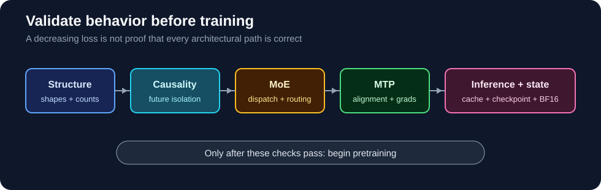

# Complete Architecture Validation and Debugging

The final model now contains MLA, decoupled RoPE, dense and MoE layers,
expert routing, balancing buffers, compressed-cache inference, and
Multi-Token Prediction. Before training it on a large corpus, we need tests
that check behavior rather than merely checking that a forward pass runs.



The validation suite lives in
`src/tests/test_final_validation.py`. It uses a small configuration so the
same mechanisms can be tested on a CPU or a modest GPU.

## 1. The validation configuration

The shared fixture in `src/tests/conftest.py` uses:

| Component | Value |
| --- | ---: |
| Hidden dimension | 64 |
| Transformer layers | 3 |
| Dense layers | 1 |
| Attention heads | 4 |
| Routed experts per MoE layer | 4 |
| Selected routed experts | 2 |
| Shared experts | 1 |
| Vocabulary | 128 |
| Maximum sequence length | 32 |

Most tests use `[batch, sequence] = [2, 8]`. The model is small, but it still
exercises the dense prefix, MoE suffix, cache, MTP branch, and router buffers.

Run the complete validation file with:

```bash
python -m pytest src/tests/test_final_validation.py -v -s
```

Run all repository tests with:

```bash
python -m pytest src/tests -v
```

## 2. Structure and shape correctness

The first test verifies that every final block uses `CachedMLA`, that layer 0
uses dense SwiGLU, and that later layers use `DeepSeekMoE`.

For (B=2), (T=8), (D=64), and (V=128), the final model must produce:

\[
\text{input}:[2,8]
\]

\[
\text{hidden}:[2,8,64]
\]

\[
\text{logits}:[2,8,128].
\]

The test also checks that logits are finite. Shape checks catch incorrect
projection dimensions and layer selection; finiteness checks catch many
normalization and masking errors early.

## 3. Causality

A causal model must not use future tokens for an earlier output. Compare:

```text
10 20 30 40 50 60 70 80
10 20 30 40 50 91 92 93
```

The first five inputs are identical, so logits at positions 0 through 4 must
match. If they do not, inspect the causal mask, RoPE positions, or an
operation that mixes token positions. MoE routing is token-local and should
not introduce a future dependency.

## 4. Sparse dispatch equivalence

The production-like path dispatches only selected token rows:

```python
token_ids, slots = torch.where(indices == expert_id)
expert_input = flat_x.index_select(0, token_ids)
output = output.index_add(0, token_ids, contribution)
```

The validation test constructs a deliberately slow reference. It evaluates
every expert on every token and masks the unselected contributions:

```python
reference = moe.experts.forward_shared(flat)
for expert_id, expert in enumerate(moe.experts.routed_experts):
    expert_output = expert(flat)
    selected = indices == expert_id
    weight = (weights * selected).sum(dim=-1, keepdim=True)
    reference = reference + expert_output * weight
```

The sparse and reference outputs must match. This tests token gathering,
routing weights, and scatter-add aggregation independently of performance.

## 5. Gradient propagation

The ordinary next-token loss should reach:

- token embeddings;
- MLA projections in every layer;
- router gate weights in every MoE layer;
- the shared expert; and
- at least the routed experts that received tokens.

An individual routed expert can correctly have no gradient in a small batch
if it received no assignments. Persistent underutilization is a routing
problem, not automatically a gradient bug.

Router gate weights receive ordinary autograd gradients. `expert_bias` is a
registered buffer and is updated separately from observed load statistics.

## 6. Balancing behavior

The deterministic balancing test uses assignment counts

\[
[6,4,1,1]
\]

for four experts. With `gamma=0.05`, overloaded experts 0 and 1 move down and
underloaded experts 2 and 3 move up:

\[
[-0.05,-0.05,0.05,0.05].
\]

The test also verifies that balancing biases affect selection but not the
normalized output weights. This distinction matters: using the balancing
buffer in output-weight normalization would change the intended router.

## 7. MTP alignment and leakage

For a six-token sequence, the one-stage MTP slices are:

| Main hidden | MTP input token | MTP target |
| --- | --- | --- |
| (h_0) | (t_1) | (t_2) |
| (h_1) | (t_2) | (t_3) |
| (h_2) | (t_3) | (t_4) |
| (h_3) | (t_4) | (t_5) |

The implementation must use:

```python
mtp_hidden = main_hidden[:, :-1]
mtp_next_tokens = tokens[:, 1:-1]
mtp_targets = tokens[:, 2:]
```

The validation suite checks the slices directly and checks the complete
wrapper shapes for a nine-token sequence:

```text
main logits: [2, 8, 128]
MTP logits:  [2, 7, 128]
```

It then changes (t_2) while keeping the first MTP inputs fixed. The first
MTP-position logits must remain unchanged. Later positions may change because
they are allowed to condition on that token.

Finally, backpropagating only `mtp_loss` must reach both the main model and
the MTP projection/block. This confirms that MTP is an auxiliary training
signal rather than an isolated prediction head.

## 8. Full forward versus cached decoding

The most important inference test compares:

1. `model(tokens)` over the complete sequence;
2. `model.prefill(tokens[:, :-1])` followed by
   `model.decode_step(tokens[:, -1:])`.

The final-position logits must agree within a small FP32 tolerance. A second
test pre-fills five tokens and decodes five consecutive tokens, comparing each
step against full-sequence logits.

Debug cache failures systematically:

| Symptom | Likely area |
| --- | --- |
| First decoded token is wrong | KV reconstruction or absorption |
| First token is correct, later steps fail | Cache append or position offsets |
| Failure only near the context limit | Cache bounds or RoPE positions |
| Small BF16-only differences | Reduced-precision arithmetic |
| Different experts are selected | Near-tied top-k scores |

Do not hide a large error by increasing tolerance. A significant FP32 logit
difference indicates a real integration problem.

## 9. Checkpoint integrity

The checkpoint test sets nonzero router biases, saves the final model, reloads
it, and compares predictions. It also checks that the step number and bias
buffer are restored.

`src/training/checkpoint.py` stores:

- serialized configuration;
- model `state_dict`;
- training step;
- optional optimizer state; and
- optional metadata.

Exact training continuation additionally requires optimizer, scheduler, RNG,
and data-order state. Those concerns belong in the training phase; this test
establishes that model state itself survives a round trip.

## 10. BF16 stability

The CUDA-only validation test uses BF16 autocast for one forward/backward pass:

```python
with torch.autocast(device_type="cuda", dtype=torch.bfloat16):
    logits = model(tokens[:, :-1])
    loss = F.cross_entropy(logits.float().reshape(-1, vocab), targets)
loss.backward()
```

It is skipped automatically when CUDA or BF16 support is unavailable. The
model is not converted wholesale with `model.bfloat16()`; autocast lets
PyTorch choose reduced precision for supported operations while keeping
important computations stable.

The router already promotes gate logits before sigmoid:

```python
scores = torch.sigmoid(logits.float())
```

The validation pass checks that the loss is finite. Training will later add
gradient clipping, accumulation, and more detailed numerical monitoring.

## 11. MTP routing and training statistics

The MTP branch contains its own additional Transformer block. With the default
configuration, that block is an MoE block and has a router of its own.

`MoELoadBalancer` attaches hooks to every `TopKRouter` in a model, so when it
is used with `DeepSeekWithMTP`, its routing records include both the main
model's MoE layers and the MTP block's router. The MTP branch is omitted from
ordinary generation, but its weights and routing state remain part of the
training checkpoint.

## 12. How to interpret failures

| Failure | First place to inspect |
| --- | --- |
| Shape or structure | Config dimensions and projection reshapes |
| Causality | Attention masks and RoPE offsets |
| MoE mismatch | Token indices, weights, and `index_add` |
| Missing gradients | `detach`, `no_grad`, and disconnected paths |
| MTP leakage | Token slices and MTP causal mask |
| Cache mismatch | RoPE positions, cache append, and absorption |
| Checkpoint mismatch | State-dict keys, buffers, and eval mode |
| BF16 non-finite values | Norms, router precision, logits, and loss |

Isolate the smallest failing component. If the full cached model fails while
the standalone `CachedMLA` test passes, inspect block integration and cache
lifecycle rather than changing the attention algorithm immediately.

## 13. Validation complete

Once this suite passes, the architecture has evidence for:

- correct model structure and tensor shapes;
- causal information flow;
- sparse MoE equivalence;
- gradient connectivity;
- balancing-buffer behavior;
- MTP alignment and target isolation;
- cached inference equivalence;
- checkpoint integrity; and
- one BF16 forward/backward step where supported.

That is the right point to begin optimization and pretraining. A decreasing
training loss alone is not proof of any of these properties.
