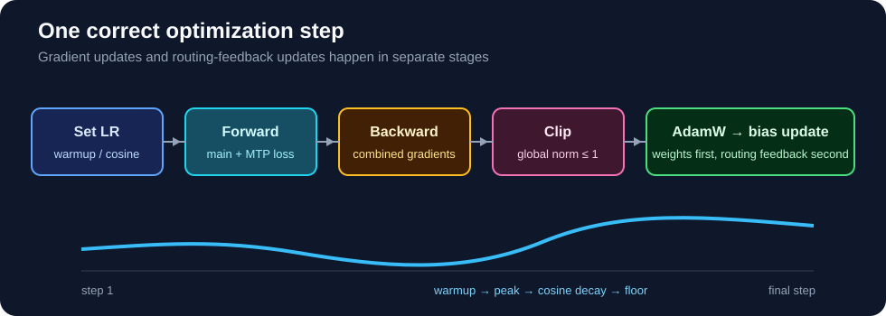

# Training DeepSeek: Losses, AdamW, and Learning-Rate Scheduling

The architecture is ready to learn. This article adds the optimization logic
that updates its weights reliably while keeping expert-balancing feedback
separate from gradient descent.



The implementation lives under `src/training/`:

- `optimizer.py` builds AdamW parameter groups;
- `scheduler.py` implements one-based warmup and cosine decay; and
- `train_step.py` combines MTP loss, clipping, AdamW, and router-bias updates.

The code uses ordinary FP32 training here. BF16 autocast, accumulation, and
memory optimizations belong to the next training phase.

## 1. What is being optimized?

| Component | How it learns |
| --- | --- |
| Token embeddings | Gradients from the training loss |
| MLA projections | Gradients from the training loss |
| Dense SwiGLU FFNs | Gradients from the training loss |
| Routed and shared experts | Gradients from assigned tokens |
| Router matrices | Gradients through selected routing weights |
| MTP Transformer | Gradients from the MTP loss |
| Expert-balancing biases | Manual updates from observed loads |

Most parameters are updated by AdamW. Router balancing biases are registered
buffers, not trainable parameters, and are updated after the optimizer step by
`MoELoadBalancer`.

## 2. The combined objective

The main model predicts the next token and the MTP branch predicts one further
token:

\[
\mathcal L_{\text{main}}
=\operatorname{CE}(\text{main logits},t_{i+1})
\]

\[
\mathcal L_{\text{MTP}}
=\operatorname{CE}(\text{MTP logits},t_{i+2}).
\]

The wrapper combines them with a configurable weight:

\[
\boxed{\mathcal L_{\text{total}}
=\mathcal L_{\text{main}}+\lambda\mathcal L_{\text{MTP}}}.
\]

The initial value is `λ = 0.3`:

```python
result = model(tokens)
main_loss = result["main_loss"]
mtp_loss = result["mtp_loss"]
total_loss = result["loss"]
total_loss.backward()
```

Backpropagate the combined loss once. The main Transformer, MTP block, shared
embedding table, and shared vocabulary head then participate in the same
gradient computation. Do not exponentiate the combined loss when reporting
ordinary next-token perplexity; use `main_loss` for that metric.

## 3. AdamW

SGD uses only the current gradient:

\[
w_{\text{new}}=w-\eta g.
\]

Adam keeps running estimates of the gradient and squared gradient, then uses
their bias-corrected values to adapt each parameter's effective update size.
AdamW decouples weight decay from that adaptive update:

\[
w\leftarrow(1-\eta\lambda_{\text{wd}})w
-\eta\frac{\hat m}{\sqrt{\hat v}+\epsilon}.
\]

The initial settings are:

| Setting | Value |
| --- | ---: |
| Optimizer | AdamW |
| `beta1` | 0.9 |
| `beta2` | 0.95 |
| Weight decay | 0.1 |
| Gradient clipping norm | 1.0 |
| Peak learning rate | `3e-4` |
| Minimum learning rate | `3e-5` |

## 4. Parameter groups

`create_optimizer` applies decay to matrix parameters and excludes
one-dimensional parameters such as RMSNorm scales. Router balancing buffers
are not returned by `model.parameters()` and therefore cannot accidentally be
included in either group.

```python
from src.training import create_optimizer

optimizer = create_optimizer(model, lr=3e-4, weight_decay=0.1)
```

The implementation uses `optimizer.zero_grad(set_to_none=True)`. A routed
expert that receives no token can retain `grad=None`, and AdamW skips it. This
is different from manufacturing a zero gradient tensor, which could still
allow weight decay or momentum behavior.

## 5. Warmup and cosine decay

The learning-rate schedule is:

1. linearly increase from the first warmup step to the peak;
2. smoothly decay toward the minimum learning rate; and
3. remain at the floor after the planned final step.

For the decay phase:

\[
\eta(t)=\eta_{\min}
+\frac12(\eta_{\max}-\eta_{\min})
\left(1+\cos(\pi p)\right),
\]

where (p) is the fraction of the decay phase completed.

The helper uses a one-based optimizer step so the schedule is explicit:

```python
from src.training import get_learning_rate, set_learning_rate

lr = get_learning_rate(
    step=25,
    total_steps=2000,
    warmup_steps=100,
    max_lr=3e-4,
    min_lr=3e-5,
)
set_learning_rate(optimizer, lr)
```

For `max_lr=3e-4`, `min_lr=3e-5`, and `warmup_steps=100`, step 100 reaches
the peak. Step 2000 reaches the floor.

This is an educational schedule, not a rescaled copy of the full-scale
DeepSeek-V3 token schedule.

## 6. Gradient clipping

If the global gradient vector is (g=[3,4,0]), its L2 norm is 5. With a
maximum norm of 1, clipping scales it to:

\[
g_{\text{clipped}}=\frac{g}{5}=[0.6,0.8,0].
\]

The direction remains the same while the magnitude is limited. PyTorch
provides the operation:

```python
grad_norm = torch.nn.utils.clip_grad_norm_(
    model.parameters(),
    max_norm=1.0,
)
```

`grad_norm` is the total norm before clipping, which makes it useful for
monitoring. Clipping must happen after `backward()` and before
`optimizer.step()`.

## 7. One complete training step

`train_step` implements this order:

1. set the learning rate for the optimizer step;
2. clear gradients and recorded router assignments;
3. run the combined main+MTP forward pass;
4. backpropagate the combined loss;
5. clip the global gradient norm;
6. update trainable weights with AdamW; and
7. update expert-balancing biases from the recorded assignments.

```python
from src.training import MoELoadBalancer, create_optimizer, train_step

optimizer = create_optimizer(model)
with MoELoadBalancer(model, gamma=0.01) as balancer:
    metrics = train_step(
        model,
        optimizer,
        balancer,
        tokens,
        step=1,
        total_steps=20,
        warmup_steps=3,
    )
```

The returned metrics include `loss`, `main_loss`, `mtp_loss`, `lr`,
`grad_norm`, and per-router `load_ratios`. Passing the complete
`DeepSeekWithMTP` wrapper to the balancer includes the additional MTP MoE
router as well as the main model's routers.

## 8. Run the optimization smoke test

The self-contained smoke test overfits one random batch:

```bash
python -m src.smoke_optimizer
```

It uses a small model, five FP32 updates, warmup, cosine decay, clipping, MTP
loss, AdamW, and router-bias updates. This validates the optimization wiring;
it does not measure language quality or generalization.

## 9. Focused tests

Run:

```bash
python -m pytest src/tests/test_training_optimizer.py -v
```

The tests cover:

- warmup and cosine schedule boundaries;
- invalid schedule and optimizer settings;
- matrix versus one-dimensional parameter groups;
- an actual AdamW parameter update; and
- one complete DeepSeek+MTP training step with routing feedback.

## 10. Initial hyperparameters

| Hyperparameter | Starting value | Purpose |
| --- | ---: | --- |
| Optimizer | AdamW | Adaptive updates |
| Peak learning rate | `3e-4` | Initial update scale |
| Minimum learning rate | `3e-5` | Decay floor |
| `beta1` | `0.9` | First-moment smoothing |
| `beta2` | `0.95` | Second-moment smoothing |
| Weight decay | `0.1` | Decoupled regularization |
| Gradient clip | `1.0` | Limit large updates |
| Warmup | 5% of planned steps | Stabilize early training |
| MTP weight | `0.3` | Future-token supervision |
| Router bias step | `0.01` | Load-balancing feedback |

These are starting points for the small model. A divergent loss, unstable
gradient norm, or oscillating expert load needs its own diagnosis; changing
every hyperparameter at once makes the cause harder to identify.

## 11. Common mistakes

| Mistake | Correct approach |
| --- | --- |
| Forgetting `zero_grad()` | Clear gradients before each independent step |
| Clipping after `optimizer.step()` | Clip between backward and optimizer update |
| Updating balancing bias inside `forward()` | Update after the optimizer step |
| Advancing the schedule per microbatch | Advance once per optimizer step |
| Reporting total loss as perplexity | Use main next-token loss |
| Using a separate MTP optimizer | Optimize main and MTP parameters together |

The essential update order is:

\[
\text{schedule}
\rightarrow\text{forward}
\rightarrow\text{backward}
\rightarrow\text{clip}
\rightarrow\text{AdamW}
\rightarrow\text{router bias update}.
\]

The optimization path is now ready to be extended with BF16 autocast,
gradient accumulation, activation checkpointing, and GPU memory measurement.
