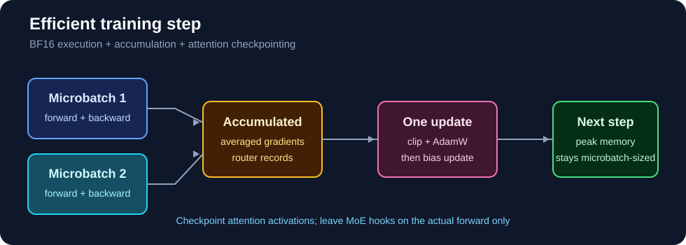

# BF16, Gradient Accumulation, and GPU Training Engineering

The FP32 optimization loop now works. This article adds the engineering
techniques needed to train with larger effective batches and lower peak
activation memory:

1. BF16 automatic mixed precision;
2. gradient accumulation;
3. attention-only activation checkpointing; and
4. GPU memory and throughput profiling.



The implementation lives in `src/training/efficient_train_step.py` and
`src/training/profiling.py`. The final model exposes a checkpointing switch
that deliberately excludes the MoE path from recomputation hooks.

## 1. Where training memory goes

Training memory comes from four major sources:

| Source | Examples |
| --- | --- |
| Model weights | MLA, experts, router, embeddings |
| Gradients | Derivatives retained for the update |
| Optimizer state | AdamW first and second moments |
| Activations | Intermediate tensors needed by backward |

For FP32 AdamW, a rough baseline is 16 bytes per trainable parameter:

| Component | Bytes per parameter |
| --- | ---: |
| FP32 weight | 4 |
| FP32 gradient | 4 |
| AdamW first moment | 4 |
| AdamW second moment | 4 |
| **Total** | **16** |

For a 14.85M-parameter model, that baseline is about 238 MB. It excludes
activations, temporary attention tensors, CUDA workspaces, allocator overhead,
and the MTP branch.

Activation memory grows with batch size, sequence length, and layer count. A
single `[4,1024,256]` hidden tensor takes roughly 2 MiB in BF16, but each layer
also creates projections, attention intermediates, SwiGLU values, and expert
outputs.

## 2. FP32, FP16, and BF16

| Format | Total bits | Exponent bits | Fraction bits |
| --- | ---: | ---: | ---: |
| FP32 | 32 | 8 | 23 |
| FP16 | 16 | 5 | 10 |
| BF16 | 16 | 8 | 7 |

BF16 has less significand precision than FP16 but an exponent range closer to
FP32. That wider range is useful when neural-network activations and gradients
vary greatly in magnitude.

Mixed precision does not mean converting every parameter to BF16. With
autocast, suitable matrix operations use BF16 while parameters and sensitive
math remain in a safer representation:

```python
use_bf16 = (
    device.type == "cuda"
    and torch.cuda.is_bf16_supported()
)

with torch.autocast(
    device_type=device.type,
    dtype=torch.bfloat16,
    enabled=use_bf16,
):
    result = model(tokens)
    loss = result["loss"]
```

The model already promotes router scores and loss logits to FP32. BF16
usually does not require `GradScaler`; FP16 often does because its narrower
range is more susceptible to underflow.

## 3. Gradient accumulation

If a GPU holds eight sequences but the desired effective batch is 32, process
four microbatches and perform one optimizer update:

\[
B_{\text{effective}}=B_{\text{micro}}\times A.
\]

With (G) data-parallel workers:

\[
B_{\text{global}}=B_{\text{micro}}\times A\times G.
\]

For equally sized microbatches with losses already averaged over their tokens,
divide each loss by the accumulation count before backward:

```python
optimizer.zero_grad(set_to_none=True)
for microbatch in microbatches:
    result = model(microbatch)
    (result["loss"] / len(microbatches)).backward()
optimizer.step()
```

Do not zero gradients between microbatches. Accumulation increases the number
of tokens per optimizer update without storing all microbatch activations at
once; it does not remove the extra forward and backward computation.

This first implementation assumes equal-sized, unmasked microbatches. A
token-weighted loss is required when valid-token counts differ.

## 4. Accumulating MoE routing statistics

The router assignment records must be combined across all microbatches before
balancing biases are updated. Otherwise a router could move down after one
microbatch and back up after another, even though the combined optimizer step
was balanced.

`MoELoadBalancer` already stores every hook record and its `update()` groups
records by router before calling `TopKRouter.update_bias` once per router.
`efficient_train_step` follows this order:

1. clear old records;
2. run every microbatch and record assignments;
3. accumulate scaled losses and gradients;
4. clip once;
5. call AdamW once; and
6. update each router bias once from combined assignments.

The MTP block has its own router, so passing the full `DeepSeekWithMTP` wrapper
to the balancer includes both main-model and MTP routing statistics.

## 5. The efficient training step

```python
from src.training import (
    MoELoadBalancer,
    create_optimizer,
    efficient_train_step,
)

optimizer = create_optimizer(model)
with MoELoadBalancer(model, gamma=0.01) as balancer:
    metrics = efficient_train_step(
        model,
        optimizer,
        balancer,
        microbatches,
        step=step,
        total_steps=total_steps,
        warmup_steps=warmup_steps,
    )
```

The function supports `use_bf16=None` for automatic BF16 selection on a
compatible CUDA device. Set `use_bf16=False` for explicit FP32 or `True` to
require BF16 support.

Returned metrics include:

| Metric | Meaning |
| --- | --- |
| `loss` | Mean combined loss across microbatches |
| `main_loss` | Mean main next-token loss |
| `mtp_loss` | Mean MTP loss |
| `lr` | Learning rate used for this optimizer step |
| `grad_norm` | Global norm before clipping |
| `load_ratios` | Per-router maximum-load ratios |
| `mean_max_load_ratio` | Average routing-load ratio |

If any microbatch fails, gradients are cleared and routing records are cleared
before the exception is re-raised.

## 6. Activation checkpointing

Activation checkpointing saves fewer forward intermediates and recomputes them
during backward:

| Without checkpointing | With checkpointing |
| --- | --- |
| More activation memory | Less activation memory |
| Less recomputation | More recomputation |
| Often faster | Often slower |

The final block has an attention-only switch:

```python
model.set_activation_checkpointing(True)
```

When training, only `CachedMLA.forward()` is wrapped with
`torch.utils.checkpoint.checkpoint(..., use_reentrant=False)`. The MoE router
and experts remain outside the checkpointed region so routing hooks observe
the actual forward pass exactly once.

The MTP wrapper enables the same behavior for its additional block:

```python
model.set_activation_checkpointing(True)
```

The setting is disabled during evaluation and inference, and cache-mutating
`prefill`/`decode_step` methods are never checkpointed.

## 7. Checkpointing correctness

The focused test compares an ordinary model with a copied model whose
attention checkpointing is enabled. It verifies that:

- forward losses match within FP32 tolerance;
- embedding gradients match; and
- MoE routing records are not duplicated by attention recomputation.

Checkpointing should be enabled only after this equivalence check passes for
the target configuration.

## 8. Profile time and memory

`profile_train_step` measures one complete optimizer step:

```python
from src.training import profile_train_step

metrics = profile_train_step(
    lambda: efficient_train_step(...),
    tokens_per_step=2048,
)
```

It reports step seconds and tokens per second. On CUDA it also reports:

- `peak_allocated_gib`: memory occupied by live tensors;
- `peak_reserved_gib`: memory held by PyTorch's caching allocator.

Reserved memory can exceed allocated memory. Warm up the GPU before comparing
configurations because the first step may include kernel and allocator setup.

For a controlled comparison, keep hardware, model, sequence length, and
optimizer fixed:

| Configuration | BF16 | Accumulation | Checkpointing |
| --- | --- | ---: | --- |
| A | No | 1 | No |
| B | Yes | 1 | No |
| C | Yes | 4 | No |
| D | Yes | 4 | Attention-only |

Compare tokens per second, peak allocated memory, peak reserved memory, and
loss—not only seconds per optimizer step. Accumulation changes tokens per
update when the microbatch size changes.

## 9. GPU strategy

For this model size, start with one GPU. The three common multi-GPU strategies
solve different problems:

| Strategy | What is distributed | Purpose |
| --- | --- | --- |
| Data parallelism / DDP | Training data | Throughput and global batch |
| Tensor parallelism | Matrix weights and calculations | Layers too large for one GPU |
| Expert parallelism | MoE experts and token assignments | Distribute expert banks |

DDP replicates the complete model and synchronizes gradients. Expert
parallelism introduces dynamic all-to-all communication because selected
experts may live on different workers.

With DDP, router assignment counts must also be reduced across workers before
updating balancing buffers. Independent local updates can make the copies'
router biases diverge. Distributed MoE engineering is intentionally deferred;
the current efficient step is single-process and single-device.

## 10. Run the smoke test and focused checks

Run the self-contained two-microbatch smoke test:

```bash
python -m src.smoke_efficient_training
```

Run focused tests:

```bash
python -m pytest src/tests/test_efficient_training.py -v
```

The smoke test uses attention checkpointing, two microbatches, automatic BF16
selection, one AdamW update, and one aggregated balancing update.

## 11. Recommended starting configuration

| Setting | Recommendation |
| --- | --- |
| Mixed precision | BF16 autocast on supported CUDA |
| Stored weights and optimizer | FP32 |
| Sequence length | 128–512 initially |
| Microbatch | 4–8 sequences |
| Gradient accumulation | 4 steps initially |
| Activation checkpointing | Off first; benchmark attention-only mode |
| Gradient clipping | Global norm 1.0 |
| Expert balancing | Aggregate and update once per optimizer step |
| Multiple GPUs | Add DDP only after the single-device path is stable |

Because the educational model is small, checkpointing may reduce throughput
without being necessary on an H100. Measure before adding complexity.

The next step is to connect this efficient training path to the prepared text
dataset and build the end-to-end pretraining loop.
