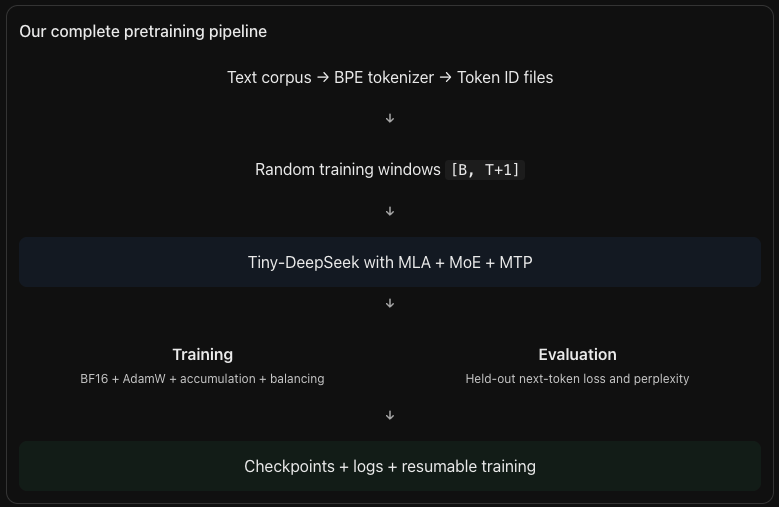
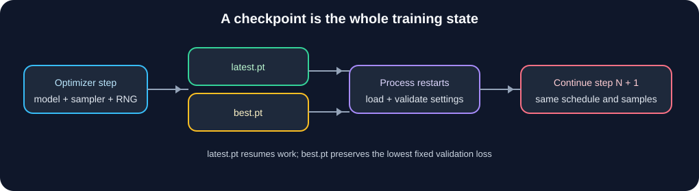

# End-to-End DeepSeek Pretraining

The model and its individual training components are now connected into a
single pretraining pipeline. It reads token IDs from disk, samples random
windows, trains the complete DeepSeek + MTP model, evaluates the main language
model, and saves enough state to resume safely.



The implementation is split into small, reusable pieces:

- `src/data/token_batches.py` samples reproducible windows from memory-mapped
  token files.
- `src/training/evaluate.py` measures held-out next-token loss and perplexity.
- `src/training/full_checkpoint.py` saves model, optimizer, sampler, router,
  schedule, and random-number-generator state.
- `src/pretrain.py` assembles the complete run.

## 1. The first training configuration

The first experiment should be small enough to debug and long enough to show
whether the pipeline is learning.

| Setting | Initial value |
| --- | ---: |
| Vocabulary | 8,192 tokens |
| Transformer layers | 6 |
| Hidden dimension | 256 |
| Initial dense layers | 1 |
| Routed experts per MoE layer | 8 |
| Active routed experts | 2 |
| Shared experts | 1 |
| Context length | 128 |
| Microbatch size | 4 |
| Accumulation steps | 4 |
| Effective batch | 16 sequences |
| Optimizer steps | 2,000 |
| Peak learning rate | `3e-4` |
| MTP loss weight | `0.3` |
| Precision | BF16 autocast when supported |

The processed token budget for this run is:

\[
4 \times 4 \times 128 \times 2{,}000 = 4{,}096{,}000
\]

This counts target positions processed by the main model. It is an engineering
experiment, not an attempt to reproduce DeepSeek-V3's training scale.

## 2. The data contract

The training script expects a directory with flat token-ID arrays:

```text
data/processed/
├── train.bin
├── val.bin
└── metadata.json
```

The binary files contain one-dimensional integer IDs. The metadata must provide
the vocabulary size and NumPy storage dtype:

```json
{
  "tokenizer_vocab_size": 8192,
  "dtype": "<u2"
}
```

The earlier preparation command writes these files. Training and validation are
kept in separate files, so validation windows never come from the training
stream.

## 3. Reproducible random windows

`TokenBatcher` memory-maps one split and samples start positions with its own
CPU `torch.Generator`:

```python
import torch

from src.data import TokenBatcher

batcher = TokenBatcher(
    "data/processed/train.bin",
    seq_len=128,
    dtype="uint16",
    seed=42,
)
tokens = batcher.next_batch(batch_size=4)
assert tokens.shape == (4, 129)
assert tokens.dtype == torch.int64
```

The extra token is needed to create next-token targets. For a batch `[B, T+1]`:

```python
inputs = tokens[:, :-1]
targets = tokens[:, 1:]
```

The batcher stores its generator state in a checkpoint. Restoring that state
continues the same sampling sequence after a restart. This simple flat-stream
sampler can cross document boundaries; document separators and more advanced
packing can be added later.

## 4. Validation and perplexity

Validation measures the main model only. It does not calculate the MTP loss,
update the optimizer, or change expert-balancing biases. The evaluator uses
the main next-token cross-entropy over held-out windows:

```python
from src.training import evaluate_main_model

metrics = evaluate_main_model(
    model.main_model,
    val_batcher,
    batch_size=4,
    num_batches=20,
)
print(metrics["val_loss"], metrics["perplexity"])
```

Perplexity is `exp(val_loss)`. It is useful only when comparing the same
tokenizer, vocabulary, context setup, and validation distribution.

The evaluator temporarily switches the model to evaluation mode and restores
its previous mode afterward. Random validation windows make the first metric
slightly noisy; fixed windows are a good later improvement.

## 5. What a resumable checkpoint contains

Saving only model weights is not enough for a faithful continuation. The full
checkpoint stores:

| State | Purpose |
| --- | --- |
| Complete model state | Main model, MTP, and router biases |
| AdamW state | Momentum and adaptive moments |
| Completed step | Correct schedule position |
| Train/validation generators | Continue sampling deterministically |
| CPU/CUDA RNG states | Preserve stochastic execution |
| Configuration | Reject incompatible model resumes |
| Run settings | Keep schedule and batch semantics fixed |

`save_training_checkpoint` writes a temporary file and then replaces the target
with `os.replace`, so a process interruption does not leave a half-written
checkpoint at the final path.



```python
from src.training import load_training_checkpoint

state = load_training_checkpoint(
    "checkpoints/latest.pt",
    model=model,
    optimizer=optimizer,
    train_batcher=train_batcher,
    val_batcher=val_batcher,
    expected_run_settings=run_settings,
)
start_step = state["step"]
```

The checkpoint format is intentionally single-process. Exact bitwise
resumption can still depend on hardware, software versions, and deterministic
kernel settings.

## 6. The complete training entry point

`src/pretrain.py` connects the data, model, optimizer, efficient training step,
validation, logging, and checkpointing:

```bash
python -m src.pretrain \
  --data-dir data/processed \
  --steps 2000 \
  --batch-size 4 \
  --accum-steps 4 \
  --seq-len 128 \
  --warmup-steps 100 \
  --eval-interval 100 \
  --save-interval 200
```

Each optimizer step does the following:

1. sample `accum_steps` microbatches;
2. compute the combined main + MTP loss with BF16 autocast when available;
3. accumulate gradients and routing records;
4. clip gradients once;
5. update AdamW once;
6. update each router bias once from all microbatches;
7. periodically evaluate the main model; and
8. periodically write a resumable checkpoint and CSV log row.

The script keeps the total step count and schedule fixed on resume. That is
important because changing the total number of steps changes the cosine
learning-rate schedule.

## 7. Resuming an interrupted run

Use the same run settings and point `--resume` at the latest checkpoint:

```bash
python -m src.pretrain \
  --data-dir data/processed \
  --checkpoint checkpoints/latest.pt \
  --resume checkpoints/latest.pt \
  --steps 2000 \
  --batch-size 4 \
  --accum-steps 4 \
  --seq-len 128 \
  --warmup-steps 100 \
  --eval-interval 100 \
  --save-interval 200
```

The loader rejects a checkpoint whose model configuration or fixed run
settings do not match the current command. This prevents accidentally mixing
optimizer state, sampling state, or a learning-rate schedule from another
experiment.

## 8. What to monitor

| Metric | Healthy signal |
| --- | --- |
| Main training loss | Trends downward with normal fluctuations |
| Validation loss | Improves on held-out text |
| MTP loss | Finite and useful as an auxiliary signal |
| Gradient norm | No persistent explosion or non-finite values |
| Expert load ratio | No sustained severe overload |
| Learning rate | Follows warmup and cosine decay |
| Tokens per second | Stable after initial setup |

If training loss decreases while validation loss rises, the run may be
overfitting. If both remain flat, inspect data, learning rate, gradients, and
expert routing before increasing the compute budget.

## 9. Run the workflow

The root `Makefile` keeps the main commands short:

```bash
make prepare-data
make smoke-pretrain
make test-module-27
make run-pretraining
make resume-pretraining
```

The default training target uses 2,000 steps, batch size 4, four accumulation
steps, context length 128, validation every 100 steps, and checkpoints every
200 steps. Override values when needed:

```bash
make run-pretraining STEPS=20 BATCH_SIZE=2 ACCUM_STEPS=2 \
  EVAL_INTERVAL=10 SAVE_INTERVAL=10
```

Before a long run, use the smoke test. It creates a temporary token dataset,
runs two optimizer steps, evaluates both steps, and verifies that a checkpoint
is written.

## 10. Key ideas

1. Pretraining is a system: data, precision, optimization, routing, evaluation,
   logging, and checkpointing must agree.
2. The combined MTP objective trains the model, while main next-token loss is
   the conventional validation metric.
3. A faithful resume requires more than model weights: optimizer, sampler, RNG,
   routing, configuration, and schedule state all matter.

The next step is to analyze validation curves, expert utilization, gradients,
and failure modes across checkpoints.
