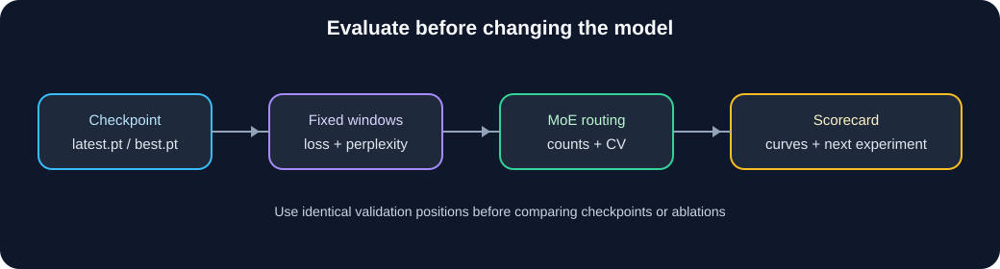

# Evaluating DeepSeek: Curves, Perplexity, and Failure Analysis

Training loss tells us what the model is optimizing. Evaluation tells us
whether the model is improving on text it has not seen, whether the experts
are being used, and which experiment should come next.



Module 27 used random validation windows for inexpensive monitoring. This
module adds a fixed validation protocol and reusable diagnostics:

- deterministic, non-overlapping validation windows;
- checkpoint scoring with main-model loss and perplexity;
- expert-utilization counts, maximum-load ratio, and coefficient of variation;
- training-curve and generalization-gap plots; and
- best-checkpoint tracking in the pretraining loop.

## 1. Read the training log correctly

The pretraining script writes one CSV row per optimizer step. The main fields
answer different questions:

| Metric | Meaning |
| --- | --- |
| `loss` | Combined main + MTP training objective |
| `main_loss` | Main next-token training loss |
| `mtp_loss` | Auxiliary two-ahead prediction loss |
| `val_loss` | Held-out main next-token loss when evaluated |
| `perplexity` | `exp(val_loss)` |
| `grad_norm` | Norm before clipping |
| `mean_max_load_ratio` | Average router overload ratio |
| `lr` | Learning rate used for the update |

Do not calculate a generalization gap from the combined `loss`. The comparable
quantity is:

\[
\text{main generalization gap} =
\mathcal L_{\text{validation, main}}
- \mathcal L_{\text{training, main}}.
\]

A positive gap is expected. A growing gap can indicate overfitting, while two
flat curves suggest a data, optimization, or capacity problem.

## 2. Perplexity is main-model cross-entropy

Perplexity is the exponential of the mean next-token cross-entropy:

\[
\operatorname{PPL}=e^{\mathcal L}.
\]

| Loss | Perplexity |
| ---: | ---: |
| 2.0 | 7.4 |
| 3.0 | 20.1 |
| 4.0 | 54.6 |
| 5.0 | 148.4 |
| 6.0 | 403.4 |

The metric is meaningful mainly within the same tokenizer, vocabulary,
context length, and evaluation distribution. It is not a universal score that
can be compared across different tokenizations.

## 3. Why fixed windows matter

Random validation windows are useful for monitoring but noisy for comparisons.
Two checkpoints can receive different difficulty distributions and appear to
move in the wrong direction.

`FixedTokenWindows` reads predetermined non-overlapping windows from `val.bin`:

```python
from src.training import FixedTokenWindows, evaluate_fixed_windows

windows = FixedTokenWindows(
    "data/processed/val.bin",
    seq_len=128,
    dtype="uint16",
)
metrics = evaluate_fixed_windows(
    model.main_model,
    windows,
    batch_size=4,
    max_windows=128,
)
```

Each window contains 129 token IDs. The first 128 are inputs and the next 128
are targets. The evaluator sums cross-entropy over all target tokens and only
then divides, so a final short batch is weighted correctly.

The context resets between windows. This measures prediction with up to 128
tokens of context, not continuous-document perplexity. Consistency is more
important than pretending these are the same metric.

## 4. Score a saved checkpoint

The command-line evaluator loads the full Module 27 checkpoint and reconstructs
the final model from its saved configuration:

```bash
python -m src.evaluate_checkpoint \
  --checkpoint checkpoints/latest.pt \
  --val-file data/processed/val.bin \
  --seq-len 128 \
  --batch-size 4 \
  --max-windows 128
```

The output contains the checkpoint step, the number of fixed windows and target
tokens, validation loss, and perplexity. It does not invent results; values are
produced only when the command is run on an actual checkpoint.

The equivalent Make target is:

```bash
make evaluate-checkpoint CHECKPOINT=checkpoints/latest.pt
```

## 5. Inspect expert utilization

Each routed token selects `top_k` experts. If a router has eight experts and
receives 2,048 assignments, perfectly even usage would be 256 assignments per
expert.

Two useful statistics are:

\[
\text{max-load ratio}=
\frac{\max_i L_i}{\operatorname{mean}_i L_i}
\]

\[
\text{CV}=\frac{\operatorname{std}_i(L_i)}
{\operatorname{mean}_i(L_i)}.
\]

The routing diagnostic collects counts separately for every routed layer:

```bash
python -m src.evaluate_checkpoint \
  --checkpoint checkpoints/latest.pt \
  --val-file data/processed/val.bin \
  --seq-len 128 \
  --max-windows 128 \
  --routing
```

Or use:

```bash
make routing-report CHECKPOINT=checkpoints/latest.pt
```

Balanced counts do not prove expert specialization. They only show that the
load-balancing mechanism is not sending nearly every token to the same expert.
Evaluation text can also have a different distribution from training text, so
its routing can be less balanced even when training was stable.


## 6. Plot curves and the generalization gap

The plotting utility reads the CSV generated by `src.pretrain`:

```bash
python -m src.plot_training \
  --log training_log.csv \
  --output training_curves.png
```

Or:

```bash
make plot-training
```

The plot includes training main loss, validation loss, and validation minus
training main loss at steps where validation was recorded. The training loss
comes from the current batches and is therefore noisier than a fixed evaluation
curve.


Install the project requirements before plotting; `matplotlib` is imported only
by this utility.

## 7. Keep the best checkpoint

`latest.pt` is for resuming. It is not necessarily the best model. The
pretraining entry point now also writes `best.pt` whenever a fixed validation
measurement improves:

```bash
make run-pretraining
```

The best validation loss is stored in the checkpoint metadata and restored on
resume. This avoids treating a later, worse validation result as a new best.
Use fixed windows for this decision; random samples can select a checkpoint by
luck.

## 8. Compare architecture choices fairly

The most useful comparisons change one choice while keeping the rest fixed.

| Comparison | Keep fixed | Change |
| --- | --- | --- |
| Dense vs MoE | MLA, tokenizer, data, steps, schedule | FFN type |
| MTP off vs on | Main model, data, schedule | Auxiliary objective |
| Routing settings | Model size and data | Top-k or expert count |

Compare at least:

- fixed-window validation loss and perplexity;
- tokens per second;
- peak GPU memory;
- gradient stability; and
- expert utilization.

For MTP-off, use a main-only training path rather than setting the MTP loss
weight to zero while still executing the extra MTP block. Otherwise the result
mixes an objective ablation with an avoidable computation cost. The current
pretraining path keeps MTP enabled; a dedicated main-only experiment can be
added when the ablation is run.

Use multiple seeds when a difference is small. Equal training tokens measures
sample efficiency; equal GPU time measures practical efficiency. MoE may win on
loss while losing on throughput in this readable Python implementation.

## 9. Failure-analysis checklist

| Observation | Inspect first |
| --- | --- |
| Both losses barely move | Learning rate, data sampling, gradients |
| Training falls and validation rises | Data size, held-out distribution, stopping point |
| Loss becomes NaN | BF16 operations, gradient norm, optimizer state |
| One or two experts dominate | Assignment counts and router bias updates |
| MoE is slower than dense | Dispatch overhead and small expert matrix multiplies |
| MTP improves but main loss does not | MTP-on/off comparison at matched compute |
| Repeated evaluation changes | Fixed windows and evaluation mode |

Change one variable at a time. Changing data, learning rate, model size, and
routing simultaneously makes the result uninterpretable.

## 10. The implementation

The Markdown keeps the important code visible next to the commands. The
repository contains the same code under `src/training/` and `src/` so it can be
imported by tests and run from the project root.

### Fixed validation windows

```python
# src/training/fixed_evaluate.py
from __future__ import annotations

import contextlib
import math
from pathlib import Path
from typing import Iterator

import numpy as np
import torch
import torch.nn.functional as F

from ..model.final_deepseek import TinyDeepSeek


class FixedTokenWindows:
    """Expose fixed non-overlapping [B, seq_len + 1] token windows."""

    def __init__(self, path, *, seq_len, dtype=np.uint16):
        if seq_len <= 0:
            raise ValueError("seq_len must be positive")
        self.path = Path(path)
        self.seq_len = seq_len
        self.dtype = np.dtype(dtype)
        self.tokens = np.memmap(self.path, dtype=self.dtype, mode="r")
        if len(self.tokens) < seq_len + 1:
            raise ValueError("not enough tokens for one validation window")
        self.num_windows = (len(self.tokens) - seq_len - 1) // seq_len + 1

    def __len__(self):
        return self.num_windows

    def window(self, index):
        if not 0 <= index < self.num_windows:
            raise IndexError(index)
        start = index * self.seq_len
        values = np.asarray(
            self.tokens[start : start + self.seq_len + 1],
            dtype=np.int64,
        ).copy()
        return torch.from_numpy(values)

    def batches(self, batch_size, *, max_windows=None):
        if batch_size <= 0:
            raise ValueError("batch_size must be positive")
        count = self.num_windows if max_windows is None else min(
            max_windows, self.num_windows
        )
        if count <= 0:
            raise ValueError("max_windows must select at least one window")
        for begin in range(0, count, batch_size):
            yield torch.stack(
                [
                    self.window(index)
                    for index in range(begin, min(begin + batch_size, count))
                ],
                dim=0,
            )


def evaluate_fixed_windows(
    model: TinyDeepSeek,
    windows: FixedTokenWindows,
    *,
    batch_size: int,
    max_windows: int | None = None,
):
    device = next(model.parameters()).device
    use_bf16 = device.type == "cuda" and torch.cuda.is_bf16_supported()
    was_training = model.training
    total_nll = 0.0
    total_targets = 0
    evaluated_windows = 0

    model.eval()
    try:
        with torch.no_grad():
            for batch in windows.batches(batch_size, max_windows=max_windows):
                batch = batch.to(device, non_blocking=True)
                inputs, targets = batch[:, :-1], batch[:, 1:]
                context = (
                    torch.autocast(device_type=device.type, dtype=torch.bfloat16)
                    if use_bf16
                    else contextlib.nullcontext()
                )
                with context:
                    logits = model(inputs)
                total_nll += float(
                    F.cross_entropy(
                        logits.float().reshape(-1, logits.shape[-1]),
                        targets.reshape(-1),
                        reduction="sum",
                    )
                )
                total_targets += targets.numel()
                evaluated_windows += batch.shape[0]
    finally:
        model.train(was_training)

    loss = total_nll / total_targets
    return {
        "loss": loss,
        "val_loss": loss,
        "perplexity": math.exp(loss),
        "target_tokens": total_targets,
        "windows": evaluated_windows,
    }
```

### Expert routing diagnostics

```python
# src/training/routing_diagnostics.py
from __future__ import annotations

from collections.abc import Iterable

import torch

from ..model.router import TopKRouter


@torch.no_grad()
def collect_routing_statistics(model, batches: Iterable[torch.Tensor]):
    counts_by_name = {}
    handles = []

    def make_hook(name):
        def hook(router, _inputs, outputs):
            indices, _weights = outputs
            counts = torch.bincount(
                indices.detach().reshape(-1).cpu(),
                minlength=router.n_experts,
            )
            counts_by_name[name] = (
                counts_by_name.get(name, torch.zeros_like(counts)) + counts
            )

        return hook

    for name, module in model.named_modules():
        if isinstance(module, TopKRouter):
            handles.append(module.register_forward_hook(make_hook(name)))

    device = next(model.parameters()).device
    was_training = model.training
    try:
        model.eval()
        for batch in batches:
            if batch.ndim != 2:
                raise ValueError("routing batches must have shape [batch, sequence]")
            model(batch.to(device, non_blocking=True))
    finally:
        for handle in handles:
            handle.remove()
        model.train(was_training)

    results = {}
    for name, counts in counts_by_name.items():
        counts = counts.float()
        mean = counts.mean()
        results[name] = {
            "counts": counts.to(torch.int64).tolist(),
            "assignments": int(counts.sum().item()),
            "max_load_ratio": float((counts.max() / mean).item()),
            "cv": float((counts.std(unbiased=False) / mean).item()),
        }
    return results
```

### Checkpoint scoring command

```python
# src/evaluate_checkpoint.py
import argparse
import json
import torch

from .model import DeepSeekConfig, DeepSeekWithMTP
from .training.fixed_evaluate import FixedTokenWindows, evaluate_fixed_windows
from .training.routing_diagnostics import collect_routing_statistics


def load_model(path, device):
    state = torch.load(path, map_location="cpu", weights_only=False)
    model = DeepSeekWithMTP(
        DeepSeekConfig(**state["config"]),
        mtp_weight=float(state.get("mtp_weight", 0.3)),
    )
    model.load_state_dict(state["model"], strict=True)
    return model.to(device), state


parser = argparse.ArgumentParser()
parser.add_argument("--checkpoint", default="checkpoints/latest.pt")
parser.add_argument("--val-file", default="data/processed/val.bin")
parser.add_argument("--dtype", default="<u2")
parser.add_argument("--seq-len", type=int, default=128)
parser.add_argument("--batch-size", type=int, default=4)
parser.add_argument("--max-windows", type=int, default=None)
parser.add_argument("--routing", action="store_true")
args = parser.parse_args()

device = torch.device("cuda" if torch.cuda.is_available() else "cpu")
model, state = load_model(args.checkpoint, device)
windows = FixedTokenWindows(args.val_file, seq_len=args.seq_len, dtype=args.dtype)
metrics = evaluate_fixed_windows(
    model.main_model,
    windows,
    batch_size=args.batch_size,
    max_windows=args.max_windows,
)
output = {"step": state.get("step"), "validation": metrics}
if args.routing:
    batches = (
        batch[:, :-1]
        for batch in windows.batches(
            args.batch_size,
            max_windows=args.max_windows,
        )
    )
    output["routing"] = collect_routing_statistics(model.main_model, batches)
print(json.dumps(output, indent=2))
```

Run it with:

```bash
python -m src.evaluate_checkpoint \
  --checkpoint checkpoints/latest.pt \
  --val-file data/processed/val.bin \
  --seq-len 128 \
  --batch-size 4 \
  --max-windows 128 \
  --routing
```

### Training-curve plotting

```python
# src/plot_training.py
import argparse
import csv
from pathlib import Path

import matplotlib.pyplot as plt


def plot_training_log(log_path, output_path="training_curves.png"):
    with Path(log_path).open(newline="", encoding="utf-8") as handle:
        rows = list(csv.DictReader(handle))
    if not rows:
        raise ValueError("training log is empty")

    steps = [int(row["step"]) for row in rows]
    main_losses = [float(row["main_loss"]) for row in rows]
    validation = [
        (int(row["step"]), float(row["val_loss"]))
        for row in rows
        if row.get("val_loss")
    ]
    val_steps = [step for step, _loss in validation]
    val_losses = [loss for _step, loss in validation]

    figure, axes = plt.subplots(2, 1, figsize=(9, 8), sharex=True)
    axes[0].plot(steps, main_losses, label="Training main loss")
    axes[0].plot(val_steps, val_losses, "o-", label="Validation loss")
    axes[0].set_ylabel("Cross-entropy")
    axes[0].legend()
    axes[0].grid(alpha=0.3)

    train_by_step = dict(zip(steps, main_losses))
    gap_steps = [step for step in val_steps if step in train_by_step]
    gaps = [
        next(loss for step, loss in validation if step == current)
        - train_by_step[current]
        for current in gap_steps
    ]
    axes[1].plot(gap_steps, gaps, "o-", label="Validation - training main loss")
    axes[1].axhline(0.0, color="black", linewidth=0.8)
    axes[1].set_xlabel("Optimizer step")
    axes[1].set_ylabel("Generalization gap")
    axes[1].grid(alpha=0.3)
    figure.tight_layout()
    figure.savefig(output_path, dpi=160)
    plt.close(figure)


if __name__ == "__main__":
    parser = argparse.ArgumentParser()
    parser.add_argument("--log", default="training_log.csv")
    parser.add_argument("--output", default="training_curves.png")
    args = parser.parse_args()
    plot_training_log(args.log, args.output)
```

Run it with:

```bash
make plot-training LOG_PATH=training_log.csv
```

### Best-checkpoint selection

The pretraining loop keeps `latest.pt` for resumption and `best.pt` for the
lowest fixed validation loss:

```python
best_val_loss = float("inf")

# After each fixed validation pass:
if validation["val_loss"] < best_val_loss:
    best_val_loss = float(validation["val_loss"])
    save_training_checkpoint(
        args.best_checkpoint,
        model=model,
        optimizer=optimizer,
        step=step,
        train_batcher=train_batcher,
        val_batcher=val_batcher,
        run_settings=run_settings,
        metrics=row,
        best_val_loss=best_val_loss,
    )
```

The saved `best_val_loss` is restored when training resumes, so a later worse
checkpoint cannot replace the best model.

## 11. Run the focused checks

```bash
make test-module-28
```

The tests cover non-overlapping windows, token-weighted fixed evaluation,
evaluation-mode restoration, and per-router utilization statistics.

## 12. Takeaways

1. Main validation loss is the primary measure of next-token generalization.
2. Perplexity is useful only under a consistent tokenization and evaluation
   protocol.
3. MoE quality has separate language-modeling, load-balance, and throughput
   dimensions.
4. Best-checkpoint selection and architecture ablations must use reproducible
   measurements.

The next step is autoregressive generation: loading a trained checkpoint,
prefilling a prompt, and decoding one token at a time through the compressed
MLA cache.
