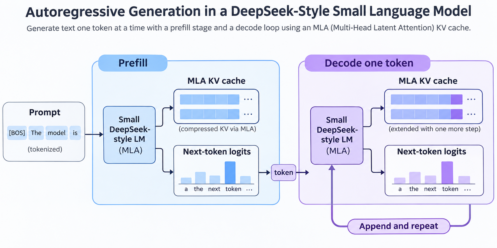

# Autoregressive Text Generation with DeepSeek

The model can now be trained and evaluated. Generation is the next step: take
a prompt, predict one token, append it to the sequence, and repeat.

This article connects the tokenizer, DeepSeek-style model, MLA cache, and
sampling code into one inference path.



The generated diagram is conceptual. It shows the important distinction
between processing the prompt once and processing one new token at a time.

## 1. What autoregressive generation means

Suppose the prompt is:

```text
The capital of France is
```

The model does not produce the whole continuation in one operation. It
produces a probability distribution for the next token:

\[
P(t_{i+1} \mid t_0, t_1, \ldots, t_i)
\]

We select one token, append it to the input, and ask the model for the next
distribution again. A possible sequence is:

```text
The capital of France is Paris . <eos>
```

The displayed words are illustrative. A BPE tokenizer may represent one word
with several token IDs.

## 2. The tensor shapes for one prediction

Using the small configuration from the implementation:

| Stage | Shape |
| --- | --- |
| Prompt token IDs | `[1, 12]` |
| Token embeddings | `[1, 12, 256]` |
| Transformer output | `[1, 12, 256]` |
| LM-head logits | `[1, 12, 8192]` |
| Final-position logits | `[1, 8192]` |
| Selected token | `[1, 1]` |

The logits used for the first generated token are:

```python
next_token_logits = logits[:, -1, :]
```

The final hidden state has attended to the entire prompt, so its vocabulary
logits describe the next token. Earlier prompt-position logits are not needed
for ordinary generation.

## 3. Prefill and decode are different operations

There are two phases.

### Prefill

The entire prompt is processed once. Every MLA layer stores its compressed
key/value representation and positional-key representation in its cache.
The returned logits are used to select the first generated token.

### Decode

The selected token is passed to the model as a single-token input. Each MLA
layer reads its existing cache, appends the new token's representation, and
returns logits for the following token.

| Step | Model input | Cache length after the call | Prediction |
| --- | --- | ---: | --- |
| Prefill | 12 prompt tokens | 12 | Token 13 |
| Decode | Token 13 | 13 | Token 14 |
| Decode | Token 14 | 14 | Token 15 |

The first token must come from the prefill logits. Calling `decode_step` before
selecting that token would process the final prompt position twice.

The public model methods are:

```python
logits = model.prefill(prompt_ids)
logits = model.decode_step(next_token)
```

## 4. Why the MLA cache matters

A naive generator calls the full model on the complete prefix every time. If
the prompt has 100 tokens, the model repeatedly recomputes those same 100
token representations as the generated sequence grows.

The cached path computes the prompt once and sends only one new token during
each decode step.

For the current configuration, one MLA layer stores these values per token:

| Cached representation | Values per token |
| --- | ---: |
| Compressed KV latent | 64 |
| RoPE positional key | 16 |
| Total | 80 |

A conventional comparison with eight heads and 32-dimensional keys and values
would store:

\[
8 \times (32 + 32) = 512
\]

scalar values per token. The illustrative scalar-count ratio is therefore
`512 / 80 = 6.4`. Actual memory use also depends on data type, allocator
overhead, tensor layout, and implementation details.

## 5. Turning logits into a token

The model produces logits, not text. A decoding strategy converts the logits
into one token ID.

### Greedy decoding

Greedy decoding always selects the largest logit:

```python
next_token = torch.argmax(logits, dim=-1, keepdim=True)
```

It is deterministic for a deterministic model and execution environment.

### Temperature sampling

Temperature rescales the logits before softmax:

\[
P_i(T) = \operatorname{softmax}\left(\frac{z_i}{T}\right)
\]

Values below `1.0` make the distribution sharper. Values above `1.0` make it
flatter. Temperature changes token selection; it does not change model
weights.

### Top-K sampling

Top-K retains only the K highest-scoring tokens and masks the rest. The
remaining probabilities are renormalized before sampling.

### Top-P sampling

Top-P, also called nucleus sampling, retains the smallest sorted set whose
cumulative probability reaches the requested threshold. With `top_p=0.9`, the
candidate set changes depending on how confident the model is.

The implementation in `src/sampling.py` applies temperature, top-K, and top-P
in that order:

```python
from src.sampling import sample_next_token

next_token = sample_next_token(
    logits[:, -1, :],
    temperature=0.8,
    top_k=50,
    top_p=0.9,
)
```

The top-P mask uses the probability mass before the current token:

```python
remove = (cumulative - sorted_probs) >= top_p
```

That keeps the first token that crosses the threshold instead of removing it.
At least one finite candidate remains for every valid logits row.

## 6. The cached generation loop

`src/generate.py` keeps the loop small and explicit:

```python
from src.generate import generate

generated = generate(
    model,
    prompt_ids,
    max_new_tokens=40,
    temperature=0.8,
    top_k=50,
    top_p=0.9,
    eos_token_id=tokenizer.eos_id,
)
```

The important control flow is:

```python
logits = model.prefill(prompt_ids)

for step in range(max_new_tokens):
    next_token = sample_next_token(
        logits[:, -1, :],
        temperature=temperature,
        top_k=top_k,
        top_p=top_p,
        greedy=greedy,
    )
    generated = torch.cat([generated, next_token], dim=1)

    if eos_token_id is not None and torch.all(next_token == eos_token_id):
        break
    if step + 1 == max_new_tokens:
        break

    logits = model.decode_step(next_token)
```

The implementation also checks that the prompt plus requested continuation
fits inside `config.max_seq_len`. It resets the model cache in a `finally`
block so one request cannot leak cached state into the next request.

The function returns the original prompt followed by the generated tokens. It
does not decode text itself; token-to-text conversion belongs to the tokenizer.

## 7. Loading a trained checkpoint

Training checkpoints contain both `main_model.*` and `mtp_module.*` weights.
MTP is a training objective, so inference only constructs the main
`TinyDeepSeek` model and extracts the `main_model.*` weights:

```python
from src.generate import load_checkpoint_model

model, checkpoint = load_checkpoint_model(
    "checkpoints/latest.pt",
    device=torch.device("cuda"),
)
```

The loader accepts both a model-only checkpoint and the full resumable
pretraining checkpoint. Router bias buffers are included because they are part
of the main model state.

## 8. Connecting the tokenizer

Once the model is loaded, text generation needs only two tokenizer operations:

```python
prompt_ids = tokenizer.encode("Once upon a time")
input_ids = torch.tensor([prompt_ids], dtype=torch.long, device=device)

output_ids = generate(
    model,
    input_ids,
    max_new_tokens=40,
    temperature=0.8,
    top_p=0.9,
    eos_token_id=tokenizer.eos_id,
)

text = tokenizer.decode(output_ids[0].tolist())
print(text)
```

Use the tokenizer's actual EOS ID when it provides one. Do not choose an
arbitrary vocabulary ID as EOS.

## 9. Running generation

From the repository root:

```bash
make generate \
  CHECKPOINT=checkpoints/latest.pt
```

Or run the entry point directly:

```bash
python -m src.generate \
  --checkpoint checkpoints/latest.pt \
  --tokenizer data/processed/tokenizer.json \
  --prompt "Once upon a time" \
  --max-new-tokens 40 \
  --temperature 0.8 \
  --top-k 50 \
  --top-p 0.9
```

For deterministic decoding:

```bash
python -m src.generate \
  --checkpoint checkpoints/latest.pt \
  --tokenizer data/processed/tokenizer.json \
  --greedy
```

The output quality depends on the training run. A short debugging run may
produce repetitive or malformed text even when the generation mechanics are
correct.

## 10. Verifying generation correctness

The generation tests check prompt preservation and the sampling primitives:

```bash
make test-generation
```

The most important future comparison is cached greedy decoding versus a
reference loop that recomputes the complete prefix at every step. With the
same model and FP32 execution, the selected token sequences should agree. A
disagreement usually points to cache positions, RoPE offsets, or the order of
prefill and decode calls.

## 11. What this implementation does not optimize

This is a correctness-first inference engine. It supports one or more rows of
equal-length token IDs, but it does not implement production serving features
such as:

- continuous batching;
- variable-length request scheduling;
- sliding-window attention or cache eviction;
- fused sampling kernels;
- optimized GPU MoE dispatch;
- tensor or expert parallelism.

Those features improve throughput and utilization. They do not change the
autoregressive algorithm described here.

## Summary

Generation is a short loop around a carefully ordered cache protocol:

1. tokenize the prompt;
2. prefill the prompt once;
3. select the first token from the prefill logits;
4. decode one token at a time using the MLA cache;
5. apply greedy, temperature, top-K, or top-P selection;
6. stop at EOS or the requested token limit;
7. reset the cache after the request.

The result is a complete token-level generation path using the DeepSeek-style
model built in this repository.
