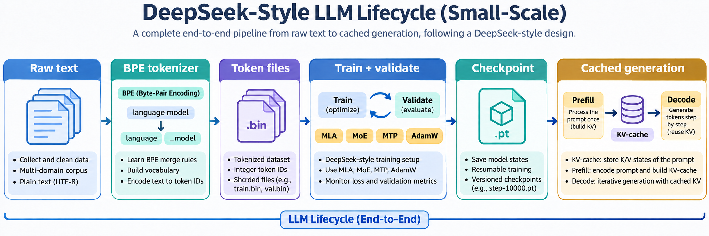
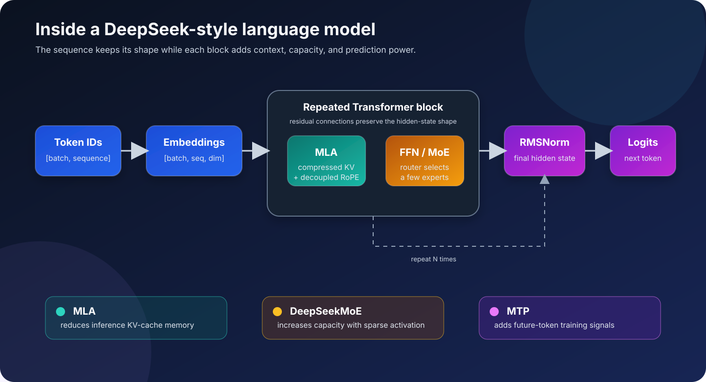
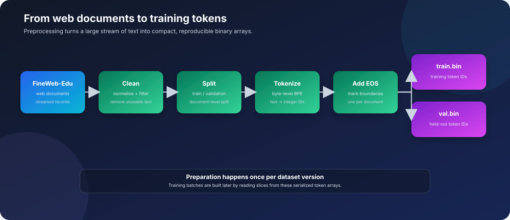
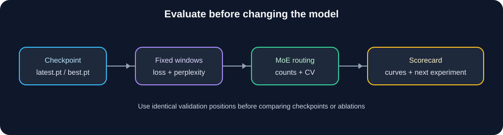
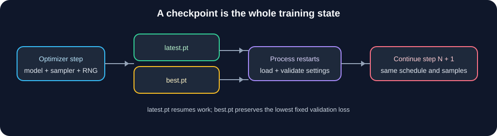
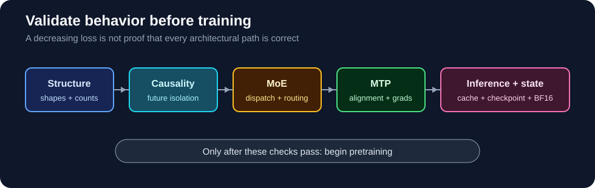
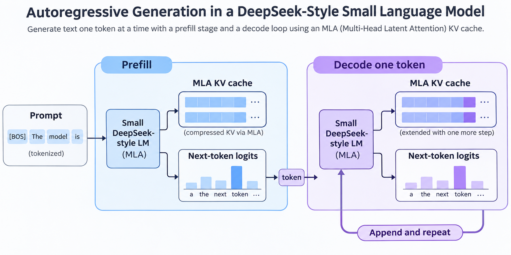

# Final DeepSeek Project Integration

The individual model components are now connected into one reproducible
workflow:

```text
raw text → tokenizer → token files → training → checkpoint → generation
```

The goal is not to claim the capabilities of the original 671-billion-
parameter DeepSeek-V3 model. The goal is to prove that our small
DeepSeek-style implementation can move through the complete lifecycle with
compatible data, checkpoints, validation, and cached inference.



The final integration work is mostly about contracts between components. A
correct MLA layer is not enough if the tokenizer changes between training and
inference, or if a checkpoint restores model weights but not the state needed
to resume training.

## 1. The system we have built



The main model is a decoder-only Transformer with:

- token embeddings and a final language-model head;
- pre-RMSNorm residual blocks;
- Multi-Head Latent Attention with decoupled RoPE;
- dense SwiGLU computation in the early block;
- shared and routed DeepSeekMoE experts in later blocks;
- a compressed MLA cache for autoregressive decoding.

The training wrapper adds one sequential Multi-Token Prediction objective. MTP
helps train the model, but the inference path loads only the main
`TinyDeepSeek` weights.

The implementation is intentionally small:

| Property | Tiny-DeepSeek | DeepSeek-V3 |
| --- | ---: | ---: |
| Hidden dimension | 256 | 7,168 |
| Transformer layers | 6 | 61 |
| Attention heads | 8 | 128 |
| Routed experts | 8 | 256 |
| Active routed experts | 2 | 8 |
| KV latent rank | 64 | 512 |
| Main-model scale | about 15M parameters | 671B parameters |

The small model preserves important architectural ideas. It does not reproduce
the original model's scale, training data, distributed systems, or language
quality.

## 2. The repository's actual code layout

The executable code lives under `src/`:

```text
src/
├── data/
│   ├── prepare_data.py
│   ├── tokenizer.py
│   ├── tokenizer_identity.py
│   ├── token_batches.py
│   └── validate_tokens.py
├── model/
│   ├── config.py
│   ├── final_deepseek.py
│   ├── mla.py
│   ├── mla_cache.py
│   ├── moe.py
│   ├── mtp.py
│   └── deepseek_with_mtp.py
├── training/
│   ├── optimizer.py
│   ├── scheduler.py
│   ├── efficient_train_step.py
│   ├── fixed_evaluate.py
│   ├── full_checkpoint.py
│   └── moe_balancer.py
├── generate.py
├── pretrain.py
└── tests/
    └── test_release.py
```

`src/model/final_deepseek.py` is the canonical complete model in this
repository. The earlier dense GPT, standalone attention, and intermediate MoE
files remain useful for learning and testing, but they are not competing final
entry points.

## 3. The data contract

The preparation pipeline writes this directory:

```text
data/processed/
├── tokenizer.json
├── train.bin
├── val.bin
└── metadata.json
```

The binary files are one-dimensional unsigned integer arrays. The metadata
connects those files to the model configuration:

```json
{
  "tokenizer_vocab_size": 8192,
  "dtype": "<u2",
  "tokenizer_path": "tokenizer.json",
  "tokenizer_sha256": "..."
}
```

The vocabulary size must match both the token embedding table and the LM head.
The binary dtype must be able to represent the largest token ID.



### Tokenizer identity

Matching vocabulary sizes is necessary but not sufficient. Token ID 172 must
mean the same thing during training and inference.

`src/data/tokenizer_identity.py` records a SHA-256 digest for the tokenizer
artifact:

```python
from src.data.tokenizer_identity import file_sha256, verify_file_sha256

tokenizer_path = "data/processed/tokenizer.json"
digest = file_sha256(tokenizer_path)
verify_file_sha256(tokenizer_path, digest)
```

Dataset preparation stores this digest in `metadata.json`. The pretraining
checkpoint carries it in its run settings, and generation verifies it when a
recorded digest is available.

## 4. Validate data before using a GPU

A malformed token file can waste an entire training run. The preflight checker
in `src/data/validate_tokens.py` checks:

- metadata vocabulary size and dtype;
- unsigned integer storage;
- binary-file alignment to the dtype size;
- non-empty train and validation splits;
- minimum and maximum token IDs.

Run it with:

```bash
make validate-data DATA_DIR=data/processed
```

The checker reports the token count and observed ID range for both splits. It
does not prove that two documents are semantically independent; the split
decision is made during dataset preparation.

## 5. The training and evaluation contract

The pretraining entry point combines:

1. reproducible token windows;
2. the main next-token loss;
3. the MTP loss;
4. BF16 autocast when supported;
5. gradient accumulation and clipping;
6. AdamW with warmup and cosine decay;
7. aggregated MoE load-balancing updates;
8. fixed-window validation.



The main model is evaluated on the same non-overlapping validation windows at
each evaluation point. This makes loss and perplexity comparisons less noisy
than drawing a new random validation sample every time.

The practical configuration is intentionally modest:

| Setting | Value |
| --- | ---: |
| Hidden dimension | 256 |
| Layers | 6 |
| Dense layers | 1 |
| Routed experts | 8 |
| Active experts | 2 |
| Context length | 128 |
| Microbatch size | 4 |
| Accumulation steps | 4 |
| Peak learning rate | `3e-4` |

## 6. Checkpoint formats

There are two useful checkpoint forms.

### Full training checkpoint

`src/training/full_checkpoint.py` saves:

| State | Why it matters |
| --- | --- |
| Main model and MTP weights | Restore the complete training wrapper |
| AdamW state | Preserve momentum and adaptive moments |
| Completed step | Continue the learning-rate schedule |
| Batch-generator state | Continue deterministic sampling |
| CPU and CUDA RNG state | Preserve stochastic execution as far as possible |
| Configuration and run settings | Reject incompatible resumes |
| Best validation loss and metrics | Continue model selection |



### Inference checkpoint

`src/training/checkpoint.py` can load a model-only checkpoint or extract the
`main_model.*` weights from a full training checkpoint. It does not construct
the MTP module for generation.

This separation matters: MTP is a training objective, while generation needs
the main model, its router buffers, and its MLA cache.

## 7. The release test

Component tests answer local questions. `src/tests/test_release.py` checks the
interfaces together using a tiny synthetic dataset:

1. validate token files;
2. run one efficient training step;
3. save a full checkpoint;
4. reload model and optimizer state;
5. compare full-sequence and cached logits;
6. generate tokens greedily;
7. confirm the cache is empty after generation.

Run it with:

```bash
make test-release
```

The core cached-inference assertion compares the final full forward position
with a prefill followed by one decode step:

```python
full_logits = model(prompt)
model.prefill(prompt[:, :-1])
cached_logits = model.decode_step(prompt[:, -1:])

torch.testing.assert_close(
    full_logits[:, -1:, :],
    cached_logits,
    rtol=1e-4,
    atol=1e-4,
)
```

This does not measure language quality. It verifies that the main software
interfaces can work together after a training update and checkpoint reload.



## 8. The complete operating sequence

### Prepare data

```bash
make prepare-data DATA_DIR=data/processed
make validate-data DATA_DIR=data/processed
```

### Run the full test suite

```bash
make test
make test-release
```

### Run a short smoke pretraining job

```bash
python -m src.pretrain \
  --data-dir data/processed \
  --steps 20 \
  --batch-size 2 \
  --accum-steps 2 \
  --seq-len 128 \
  --warmup-steps 2 \
  --eval-interval 10 \
  --eval-windows 10 \
  --save-interval 10
```

### Run the main experiment

```bash
make run-pretraining \
  DATA_DIR=data/processed \
  CHECKPOINT=checkpoints/latest.pt \
  BEST_CHECKPOINT=checkpoints/best.pt
```

### Evaluate a checkpoint

```bash
make evaluate-checkpoint \
  CHECKPOINT=checkpoints/latest.pt \
  VAL_FILE=data/processed/val.bin
```

The evaluation command reports fixed-window loss and perplexity. Add
`make routing-report` to inspect expert utilization.

### Generate text



```bash
make generate CHECKPOINT=checkpoints/latest.pt
```

Or choose the prompt and sampling controls directly:

```bash
python -m src.generate \
  --checkpoint checkpoints/latest.pt \
  --tokenizer data/processed/tokenizer.json \
  --prompt "Once upon a time" \
  --max-new-tokens 40 \
  --temperature 0.8 \
  --top-k 50 \
  --top-p 0.9
```

The exact tokenizer used for training must be supplied. A token-ID sequence
can be generated by a random model, but useful text requires a meaningful
training run and the matching tokenizer artifact.

## 9. What to record from the final experiment

The final result should be measured rather than inferred from a successful
command. Record:

| Measurement | Meaning |
| --- | --- |
| Main-model parameter count | Inference model size |
| Training-wrapper parameter count | Main model plus MTP |
| Train and validation token counts | Data budget and split size |
| Completed optimizer steps | Actual training progress |
| Final training loss | Fit to the training stream |
| Best validation loss and perplexity | Held-out generalization |
| Peak GPU memory | Hardware requirement |
| Tokens per second | Training throughput |
| Expert-load ratio and CV | Routing balance |
| Full-vs-cached maximum error | Inference correctness |
| Decoded sample | Qualitative output after training |

`src/plot_training.py` can visualize the CSV log:

```bash
make plot-training LOG_PATH=training_log.csv
```

## 10. Boundaries of this implementation

This repository implements the important small-scale architectural and
training ideas, not production DeepSeek-V3 infrastructure.

| Capability | Current status |
| --- | --- |
| MLA low-rank compression | Implemented at small scale |
| Decoupled RoPE | Implemented |
| Compressed MLA cache | Implemented |
| Shared and routed experts | Implemented |
| Auxiliary-loss-free balancing idea | Simplified implementation |
| Multi-Token Prediction | One-stage training implementation |
| Distributed expert parallelism | Not implemented |
| FP8 optimization | Not implemented |
| Fused expert dispatch | Not implemented |
| Continuous batching | Not implemented |
| Long-context serving | Not implemented |
| Instruction tuning and reasoning training | Not part of this codebase |

The meaningful claim is therefore precise: this is a small, trainable,
DeepSeek-V3-style language-model implementation with tested cached inference.
It is not the original checkpoint and it is not a replacement for a production
serving system.

## Final checklist

- [ ] Tokenizer artifact and checksum are recorded.
- [ ] Token files pass `make validate-data`.
- [ ] Architecture and causality tests pass.
- [ ] The release test passes.
- [ ] A short smoke run completes with finite loss and gradients.
- [ ] A resumable checkpoint reloads successfully.
- [ ] Fixed validation loss and perplexity are recorded.
- [ ] Full and cached logits agree within tolerance.
- [ ] The matching tokenizer decodes generated IDs into text.

When every item is checked, the project has reached a coherent final state:
raw text can become a checkpoint, and that checkpoint can produce text through
the same DeepSeek-style architecture that was trained from scratch.
