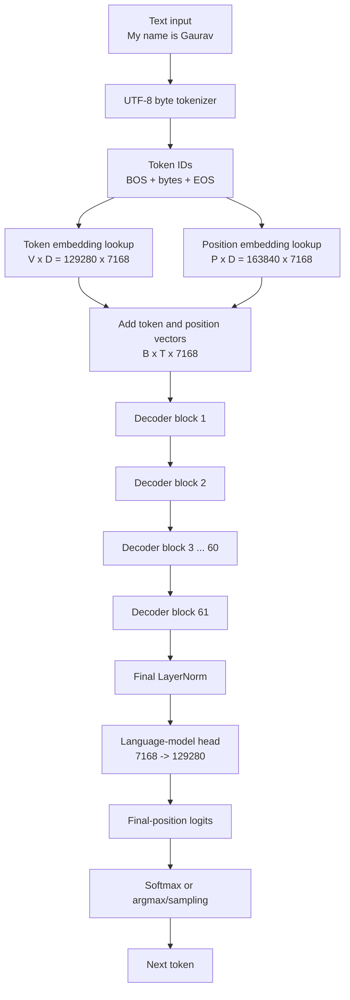
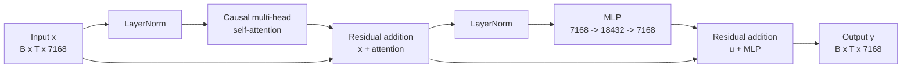

# DeepSeek architecture: a complete input-to-output walkthrough

This document explains how one input travels through the architecture currently
represented in this repository. It starts with text, converts it into token
IDs, turns those IDs into vectors, processes them through one decoder block,
repeats that block 61 times, and finally produces the next-token prediction.

The reference dimensions come from
[configs/deepseek_v3.json](../configs/deepseek_v3.json). The implementation
profile in this repository is `standard_attention_educational`, implemented by
[src/model/attention.py](../src/model/attention.py) and
[src/model/deepseek.py](../src/model/deepseek.py).

Important scope clarification: the dimensions are DeepSeek-V3 reference
dimensions, while the current code intentionally uses the simpler architecture
that has been built step by step here: learned absolute positions, ordinary
causal multi-head self-attention, LayerNorm, an SiLU MLP, residual connections,
and a vocabulary projection. This document describes exactly what the current
code and configuration do.

## 1. Configuration and notation

We use these symbols throughout the document:

| Symbol | Meaning | Value |
| --- | --- | --- |
| `B` | Batch size | Depends on the run |
| `T` | Number of tokens in one sequence | Depends on the input |
| `V` | Vocabulary size | `129280` |
| `D` | Hidden size | `7168` |
| `L` | Number of decoder blocks | `61` |
| `H` | Number of attention heads | `128` |
| `Dh` | Dimension of one head | `56` |
| `I` | MLP intermediate size | `18432` |
| `P` | Maximum position count | `163840` |

The key relationship is:

```text
D = H x Dh
7168 = 128 x 56
```

This is why 128 heads with head dimension 56 produce a hidden size of 7168.
The head dimension is not added to the hidden size; the head dimensions are
concatenated, so they are multiplied by the number of heads.

## 2. Complete model overview



For a batch of sequences, the main hidden-state shape is always:

```text
[B, T, D] = [B, T, 7168]
```

The 61 decoder blocks preserve this shape. They repeatedly change the values
inside the vectors, not the number of tokens or the hidden width.

## 3. Example input and token IDs

Consider this input:

```text
My name is Gaurav
```

The current [ByteTokenizer](../src/data/byte_tokenizer.py) converts UTF-8
bytes directly into IDs. Every character in this example is ASCII, so each
character has one byte ID:

```text
characters: M  y     n  a  m  e     i  s     G  a  u  r  a  v
byte IDs:  77 121  32 110 97 109 101 32 105 115 32 71 97 117 114 97 118
```

The tokenizer also uses two special IDs:

```text
256 = BOS, beginning of sequence
257 = EOS, end of sequence
```

The resulting training sequence is:

```text
[256, 77, 121, 32, 110, 97, 109, 101, 32, 105, 115,
 32, 71, 97, 117, 114, 97, 118, 257]
```

There are 19 IDs, so for this example:

```text
B = 1
T = 19
input_ids shape = [1, 19]
```

These are integer indexes. They are not yet 7168-dimensional vectors.

## 4. Token embedding lookup

The token embedding table has one row per vocabulary item and one column per
hidden feature:

```text
token_embeddings.weight shape = [V, D]
                              = [129280, 7168]

parameter calculation:
129280 x 7168 = 926679040 (≈926.68 million)
```

For each token ID the model selects one row. For example token ID 77 selects
row 77. The full input changes shape as follows:

```text
[1, 19] token IDs
      ↓ row lookup
[1, 19, 7168] token vectors
```

The ID is used as a row index. The model does not multiply the number 77 by
the entire embedding matrix.

## 5. Learned positional embedding

Token embeddings describe what the token is. Position embeddings describe
where it appears in the sequence.

The learned position table is:

```text
position_embeddings.embedding shape = [P, D]
                                    = [163840, 7168]

parameter calculation:
163840 x 7168 = 1174405120 (≈1.17 billion)
```

For a 19-token sequence, positions 0 through 18 select 19 rows:

```text
token vectors       [1, 19, 7168]
position vectors    [1, 19, 7168]
                    ----------------
initial hidden      [1, 19, 7168]
```

The addition is element by element. Position 0 is added to BOS, position 1
is added to the byte for `M`, and so on.

## 6. One decoder block

The same decoder-block structure is used 61 times. One block has two residual
paths:



The equations are:

```text
u = x + Attention(LayerNorm(x))
y = u + MLP(LayerNorm(u))
```

The residual connection means each sublayer adds an update to the current
representation instead of replacing it completely.

## 7. LayerNorm parameters

The current implementation uses `nn.LayerNorm`. Each LayerNorm has a learned
scale vector and a learned bias vector:

```text
one LayerNorm:
7168 scale values + 7168 bias values
= 14336 parameters (≈14.34 thousand)
```

There are two LayerNorm modules per decoder block:

```text
two block LayerNorms
= 2 x 14336
= 28672 parameters (≈28.67 thousand)
```

## 8. Causal multi-head self-attention

The attention input is:

```text
x shape = [B, T, D]
        = [B, T, 7168]
```

### 8.1 Projection matrices

The attention module creates queries, keys, and values using three learned
linear projections. It also has a fourth learned projection after the heads
are combined.

```text
WQ shape = [D, D] = [7168, 7168]
WK shape = [D, D] = [7168, 7168]
WV shape = [D, D] = [7168, 7168]
WO shape = [D, D] = [7168, 7168]
```

In PyTorch, `nn.Linear(7168, 7168)` stores a weight with shape
`[out_features, in_features]`. Because both dimensions are 7168, the displayed
shape is square either way.

The first three projections are:

```text
Q = x @ WQ     [B, T, 7168] @ [7168, 7168] -> [B, T, 7168]
K = x @ WK     [B, T, 7168] @ [7168, 7168] -> [B, T, 7168]
V = x @ WV     [B, T, 7168] @ [7168, 7168] -> [B, T, 7168]
```

Each matrix has:

```text
7168 x 7168 = 51380224 weights (≈51.38 million)
```

Attention bias is disabled in the current configuration. Therefore the four
matrices contain:

```text
Q, K, V, and WO
= 4 x 51380224
= 205520896 parameters (≈205.52 million)
```

### 8.2 Split Q, K, and V into heads

Each projected tensor is reshaped and transposed:

```text
[B, T, 7168]
      ↓ view as [B, T, H, Dh]
[B, T, 128, 56]
      ↓ transpose sequence and head axes
[B, 128, T, 56]
```

The same operation is applied to all three projections:

```text
Q: [B, T, 7168] -> [B, T, 128, 56] -> [B, 128, T, 56]
K: [B, T, 7168] -> [B, T, 128, 56] -> [B, 128, T, 56]
V: [B, T, 7168] -> [B, T, 128, 56] -> [B, 128, T, 56]
```

For `B = 1` and `T = 19`:

```text
Q, K, V shape = [1, 128, 19, 56]
```

### 8.3 Query-key scores

Keys are transposed in their last two dimensions so each query can compare
against every key position:

```text
Q              [B, 128, T, 56]
K transposed   [B, 128, 56, T]
Q @ K.T        [B, 128, T, T]
```

For one query position `i` and key position `j`:

```text
raw_score(i, j) = sum(Q[i, k] x K[j, k]) for k in 0 ... 55
scaled_score(i, j) = raw_score(i, j) / sqrt(56)
```

For the example with `T = 19`:

```text
attention score shape = [1, 128, 19, 19]
```

Each head has a 19 by 19 matrix showing how every query position scores every
key position.

### 8.4 Causal mask

The causal mask prevents a token from reading future tokens:

```text
position       0  1  2  3  4
query 0        ✓  ✗  ✗  ✗  ✗
query 1        ✓  ✓  ✗  ✗  ✗
query 2        ✓  ✓  ✓  ✗  ✗
query 3        ✓  ✓  ✓  ✓  ✗
query 4        ✓  ✓  ✓  ✓  ✓
```

Scores above the diagonal are replaced with the minimum representable value.
After softmax those future positions receive effectively zero probability.

### 8.5 Softmax attention weights

Softmax is applied across the key-position axis:

```text
weights = softmax(masked_scaled_scores)
weights shape = [B, 128, T, T]
```

For a fixed batch, head, and query position:

```text
weights[i, j] = exp(score[i, j]) / sum(exp(score[i, k]))
```

The sum is taken only across allowed key positions because future positions
were masked first.

### 8.6 Weighted values

The weights select information from the values:

```text
weights       [B, 128, T, T]
V             [B, 128, T, 56]
weights @ V   [B, 128, T, 56]
```

For one query position, the output of one head is a weighted sum of value
vectors:

```text
head_output[i] =
    weights[i, 0] x V[0]
  + weights[i, 1] x V[1]
  + ...
  + weights[i, T-1] x V[T-1]
```

Masked future positions contribute zero.

## 9. Output projection after attention

After attention has calculated one 56-dimensional result for every one of the
128 heads, the head results are concatenated:

```text
per-head context       [B, 128, T, 56]
      ↓ transpose axes 1 and 2
[B, T, 128, 56]
      ↓ contiguous reshape
context_concat         [B, T, 7168]
```

The output projection is a learned `WO` matrix:

```text
WO shape = [7168, 7168]
```

It is applied after the heads have been combined:

```text
context_concat [B, T, 7168]
      @ WO.T   [7168, 7168]
      = output [B, T, 7168]
```

PyTorch stores `out_proj.weight` as `[out_features, in_features]`, so the
forward operation is equivalent to multiplying by `WO.T` in the notation
above.

For one token, each output feature is a weighted combination of every feature
from every head:

```text
output[j] =
    context_concat[0]    x WO[j, 0]
  + context_concat[1]    x WO[j, 1]
  + ...
  + context_concat[7167]  x WO[j, 7167]
```

This is why `WO` needs its own weights. Concatenation only puts the head
outputs next to each other. `WO` learns how to mix those 7168 values into the
next representation that will be added to the residual stream.

### Small two-head example

Imagine a tiny attention layer with two heads of dimension three:

```text
head_0 result = [a, b, c]
head_1 result = [d, e, f]
context_concat = [a, b, c, d, e, f]
WO shape = [6, 6]
output = context_concat @ WO.T
```

The first output feature is:

```text
output[0] = a x WO[0, 0] + b x WO[0, 1] + c x WO[0, 2]
          + d x WO[0, 3] + e x WO[0, 4] + f x WO[0, 5]
```

The real model performs this same operation with 128 heads and 7168 total
features.

## 10. Feed-forward MLP

The MLP processes each token position independently. Attention mixes
information across positions; the MLP transforms the features at each
position:

```text
[B, T, 7168]
      ↓ Linear
[B, T, 18432]
      ↓ SiLU
[B, T, 18432]
      ↓ Linear
[B, T, 7168]
```

The two linear layers have no bias:

```text
first layer  = 7168 x 18432 = 132120576 (≈132.12 million)
second layer = 18432 x 7168 = 132120576 (≈132.12 million)
MLP total    = 264241152 (≈264.24 million)
```

## 11. Parameters in one decoder block

```text
attention projections       205520896 (≈205.52 million)
MLP                         264241152 (≈264.24 million)
two LayerNorms                   28672 (≈28.67 thousand)
                             ---------
one decoder block           469790720 (≈469.79 million)
```

The blocks have the same structure but do not share weights. Every block has
its own Q, K, V, WO matrices, MLP matrices, and LayerNorm parameters.

## 12. Repeat the decoder block 61 times

```text
initial hidden states [B, T, 7168]
        ↓
decoder block 1       [B, T, 7168]
        ↓
decoder block 2       [B, T, 7168]
        ↓
        ...
        ↓
decoder block 61      [B, T, 7168]
        ↓
final LayerNorm        [B, T, 7168]
```

The parameter calculation for all decoder blocks is:

```text
61 x 469790720 = 28657233920 (≈28.66 billion)
```

The sequence length and hidden size remain unchanged. The representation is
refined 61 times, and each block can use the earlier context allowed by the
causal mask.

## 13. Final vocabulary projection

After block 61, the final LayerNorm produces:

```text
hidden state shape = [B, T, 7168]
```

The bias-free language-model head has:

```text
lm_head.weight shape = [129280, 7168]
parameter count      = 129280 x 7168
                     = 926679040 (≈926.68 million)
```

For one final-position hidden vector `h`:

```text
h shape                = [7168]
lm_head.weight.T shape = [7168, 129280]

logits = h @ lm_head.weight.T
logits shape = [7168] @ [7168, 129280]
             = [129280]
```

For vocabulary token `i`, the logit is:

```text
logits[i] =
    h[0]    x lm_head.weight[i, 0]
  + h[1]    x lm_head.weight[i, 1]
  + ...
  + h[7167] x lm_head.weight[i, 7167]
```

For the complete sequence:

```text
[B, T, 7168] -> [B, T, 129280]
```

For next-token generation, only the last position is needed:

```text
final hidden state [B, 7168]
      ↓ lm_head
final logits       [B, 129280]
```

## 14. Logits become probabilities

A logit is an unnormalized score. In inference, softmax converts the final
logits into a probability distribution. For vocabulary item `i`:

```text
probability[i] = exp(logits[i]) /
                 sum(exp(logits[j]) for j in 0 ... 129279)
```

The result has shape `[B, 129280]` and satisfies:

```text
0 <= probability[i] <= 1
sum(probability) = 1
```

### Small softmax example

With four possible tokens:

```text
tokens = [cat, dog, runs, EOS]
logits = [2.0, 1.0, 0.0, -1.0]
```

Exponentiation gives approximately:

```text
exp(logits) = [7.389, 2.718, 1.000, 0.368]
sum         = 11.475
```

Dividing by the sum gives:

```text
probabilities ≈ [0.644, 0.237, 0.087, 0.032]
```

The model considers `cat` most likely, but sampling can still select another
token according to its probability.

### Temperature and top-k

Temperature changes the sharpness of the distribution:

```text
adjusted_logits = logits / temperature
probabilities = softmax(adjusted_logits)
```

```text
temperature < 1  -> sharper and more deterministic
temperature = 1  -> original distribution
temperature > 1  -> flatter and more varied
temperature = 0  -> greedy argmax in inference.py
```

With top-k sampling, all logits except the `k` largest are suppressed before
softmax. The remaining probabilities are renormalized and sampled.

## 15. Choosing the next token

The root-level [inference.py](../inference.py) repeats this process:

```text
1. Encode the prompt.
2. Run the model on the current context.
3. Read logits at the final position.
4. Select or sample one next token.
5. Append the token to the context.
6. Stop at EOS or after n new tokens.
7. Repeat for the next token.
```

Greedy decoding selects the largest logit:

```text
next_token = argmax(logits)
```

Sampling uses the probability distribution:

```text
next_token = sample(softmax(logits / temperature))
```

The current inference code keeps the newest part of the context when the
sequence reaches `max_position_embeddings`.

## 16. Training target shift

Training teaches the model to predict the next token. If the input sequence is:

```text
[BOS, M, y, space, n, ..., v, EOS]
```

then the prediction targets are shifted by one position:

```text
logits at position 0 -> target M
logits at position 1 -> target y
logits at position 2 -> target space
...
logits at position T-2 -> target EOS
```

The implementation compares:

```text
logits[:, :-1]
labels[:, 1:]
```

For one target token `t`, the cross-entropy term is conceptually:

```text
loss = -log(exp(logits[t]) / sum(exp(logits[j])))
```

The implementation passes logits directly to `F.cross_entropy`, which performs
the numerically stable log-softmax and negative-log-likelihood calculation
internally. During inference, we explicitly use softmax when probabilities are
needed for sampling.

## 17. Total parameter count

The major parameter groups are:

```text
token embedding table       926679040 (≈926.68 million)
position embedding table   1174405120 (≈1.17 billion)
61 decoder blocks          28657233920 (≈28.66 billion)
final LayerNorm                  14336 (≈14.34 thousand)
language-model head          926679040 (≈926.68 million)
                           ------------
total                     31685011456 (≈31.69 billion)
```

The total is approximately 31.69 billion parameters for this repository's
reference configuration.

At two bytes per parameter, the weights alone require approximately:

```text
31685011456 x 2 bytes ≈ 63.37 GB
```

Training needs more memory for gradients, activations, and optimizer state.
That is why local development uses
[configs/tiny_train.json](../configs/tiny_train.json), while
`configs/deepseek_v3.json` serves as the large reference configuration.

## 18. Shape summary for the example

For `B = 1` and `T = 19`:

| Stage | Shape |
| --- | --- |
| Input token IDs | `[1, 19]` |
| Token embeddings | `[1, 19, 7168]` |
| Position embeddings | `[1, 19, 7168]` |
| One block input/output | `[1, 19, 7168]` |
| Q, K, V before head split | `[1, 19, 7168]` |
| Q, K, V after head split | `[1, 128, 19, 56]` |
| Attention scores | `[1, 128, 19, 19]` |
| Attention context before merge | `[1, 128, 19, 56]` |
| Context after head merge | `[1, 19, 7168]` |
| MLP hidden state | `[1, 19, 18432]` |
| Final hidden state | `[1, 19, 7168]` |
| Vocabulary logits | `[1, 19, 129280]` |
| Final-position logits | `[1, 129280]` |

This is the complete data flow for one input through the architecture currently
built in this repository.
