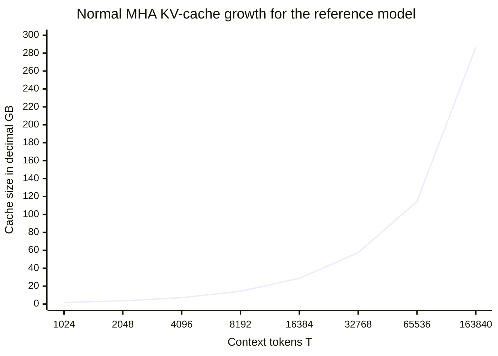

# Computing KV-cache size for normal multi-head attention

This document computes the key-value cache for the current educational
DeepSeek flow. It assumes ordinary multi-head self-attention where every
attention head has its own keys and values.

The checked-in reference configuration is:

```text
number of decoder layers L = 61
number of attention heads H = 128
head dimension Dh = 56
hidden size D = 7168
maximum context length P = 163840
```

The relationship between the hidden size and attention dimensions is:

```text
D = H x Dh
7168 = 128 x 56
```

The current root-level [inference.py](../inference.py) does not yet reuse a
KV cache. It recomputes attention over the current context for every generated
token. This document explains the memory that would be required when cache
reuse is added to normal multi-head attention.

## 1. What is stored in the cache?

At every decoder layer, attention creates:

```text
K = hidden_states @ WK
V = hidden_states @ WV
```

For a sequence of `T` tokens, the key and value tensors have shapes:

```text
K shape = [B, H, T, Dh]
V shape = [B, H, T, Dh]
```

The cache stores these K and V tensors for already processed tokens so the
model does not need to calculate them again when a new token is generated.

The cache does not store Q for previous tokens. During next-token generation,
the new token still needs a new query, while its key and value are appended to
the cache.

## 2. KV-cache shape for one layer

For one layer, the cache is often represented as:

```text
key_cache   = [B, H, T, Dh]
value_cache = [B, H, T, Dh]
```

Together:

```text
total elements per layer
= elements in K + elements in V
= B x H x T x Dh + B x H x T x Dh
= 2 x B x H x T x Dh
```

Because `H x Dh = D`:

```text
total elements per layer
= 2 x B x T x D
```

This is the generic formula for normal multi-head attention.

## 3. KV-cache size for all decoder layers

The model has `L` decoder layers, and every layer has its own K and V cache:

```text
total KV elements
= 2 x B x L x H x T x Dh
```

Using `D = H x Dh`, this can also be written as:

```text
total KV elements
= 2 x B x L x T x D
```

The number of bytes depends on the datatype:

```text
KV-cache bytes
= 2 x B x L x T x H x Dh x bytes_per_element
```

Common storage sizes are:

| Datatype | Bytes per element |
| --- | ---: |
| FP32 | 4 |
| BF16 | 2 |
| FP16 | 2 |
| INT8 | 1 |
| INT4 | 0.5 |

The current reference configuration uses BF16 as its configured model dtype,
so the main examples below use 2 bytes per element.

## 4. Current reference model calculation

For the repository reference configuration with batch size `B = 1`:

```text
L = 61
H = 128
Dh = 56
D = 7168
```

### 4.1 One token

The cache added by one new token across all layers is:

```text
K and V elements per token
= 2 x B x L x H x Dh
= 2 x 1 x 61 x 128 x 56
= 874496 elements
```

At BF16 or FP16:

```text
874496 x 2 bytes
= 1748992 bytes per token
≈ 1.75 MB per token
```

So every additional generated token increases the cache by approximately
1.75 MB for one sequence in this reference configuration.

### 4.2 One layer at one token

For comparison, one layer contributes:

```text
2 x B x H x Dh
= 2 x 1 x 128 x 56
= 14336 elements
```

At BF16 or FP16:

```text
14336 x 2 bytes
= 28672 bytes
≈ 28.67 KB per layer per token
```

Multiplying by 61 layers gives the 1.75 MB per-token total.

## 5. Cache growth as context length increases

Because `T` is multiplied directly in the formula, KV-cache size grows
linearly with context length:

```text
KV bytes = 2 x B x L x H x T x Dh x bytes_per_element
```

For `B = 1` and BF16/FP16, the current reference model gives:

| Context `T` | KV elements | BF16/FP16 bytes | Approximate decimal size | Approximate binary size |
| ---: | ---: | ---: | ---: | ---: |
| 1 | 874496 | 1748992 | 1.75 MB | 1.67 MiB |
| 1024 | 895483904 | 1790967808 | 1.79 GB | 1.67 GiB |
| 2048 | 1790967808 | 3581935616 | 3.58 GB | 3.34 GiB |
| 4096 | 3581935616 | 7163871232 | 7.16 GB | 6.67 GiB |
| 8192 | 7163871232 | 14327742464 | 14.33 GB | 13.35 GiB |
| 16384 | 14327742464 | 28655484928 | 28.66 GB | 26.69 GiB |
| 32768 | 28655484928 | 57310969856 | 57.31 GB | 53.38 GiB |
| 65536 | 57310969856 | 114621939712 | 114.62 GB | 106.76 GiB |
| 163840 | 143277424640 | 286554849280 | 286.55 GB | 266.88 GiB |

The maximum configured context is `T = 163840`. At that length, one sequence
requires approximately 286.55 GB of BF16 or FP16 KV-cache memory under normal
multi-head attention.

## 6. KV-cache growth chart

The following chart shows decimal GB for one sequence at BF16 or FP16:



The straight-line behavior is the important idea: doubling `T` doubles the
KV-cache memory.

## 7. Batch size multiplies the cache

All values above use `B = 1`. If the batch contains multiple independent
sequences, each sequence needs its own keys and values:

```text
KV bytes for batch B
= KV bytes for B=1 x B
```

For example, at `T = 4096` and BF16/FP16:

| Batch size | KV-cache size |
| ---: | ---: |
| 1 | 7.16 GB |
| 2 | 14.33 GB |
| 4 | 28.66 GB |
| 8 | 57.31 GB |
| 16 | 114.62 GB |

This is why long-context serving often uses a small batch size or dynamically
allocates cache space as sequences grow.

## 8. Datatype changes the memory requirement

For `B = 1` and `T = 163840`, the number of cache elements is fixed:

```text
total elements = 143277424640
```

Only the bytes per element change:

| Datatype | Bytes per element | Approximate cache size |
| --- | ---: | ---: |
| FP32 | 4 | 573.11 GB |
| BF16 | 2 | 286.55 GB |
| FP16 | 2 | 286.55 GB |
| INT8 | 1 | 143.28 GB |
| INT4 | 0.5 | 71.64 GB |

Quantization reduces storage, but it also requires a compatible cache
implementation and appropriate numerical handling. It is not automatically
provided by the current educational inference script.

## 9. What happens when one new token is generated?

Assume the model has already cached `T` tokens and receives one new token.
For each decoder layer:

```text
1. Compute Q for the new token.
2. Compute K for the new token.
3. Compute V for the new token.
4. Append the new K to key_cache.
5. Append the new V to value_cache.
6. Let the new query attend to all cached positions.
7. Produce the new hidden representation.
```

The cache changes from:

```text
K, V = [B, H, T, Dh]
```

to:

```text
K, V = [B, H, T + 1, Dh]
```

The new query itself has shape:

```text
Q_new = [B, H, 1, Dh]
```

It compares against all cached keys:

```text
Q_new             [B, H, 1, Dh]
cached K.T        [B, H, Dh, T + 1]
Q_new @ cached K.T [B, H, 1, T + 1]
```

Only one new row of attention scores is needed for the new token. The cache
avoids recomputing K and V for the previous `T` tokens.

## 10. Why normal multi-head attention is expensive

In normal multi-head attention, the cache stores one K vector and one V vector
for every head:

```text
K and V per token per layer = 2 x H x Dh
                             = 2 x D
```

For this reference model:

```text
2 x 7168 = 14336 elements per token per layer
```

Across 61 layers:

```text
14336 x 61 = 874496 elements per token
```

That is the source of the linear growth shown above. The cache size is not
determined only by the context window. It also depends on batch size, number
of layers, number of heads, head dimension, and datatype.

## 11. Generic calculator

For any normal multi-head-attention model, use this calculation:

```text
elements = 2 x B x L x H x T x Dh
bytes = elements x bytes_per_element
decimal_GB = bytes / 1000000000
binary_GiB = bytes / 1073741824
```

If the model configuration gives hidden size instead of head dimension, use:

```text
Dh = D / H
```

Then:

```text
elements = 2 x B x L x T x D
```

### Example: current reference model

```text
B = 1
L = 61
T = 4096
D = 7168
bytes_per_element = 2

elements = 2 x 1 x 61 x 4096 x 7168
         = 3581935616

bytes = 3581935616 x 2
      = 7163871232

decimal_GB = 7163871232 / 1000000000
           ≈ 7.16 GB
```

## 12. Practical conclusion

For the current DeepSeek reference dimensions and normal multi-head attention:

```text
each new token adds ≈1.75 MB of BF16/FP16 KV cache for B = 1
```

Therefore:

```text
4096 tokens  -> ≈7.16 GB
163840 tokens -> ≈286.55 GB
```

The current repository uses a small configuration for local execution, so its
real cache requirements are much smaller. The large numbers above are a direct
consequence of applying the reference dimensions to normal multi-head
attention.
