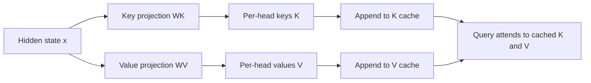
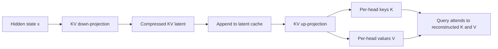

# Understanding 03 — Why the MLA KV cache is smaller

This guide compares the cache used by ordinary multi-head attention (MHA) with
the compressed cache used by this repository's multi-head latent attention
(MLA) implementation. Both outputs shown here come from the tiny training
configuration, at the same decoding step and with the same 43 cached tokens.

The short explanation is:

> MHA stores a separate key and value vector for every attention head and
> token. MLA stores one low-rank KV latent per token and reconstructs the
> multi-head keys and values from it when computing attention.

The cache still grows by one token each generation step, but each token takes
less space in MLA.

## 1. What each implementation keeps

In ordinary MHA, each decoder layer keeps both projected tensors:

```text
K: [batch, heads, tokens, head_dim]
V: [batch, heads, tokens, head_dim]
```



In this repository's MLA, the hidden state is first compressed to one shared
KV latent for each token. The cache stores that smaller representation:

```text
KV latent: [batch, tokens, kv_lora_rank]
```

For attention, the implementation projects the cached latents back into
per-head K and V tensors:



The query also uses a low-rank down-projection and up-projection. It is not
stored for old tokens; each new token produces a query for its own attention
calculation.

## 2. Cache-size formulas

Let:

```text
B  = batch size
L  = number of decoder layers
T  = number of cached tokens
H  = number of attention heads
Dh = dimension of one attention head
R  = kv_lora_rank
S  = bytes per cache element
```

Ordinary MHA stores K and V for every head:

```text
MHA elements = 2 x B x L x T x H x Dh
MHA bytes    = 2 x B x L x T x H x Dh x S
```

MLA stores one compressed latent per token and layer:

```text
MLA elements = B x L x T x R
MLA bytes    = B x L x T x R x S
```

The ratio of their cache sizes, assuming the same batch, layers, token count,
and dtype, is:

```text
MHA / MLA = (2 x H x Dh) / R
```

In the tiny configuration, `H = 8`, `Dh = 32`, and `R = 64`:

```text
2 x H x Dh = 2 x 8 x 32 = 512 MHA elements per token per layer
R          = 64 MLA elements per token per layer
512 / 64   = 8
```

Thus the latent cache in this run uses one eighth as many elements, or an
87.5% cache reduction. Both caches grow linearly with `T`; MLA changes the
per-token storage factor, not the fact that longer context requires more
memory.

## 3. Reading the supplied output at generation step 26

The normal-MHA screenshot reports:

```text
generation_step=26
kv_cache_tokens_per_layer=43
kv_cache_elements=88064
kv_cache_bytes=352256
kv_cache_mib=0.3359
```

The MLA output at that same step reports:

```text
generation_step=26
kv_latent_tokens_per_layer=43
kv_latent_rank=64
kv_cache_elements=11008
kv_cache_bytes=44032
kv_cache_mib=0.0420
```

The tiny config has `L = 4` layers and uses float32 cache tensors, so `S = 4`.
For `B = 1` and `T = 43`:

```text
MHA:
2 x 1 x 4 x 43 x 8 x 32 = 88064 elements
88064 x 4                 = 352256 bytes

MLA:
1 x 4 x 43 x 64 = 11008 elements
11008 x 4       = 44032 bytes
```

Direct comparison:

| Cache at step 26 | Elements | Bytes | MiB |
| --- | ---: | ---: | ---: |
| Ordinary MHA K and V | 88,064 | 352,256 | 0.3359 |
| MLA compressed KV latent | 11,008 | 44,032 | 0.0420 |
| MHA / MLA | 8x | 8x | 8x |

The token count and dtype match, so this difference comes from what is retained
per token: two full vectors for every head in MHA, versus one rank-64 latent
in MLA.

## 4. Why the counts increase one step at a time

Generation starts by pre-filling the prompt. After that, each inference call
processes the most recently generated token and adds its cache representation.
For this example, the cache has 18 tokens after the first generation step and
43 tokens at step 26:

```text
cached tokens at step n = prompt tokens + (n - 1)
```

At each subsequent step, the cache adds a constant number of elements:

```text
MHA increment per token = 2 x B x L x H x Dh
                        = 2 x 1 x 4 x 8 x 32
                        = 2048 elements

MLA increment per token = B x L x R
                        = 1 x 4 x 64
                        = 256 elements
```

At four bytes per element, that is 8192 bytes per generated token for MHA and
1024 bytes per generated token for MLA. The latter is one eighth the growth
rate for this configuration.

## 5. Cache memory is not the same as total GPU memory

The inference log measures the cache tensors themselves using their
`numel()` and dtype. It does not include model weights, temporary attention
scores and activations, allocator reservations, or other runtime overhead.
Consequently, the printed `kv_cache_mib` is a useful like-for-like cache
comparison, not a measurement of total process or GPU memory.

The result also depends on the configuration:

- Increasing `kv_lora_rank` increases the MLA cache linearly.
- Increasing the number of layers or batch size increases either cache
  linearly.
- The dtype changes the byte count, but not the element count.
- Long prompts count toward the cache just like generated tokens.

## 6. Memory reduction does not automatically mean faster decoding

This implementation achieves the smaller retained cache, but its MLA forward
path concatenates the old compressed latents with the new latent and applies
the KV up-projection to the full sequence of latents to reconstruct K and V.
Therefore it can recompute expanded K/V representations for cached tokens at
each decoding step.

The demonstrated improvement is specifically cache storage. It does not by
itself prove lower latency or total computation than MHA. Further MLA
optimizations can avoid repeatedly expanding all historical latents, but they
are not part of this educational implementation.

## 7. What this comparison demonstrates

```text
MHA cache: [K for all heads and tokens] + [V for all heads and tokens]
MLA cache: [one compressed KV latent for each token]

Same tokens: yes
Same dtype:  yes
Smaller retained cache in this tiny run: 8x
Automatic 8x speedup: no
```

This is the key intuition behind the observed output: MLA reduces what must
remain resident for past tokens, while attention still forms multi-head
queries, keys, values, and attention scores.
